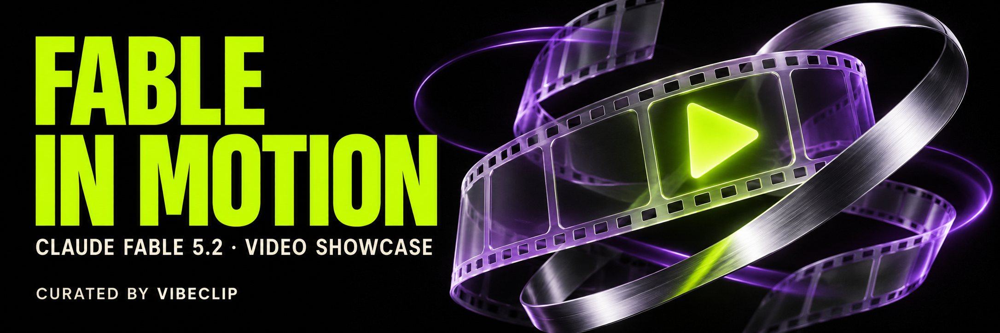

<!-- Generated by scripts/build.py; edit data/ and locales/. -->

# Fable in Motion

**Vídeos creados con Claude Fable 5.2. Tu próxima idea, en movimiento.**

[English](https://github.com/VibeClip/awesome-fable-5-2-videos/blob/main/README.md) · [简体中文](https://github.com/VibeClip/awesome-fable-5-2-videos/blob/main/README.zh-CN.md) · [日本語](https://github.com/VibeClip/awesome-fable-5-2-videos/blob/main/README.ja.md) · [한국어](https://github.com/VibeClip/awesome-fable-5-2-videos/blob/main/README.ko.md) · [Español](https://github.com/VibeClip/awesome-fable-5-2-videos/blob/main/README.es.md)

   

Una selección de cortometrajes, motion graphics, vídeos de producto y explicaciones visuales de la comunidad. Descubre las publicaciones originales, sus creadores y los prompts que compartieron.

**Guarda la colección con una Star para tu próximo proyecto. ¿Encontraste un gran vídeo? Compártelo abajo.**

[Proponer un vídeo](https://github.com/VibeClip/awesome-fable-5-2-videos/issues/new?template=submit-video.yml) · [Contribuir](https://github.com/VibeClip/awesome-fable-5-2-videos/blob/main/CONTRIBUTING.md) · [JSON](https://github.com/VibeClip/awesome-fable-5-2-videos/blob/main/data/videos.json)

Actualizado: 2026-11-10 · 18 vídeos · 4 prompts compartidos

## Empieza por aquí

<table>
<tr><td width="50%" valign="top"> <b>Un videoclip de anime sincronizado con la letra</b> <a href="https://x.com/WesRoth">@WesRoth</a> · 0:37 <a href="https://x.com/WesRoth/status/2119911161386934330">▶ Ver original</a> · <a href="https://github.com/VibeClip/awesome-fable-5-2-videos/blob/main/docs/videos/es/wesroth-934330.md">Detalles</a></td><td width="50%" valign="top"> <b>Un amanecer de papel recortado</b> <a href="https://x.com/eluchocha">@eluchocha</a> · 0:38 <a href="https://x.com/eluchocha/status/2119902302001635455">▶ Ver original</a> · <a href="https://github.com/VibeClip/awesome-fable-5-2-videos/blob/main/docs/videos/es/eluchocha-635455.md">Detalles</a></td></tr>
<tr><td width="50%" valign="top"> <b>Un gato devuelve la vida a un viejo robot</b> <a href="https://x.com/EngMoElgaraihy">@EngMoElgaraihy</a> · 0:40 <a href="https://x.com/EngMoElgaraihy/status/2119904813718643141">▶ Ver original</a> · <a href="https://github.com/VibeClip/awesome-fable-5-2-videos/blob/main/docs/videos/es/engmoelgaraihy-643141.md">Detalles</a></td><td width="50%" valign="top"> <b>Discovery: un cortometraje en Three.js</b> <a href="https://x.com/YinYangYoeshi">@YinYangYoeshi</a> · 1:42 <a href="https://x.com/YinYangYoeshi/status/2119897840965001317">▶ Ver original</a> · <a href="https://github.com/VibeClip/awesome-fable-5-2-videos/blob/main/docs/videos/es/yinyangyoeshi-001317.md">Detalles</a></td></tr>
<tr><td width="50%" valign="top"> <b>Fable 5.2 anima su propia presentación</b> <a href="https://x.com/grafikcem">@grafikcem</a> · 1:00 <a href="https://x.com/grafikcem/status/2119910525064937806">▶ Ver original</a> · <a href="https://github.com/VibeClip/awesome-fable-5-2-videos/blob/main/docs/videos/es/grafikcem-937806.md">Detalles</a></td><td width="50%" valign="top"> <b>Por qué el cielo es azul, explicado en japonés</b> <a href="https://x.com/yzr_koba">@yzr_koba</a> · 0:55 <a href="https://x.com/yzr_koba/status/2119907670077722932">▶ Ver original</a> · <a href="https://github.com/VibeClip/awesome-fable-5-2-videos/blob/main/docs/videos/es/yzr-koba-722932.md">Detalles</a></td></tr>
</table>

## Explora por categoría

| | |
| :-- | --: |
| [Motion graphics y animación](https://github.com/VibeClip/awesome-fable-5-2-videos/blob/main/docs/collections/es.md#motion) | 6 |
| [Cortometrajes y escenas cinematográficas](https://github.com/VibeClip/awesome-fable-5-2-videos/blob/main/docs/collections/es.md#short-films) | 4 |
| [Vídeos de producto y lanzamiento](https://github.com/VibeClip/awesome-fable-5-2-videos/blob/main/docs/collections/es.md#product) | 4 |
| [Explicaciones visuales](https://github.com/VibeClip/awesome-fable-5-2-videos/blob/main/docs/collections/es.md#explainers) | 4 |

[Todos los vídeos](https://github.com/VibeClip/awesome-fable-5-2-videos/blob/main/docs/collections/es.md)

## Prompt compartido

Texto original compartido por el creador. Consulta la fuente para conocer el contexto y los materiales necesarios.

- [Un pequeño mago presenta Fable 5.2](https://github.com/VibeClip/awesome-fable-5-2-videos/blob/main/docs/videos/es/other-reality-913784.md) — @other__reality
- [Fable 5.2 anima su propia presentación](https://github.com/VibeClip/awesome-fable-5-2-videos/blob/main/docs/videos/es/grafikcem-937806.md) — @grafikcem
- [Un vídeo de lanzamiento programado para sí mismo](https://github.com/VibeClip/awesome-fable-5-2-videos/blob/main/docs/videos/es/furkancavlakcom-695521.md) — @furkancavlakcom
- [Una animación de logotipo cromado en 3D](https://github.com/VibeClip/awesome-fable-5-2-videos/blob/main/docs/videos/es/hello-amani-237842.md) — @hello_amani

## Sobre la colección

Selección de VibeClip. Colección comunitaria independiente, sin afiliación con Anthropic. La atribución del modelo sigue las fuentes enlazadas; no se ha reproducido de forma independiente. Los creadores conservan los derechos de sus vídeos. Las miniaturas se cargan desde la red social original y los vídeos se ven en su publicación.

[Fuentes y créditos](https://github.com/VibeClip/awesome-fable-5-2-videos/blob/main/docs/SOURCES.md) · [Licencia y derechos del contenido](https://github.com/VibeClip/awesome-fable-5-2-videos/blob/main/docs/MEDIA-RIGHTS.md)

La portada es arte original del repositorio, no una muestra de vídeo de Fable.
