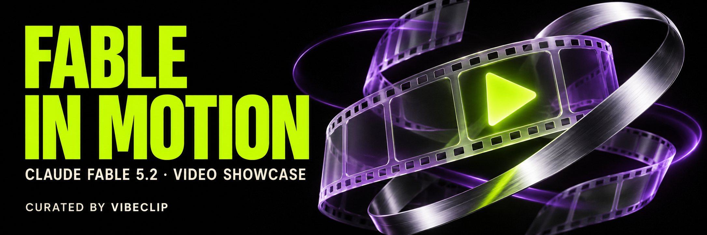

<!-- Generated by scripts/build.py; edit data/ and locales/. -->

# Fable in Motion

**Claude Fable 5.2で作られた動画。次のアイデアを、動きの中で。**

[English](https://github.com/VibeClip/awesome-fable-5-2-videos/blob/main/README.md) · [简体中文](https://github.com/VibeClip/awesome-fable-5-2-videos/blob/main/README.zh-CN.md) · [日本語](https://github.com/VibeClip/awesome-fable-5-2-videos/blob/main/README.ja.md) · [한국어](https://github.com/VibeClip/awesome-fable-5-2-videos/blob/main/README.ko.md) · [Español](https://github.com/VibeClip/awesome-fable-5-2-videos/blob/main/README.es.md)

   

コミュニティの短編、モーショングラフィックス、製品映像、解説動画を厳選。元の投稿から作品と作者、公開プロンプトを探せます。

**次の制作のヒントに、Starで保存。素敵な動画の投稿も歓迎します。**

[動画を投稿](https://github.com/VibeClip/awesome-fable-5-2-videos/issues/new?template=submit-video.yml) · [貢献する](https://github.com/VibeClip/awesome-fable-5-2-videos/blob/main/CONTRIBUTING.md) · [JSON](https://github.com/VibeClip/awesome-fable-5-2-videos/blob/main/data/videos.json)

更新: 2026-11-10 · 18 本の動画 · 4 件の公開プロンプト

## まずはこの作品から

<table>
<tr><td width="50%" valign="top"> <b>歌詞とシンクロするアニメMV</b> <a href="https://x.com/WesRoth">@WesRoth</a> · 0:37 <a href="https://x.com/WesRoth/status/2119911161386934330">▶ 元の投稿を見る</a> · <a href="https://github.com/VibeClip/awesome-fable-5-2-videos/blob/main/docs/videos/ja/wesroth-934330.md">詳細</a></td><td width="50%" valign="top"> <b>切り絵で描く日の出</b> <a href="https://x.com/eluchocha">@eluchocha</a> · 0:38 <a href="https://x.com/eluchocha/status/2119902302001635455">▶ 元の投稿を見る</a> · <a href="https://github.com/VibeClip/awesome-fable-5-2-videos/blob/main/docs/videos/ja/eluchocha-635455.md">詳細</a></td></tr>
<tr><td width="50%" valign="top"> <b>猫が古いロボットをよみがえらせる</b> <a href="https://x.com/EngMoElgaraihy">@EngMoElgaraihy</a> · 0:40 <a href="https://x.com/EngMoElgaraihy/status/2119904813718643141">▶ 元の投稿を見る</a> · <a href="https://github.com/VibeClip/awesome-fable-5-2-videos/blob/main/docs/videos/ja/engmoelgaraihy-643141.md">詳細</a></td><td width="50%" valign="top"> <b>Discovery：Three.jsの短編</b> <a href="https://x.com/YinYangYoeshi">@YinYangYoeshi</a> · 1:42 <a href="https://x.com/YinYangYoeshi/status/2119897840965001317">▶ 元の投稿を見る</a> · <a href="https://github.com/VibeClip/awesome-fable-5-2-videos/blob/main/docs/videos/ja/yinyangyoeshi-001317.md">詳細</a></td></tr>
<tr><td width="50%" valign="top"> <b>Fable 5.2が自分の発表映像を作る</b> <a href="https://x.com/grafikcem">@grafikcem</a> · 1:00 <a href="https://x.com/grafikcem/status/2119910525064937806">▶ 元の投稿を見る</a> · <a href="https://github.com/VibeClip/awesome-fable-5-2-videos/blob/main/docs/videos/ja/grafikcem-937806.md">詳細</a></td><td width="50%" valign="top"> <b>空が青い理由を日本語で解説</b> <a href="https://x.com/yzr_koba">@yzr_koba</a> · 0:55 <a href="https://x.com/yzr_koba/status/2119907670077722932">▶ 元の投稿を見る</a> · <a href="https://github.com/VibeClip/awesome-fable-5-2-videos/blob/main/docs/videos/ja/yzr-koba-722932.md">詳細</a></td></tr>
</table>

## カテゴリー別に探す

| | |
| :-- | --: |
| [モーションとアニメーション](https://github.com/VibeClip/awesome-fable-5-2-videos/blob/main/docs/collections/ja.md#motion) | 6 |
| [短編とシネマティックな場面](https://github.com/VibeClip/awesome-fable-5-2-videos/blob/main/docs/collections/ja.md#short-films) | 4 |
| [製品・発表映像](https://github.com/VibeClip/awesome-fable-5-2-videos/blob/main/docs/collections/ja.md#product) | 4 |
| [ビジュアル解説](https://github.com/VibeClip/awesome-fable-5-2-videos/blob/main/docs/collections/ja.md#explainers) | 4 |

[すべての動画](https://github.com/VibeClip/awesome-fable-5-2-videos/blob/main/docs/collections/ja.md)

## 公開プロンプト

作者が公開した原文のまま掲載。必要な入力や文脈は元の投稿を参照してください。

- [小さな魔法使いの発表映像](https://github.com/VibeClip/awesome-fable-5-2-videos/blob/main/docs/videos/ja/other-reality-913784.md) — @other__reality
- [Fable 5.2が自分の発表映像を作る](https://github.com/VibeClip/awesome-fable-5-2-videos/blob/main/docs/videos/ja/grafikcem-937806.md) — @grafikcem
- [自分のためにコードで作った発表映像](https://github.com/VibeClip/awesome-fable-5-2-videos/blob/main/docs/videos/ja/furkancavlakcom-695521.md) — @furkancavlakcom
- [クロームの3Dロゴアニメーション](https://github.com/VibeClip/awesome-fable-5-2-videos/blob/main/docs/videos/ja/hello-amani-237842.md) — @hello_amani

## このコレクションについて

VibeClipが編集する独立したコミュニティ集です。Anthropicとは提携していません。モデル表記はリンク先の証拠に基づき、独立した再現は行っていません。メディアの権利は作者に帰属します。サムネイルは元のSNSから読み込み、動画は元の投稿で再生します。

[出典とクレジット](https://github.com/VibeClip/awesome-fable-5-2-videos/blob/main/docs/SOURCES.md) · [ライセンスとメディアの権利](https://github.com/VibeClip/awesome-fable-5-2-videos/blob/main/docs/MEDIA-RIGHTS.md)

表紙はリポジトリ用のオリジナルアートで、Fableの動画サンプルではありません。
