<!-- Generated by scripts/build.py; edit data/ and locales/. -->

    

<h1>Fable in Motion · Claude Fable 5.2 Videos</h1>

<b>Videos made with Claude Fable 5.2. Find your next idea in motion.</b>

<a href="https://github.com/VibeClip/awesome-fable-5-2-videos/blob/main/README.md">English</a> · <a href="https://github.com/VibeClip/awesome-fable-5-2-videos/blob/main/README.zh-CN.md">简体中文</a> · <a href="https://github.com/VibeClip/awesome-fable-5-2-videos/blob/main/README.ja.md">日本語</a> · <a href="https://github.com/VibeClip/awesome-fable-5-2-videos/blob/main/README.ko.md">한국어</a> · <a href="https://github.com/VibeClip/awesome-fable-5-2-videos/blob/main/README.es.md">Español</a>

**Fable in Motion** is a collection of **Claude Fable 5.2 videos, AI animation, motion graphics and creative coding**—curated by **VibeClip** for filmmakers, designers, developers and curious makers.

Browse **329 video examples** across short films, 3D animation, product launches, visual explainers and interactive worlds. Start with a looping preview, watch the original clip, and explore the prompts creators chose to share. The collection includes code-rendered work and clearly identified mixed-tool workflows.

- **Watch the result:** every card has a local animated preview, a full-video route and the original creator’s post.
- **Learn from the prompt:** 41 public prompt sources are attached to their own works. Expand the 📝 panel on a card to read a short prompt or visit its source.
- **Find a new direction:** explore code to video, AI filmmaking, Three.js scenes, Blender animation, Remotion, HyperFrames and generative art.

**Looping previews on every card. Full videos open on the original platform; unavailable sources are marked.**

[Start here](#featured) · [Explore by technique & use case](#techniques) · [How it works](#guide) · [New discoveries](https://github.com/VibeClip/awesome-fable-5-2-videos/blob/main/docs/DISCOVERIES.md) · [Submit a video](https://github.com/VibeClip/awesome-fable-5-2-videos/issues/new?template=submit-video.yml)

## Explore by creative direction

| Collection | Examples | What you will find |
| :-- | --: | :-- |
| [Short Films & Stories](#short-films) | 35 | Character animation, anime shorts, cinematic storytelling and music videos. |
| [Motion Design & Animation](#motion) | 46 | Kinetic typography, particle animation, generative art, SVG and graphic experiments. |
| [3D Worlds & Simulations](#3d) | 89 | Procedural worlds, virtual cities, Blender scenes and physics simulations. |
| [Product Films & Web Experiences](#product) | 43 | Brand films, SaaS demos, launch videos, landing pages and web motion. |
| [Visual Explainers & Music](#explainers) | 50 | Educational animation, science visualization, musical scores and synthesized sound. |
| [Games & Interactive Creations](#interactive) | 66 | Browser games, playable worlds, creative tools and interactive interface design. |

## Start here

<table>
<tr>
<td width="33%" valign="top">
 
<b>Six shots through a Bombay bazaar</b> 
<b>↗ Rising</b> · <a href="https://x.com/higgsfield_ai">@higgsfield_ai</a> · 0:22 · 2026-11-09 
<a href="https://video.twimg.com/amplify_video/2119915176354885632/vid/avc1/1920x1080/KKtYnQwg6iF7nZO0.mp4?tag=29">▶ Watch</a> · <a href="https://x.com/higgsfield_ai/status/2119918834841010320">Source</a> · <a href="https://github.com/VibeClip/awesome-fable-5-2-videos/blob/main/docs/videos/en/higgsfield-ai-2119918834841010320.md">Details</a>

</td>
<td width="33%" valign="top">
 
<b>A piano sonata, from score to video</b> 
<b>↗ Rising</b> · <a href="https://x.com/imjustnewatai">@imjustnewatai</a> · 2:51 · 2026-11-09 
<a href="https://video.twimg.com/amplify_video/2119919333140840449/vid/avc1/1920x1080/125Re1yzvUQndyX4.mp4?tag=29">▶ Watch</a> · <a href="https://x.com/imjustnewatai/status/2119919644836347926">Source</a> · <a href="https://github.com/VibeClip/awesome-fable-5-2-videos/blob/main/docs/videos/en/imjustnewatai-2119919644836347926.md">Details</a>

</td>
<td width="33%" valign="top">
 
<b>An endless journey through connected worlds</b> 
<b>↗ Rising</b> · <a href="https://x.com/emollick">@emollick</a> · 1:10 · 2026-11-09 
<a href="https://video.twimg.com/amplify_video/2119916822719840256/vid/avc1/1280x720/lEbniPMiC8aWDbWF.mp4?tag=29">▶ Watch</a> · <a href="https://x.com/emollick/status/2119918307457577163">Source</a> · <a href="https://github.com/VibeClip/awesome-fable-5-2-videos/blob/main/docs/videos/en/emollick-2119918307457577163.md">Details</a>

</td>
</tr>
<tr>
<td width="33%" valign="top">
 
<b>Convex, explained in motion</b> 
<b>↗ Rising</b> · <a href="https://x.com/Rasmic">@Rasmic</a> · 4:08 · 2026-11-09 
<a href="https://video.twimg.com/amplify_video/2119919371401244672/vid/avc1/1920x1080/yS6Kbc5l0NBv4N40.mp4?tag=29">▶ Watch</a> · <a href="https://x.com/Rasmic/status/2119919466163093768">Source</a> · <a href="https://github.com/VibeClip/awesome-fable-5-2-videos/blob/main/docs/videos/en/rasmic-2119919466163093768.md">Details</a>

</td>
<td width="33%" valign="top">
 
<b>Saltline, a first-person game in a rainy cargo port</b> 
<a href="https://x.com/felixrieseberg">@felixrieseberg</a> · 1:12 · 2026-11-09 
<a href="https://video.twimg.com/amplify_video/2119919821538447360/vid/avc1/3648x2022/y1dhMLmyKZ-oidQ6.mp4?tag=29">▶ Watch</a> · <a href="https://x.com/felixrieseberg/status/2119925633564463609">Source</a> · <a href="https://github.com/VibeClip/awesome-fable-5-2-videos/blob/main/docs/videos/en/felixrieseberg-2119925633564463609.md">Details</a>

📝 View prompt

The creator shared a prompt at the link below. Read it in its original context, with any references and follow-up instructions.

<a href="https://x.com/felixrieseberg/status/2119927483994907024">Read the creator’s prompt</a>

</td>
<td width="33%" valign="top">
 
<b>A saber-toothed tiger on the hunt</b> 
<b>↗ Rising</b> · <a href="https://x.com/wshuyi">@wshuyi</a> · 0:28 · 2026-11-10 
<a href="https://video.twimg.com/amplify_video/2120014231450034176/vid/avc1/1920x1080/7CaA0vV2Tej61d3g.mp4?tag=29">▶ Watch</a> · <a href="https://x.com/wshuyi/status/2120014892040417720">Source</a> · <a href="https://github.com/VibeClip/awesome-fable-5-2-videos/blob/main/docs/videos/en/wshuyi-2120014892040417720.md">Details</a>

📝 View prompt

The creator shared a prompt at the link below. Read it in its original context, with any references and follow-up instructions.

<a href="https://x.com/wshuyi/status/2120014892040417720">Read the creator’s prompt</a>

</td>
</tr>
</table>

**Star this collection to save it for your next project. Have a great video? Submit it below.**

## Explore by technique & use case

Use these discovery terms to find an approach for your next project. Check each creator’s original post for the tools and workflow they actually used.

| Direction | Techniques & search terms |
| :-- | :-- |
| From prompts to video | code to video · AI video generation · text to animation · creative coding · vibe coding |
| Web animation & motion | HTML · CSS · JavaScript · SVG animation · HTML5 Canvas · motion graphics · kinetic typography |
| 3D scenes & rendering | Three.js · WebGL · WebGPU · Blender · 3D animation · procedural modeling · physics simulation |
| Video creation workflows | Remotion · HyperFrames · AI video editing · code-based rendering · camera animation |
| Products & campaigns | product launch video · SaaS demo · brand film · social media video · explainer video |
| Games & creative interfaces | game development · browser games · interactive UI · voxel worlds · generative art |
| Music & storytelling | AI music · music video · synthesized audio · sound design · cinematic storytelling |

## Short Films & Stories · 35

Character animation, anime shorts, cinematic storytelling and music videos.

<table>
<tr>
<td width="33%" valign="top">
 
<b>A first-person Blender short that jumps between worlds</b> 
<b>New</b> · <a href="https://x.com/shun_cmdouga">@shun_cmdouga</a> · 0:18 · 2026-11-11 
<a href="https://video.twimg.com/amplify_video/2120351689219936256/vid/avc1/1280x720/-ICvOF8Av4JnSAaj.mp4?tag=29">▶ Watch</a> · <a href="https://x.com/shun_cmdouga/status/2120622594663616515">Source</a> · <a href="https://github.com/VibeClip/awesome-fable-5-2-videos/blob/main/docs/videos/en/shun-cmdouga-2120622594663616515.md">Details</a>

</td>
<td width="33%" valign="top">
 
<b>A reel of browser-rendered short films</b> 
<b>New</b> · <a href="https://x.com/Iamshankhadeep">@Iamshankhadeep</a> · 0:48 · 2026-11-11 
<a href="https://video.twimg.com/amplify_video/2120601647760261120/vid/avc1/1920x1080/IAnqlZZmZKQrtPKZ.mp4?tag=29">▶ Watch</a> · <a href="https://x.com/Iamshankhadeep/status/2120601879029907520">Source</a> · <a href="https://github.com/VibeClip/awesome-fable-5-2-videos/blob/main/docs/videos/en/iamshankhadeep-2120601879029907520.md">Details</a>

</td>
<td width="33%" valign="top">
 
<b>A code-drawn story about growing a tree</b> 
<b>New</b> · <a href="https://x.com/IAenCrudo">@IAenCrudo</a> · 0:56 · 2026-11-10 
<a href="https://video.twimg.com/amplify_video/2120291597568954368/vid/avc1/1080x1080/s1ZeBfuKZ6fDnlbx.mp4?tag=29">▶ Watch</a> · <a href="https://x.com/IAenCrudo/status/2120291820844273983">Source</a> · <a href="https://github.com/VibeClip/awesome-fable-5-2-videos/blob/main/docs/videos/en/iaencrudo-2120291820844273983.md">Details</a>

</td>
</tr>
<tr>
<td width="33%" valign="top">
 
<b>A Blender short built around light in a quiet room</b> 
<b>New</b> · <a href="https://x.com/untitled_sys">@untitled_sys</a> · 0:20 · 2026-11-10 
<a href="https://video.twimg.com/amplify_video/2120265887135715328/vid/avc1/1920x1080/6M8UYJ2wXkM5cgJM.mp4?tag=29">▶ Watch</a> · <a href="https://x.com/untitled_sys/status/2120265921390621058">Source</a> · <a href="https://github.com/VibeClip/awesome-fable-5-2-videos/blob/main/docs/videos/en/untitled-sys-2120265921390621058.md">Details</a>

</td>
<td width="33%" valign="top">
 
<b>A Blender showreel on a desk beside a waterfall</b> 
<b>New</b> · <a href="https://x.com/Iamshankhadeep">@Iamshankhadeep</a> · 0:54 · 2026-11-10 
<a href="https://video.twimg.com/amplify_video/2120264070083620864/vid/avc1/1920x1080/80xVsB3rl4Bxzo30.mp4?tag=29">▶ Watch</a> · <a href="https://x.com/Iamshankhadeep/status/2120264513224392712">Source</a> · <a href="https://github.com/VibeClip/awesome-fable-5-2-videos/blob/main/docs/videos/en/iamshankhadeep-2120264513224392712.md">Details</a>

</td>
<td width="33%" valign="top">
 
<b>A code-built film about Japan’s technical colleges</b> 
<b>New</b> · <a href="https://x.com/kosen_labo">@kosen_labo</a> · 1:00 · 2026-11-10 
<a href="https://video.twimg.com/amplify_video/2120128135681470464/vid/avc1/910x512/z_FMx9vV7-Tja50p.mp4?tag=14">▶ Watch</a> · <a href="https://x.com/kosen_labo/status/2120128253327474845">Source</a> · <a href="https://github.com/VibeClip/awesome-fable-5-2-videos/blob/main/docs/videos/en/kosen-labo-2120128253327474845.md">Details</a>

📝 View prompt
<blockquote>高専について、なんかすごい動画を作ってください</blockquote>
<a href="https://x.com/kosen_labo/status/2120128253327474845">Read the creator’s prompt</a>

</td>
</tr>
<tr>
<td width="33%" valign="top">
 
<b>Yami vs Shanks, animated in code</b> 
<b>New</b> · <a href="https://x.com/Uraharastudio">@Uraharastudio</a> · 1:00 · 2026-11-10 
<a href="https://video.twimg.com/amplify_video/2120128077975977984/vid/avc1/1280x720/m9IjLTrfzffl_S5p.mp4?tag=29">▶ Watch</a> · <a href="https://x.com/Uraharastudio/status/2120128234499002537">Source</a> · <a href="https://github.com/VibeClip/awesome-fable-5-2-videos/blob/main/docs/videos/en/uraharastudio-2120128234499002537.md">Details</a>

</td>
<td width="33%" valign="top">
 
<b>A moonlit library of flying pages</b> 
<b>↗ Rising</b> · <a href="https://x.com/lemomo_ai">@lemomo_ai</a> · 0:55 · 2026-11-10 
<a href="https://video.twimg.com/amplify_video/2120117891240742914/vid/avc1/1920x1080/-2LACPT73SSi5tr7.mp4?tag=29">▶ Watch</a> · <a href="https://x.com/lemomo_ai/status/2120118194409193682">Source</a> · <a href="https://github.com/VibeClip/awesome-fable-5-2-videos/blob/main/docs/videos/en/lemomo-ai-2120118194409193682.md">Details</a>

</td>
<td width="33%" valign="top">
 
<b>A hallway marks the passage of time</b> 
<b>New</b> · <a href="https://x.com/argofowl">@argofowl</a> · 0:16 · 2026-11-10 
<a href="https://video.twimg.com/amplify_video/2120100208990371842/vid/avc1/1920x1080/AvuwxFaTzQOwI2tO.mp4?tag=29">▶ Watch</a> · <a href="https://x.com/argofowl/status/2120100759195000942">Source</a> · <a href="https://github.com/VibeClip/awesome-fable-5-2-videos/blob/main/docs/videos/en/argofowl-2120100759195000942.md">Details</a>

</td>
</tr>
<tr>
<td width="33%" valign="top">
 
<b>A real-time visual poem in a single HTML file</b> 
<b>New</b> · <a href="https://x.com/hajimetwi3">@hajimetwi3</a> · 3:22 · 2026-11-10 
<a href="https://video.twimg.com/amplify_video/2120091572830388224/vid/avc1/1212x668/4dpNdt1GmAYYx4ix.mp4?tag=29">▶ Watch</a> · <a href="https://x.com/hajimetwi3/status/2120093427731943510">Source</a> · <a href="https://github.com/VibeClip/awesome-fable-5-2-videos/blob/main/docs/videos/en/hajimetwi3-2120093427731943510.md">Details</a>

📝 View prompt
<blockquote>凄いものを作って！！</blockquote>
<a href="https://x.com/hajimetwi3/status/2120093427731943510">Read the creator’s prompt</a>

</td>
<td width="33%" valign="top">
 
<b>Model Wars, an animated final-boss reveal</b> 
<b>New</b> · <a href="https://x.com/okknews">@okknews</a> · 0:21 · 2026-11-10 
<a href="https://video.twimg.com/amplify_video/2120093387827408896/vid/avc1/1280x720/smY9JD24a6IJBHmb.mp4?tag=29">▶ Watch</a> · <a href="https://x.com/okknews/status/2120093425739706435">Source</a> · <a href="https://github.com/VibeClip/awesome-fable-5-2-videos/blob/main/docs/videos/en/okknews-2120093425739706435.md">Details</a>

</td>
<td width="33%" valign="top">
 
<b>River of Lanterns, a code-rendered night short</b> 
<b>New</b> · <a href="https://x.com/seiiiiiiiiiiru">@seiiiiiiiiiiru</a> · 0:30 · 2026-11-10 
<a href="https://video.twimg.com/amplify_video/2119959242413379584/vid/avc1/1920x1080/wGI80-cGZLEwRMvR.mp4?tag=29">▶ Watch</a> · <a href="https://x.com/seiiiiiiiiiiru/status/2120079029386588503">Source</a> · <a href="https://github.com/VibeClip/awesome-fable-5-2-videos/blob/main/docs/videos/en/seiiiiiiiiiiru-2120079029386588503.md">Details</a>

</td>
</tr>
<tr>
<td width="33%" valign="top">
 
<b>A Japanese short from particle studies to a cherry-blossom scene</b> 
<b>New</b> · <a href="https://x.com/rute1203d">@rute1203d</a> · 2:26 · 2026-11-10 
<a href="https://video.twimg.com/amplify_video/2120076635022176256/vid/avc1/1920x1080/_pMVSUXNU5xgUqUo.mp4?tag=29">▶ Watch</a> · <a href="https://x.com/rute1203d/status/2120077147872391540">Source</a> · <a href="https://github.com/VibeClip/awesome-fable-5-2-videos/blob/main/docs/videos/en/rute1203d-2120077147872391540.md">Details</a>

📝 View prompt

The creator shared a prompt at the link below. Read it in its original context, with any references and follow-up instructions.

<a href="https://x.com/rute1203d/status/2120077147872391540">Read the creator’s prompt</a>

</td>
<td width="33%" valign="top">
 
<b>Do Not Touch: a storyboard-led 3D short</b> 
<b>↗ Rising</b> · <a href="https://x.com/HaileyAILabs">@HaileyAILabs</a> · 0:30 · 2026-11-10 
<a href="https://video.twimg.com/amplify_video/2120073390942048256/vid/avc1/3024x1714/xZRjyNo0Fwszd5WF.mp4?tag=29">▶ Watch</a> · <a href="https://x.com/HaileyAILabs/status/2120075292043890890">Source</a> · <a href="https://github.com/VibeClip/awesome-fable-5-2-videos/blob/main/docs/videos/en/haileyailabs-2120075292043890890.md">Details</a>

</td>
<td width="33%" valign="top">
 
<b>A saber-toothed tiger on the hunt</b> 
<b>↗ Rising</b> · <a href="https://x.com/wshuyi">@wshuyi</a> · 0:28 · 2026-11-10 
<a href="https://video.twimg.com/amplify_video/2120014231450034176/vid/avc1/1920x1080/7CaA0vV2Tej61d3g.mp4?tag=29">▶ Watch</a> · <a href="https://x.com/wshuyi/status/2120014892040417720">Source</a> · <a href="https://github.com/VibeClip/awesome-fable-5-2-videos/blob/main/docs/videos/en/wshuyi-2120014892040417720.md">Details</a>

📝 View prompt

The creator shared a prompt at the link below. Read it in its original context, with any references and follow-up instructions.

<a href="https://x.com/wshuyi/status/2120014892040417720">Read the creator’s prompt</a>

</td>
</tr>
<tr>
<td width="33%" valign="top">
 
<b>A dream film with code-built sets</b> 
<b>↗ Rising</b> · <a href="https://x.com/anabology">@anabology</a> · 3:33 · 2026-11-10 
<a href="https://video.twimg.com/amplify_video/2120010999818289152/vid/avc1/1920x1080/IWfi7bdM6kIQXIB4.mp4?tag=29">▶ Watch</a> · <a href="https://x.com/anabology/status/2120011096287297557">Source</a> · <a href="https://github.com/VibeClip/awesome-fable-5-2-videos/blob/main/docs/videos/en/anabology-2120011096287297557.md">Details</a>

</td>
<td width="33%" valign="top">
<a href="https://video.twimg.com/amplify_video/2119991676600975360/vid/avc1/1920x1080/SkX17BUiYGK12VwD.mp4?tag=29">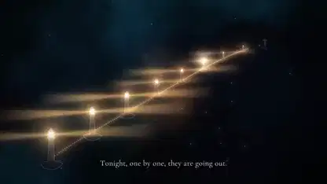</a> 
<b>An original space-opera opening and overture</b> 
<b>New</b> · <a href="https://x.com/imjustnewatai">@imjustnewatai</a> · 2:02 · 2026-11-10 
<a href="https://video.twimg.com/amplify_video/2119991676600975360/vid/avc1/1920x1080/SkX17BUiYGK12VwD.mp4?tag=29">▶ Watch</a> · <a href="https://x.com/imjustnewatai/status/2119991883997045049">Source</a> · <a href="https://github.com/VibeClip/awesome-fable-5-2-videos/blob/main/docs/videos/en/imjustnewatai-2119991883997045049.md">Details</a>

</td>
<td width="33%" valign="top">
 
<b>A cat that refuses to follow the script</b> 
<b>↗ Rising</b> · <a href="https://x.com/renoiseai">@renoiseai</a> · 1:02 · 2026-11-10 
<a href="https://video.twimg.com/amplify_video/2119959154026840064/vid/avc1/1920x1080/xTHXVvf_6YhKOkmx.mp4?tag=29">▶ Watch</a> · <a href="https://x.com/renoiseai/status/2119959294716326280">Source</a> · <a href="https://github.com/VibeClip/awesome-fable-5-2-videos/blob/main/docs/videos/en/renoiseai-2119959294716326280.md">Details</a>

</td>
</tr>
<tr>
<td width="33%" valign="top">
 
<b>A JavaScript-drawn animated short</b> 
<b>↗ Rising</b> · <a href="https://x.com/kevin_t_ngo">@kevin_t_ngo</a> · 1:40 · 2026-11-09 
<a href="https://video.twimg.com/amplify_video/2119937132647313408/vid/avc1/1080x1080/T2W6Dhpu_gMoxVTM.mp4?tag=29">▶ Watch</a> · <a href="https://x.com/kevin_t_ngo/status/2119938129079808282">Source</a> · <a href="https://github.com/VibeClip/awesome-fable-5-2-videos/blob/main/docs/videos/en/kevin-t-ngo-2119938129079808282.md">Details</a>

</td>
<td width="33%" valign="top">
 
<b>The story of The Scream as a short</b> 
<b>New</b> · <a href="https://x.com/osmanaga__">@osmanaga__</a> · 1:28 · 2026-11-09 
<a href="https://video.twimg.com/amplify_video/2119923123092893696/vid/avc1/720x1280/M2J_aC5567oGoPEu.mp4?tag=14">▶ Watch</a> · <a href="https://x.com/osmanaga__/status/2119923975635738780">Source</a> · <a href="https://github.com/VibeClip/awesome-fable-5-2-videos/blob/main/docs/videos/en/osmanaga-146194.md">Details</a>

</td>
<td width="33%" valign="top">
 
<b>An anime music video with timed lyrics</b> 
<a href="https://x.com/WesRoth">@WesRoth</a> · 0:37 · 2026-11-09 
<a href="https://video.twimg.com/amplify_video/2119910396719177728/vid/avc1/1280x720/0X1wTe1JivqZgtXw.mp4?tag=29">▶ Watch</a> · <a href="https://x.com/WesRoth/status/2119911161386934330">Source</a> · <a href="https://github.com/VibeClip/awesome-fable-5-2-videos/blob/main/docs/videos/en/wesroth-934330.md">Details</a>

</td>
</tr>
<tr>
<td width="33%" valign="top">
 
<b>A Blender short planned by Fable 5.2 and built by Opus 5.5</b> 
<b>New</b> · <a href="https://x.com/kloss_xyz">@kloss_xyz</a> · 0:16 · 2026-11-09 
<a href="https://video.twimg.com/amplify_video/2119909698367557632/vid/avc1/1920x1080/EkOxfDMK1PSG_XOD.mp4?tag=29">▶ Watch</a> · <a href="https://x.com/kloss_xyz/status/2119910613828980846">Source</a> · <a href="https://github.com/VibeClip/awesome-fable-5-2-videos/blob/main/docs/videos/en/kloss-xyz-2119910613828980846.md">Details</a>

</td>
<td width="33%" valign="top">
 
<b>A cat brings an old robot back to life</b> 
<a href="https://x.com/EngMoElgaraihy">@EngMoElgaraihy</a> · 0:40 · 2026-11-09 
<a href="https://video.twimg.com/amplify_video/2119904158409256960/vid/avc1/1920x1080/FHiVbLKGnw5mFlJ7.mp4?tag=29">▶ Watch</a> · <a href="https://x.com/EngMoElgaraihy/status/2119904813718643141">Source</a> · <a href="https://github.com/VibeClip/awesome-fable-5-2-videos/blob/main/docs/videos/en/engmoelgaraihy-643141.md">Details</a>

</td>
<td width="33%" valign="top">
 
<b>A 46-second film with zero generated images</b> 
<a href="https://x.com/cube__lol">@cube__lol</a> · 0:46 · 2026-11-09 
<a href="https://video.twimg.com/amplify_video/2119904119569690624/vid/avc1/1080x1920/24p1AimqIbXNXJ-Z.mp4?tag=29">▶ Watch</a> · <a href="https://x.com/cube__lol/status/2119904449556832554">Source</a> · <a href="https://github.com/VibeClip/awesome-fable-5-2-videos/blob/main/docs/videos/en/cube-lol-832554.md">Details</a>

</td>
</tr>
<tr>
<td width="33%" valign="top">
 
<b>A deep-sea dive rendered in code</b> 
<a href="https://x.com/g_beyrouti">@g_beyrouti</a> · 0:30 · 2026-11-09 
<a href="https://video.twimg.com/amplify_video/2119904334397792256/vid/avc1/1920x1080/Sz-4m8aagrACSa85.mp4?tag=29">▶ Watch</a> · <a href="https://x.com/g_beyrouti/status/2119904386826780943">Source</a> · <a href="https://github.com/VibeClip/awesome-fable-5-2-videos/blob/main/docs/videos/en/g-beyrouti-780943.md">Details</a>

</td>
<td width="33%" valign="top">
 
<b>A steam locomotive anime short</b> 
<a href="https://x.com/0kncn">@0kncn</a> · 1:30 · 2026-11-09 
<a href="https://video.twimg.com/amplify_video/2119900741783400450/vid/avc1/1920x1080/m--vaF5s-VQhaEAL.mp4?tag=29">▶ Watch</a> · <a href="https://x.com/0kncn/status/2119901782482543073">Source</a> · <a href="https://github.com/VibeClip/awesome-fable-5-2-videos/blob/main/docs/videos/en/0kncn-543073.md">Details</a>

📝 View prompt

The creator shared a prompt at the link below. Read it in its original context, with any references and follow-up instructions.

<a href="https://x.com/0kncn/status/2119901786060259612">Read the creator’s prompt</a>

</td>
<td width="33%" valign="top">
 
<b>An 83-second anime film made of code</b> 
<a href="https://x.com/noisyb0y1">@noisyb0y1</a> · 1:07 · 2026-11-09 
<a href="https://video.twimg.com/amplify_video/2119899951345893376/vid/avc1/1920x1080/YjLMjLxfThe6MUXI.mp4?tag=29">▶ Watch</a> · <a href="https://x.com/noisyb0y1/status/2119900528197218472">Source</a> · <a href="https://github.com/VibeClip/awesome-fable-5-2-videos/blob/main/docs/videos/en/noisyb0y1-218472.md">Details</a>

</td>
</tr>
<tr>
<td width="33%" valign="top">
 
<b>Discovery, a short film in Three.js</b> 
<a href="https://x.com/YinYangYoeshi">@YinYangYoeshi</a> · 1:42 · 2026-11-09 
<a href="https://video.twimg.com/amplify_video/2119897357940621312/vid/avc1/1920x1080/ZjoaXFviS7F_qc-m.mp4?tag=29">▶ Watch</a> · <a href="https://x.com/YinYangYoeshi/status/2119897840965001317">Source</a> · <a href="https://github.com/VibeClip/awesome-fable-5-2-videos/blob/main/docs/videos/en/yinyangyoeshi-001317.md">Details</a>

</td>
<td width="33%" valign="top">
 
<b>A Sea I Have Never Seen</b> 
<a href="https://x.com/jessalanfields">@jessalanfields</a> · 1:45 · 2026-11-09 
<a href="https://video.twimg.com/amplify_video/2119895450509586432/vid/avc1/1920x1080/AS5GlEaPMeHXKU5d.mp4?tag=29">▶ Watch</a> · <a href="https://x.com/jessalanfields/status/2119895969957392730">Source</a> · <a href="https://github.com/VibeClip/awesome-fable-5-2-videos/blob/main/docs/videos/en/jessalanfields-392730.md">Details</a>

</td>
<td width="33%" valign="top">
 
<b>From a tiny creature to the cosmos</b> 
<a href="https://x.com/devteamdrew">@devteamdrew</a> · 0:32 · 2026-11-09 
<a href="https://video.twimg.com/amplify_video/2119892377045237760/vid/avc1/1920x1080/u8IeGB-A3MQgl4XE.mp4?tag=29">▶ Watch</a> · <a href="https://x.com/devteamdrew/status/2119892540950241283">Source</a> · <a href="https://github.com/VibeClip/awesome-fable-5-2-videos/blob/main/docs/videos/en/devteamdrew-241283.md">Details</a>

</td>
</tr>
<tr>
<td width="33%" valign="top">
 
<b>A lighthouse keeper short film</b> 
<a href="https://x.com/MarvellousDev">@MarvellousDev</a> · 0:15 · 2026-11-09 
<a href="https://video.twimg.com/amplify_video/2119889346706673664/vid/avc1/1920x1080/VxlTVaaElWO17W42.mp4?tag=29">▶ Watch</a> · <a href="https://x.com/MarvellousDev/status/2119889511333380563">Source</a> · <a href="https://github.com/VibeClip/awesome-fable-5-2-videos/blob/main/docs/videos/en/marvellousdev-380563.md">Details</a>

</td>
<td width="33%" valign="top">
 
<b>A full film from the laziest prompt</b> 
<a href="https://x.com/ponken00">@ponken00</a> · 1:26 · 2026-11-09 
<a href="https://video.twimg.com/amplify_video/2119887881321787392/vid/avc1/1920x1080/zPvL0-S5VSv6SkYI.mp4?tag=29">▶ Watch</a> · <a href="https://x.com/ponken00/status/2119888362148622656">Source</a> · <a href="https://github.com/VibeClip/awesome-fable-5-2-videos/blob/main/docs/videos/en/ponken00-622656.md">Details</a>

</td>
<td width="33%" valign="top">
 
<b>A Vocaloid love song starring Teto</b> 
<a href="https://x.com/peach2k2">@peach2k2</a> · 0:25 · 2026-11-09 
<a href="https://video.twimg.com/ext_tw_video/2119885702250786816/pu/vid/avc1/1280x720/vaqq1fwB8qUuFlPu.mp4?tag=27">▶ Watch</a> · <a href="https://x.com/peach2k2/status/2119885741773738033">Source</a> · <a href="https://github.com/VibeClip/awesome-fable-5-2-videos/blob/main/docs/videos/en/peach2k2-738033.md">Details</a>

</td>
</tr>
<tr>
<td width="33%" valign="top">
 
<b>A flight through a living world</b> 
<a href="https://x.com/LexnLin">@LexnLin</a> · 0:30 · 2026-11-09 
<a href="https://video.twimg.com/amplify_video/2119880037172146176/vid/avc1/1920x1080/E4G1BysAeWIl4yTX.mp4?tag=29">▶ Watch</a> · <a href="https://x.com/LexnLin/status/2119880654858977333">Source</a> · <a href="https://github.com/VibeClip/awesome-fable-5-2-videos/blob/main/docs/videos/en/lexnlin-977333.md">Details</a>

</td>
<td width="33%" valign="top">
 
<b>Drive to heaven</b> 
<a href="https://x.com/abhinavflac">@abhinavflac</a> · 1:15 · 2026-11-09 
<a href="https://video.twimg.com/amplify_video/2119874130904502272/vid/avc1/1920x1080/FVx09qWfu11d8QIK.mp4?tag=29">▶ Watch</a> · <a href="https://x.com/abhinavflac/status/2119875975131676827">Source</a> · <a href="https://github.com/VibeClip/awesome-fable-5-2-videos/blob/main/docs/videos/en/abhinavflac-676827.md">Details</a>

</td>
<td width="33%"></td>
</tr>
</table>

## Motion Design & Animation · 46

Kinetic typography, particle animation, generative art, SVG and graphic experiments.

<table>
<tr>
<td width="33%" valign="top">
 
<b>A hand-drawn wolf becomes a 3D intro</b> 
<b>↗ Rising</b> · <a href="https://x.com/husky__create">@husky__create</a> · 0:10 · 2026-11-11 
<a href="https://video.twimg.com/amplify_video/2120622616344219648/vid/avc1/1920x1080/YQkggnwdUXqipVTR.mp4?tag=16">▶ Watch</a> · <a href="https://x.com/husky__create/status/2120622644362199182">Source</a> · <a href="https://github.com/VibeClip/awesome-fable-5-2-videos/blob/main/docs/videos/en/husky-create-2120622644362199182.md">Details</a>

</td>
<td width="33%" valign="top">
 
<b>A retro animated show opening rendered in Blender</b> 
<b>↗ Rising</b> · <a href="https://x.com/kevin_t_ngo">@kevin_t_ngo</a> · 0:45 · 2026-11-11 
<a href="https://video.twimg.com/amplify_video/2120540485764927488/vid/avc1/1920x1080/xC8eOMGaTeccgQUH.mp4?tag=29">▶ Watch</a> · <a href="https://x.com/kevin_t_ngo/status/2120540964909711415">Source</a> · <a href="https://github.com/VibeClip/awesome-fable-5-2-videos/blob/main/docs/videos/en/kevin-t-ngo-2120540964909711415.md">Details</a>

</td>
<td width="33%" valign="top">
 
<b>Particles leave a monitor and assemble into a logo</b> 
<b>New</b> · <a href="https://x.com/onofumi_AI">@onofumi_AI</a> · 0:15 · 2026-11-11 
<a href="https://video.twimg.com/amplify_video/2120503595762376704/vid/avc1/1920x1080/HyUCUZvRzYJDKtca.mp4?tag=29">▶ Watch</a> · <a href="https://x.com/onofumi_AI/status/2120503860141912399">Source</a> · <a href="https://github.com/VibeClip/awesome-fable-5-2-videos/blob/main/docs/videos/en/onofumi-ai-2120503860141912399.md">Details</a>

</td>
</tr>
<tr>
<td width="33%" valign="top">
 
<b>Particles assemble into three Japanese words</b> 
<b>New</b> · <a href="https://x.com/noteka114514">@noteka114514</a> · 0:40 · 2026-11-11 
<a href="https://video.twimg.com/amplify_video/2120351414333702144/vid/avc1/1280x720/lGFLjUkfH9l6tKgu.mp4?tag=14">▶ Watch</a> · <a href="https://x.com/noteka114514/status/2120351467815285224">Source</a> · <a href="https://github.com/VibeClip/awesome-fable-5-2-videos/blob/main/docs/videos/en/noteka114514-2120351467815285224.md">Details</a>

📝 View prompt
<blockquote>テーマは任せる。すごい動画を作って</blockquote>
<a href="https://x.com/noteka114514/status/2120351467815285224">Read the creator’s prompt</a>

</td>
<td width="33%" valign="top">
 
<b>A reference painting rebuilt stroke by stroke in JavaScript</b> 
<b>↗ Rising</b> · <a href="https://x.com/vctbtc">@vctbtc</a> · 0:19 · 2026-11-11 
<a href="https://video.twimg.com/amplify_video/2120343763776421888/vid/avc1/2228x1236/yG-wohfFEEEsZ2I0.mp4?tag=29">▶ Watch</a> · <a href="https://x.com/vctbtc/status/2120344162730123733">Source</a> · <a href="https://github.com/VibeClip/awesome-fable-5-2-videos/blob/main/docs/videos/en/vctbtc-2120344162730123733.md">Details</a>

</td>
<td width="33%" valign="top">
 
<b>An AI declares a takeover of software engineering</b> 
<b>New</b> · <a href="https://x.com/iamwesleysmits">@iamwesleysmits</a> · 0:48 · 2026-11-10 
<a href="https://video.twimg.com/amplify_video/2120230145994694656/vid/avc1/1080x1920/ikcB__RdST1QlByH.mp4?tag=29">▶ Watch</a> · <a href="https://x.com/iamwesleysmits/status/2120230414568599912">Source</a> · <a href="https://github.com/VibeClip/awesome-fable-5-2-videos/blob/main/docs/videos/en/iamwesleysmits-2120230414568599912.md">Details</a>

</td>
</tr>
<tr>
<td width="33%" valign="top">
 
<b>A potato versus a room full of blue chairs</b> 
<b>New</b> · <a href="https://x.com/argofowl">@argofowl</a> · 0:12 · 2026-11-10 
<a href="https://video.twimg.com/amplify_video/2120171639031865344/vid/avc1/1920x1080/ePpeMCdemHzHeXby.mp4?tag=29">▶ Watch</a> · <a href="https://x.com/argofowl/status/2120172009972003115">Source</a> · <a href="https://github.com/VibeClip/awesome-fable-5-2-videos/blob/main/docs/videos/en/argofowl-2120172009972003115.md">Details</a>

</td>
<td width="33%" valign="top">
 
<b>A book folds into the Claude mark</b> 
<a href="https://x.com/LexnLin">@LexnLin</a> · 0:30 · 2026-11-10 
<a href="https://video.twimg.com/amplify_video/2120167523039518720/vid/avc1/2560x1440/1zRebOXK7I92mAvT.mp4?tag=29">▶ Watch</a> · <a href="https://x.com/LexnLin/status/2120167637133238295">Source</a> · <a href="https://github.com/VibeClip/awesome-fable-5-2-videos/blob/main/docs/videos/en/lexnlin-2120167637133238295.md">Details</a>

</td>
<td width="33%" valign="top">
<a href="https://video.twimg.com/amplify_video/2120131882973270017/vid/avc1/1920x1080/nnzs4x3Nt9BJIO1e.mp4?tag=16">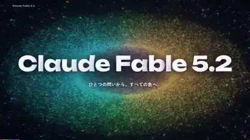</a> 
<b>Fable 5.2 explains its abilities in a colorful motion reel</b> 
<b>New</b> · <a href="https://x.com/husky__create">@husky__create</a> · 1:00 · 2026-11-10 
<a href="https://video.twimg.com/amplify_video/2120131882973270017/vid/avc1/1920x1080/nnzs4x3Nt9BJIO1e.mp4?tag=16">▶ Watch</a> · <a href="https://x.com/husky__create/status/2120131960349802957">Source</a> · <a href="https://github.com/VibeClip/awesome-fable-5-2-videos/blob/main/docs/videos/en/husky-create-2120131960349802957.md">Details</a>

📝 View prompt

The creator shared a prompt at the link below. Read it in its original context, with any references and follow-up instructions.

<a href="https://x.com/husky__create/status/2120131960349802957">Read the creator’s prompt</a>

</td>
</tr>
<tr>
<td width="33%" valign="top">
 
<b>Liquid-chrome real-time audiovisual demo</b> 
<b>New</b> · <a href="https://x.com/Nakachan">@Nakachan</a> · 0:10 · 2026-11-10 
<a href="https://video.twimg.com/amplify_video/2120127355821948928/vid/avc1/1048x720/YvT2SPzL_LdlCRo4.mp4?tag=14">▶ Watch</a> · <a href="https://x.com/Nakachan/status/2120127995625316511">Source</a> · <a href="https://github.com/VibeClip/awesome-fable-5-2-videos/blob/main/docs/videos/en/nakachan-2120127995625316511.md">Details</a>

📝 View prompt
<blockquote>Fable 5.2の考える最強のメガデモを作って</blockquote>
<a href="https://x.com/Nakachan/status/2120127995625316511">Read the creator’s prompt</a>

</td>
<td width="33%" valign="top">
 
<b>A Tripo character animated in Blender from a video reference</b> 
<b>↗ Rising</b> · <a href="https://x.com/maxt3chno">@maxt3chno</a> · 0:16 · 2026-11-10 
<a href="https://video.twimg.com/amplify_video/2120112581515829248/vid/avc1/2304x1440/FuMsMyEM4q9Lj-I7.mp4?tag=29">▶ Watch</a> · <a href="https://x.com/maxt3chno/status/2120113578531234172">Source</a> · <a href="https://github.com/VibeClip/awesome-fable-5-2-videos/blob/main/docs/videos/en/maxt3chno-2120113578531234172.md">Details</a>

📝 View prompt

The creator shared a prompt at the link below. Read it in its original context, with any references and follow-up instructions.

<a href="https://x.com/maxt3chno/status/2120116202559217812">Read the creator’s prompt</a>

</td>
<td width="33%" valign="top">
 
<b>Motion previz: jogging, sprinting and dashing</b> 
<a href="https://x.com/akakuma0219">@akakuma0219</a> · 0:10 · 2026-11-10 
<a href="https://video.twimg.com/amplify_video/2120030599155195904/vid/avc1/1128x1280/gg7e4hW5e7l_HZcs.mp4?tag=29">▶ Watch</a> · <a href="https://x.com/akakuma0219/status/2120030634248929556">Source</a> · <a href="https://github.com/VibeClip/awesome-fable-5-2-videos/blob/main/docs/videos/en/akakuma0219-2120030634248929556.md">Details</a>

📝 View prompt

The creator shared a prompt at the link below. Read it in its original context, with any references and follow-up instructions.

<a href="https://x.com/akakuma0219/status/2120030634248929556">Read the creator’s prompt</a>

</td>
</tr>
<tr>
<td width="33%" valign="top">
<a href="https://video.twimg.com/amplify_video/2119979706703593472/vid/avc1/1920x1080/VkiOtr16fvkfXibk.mp4?tag=29">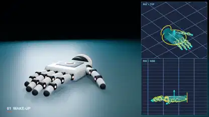</a> 
<b>A robotic hand with its rig shown beside the render</b> 
<b>New</b> · <a href="https://x.com/onofumi_AI">@onofumi_AI</a> · 0:19 · 2026-11-10 
<a href="https://video.twimg.com/amplify_video/2119979706703593472/vid/avc1/1920x1080/VkiOtr16fvkfXibk.mp4?tag=29">▶ Watch</a> · <a href="https://x.com/onofumi_AI/status/2119979764895330453">Source</a> · <a href="https://github.com/VibeClip/awesome-fable-5-2-videos/blob/main/docs/videos/en/onofumi-ai-2119979764895330453.md">Details</a>

</td>
<td width="33%" valign="top">
 
<b>A motion designer’s portfolio film</b> 
<b>↗ Rising</b> · <a href="https://x.com/Leviwoyun">@Leviwoyun</a> · 0:30 · 2026-11-10 
<a href="https://video.twimg.com/amplify_video/2119953670280478720/vid/avc1/1920x1080/jpEsi7C-DU6eEvmL.mp4?tag=29">▶ Watch</a> · <a href="https://x.com/Leviwoyun/status/2119955625820258308">Source</a> · <a href="https://github.com/VibeClip/awesome-fable-5-2-videos/blob/main/docs/videos/en/leviwoyun-2119955625820258308.md">Details</a>

📝 View prompt

The creator shared a prompt at the link below. Read it in its original context, with any references and follow-up instructions.

<a href="https://x.com/Leviwoyun/status/2119955625820258308">Read the creator’s prompt</a>

</td>
<td width="33%" valign="top">
 
<b>Movie-title design: Fable 5.2 versus Opus 5.5</b> 
<b>↗ Rising</b> · <a href="https://x.com/muku_sns">@muku_sns</a> · 0:15 · 2026-11-09 
<a href="https://video.twimg.com/amplify_video/2119941109262815232/vid/avc1/1280x720/M2pIcNz3WNz2L3_c.mp4?tag=29">▶ Watch</a> · <a href="https://x.com/muku_sns/status/2119941490969624679">Source</a> · <a href="https://github.com/VibeClip/awesome-fable-5-2-videos/blob/main/docs/videos/en/muku-sns-2119941490969624679.md">Details</a>

</td>
</tr>
<tr>
<td width="33%" valign="top">
 
<b>Lip-synced speech timed frame by frame</b> 
<a href="https://x.com/higgsfield_ai">@higgsfield_ai</a> · 0:19 · 2026-11-09 
<a href="https://video.twimg.com/amplify_video/2119909898960130048/vid/avc1/1440x1080/frJSbqPklB--YVmT.mp4?tag=29">▶ Watch</a> · <a href="https://x.com/higgsfield_ai/status/2119909938969580024">Source</a> · <a href="https://github.com/VibeClip/awesome-fable-5-2-videos/blob/main/docs/videos/en/higgsfield-ai-580024.md">Details</a>

</td>
<td width="33%" valign="top">
 
<b>A formant synthesizer that makes code talk</b> 
<a href="https://x.com/higgsfield_ai">@higgsfield_ai</a> · 0:15 · 2026-11-09 
<a href="https://video.twimg.com/amplify_video/2119906292542459904/vid/avc1/1920x1080/hSTBPKQjjpo8EiKA.mp4?tag=29">▶ Watch</a> · <a href="https://x.com/higgsfield_ai/status/2119906332077957629">Source</a> · <a href="https://github.com/VibeClip/awesome-fable-5-2-videos/blob/main/docs/videos/en/higgsfield-ai-957629.md">Details</a>

</td>
<td width="33%" valign="top">
 
<b>A showreel that says goodbye to Opus 5.5</b> 
<a href="https://x.com/kaif9998">@kaif9998</a> · 0:15 · 2026-11-09 
<a href="https://video.twimg.com/amplify_video/2119903274031828992/vid/avc1/1920x1080/NG1jRcBKfR-B1SsJ.mp4?tag=29">▶ Watch</a> · <a href="https://x.com/kaif9998/status/2119903824848761287">Source</a> · <a href="https://github.com/VibeClip/awesome-fable-5-2-videos/blob/main/docs/videos/en/kaif9998-761287.md">Details</a>

📝 View prompt

The creator shared a prompt at the link below. Read it in its original context, with any references and follow-up instructions.

<a href="https://x.com/kaif9998/status/2119904086288118219">Read the creator’s prompt</a>

</td>
</tr>
<tr>
<td width="33%" valign="top">
 
<b>Painting a portrait stroke by stroke</b> 
<a href="https://x.com/internetphysics">@internetphysics</a> · 1:00 · 2026-11-09 
<a href="https://video.twimg.com/amplify_video/2119902893394337792/vid/avc1/1440x748/Qs1TOP9hXZf08Xkl.mp4?tag=29">▶ Watch</a> · <a href="https://x.com/internetphysics/status/2119903808935313778">Source</a> · <a href="https://github.com/VibeClip/awesome-fable-5-2-videos/blob/main/docs/videos/en/internetphysics-313778.md">Details</a>

</td>
<td width="33%" valign="top">
 
<b>A motion reel from one shared prompt</b> 
<a href="https://x.com/heypearlai">@heypearlai</a> · 0:15 · 2026-11-09 
<a href="https://video.twimg.com/amplify_video/2119902252723023872/vid/avc1/1920x1080/p0Q91YuD0ECQfDLv.mp4?tag=29">▶ Watch</a> · <a href="https://x.com/heypearlai/status/2119903760529113116">Source</a> · <a href="https://github.com/VibeClip/awesome-fable-5-2-videos/blob/main/docs/videos/en/heypearlai-113116.md">Details</a>

</td>
<td width="33%" valign="top">
 
<b>A one-shot pixel art forest</b> 
<a href="https://x.com/JBabaTalks">@JBabaTalks</a> · 0:41 · 2026-11-09 
<a href="https://video.twimg.com/amplify_video/2119903258588086272/vid/avc1/1808x1722/-oRMSGBL9FaVhUCA.mp4?tag=29">▶ Watch</a> · <a href="https://x.com/JBabaTalks/status/2119903489270694319">Source</a> · <a href="https://github.com/VibeClip/awesome-fable-5-2-videos/blob/main/docs/videos/en/jbabatalks-694319.md">Details</a>

</td>
</tr>
<tr>
<td width="33%" valign="top">
 
<b>A tiny planet full of moving parts</b> 
<a href="https://x.com/leoy_dev">@leoy_dev</a> · 1:09 · 2026-11-09 
<a href="https://video.twimg.com/amplify_video/2119902402643890177/vid/avc1/1920x918/dO0GyuVK6-YhKfS9.mp4?tag=29">▶ Watch</a> · <a href="https://x.com/leoy_dev/status/2119903166149922853">Source</a> · <a href="https://github.com/VibeClip/awesome-fable-5-2-videos/blob/main/docs/videos/en/leoy-dev-922853.md">Details</a>

</td>
<td width="33%" valign="top">
 
<b>A paper-cut sunrise animation</b> 
<a href="https://x.com/eluchocha">@eluchocha</a> · 0:38 · 2026-11-09 
<a href="https://video.twimg.com/amplify_video/2119900235761688576/vid/avc1/1080x1080/cejGINOI5PNwIMrQ.mp4?tag=29">▶ Watch</a> · <a href="https://x.com/eluchocha/status/2119902302001635455">Source</a> · <a href="https://github.com/VibeClip/awesome-fable-5-2-videos/blob/main/docs/videos/en/eluchocha-635455.md">Details</a>

</td>
<td width="33%" valign="top">
 
<b>From chaos to a hello, drawn with particles</b> 
<a href="https://x.com/ici_dab">@ici_dab</a> · 1:08 · 2026-11-09 
<a href="https://video.twimg.com/amplify_video/2119901144256299009/vid/avc1/1080x1080/5idfS03gAdRsJT3k.mp4?tag=29">▶ Watch</a> · <a href="https://x.com/ici_dab/status/2119901910237098351">Source</a> · <a href="https://github.com/VibeClip/awesome-fable-5-2-videos/blob/main/docs/videos/en/ici-dab-098351.md">Details</a>

📝 View prompt

The creator shared a prompt at the link below. Read it in its original context, with any references and follow-up instructions.

<a href="https://x.com/ici_dab/status/2119902189271605579">Read the creator’s prompt</a>

</td>
</tr>
<tr>
<td width="33%" valign="top">
 
<b>Simple rules, complex beauty</b> 
<a href="https://x.com/techfren">@techfren</a> · 1:18 · 2026-11-09 
<a href="https://video.twimg.com/amplify_video/2119899709913579520/vid/avc1/1920x1080/3p4USJ7fdJfCsE8Y.mp4?tag=29">▶ Watch</a> · <a href="https://x.com/techfren/status/2119899949756539056">Source</a> · <a href="https://github.com/VibeClip/awesome-fable-5-2-videos/blob/main/docs/videos/en/techfren-539056.md">Details</a>

</td>
<td width="33%" valign="top">
 
<b>The pelican on a bicycle, as one animated SVG</b> 
<a href="https://x.com/eyadnour">@eyadnour</a> · 0:10 · 2026-11-09 
<a href="https://video.twimg.com/amplify_video/2119898688180850688/vid/avc1/1600x1200/iBBPAJliWGeytp-Y.mp4?tag=29">▶ Watch</a> · <a href="https://x.com/eyadnour/status/2119899260606910886">Source</a> · <a href="https://github.com/VibeClip/awesome-fable-5-2-videos/blob/main/docs/videos/en/eyadnour-910886.md">Details</a>

</td>
<td width="33%" valign="top">
 
<b>Dev Deepawali on the Varanasi riverfront</b> 
<a href="https://x.com/sverma_231">@sverma_231</a> · 0:38 · 2026-11-09 
<a href="https://video.twimg.com/amplify_video/2119894212145778688/vid/avc1/1920x1080/nsF2E4hVVA0HQ4Uu.mp4?tag=29">▶ Watch</a> · <a href="https://x.com/sverma_231/status/2119894332656570708">Source</a> · <a href="https://github.com/VibeClip/awesome-fable-5-2-videos/blob/main/docs/videos/en/sverma-231-570708.md">Details</a>

</td>
</tr>
<tr>
<td width="33%" valign="top">
 
<b>A stick-figure duel compared across two Claude models</b> 
<b>New</b> · <a href="https://x.com/DanielZambrini">@DanielZambrini</a> · 0:15 · 2026-11-09 
<a href="https://video.twimg.com/amplify_video/2119893599638675457/vid/avc1/1280x1600/iClzByVh2DZ-9UoK.mp4?tag=29">▶ Watch</a> · <a href="https://x.com/DanielZambrini/status/2119893834276507954">Source</a> · <a href="https://github.com/VibeClip/awesome-fable-5-2-videos/blob/main/docs/videos/en/danielzambrini-2119893834276507954.md">Details</a>

</td>
<td width="33%" valign="top">
 
<b>The pelican knows it is being tested</b> 
<a href="https://x.com/benjistacked">@benjistacked</a> · 0:15 · 2026-11-09 
<a href="https://video.twimg.com/amplify_video/2119892925077143552/vid/avc1/1920x1080/SEaLFBXtc8dukb55.mp4?tag=29">▶ Watch</a> · <a href="https://x.com/benjistacked/status/2119893035240849805">Source</a> · <a href="https://github.com/VibeClip/awesome-fable-5-2-videos/blob/main/docs/videos/en/benjistacked-849805.md">Details</a>

</td>
<td width="33%" valign="top">
 
<b>A pet robot you could build at home</b> 
<a href="https://x.com/mattshumer_">@mattshumer_</a> · 0:20 · 2026-11-09 
<a href="https://video.twimg.com/amplify_video/2119889498527969281/vid/avc1/960x540/EqG79zEwj6BDTrPE.mp4?tag=29">▶ Watch</a> · <a href="https://x.com/mattshumer_/status/2119889518564147409">Source</a> · <a href="https://github.com/VibeClip/awesome-fable-5-2-videos/blob/main/docs/videos/en/mattshumer-147409.md">Details</a>

</td>
</tr>
<tr>
<td width="33%" valign="top">
 
<b>A pelican, a bicycle and a game controller</b> 
<a href="https://x.com/dummerspast39">@dummerspast39</a> · 0:15 · 2026-11-09 
<a href="https://video.twimg.com/amplify_video/2119889199935447041/vid/avc1/2048x2048/TrgMbHC6HoEL8LT9.mp4?tag=29">▶ Watch</a> · <a href="https://x.com/dummerspast39/status/2119889279740432389">Source</a> · <a href="https://github.com/VibeClip/awesome-fable-5-2-videos/blob/main/docs/videos/en/dummerspast39-432389.md">Details</a>

</td>
<td width="33%" valign="top">
 
<b>A motion design film in eight minutes</b> 
<a href="https://x.com/titouangillet_">@titouangillet_</a> · 0:40 · 2026-11-09 
Archived source · <a href="https://x.com/titouangillet_/status/2119885739769131093">Source</a> · <a href="https://github.com/VibeClip/awesome-fable-5-2-videos/blob/main/docs/videos/en/titouangillet-131093.md">Details</a>

</td>
<td width="33%" valign="top">
 
<b>A sticker sign made of tiny prisms</b> 
<a href="https://x.com/Maaaaaaadiii">@Maaaaaaadiii</a> · 0:13 · 2026-11-09 
<a href="https://video.twimg.com/amplify_video/2119884897305190402/vid/avc1/1920x1080/S18ZsHUYlSo8vdOU.mp4?tag=29">▶ Watch</a> · <a href="https://x.com/Maaaaaaadiii/status/2119885527243714946">Source</a> · <a href="https://github.com/VibeClip/awesome-fable-5-2-videos/blob/main/docs/videos/en/maaaaaaadiii-714946.md">Details</a>

</td>
</tr>
<tr>
<td width="33%" valign="top">
 
<b>A little wizard launches Fable 5.2</b> 
<a href="https://x.com/other__reality">@other__reality</a> · 0:26 · 2026-11-09 
<a href="https://video.twimg.com/amplify_video/2119884273071411200/vid/avc1/1280x720/DwN1eSgpBgK8Wpa6.mp4?tag=14">▶ Watch</a> · <a href="https://x.com/other__reality/status/2119885430627913784">Source</a> · <a href="https://github.com/VibeClip/awesome-fable-5-2-videos/blob/main/docs/videos/en/other-reality-913784.md">Details</a>

📝 View prompt
<blockquote>Create an animated video of clawd creating and releasing Claude Fable 5.2</blockquote>
<a href="https://x.com/other__reality/status/2119885430627913784">Read the creator’s prompt</a>

</td>
<td width="33%" valign="top">
 
<b>An airport departures board</b> 
<a href="https://x.com/QRoonjha">@QRoonjha</a> · 0:12 · 2026-11-09 
<a href="https://video.twimg.com/amplify_video/2119884921611460608/vid/avc1/1920x1080/P5jqJNDpsShsC-ka.mp4?tag=29">▶ Watch</a> · <a href="https://x.com/QRoonjha/status/2119885167045300593">Source</a> · <a href="https://github.com/VibeClip/awesome-fable-5-2-videos/blob/main/docs/videos/en/qroonjha-300593.md">Details</a>

</td>
<td width="33%" valign="top">
 
<b>A floating pixel island</b> 
<a href="https://x.com/jumperz">@jumperz</a> · 0:30 · 2026-11-09 
<a href="https://video.twimg.com/amplify_video/2119884053226651648/vid/avc1/1920x1080/PTIheNUul9mU31Ay.mp4?tag=29">▶ Watch</a> · <a href="https://x.com/jumperz/status/2119884258789757436">Source</a> · <a href="https://github.com/VibeClip/awesome-fable-5-2-videos/blob/main/docs/videos/en/jumperz-757436.md">Details</a>

</td>
</tr>
<tr>
<td width="33%" valign="top">
 
<b>The pelican on a bicycle, fully animated</b> 
<a href="https://x.com/abhinavflac">@abhinavflac</a> · 0:11 · 2026-11-09 
<a href="https://video.twimg.com/amplify_video/2119884052622876672/vid/avc1/1920x1080/cKq9zTwAltKH6RX3.mp4?tag=29">▶ Watch</a> · <a href="https://x.com/abhinavflac/status/2119884257145581980">Source</a> · <a href="https://github.com/VibeClip/awesome-fable-5-2-videos/blob/main/docs/videos/en/abhinavflac-581980.md">Details</a>

</td>
<td width="33%" valign="top">
 
<b>An Earth-from-orbit launch video</b> 
<a href="https://x.com/octuedit">@octuedit</a> · 0:23 · 2026-11-09 
<a href="https://video.twimg.com/amplify_video/2119883683788460032/vid/avc1/1920x1080/uhCV24iRRwiw6DZD.mp4?tag=29">▶ Watch</a> · <a href="https://x.com/octuedit/status/2119883810133397978">Source</a> · <a href="https://github.com/VibeClip/awesome-fable-5-2-videos/blob/main/docs/videos/en/octuedit-397978.md">Details</a>

</td>
<td width="33%" valign="top">
 
<b>400,000 particles in a perfect loop</b> 
<a href="https://x.com/immadiuttej">@immadiuttej</a> · 0:24 · 2026-11-09 
Archived source · <a href="https://x.com/immadiuttej/status/2119882515410538626">Source</a> · <a href="https://github.com/VibeClip/awesome-fable-5-2-videos/blob/main/docs/videos/en/immadiuttej-538626.md">Details</a>

</td>
</tr>
<tr>
<td width="33%" valign="top">
 
<b>Impressionist pixel art of a river</b> 
<a href="https://x.com/aimi_teno">@aimi_teno</a> · 1:00 · 2026-11-09 
<a href="https://video.twimg.com/amplify_video/2119881783424827392/vid/avc1/720x1278/izAE8abvXqtU_pQN.mp4?tag=29">▶ Watch</a> · <a href="https://x.com/aimi_teno/status/2119881949540229421">Source</a> · <a href="https://github.com/VibeClip/awesome-fable-5-2-videos/blob/main/docs/videos/en/aimi-teno-229421.md">Details</a>

</td>
<td width="33%" valign="top">
 
<b>Chalk drawings brought to life</b> 
<a href="https://x.com/dfeinition">@dfeinition</a> · 0:31 · 2026-11-09 
<a href="https://video.twimg.com/amplify_video/2119871816848084993/vid/avc1/3840x2160/KTr_-pLweRTaTs_F.mp4?tag=29">▶ Watch</a> · <a href="https://x.com/dfeinition/status/2119881243990859818">Source</a> · <a href="https://github.com/VibeClip/awesome-fable-5-2-videos/blob/main/docs/videos/en/dfeinition-859818.md">Details</a>

</td>
<td width="33%" valign="top">
 
<b>A planet title sequence</b> 
<a href="https://x.com/octuedit">@octuedit</a> · 0:27 · 2026-11-09 
<a href="https://video.twimg.com/amplify_video/2119879938488811520/vid/avc1/3840x2160/0a9v9wYF2-6m0Ibf.mp4?tag=29">▶ Watch</a> · <a href="https://x.com/octuedit/status/2119880089039171806">Source</a> · <a href="https://github.com/VibeClip/awesome-fable-5-2-videos/blob/main/docs/videos/en/octuedit-171806.md">Details</a>

</td>
</tr>
<tr>
<td width="33%" valign="top">
 
<b>A ten-second animation about itself</b> 
<a href="https://x.com/dariuusnv">@dariuusnv</a> · 0:10 · 2026-11-09 
<a href="https://video.twimg.com/amplify_video/2119878913857888257/vid/avc1/1920x1080/ydaWAIBjAaoGY3Ei.mp4?tag=29">▶ Watch</a> · <a href="https://x.com/dariuusnv/status/2119878952588329192">Source</a> · <a href="https://github.com/VibeClip/awesome-fable-5-2-videos/blob/main/docs/videos/en/dariuusnv-329192.md">Details</a>

</td>
<td width="33%" valign="top">
 
<b>Keyboard keys that spell a manifesto</b> 
<a href="https://x.com/seanaiux">@seanaiux</a> · 0:14 · 2026-11-09 
<a href="https://video.twimg.com/amplify_video/2119871818400231424/vid/avc1/1920x1080/18OA01YaRqLibwCV.mp4?tag=29">▶ Watch</a> · <a href="https://x.com/seanaiux/status/2119877685044240526">Source</a> · <a href="https://github.com/VibeClip/awesome-fable-5-2-videos/blob/main/docs/videos/en/seanaiux-240526.md">Details</a>

</td>
<td width="33%" valign="top">
 
<b>An isometric floating village</b> 
<a href="https://x.com/josendev">@josendev</a> · 0:08 · 2026-11-09 
<a href="https://video.twimg.com/amplify_video/2119876092433510400/vid/avc1/1920x1080/FdZgIOU9olLEHOKV.mp4?tag=29">▶ Watch</a> · <a href="https://x.com/josendev/status/2119876164051243409">Source</a> · <a href="https://github.com/VibeClip/awesome-fable-5-2-videos/blob/main/docs/videos/en/josendev-243409.md">Details</a>

</td>
</tr>
<tr>
<td width="33%" valign="top">
 
<b>A portrait painted one stroke at a time</b> 
<a href="https://x.com/devsvn2">@devsvn2</a> · 0:35 · 2026-11-09 
<a href="https://video.twimg.com/amplify_video/2119875459819450368/vid/avc1/1160x1200/m_1yxd9t-C37pVN-.mp4?tag=29">▶ Watch</a> · <a href="https://x.com/devsvn2/status/2119875516216070289">Source</a> · <a href="https://github.com/VibeClip/awesome-fable-5-2-videos/blob/main/docs/videos/en/devsvn2-070289.md">Details</a>

</td>
<td width="33%"></td>
<td width="33%"></td>
</tr>
</table>

## 3D Worlds & Simulations · 89

Procedural worlds, virtual cities, Blender scenes and physics simulations.

<table>
<tr>
<td width="33%" valign="top">
 
<b>Celestial Palace, a 3D palace above the clouds</b> 
<b>New</b> · <a href="https://x.com/scottstts">@scottstts</a> · 2:00 · 2026-11-12 
<a href="https://video.twimg.com/amplify_video/2120975845300879360/vid/avc1/3840x2160/aUvUHaQSajvWcVJf.mp4?tag=29">▶ Watch</a> · <a href="https://x.com/scottstts/status/2120977157396533678">Source</a> · <a href="https://github.com/VibeClip/awesome-fable-5-2-videos/blob/main/docs/videos/en/scottstts-2120977157396533678.md">Details</a>

</td>
<td width="33%" valign="top">
 
<b>A VRM avatar built from a character reference</b> 
<b>New</b> · <a href="https://x.com/hajimetwi3">@hajimetwi3</a> · 0:32 · 2026-11-12 
<a href="https://video.twimg.com/amplify_video/2120909338009370624/vid/avc1/1332x752/dq-euZULQItG3ci3.mp4?tag=29">▶ Watch</a> · <a href="https://x.com/hajimetwi3/status/2120910386614690098">Source</a> · <a href="https://github.com/VibeClip/awesome-fable-5-2-videos/blob/main/docs/videos/en/hajimetwi3-2120910386614690098.md">Details</a>

</td>
<td width="33%" valign="top">
 
<b>Arcadia, a cliffside house built procedurally</b> 
<b>New</b> · <a href="https://x.com/scottstts">@scottstts</a> · 2:00 · 2026-11-12 
<a href="https://video.twimg.com/amplify_video/2120905300781694977/vid/avc1/3840x2160/id9V3ukBWga8hIl-.mp4?tag=29">▶ Watch</a> · <a href="https://x.com/scottstts/status/2120907123357851697">Source</a> · <a href="https://github.com/VibeClip/awesome-fable-5-2-videos/blob/main/docs/videos/en/scottstts-2120907123357851697.md">Details</a>

</td>
</tr>
<tr>
<td width="33%" valign="top">
<a href="https://video.twimg.com/amplify_video/2120735773737558016/vid/avc1/1920x1080/sJp2l7Rcm0PCGphv.mp4?tag=29">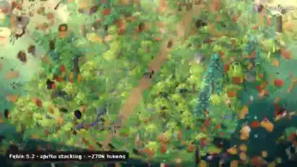</a> 
<b>A sprite-stacked dinosaur chase</b> 
<b>↗ Rising</b> · <a href="https://x.com/loktar00">@loktar00</a> · 1:09 · 2026-11-12 
<a href="https://video.twimg.com/amplify_video/2120735773737558016/vid/avc1/1920x1080/sJp2l7Rcm0PCGphv.mp4?tag=29">▶ Watch</a> · <a href="https://x.com/loktar00/status/2120905457380507991">Source</a> · <a href="https://github.com/VibeClip/awesome-fable-5-2-videos/blob/main/docs/videos/en/loktar00-2120905457380507991.md">Details</a>

</td>
<td width="33%" valign="top">
 
<b>A continuous flight from a blade of grass to orbit</b> 
<b>New</b> · <a href="https://x.com/KanaWorks_AI">@KanaWorks_AI</a> · 0:30 · 2026-11-12 
<a href="https://video.twimg.com/amplify_video/2120756185255280640/vid/avc1/1920x1080/cyqR1cP_m0o4kK5p.mp4?tag=29">▶ Watch</a> · <a href="https://x.com/KanaWorks_AI/status/2120756625699143977">Source</a> · <a href="https://github.com/VibeClip/awesome-fable-5-2-videos/blob/main/docs/videos/en/kanaworks-ai-2120756625699143977.md">Details</a>

</td>
<td width="33%" valign="top">
 
<b>Fifty simulated cars learn a test track</b> 
<b>New</b> · <a href="https://x.com/imjustnewatai">@imjustnewatai</a> · 1:38 · 2026-11-12 
<a href="https://video.twimg.com/amplify_video/2120695261080997888/vid/avc1/1920x1080/Kxjgtlp4UUvIqjQ_.mp4?tag=29">▶ Watch</a> · <a href="https://x.com/imjustnewatai/status/2120695368874631226">Source</a> · <a href="https://github.com/VibeClip/awesome-fable-5-2-videos/blob/main/docs/videos/en/imjustnewatai-2120695368874631226.md">Details</a>

</td>
</tr>
<tr>
<td width="33%" valign="top">
 
<b>An explorable painted valley under changing skies</b> 
<b>↗ Rising</b> · <a href="https://x.com/BlendiByl">@BlendiByl</a> · 0:23 · 2026-11-12 
<a href="https://video.twimg.com/amplify_video/2120693488123871232/vid/avc1/2560x1440/qE95X-Mwerms3yXv.mp4?tag=29">▶ Watch</a> · <a href="https://x.com/BlendiByl/status/2120694003230560585">Source</a> · <a href="https://github.com/VibeClip/awesome-fable-5-2-videos/blob/main/docs/videos/en/blendibyl-2120694003230560585.md">Details</a>

</td>
<td width="33%" valign="top">
 
<b>A layered desert diorama built with sprite stacking</b> 
<b>↗ Rising</b> · <a href="https://x.com/loktar00">@loktar00</a> · 0:40 · 2026-11-11 
<a href="https://video.twimg.com/amplify_video/2120653467043667968/vid/avc1/1920x1080/hy2Hk_wMUEO0YT1V.mp4?tag=29">▶ Watch</a> · <a href="https://x.com/loktar00/status/2120653702843277359">Source</a> · <a href="https://github.com/VibeClip/awesome-fable-5-2-videos/blob/main/docs/videos/en/loktar00-2120653702843277359.md">Details</a>

</td>
<td width="33%" valign="top">
 
<b>A walkable 3D scene of Yokohama’s Minato Mirai</b> 
<b>New</b> · <a href="https://x.com/excel_niisan">@excel_niisan</a> · 0:36 · 2026-11-11 
<a href="https://video.twimg.com/amplify_video/2120425125900328960/vid/avc1/1168x2248/ewBXgYEXri_Y_wGA.mp4?tag=29">▶ Watch</a> · <a href="https://x.com/excel_niisan/status/2120425260889817476">Source</a> · <a href="https://github.com/VibeClip/awesome-fable-5-2-videos/blob/main/docs/videos/en/excel-niisan-2120425260889817476.md">Details</a>

📝 View prompt
<blockquote>横浜みなとみらいの3D空間を作って</blockquote>
<a href="https://x.com/excel_niisan/status/2120425260889817476">Read the creator’s prompt</a>

</td>
</tr>
<tr>
<td width="33%" valign="top">
 
<b>A marble-powered chain reaction in Lattice</b> 
<b>New</b> · <a href="https://x.com/sin_ceriously">@sin_ceriously</a> · 0:25 · 2026-11-11 
<a href="https://video.twimg.com/amplify_video/2120314560297021440/vid/avc1/3840x2160/7HGk23L88dFl3nSk.mp4?tag=29">▶ Watch</a> · <a href="https://x.com/sin_ceriously/status/2120318808216981986">Source</a> · <a href="https://github.com/VibeClip/awesome-fable-5-2-videos/blob/main/docs/videos/en/sin-ceriously-2120318808216981986.md">Details</a>

</td>
<td width="33%" valign="top">
 
<b>A Three.js apartment recreated in Blender</b> 
<b>New</b> · <a href="https://x.com/MengTo">@MengTo</a> · 0:52 · 2026-11-11 
<a href="https://video.twimg.com/amplify_video/2120315007900819456/vid/avc1/1920x1080/GZkLFadi9AtkYzAJ.mp4?tag=29">▶ Watch</a> · <a href="https://x.com/MengTo/status/2120316203738829180">Source</a> · <a href="https://github.com/VibeClip/awesome-fable-5-2-videos/blob/main/docs/videos/en/mengto-2120316203738829180.md">Details</a>

</td>
<td width="33%" valign="top">
 
<b>A walk through an autumn zen garden</b> 
<b>New</b> · <a href="https://x.com/jpschroeder">@jpschroeder</a> · 1:29 · 2026-11-10 
<a href="https://video.twimg.com/amplify_video/2120274361063964672/vid/avc1/2208x1232/MGymGTy2uK8ZYX4z.mp4?tag=29">▶ Watch</a> · <a href="https://x.com/jpschroeder/status/2120274979614851145">Source</a> · <a href="https://github.com/VibeClip/awesome-fable-5-2-videos/blob/main/docs/videos/en/jpschroeder-2120274979614851145.md">Details</a>

</td>
</tr>
<tr>
<td width="33%" valign="top">
 
<b>A Blender character rigging comparison from Tripo assets</b> 
<b>New</b> · <a href="https://x.com/0xApexAi">@0xApexAi</a> · 0:28 · 2026-11-10 
<a href="https://video.twimg.com/amplify_video/2120267796810473472/vid/avc1/1920x1080/KSmjuhKzCxmnfnXo.mp4?tag=29">▶ Watch</a> · <a href="https://x.com/0xApexAi/status/2120268733360779645">Source</a> · <a href="https://github.com/VibeClip/awesome-fable-5-2-videos/blob/main/docs/videos/en/0xapexai-2120268733360779645.md">Details</a>

</td>
<td width="33%" valign="top">
 
<b>A rainy greenhouse at night</b> 
<b>New</b> · <a href="https://x.com/itsluneri">@itsluneri</a> · 0:28 · 2026-11-10 
<a href="https://video.twimg.com/amplify_video/2120266429807083520/vid/avc1/1280x536/cqqPa-Wwvx0eJotG.mp4?tag=29">▶ Watch</a> · <a href="https://x.com/itsluneri/status/2120266583826182317">Source</a> · <a href="https://github.com/VibeClip/awesome-fable-5-2-videos/blob/main/docs/videos/en/itsluneri-2120266583826182317.md">Details</a>

</td>
<td width="33%" valign="top">
 
<b>A 3D house tour from a floor plan and photos</b> 
<b>New</b> · <a href="https://x.com/oalanicolas">@oalanicolas</a> · 0:45 · 2026-11-10 
<a href="https://video.twimg.com/amplify_video/2120265385471574016/vid/avc1/1920x1080/fIfzIciKght3vPN5.mp4?tag=29">▶ Watch</a> · <a href="https://x.com/oalanicolas/status/2120266468780585456">Source</a> · <a href="https://github.com/VibeClip/awesome-fable-5-2-videos/blob/main/docs/videos/en/oalanicolas-2120266468780585456.md">Details</a>

📝 View prompt

The creator shared a prompt at the link below. Read it in its original context, with any references and follow-up instructions.

<a href="https://x.com/oalanicolas/status/2120266474950389779">Read the creator’s prompt</a>

</td>
</tr>
<tr>
<td width="33%" valign="top">
 
<b>A Three.js campfire lit against the dark</b> 
<b>New</b> · <a href="https://x.com/hajimetwi3">@hajimetwi3</a> · 0:32 · 2026-11-10 
<a href="https://video.twimg.com/amplify_video/2120245103516364800/vid/avc1/758x714/qnjU8gDkvq3f7_-K.mp4?tag=29">▶ Watch</a> · <a href="https://x.com/hajimetwi3/status/2120245907115651521">Source</a> · <a href="https://github.com/VibeClip/awesome-fable-5-2-videos/blob/main/docs/videos/en/hajimetwi3-2120245907115651521.md">Details</a>

📝 View prompt
<blockquote>AAA級のたき火が見たい！！</blockquote>
<a href="https://x.com/hajimetwi3/status/2120245907115651521">Read the creator’s prompt</a>

</td>
<td width="33%" valign="top">
 
<b>A Blender landscape of flowering hills</b> 
<b>New</b> · <a href="https://x.com/aecyydesign">@aecyydesign</a> · 0:10 · 2026-11-10 
<a href="https://video.twimg.com/amplify_video/2120239272632446976/vid/avc1/3840x2160/cCVjSrAMmLTwHIcZ.mp4?tag=29">▶ Watch</a> · <a href="https://x.com/aecyydesign/status/2120239401821487149">Source</a> · <a href="https://github.com/VibeClip/awesome-fable-5-2-videos/blob/main/docs/videos/en/aecyydesign-2120239401821487149.md">Details</a>

</td>
<td width="33%" valign="top">
 
<b>A flythrough of a rain-soaked green city</b> 
<b>New</b> · <a href="https://x.com/tornikegomareli">@tornikegomareli</a> · 1:10 · 2026-11-10 
<a href="https://video.twimg.com/amplify_video/2120225991066779648/vid/avc1/3840x2160/4z8saQVTMhPUC8Cw.mp4?tag=29">▶ Watch</a> · <a href="https://x.com/tornikegomareli/status/2120227696261120225">Source</a> · <a href="https://github.com/VibeClip/awesome-fable-5-2-videos/blob/main/docs/videos/en/tornikegomareli-2120227696261120225.md">Details</a>

</td>
</tr>
<tr>
<td width="33%" valign="top">
 
<b>A cobblestone courtyard with detailed surface relief</b> 
<b>↗ Rising</b> · <a href="https://x.com/jsnnsa">@jsnnsa</a> · 0:03 · 2026-11-10 
<a href="https://video.twimg.com/amplify_video/2120113092512436224/vid/avc1/3380x2026/IoUOfTQR_hB4fWMx.mp4?tag=29">▶ Watch</a> · <a href="https://x.com/jsnnsa/status/2120113469290901850">Source</a> · <a href="https://github.com/VibeClip/awesome-fable-5-2-videos/blob/main/docs/videos/en/jsnnsa-2120113469290901850.md">Details</a>

</td>
<td width="33%" valign="top">
 
<b>A miniature voxel world inside a bottle</b> 
<b>New</b> · <a href="https://x.com/vib3coded">@vib3coded</a> · 0:17 · 2026-11-10 
<a href="https://video.twimg.com/amplify_video/2120104433254068225/vid/avc1/1920x1080/TwqTpSJ125nfAGeC.mp4?tag=29">▶ Watch</a> · <a href="https://x.com/vib3coded/status/2120104517282775514">Source</a> · <a href="https://github.com/VibeClip/awesome-fable-5-2-videos/blob/main/docs/videos/en/vib3coded-2120104517282775514.md">Details</a>

</td>
<td width="33%" valign="top">
 
<b>An unbroken flight through changing 3D worlds</b> 
<b>↗ Rising</b> · <a href="https://x.com/KanaWorks_AI">@KanaWorks_AI</a> · 0:37 · 2026-11-10 
<a href="https://video.twimg.com/amplify_video/2120098419654230017/vid/avc1/1920x1080/oFLDhtXCqoMaEWyp.mp4?tag=29">▶ Watch</a> · <a href="https://x.com/KanaWorks_AI/status/2120098607382880627">Source</a> · <a href="https://github.com/VibeClip/awesome-fable-5-2-videos/blob/main/docs/videos/en/kanaworks-ai-2120098607382880627.md">Details</a>

</td>
</tr>
<tr>
<td width="33%" valign="top">
 
<b>Adam Tamagotchi: PCB, enclosure and Blender render</b> 
<b>↗ Rising</b> · <a href="https://x.com/adamdotnew">@adamdotnew</a> · 0:09 · 2026-11-10 
<a href="https://video.twimg.com/amplify_video/2120071508370640896/vid/avc1/3586x2160/cVxJQZsnnBLew_X_.mp4?tag=29">▶ Watch</a> · <a href="https://x.com/adamdotnew/status/2120071630139621540">Source</a> · <a href="https://github.com/VibeClip/awesome-fable-5-2-videos/blob/main/docs/videos/en/adamdotnew-2120071630139621540.md">Details</a>

</td>
<td width="33%" valign="top">
 
<b>A Japanese castle rises in a construction time-lapse</b> 
<b>New</b> · <a href="https://x.com/onofumi_AI">@onofumi_AI</a> · 0:18 · 2026-11-10 
<a href="https://video.twimg.com/amplify_video/2120041080502771712/vid/avc1/1920x1080/Y6-SMkmCzqQY0R50.mp4?tag=29">▶ Watch</a> · <a href="https://x.com/onofumi_AI/status/2120041161251569681">Source</a> · <a href="https://github.com/VibeClip/awesome-fable-5-2-videos/blob/main/docs/videos/en/onofumi-ai-2120041161251569681.md">Details</a>

</td>
<td width="33%" valign="top">
 
<b>A Blender meadow with ElevenLabs-generated audio</b> 
<b>↗ Rising</b> · <a href="https://x.com/KanaWorks_AI">@KanaWorks_AI</a> · 0:46 · 2026-11-10 
<a href="https://video.twimg.com/amplify_video/2119997805469343744/vid/avc1/1920x1080/k9AwH2MwZ_uq1Npk.mp4?tag=29">▶ Watch</a> · <a href="https://x.com/KanaWorks_AI/status/2119998466143490282">Source</a> · <a href="https://github.com/VibeClip/awesome-fable-5-2-videos/blob/main/docs/videos/en/kanaworks-ai-2119998466143490282.md">Details</a>

</td>
</tr>
<tr>
<td width="33%" valign="top">
 
<b>A reference-guided Bugatti Tourbillon Blender film</b> 
<b>↗ Rising</b> · <a href="https://x.com/xikhar">@xikhar</a> · 0:34 · 2026-11-10 
<a href="https://video.twimg.com/amplify_video/2119965554627014656/vid/avc1/1920x1080/5kgrvrWg41_GG_7E.mp4?tag=29">▶ Watch</a> · <a href="https://x.com/xikhar/status/2119966147328299284">Source</a> · <a href="https://github.com/VibeClip/awesome-fable-5-2-videos/blob/main/docs/videos/en/xikhar-2119966147328299284.md">Details</a>

</td>
<td width="33%" valign="top">
 
<b>A tiny Machu Picchu world with fog and alpacas</b> 
<b>↗ Rising</b> · <a href="https://x.com/loktar00">@loktar00</a> · 0:40 · 2026-11-10 
<a href="https://video.twimg.com/amplify_video/2119931613010108416/vid/avc1/1920x1080/ajuuqeO_AOInKjjo.mp4?tag=29">▶ Watch</a> · <a href="https://x.com/loktar00/status/2119958719362666708">Source</a> · <a href="https://github.com/VibeClip/awesome-fable-5-2-videos/blob/main/docs/videos/en/loktar00-2119958719362666708.md">Details</a>

</td>
<td width="33%" valign="top">
 
<b>Glass pool: Fable 5.2 and Opus 5.5 compared</b> 
<a href="https://x.com/MrTacticalX">@MrTacticalX</a> · 0:30 · 2026-11-10 
<a href="https://video.twimg.com/amplify_video/2119955491941949440/vid/avc1/1080x1216/I1OZU6Yuz2YtpyCA.mp4?tag=29">▶ Watch</a> · <a href="https://x.com/MrTacticalX/status/2119955647542542439">Source</a> · <a href="https://github.com/VibeClip/awesome-fable-5-2-videos/blob/main/docs/videos/en/mrtacticalx-2119955647542542439.md">Details</a>

</td>
</tr>
<tr>
<td width="33%" valign="top">
 
<b>A Mediterranean-themed space habitat</b> 
<b>↗ Rising</b> · <a href="https://x.com/MaxXWilliamson">@MaxXWilliamson</a> · 0:25 · 2026-11-10 
<a href="https://video.twimg.com/amplify_video/2119950297183166464/vid/avc1/1920x1080/Rlaw9k2rNAElPEi1.mp4?tag=29">▶ Watch</a> · <a href="https://x.com/MaxXWilliamson/status/2119953172634677533">Source</a> · <a href="https://github.com/VibeClip/awesome-fable-5-2-videos/blob/main/docs/videos/en/maxxwilliamson-2119953172634677533.md">Details</a>

</td>
<td width="33%" valign="top">
 
<b>A real-time WebGL honey simulation</b> 
<b>↗ Rising</b> · <a href="https://x.com/deedydas">@deedydas</a> · 0:51 · 2026-11-09 
<a href="https://video.twimg.com/amplify_video/2119930095406288896/vid/avc1/3456x1438/QrvS6vt8W2VY3Fld.mp4?tag=29">▶ Watch</a> · <a href="https://x.com/deedydas/status/2119930300990177509">Source</a> · <a href="https://github.com/VibeClip/awesome-fable-5-2-videos/blob/main/docs/videos/en/deedydas-2119930300990177509.md">Details</a>

📝 View prompt
<blockquote>Can you write the most intricate photorealistic simulation of honey in WebGL in the browser</blockquote>
<a href="https://x.com/deedydas/status/2119930300990177509">Read the creator’s prompt</a>

</td>
<td width="33%" valign="top">
 
<b>Six shots through a Bombay bazaar</b> 
<b>↗ Rising</b> · <a href="https://x.com/higgsfield_ai">@higgsfield_ai</a> · 0:22 · 2026-11-09 
<a href="https://video.twimg.com/amplify_video/2119915176354885632/vid/avc1/1920x1080/KKtYnQwg6iF7nZO0.mp4?tag=29">▶ Watch</a> · <a href="https://x.com/higgsfield_ai/status/2119918834841010320">Source</a> · <a href="https://github.com/VibeClip/awesome-fable-5-2-videos/blob/main/docs/videos/en/higgsfield-ai-2119918834841010320.md">Details</a>

</td>
</tr>
<tr>
<td width="33%" valign="top">
 
<b>An American diner built in code</b> 
<b>↗ Rising</b> · <a href="https://x.com/higgsfield_ai">@higgsfield_ai</a> · 0:20 · 2026-11-09 
<a href="https://video.twimg.com/amplify_video/2119918430635626496/vid/avc1/1080x1210/P1HVkhM5lHbULv8J.mp4?tag=29">▶ Watch</a> · <a href="https://x.com/higgsfield_ai/status/2119918838490010008">Source</a> · <a href="https://github.com/VibeClip/awesome-fable-5-2-videos/blob/main/docs/videos/en/higgsfield-ai-2119918838490010008.md">Details</a>

</td>
<td width="33%" valign="top">
 
<b>Fly into a spiral galaxy</b> 
<a href="https://x.com/handsher_NGU">@handsher_NGU</a> · 0:09 · 2026-11-09 
<a href="https://video.twimg.com/amplify_video/2119910441837305856/vid/avc1/2300x1080/9Jjvi_wR23hStOua.mp4?tag=16">▶ Watch</a> · <a href="https://x.com/handsher_NGU/status/2119910478025789655">Source</a> · <a href="https://github.com/VibeClip/awesome-fable-5-2-videos/blob/main/docs/videos/en/handsher-ngu-789655.md">Details</a>

</td>
<td width="33%" valign="top">
 
<b>Paris in 1940, rebuilt in Three.js</b> 
<a href="https://x.com/higgsfield_ai">@higgsfield_ai</a> · 0:24 · 2026-11-09 
<a href="https://video.twimg.com/amplify_video/2119909152743194624/vid/avc1/1920x1080/F_ZjzZnw1Sh-Mmb8.mp4?tag=29">▶ Watch</a> · <a href="https://x.com/higgsfield_ai/status/2119910344998912507">Source</a> · <a href="https://github.com/VibeClip/awesome-fable-5-2-videos/blob/main/docs/videos/en/higgsfield-ai-912507.md">Details</a>

</td>
</tr>
<tr>
<td width="33%" valign="top">
 
<b>A 3D piranha that takes itself apart</b> 
<a href="https://x.com/Scratcherrrr">@Scratcherrrr</a> · 0:20 · 2026-11-09 
<a href="https://video.twimg.com/amplify_video/2119909700862943233/vid/avc1/1920x1080/FN2antQKJ-tZoIhH.mp4?tag=29">▶ Watch</a> · <a href="https://x.com/Scratcherrrr/status/2119909780269785332">Source</a> · <a href="https://github.com/VibeClip/awesome-fable-5-2-videos/blob/main/docs/videos/en/scratcherrrr-785332.md">Details</a>

</td>
<td width="33%" valign="top">
 
<b>A command center for an agent system</b> 
<a href="https://x.com/s_matysik">@s_matysik</a> · 0:33 · 2026-11-09 
<a href="https://video.twimg.com/ext_tw_video/2119909140998823936/pu/vid/avc1/1280x720/Le9VVnckc0pwI3QT.mp4?tag=12">▶ Watch</a> · <a href="https://x.com/s_matysik/status/2119909371484213380">Source</a> · <a href="https://github.com/VibeClip/awesome-fable-5-2-videos/blob/main/docs/videos/en/s-matysik-213380.md">Details</a>

</td>
<td width="33%" valign="top">
 
<b>A flat sketch becomes a textured 3D room</b> 
<a href="https://x.com/higgsfield_ai">@higgsfield_ai</a> · 0:14 · 2026-11-09 
<a href="https://video.twimg.com/amplify_video/2119908342663651330/vid/avc1/1920x1080/qPUbaNsET2HB1nmF.mp4?tag=29">▶ Watch</a> · <a href="https://x.com/higgsfield_ai/status/2119908486880342326">Source</a> · <a href="https://github.com/VibeClip/awesome-fable-5-2-videos/blob/main/docs/videos/en/higgsfield-ai-342326.md">Details</a>

</td>
</tr>
<tr>
<td width="33%" valign="top">
 
<b>The world through a fly&#x27;s eyes</b> 
<a href="https://x.com/higgsfield_ai">@higgsfield_ai</a> · 0:20 · 2026-11-09 
<a href="https://video.twimg.com/amplify_video/2119907568432934912/vid/avc1/1920x1080/eq_KAVRRnNt9sJcM.mp4?tag=29">▶ Watch</a> · <a href="https://x.com/higgsfield_ai/status/2119907841599496421">Source</a> · <a href="https://github.com/VibeClip/awesome-fable-5-2-videos/blob/main/docs/videos/en/higgsfield-ai-496421.md">Details</a>

</td>
<td width="33%" valign="top">
 
<b>Cathedral of Ice: Fable 5.2 and Opus 5.5 compared</b> 
<a href="https://x.com/EnvolDev">@EnvolDev</a> · 0:25 · 2026-11-09 
<a href="https://video.twimg.com/amplify_video/2119907107449544704/vid/avc1/2880x2880/aQsdilYUcKwF_4Di.mp4?tag=29">▶ Watch</a> · <a href="https://x.com/EnvolDev/status/2119907318729245180">Source</a> · <a href="https://github.com/VibeClip/awesome-fable-5-2-videos/blob/main/docs/videos/en/envoldev-2119907318729245180.md">Details</a>

</td>
<td width="33%" valign="top">
 
<b>A voxel pagoda full of tiny details</b> 
<a href="https://x.com/LuminaBench">@LuminaBench</a> · 0:47 · 2026-11-09 
<a href="https://video.twimg.com/amplify_video/2119906290478559232/vid/avc1/1880x1280/d1J65qUiPlX62ABY.mp4?tag=29">▶ Watch</a> · <a href="https://x.com/LuminaBench/status/2119907096636657696">Source</a> · <a href="https://github.com/VibeClip/awesome-fable-5-2-videos/blob/main/docs/videos/en/luminabench-657696.md">Details</a>

</td>
</tr>
<tr>
<td width="33%" valign="top">
 
<b>A ray tracer written from scratch, no 3D software</b> 
<a href="https://x.com/fuoeba">@fuoeba</a> · 0:20 · 2026-11-09 
<a href="https://video.twimg.com/amplify_video/2119906227853602816/vid/avc1/1920x1080/N4YdoIeKUPkbvTzU.mp4?tag=29">▶ Watch</a> · <a href="https://x.com/fuoeba/status/2119906486017307074">Source</a> · <a href="https://github.com/VibeClip/awesome-fable-5-2-videos/blob/main/docs/videos/en/fuoeba-307074.md">Details</a>

</td>
<td width="33%" valign="top">
 
<b>A Mexico City market built entirely in code</b> 
<a href="https://x.com/higgsfield_ai">@higgsfield_ai</a> · 0:15 · 2026-11-09 
<a href="https://video.twimg.com/amplify_video/2119905289743020032/vid/avc1/1920x1080/etz_eCYQ6b-Lj5MO.mp4?tag=29">▶ Watch</a> · <a href="https://x.com/higgsfield_ai/status/2119906341078945977">Source</a> · <a href="https://github.com/VibeClip/awesome-fable-5-2-videos/blob/main/docs/videos/en/higgsfield-ai-945977.md">Details</a>

</td>
<td width="33%" valign="top">
 
<b>An ASCII dungeon animation remade</b> 
<a href="https://x.com/josendev">@josendev</a> · 0:08 · 2026-11-09 
<a href="https://video.twimg.com/amplify_video/2119906148698484736/vid/avc1/1920x1080/Sgdo6c9D1mBdZbhn.mp4?tag=29">▶ Watch</a> · <a href="https://x.com/josendev/status/2119906280118845704">Source</a> · <a href="https://github.com/VibeClip/awesome-fable-5-2-videos/blob/main/docs/videos/en/josendev-845704.md">Details</a>

</td>
</tr>
<tr>
<td width="33%" valign="top">
 
<b>A ramen stall on a rainy Tokyo night</b> 
<a href="https://x.com/sprinntt">@sprinntt</a> · 0:19 · 2026-11-09 
<a href="https://video.twimg.com/amplify_video/2119905884365074432/vid/avc1/1922x1080/SgmAc5CFTaaJq3tq.mp4?tag=29">▶ Watch</a> · <a href="https://x.com/sprinntt/status/2119906202330988961">Source</a> · <a href="https://github.com/VibeClip/awesome-fable-5-2-videos/blob/main/docs/videos/en/sprinntt-988961.md">Details</a>

</td>
<td width="33%" valign="top">
 
<b>A pirate ship sailing across the ocean</b> 
<a href="https://x.com/notjazii">@notjazii</a> · 0:50 · 2026-11-09 
<a href="https://video.twimg.com/amplify_video/2119904377221910528/vid/avc1/1920x1080/NVeak_ycaNknS-mN.mp4?tag=29">▶ Watch</a> · <a href="https://x.com/notjazii/status/2119905661505122575">Source</a> · <a href="https://github.com/VibeClip/awesome-fable-5-2-videos/blob/main/docs/videos/en/notjazii-122575.md">Details</a>

</td>
<td width="33%" valign="top">
 
<b>A voxel Japanese tea garden</b> 
<a href="https://x.com/MooncastOnline">@MooncastOnline</a> · 1:00 · 2026-11-09 
<a href="https://video.twimg.com/amplify_video/2119904157574279169/vid/avc1/1440x1080/sQX85HkDqeEicshB.mp4?tag=29">▶ Watch</a> · <a href="https://x.com/MooncastOnline/status/2119905190254145963">Source</a> · <a href="https://github.com/VibeClip/awesome-fable-5-2-videos/blob/main/docs/videos/en/mooncastonline-145963.md">Details</a>

</td>
</tr>
<tr>
<td width="33%" valign="top">
 
<b>A rainy Tokyo alley made without a video model</b> 
<a href="https://x.com/higgsfield_ai">@higgsfield_ai</a> · 0:15 · 2026-11-09 
<a href="https://video.twimg.com/amplify_video/2119903112425066496/vid/avc1/1920x1080/m1x8bc6dk1l-gRsQ.mp4?tag=29">▶ Watch</a> · <a href="https://x.com/higgsfield_ai/status/2119905141822484595">Source</a> · <a href="https://github.com/VibeClip/awesome-fable-5-2-videos/blob/main/docs/videos/en/higgsfield-ai-484595.md">Details</a>

</td>
<td width="33%" valign="top">
 
<b>A Star Wars battle built in Blender</b> 
<a href="https://x.com/adityavg13">@adityavg13</a> · 0:30 · 2026-11-09 
<a href="https://video.twimg.com/amplify_video/2119903375407878145/vid/avc1/1920x1080/CLp6m1t05mkdAtEV.mp4?tag=29">▶ Watch</a> · <a href="https://x.com/adityavg13/status/2119903463735799971">Source</a> · <a href="https://github.com/VibeClip/awesome-fable-5-2-videos/blob/main/docs/videos/en/adityavg13-799971.md">Details</a>

</td>
<td width="33%" valign="top">
 
<b>A synth keyboard film with custom sound design</b> 
<a href="https://x.com/AmirMushich">@AmirMushich</a> · 0:10 · 2026-11-09 
<a href="https://video.twimg.com/amplify_video/2119902373770334209/vid/avc1/1920x1080/vCU11lupXlFgCNwm.mp4?tag=29">▶ Watch</a> · <a href="https://x.com/AmirMushich/status/2119903338078564844">Source</a> · <a href="https://github.com/VibeClip/awesome-fable-5-2-videos/blob/main/docs/videos/en/amirmushich-564844.md">Details</a>

</td>
</tr>
<tr>
<td width="33%" valign="top">
 
<b>A tribute to 90s Bryce ray tracing</b> 
<a href="https://x.com/pleometric">@pleometric</a> · 0:15 · 2026-11-09 
<a href="https://video.twimg.com/amplify_video/2119901650827489280/vid/avc1/1920x1080/jGY1FHT06IKubKX6.mp4?tag=29">▶ Watch</a> · <a href="https://x.com/pleometric/status/2119901747930186234">Source</a> · <a href="https://github.com/VibeClip/awesome-fable-5-2-videos/blob/main/docs/videos/en/pleometric-186234.md">Details</a>

</td>
<td width="33%" valign="top">
 
<b>An immersive 3D model of ancient Jerusalem</b> 
<a href="https://x.com/kplikethebird">@kplikethebird</a> · 0:30 · 2026-11-09 
<a href="https://video.twimg.com/amplify_video/2119900521687314432/vid/avc1/1920x1080/jEvZ74FxOfPJmnWp.mp4?tag=29">▶ Watch</a> · <a href="https://x.com/kplikethebird/status/2119900775727902732">Source</a> · <a href="https://github.com/VibeClip/awesome-fable-5-2-videos/blob/main/docs/videos/en/kplikethebird-902732.md">Details</a>

📝 View prompt

The creator shared a prompt at the link below. Read it in its original context, with any references and follow-up instructions.

<a href="https://x.com/kplikethebird/status/2119900775727902732">Read the creator’s prompt</a>

</td>
<td width="33%" valign="top">
 
<b>A lighthouse in a storm</b> 
<a href="https://x.com/rohit3a">@rohit3a</a> · 0:30 · 2026-11-09 
<a href="https://video.twimg.com/amplify_video/2119899434121330688/vid/avc1/1920x1080/TejXiGNAzz3Ug7pm.mp4?tag=29">▶ Watch</a> · <a href="https://x.com/rohit3a/status/2119899684999487954">Source</a> · <a href="https://github.com/VibeClip/awesome-fable-5-2-videos/blob/main/docs/videos/en/rohit3a-487954.md">Details</a>

</td>
</tr>
<tr>
<td width="33%" valign="top">
 
<b>San Francisco modeled in 15 minutes</b> 
<a href="https://x.com/sakshamships">@sakshamships</a> · 1:31 · 2026-11-09 
<a href="https://video.twimg.com/amplify_video/2119883625831538689/vid/avc1/1920x1080/oYiIXmDxdlAt7KPN.mp4?tag=29">▶ Watch</a> · <a href="https://x.com/sakshamships/status/2119898573135310965">Source</a> · <a href="https://github.com/VibeClip/awesome-fable-5-2-videos/blob/main/docs/videos/en/sakshamships-310965.md">Details</a>

</td>
<td width="33%" valign="top">
 
<b>A PS2-style nuclear explosion</b> 
<a href="https://x.com/ConvictionFAQ">@ConvictionFAQ</a> · 0:10 · 2026-11-09 
<a href="https://video.twimg.com/amplify_video/2119898031696887808/vid/avc1/1280x960/23BJrLg2vEzkewba.mp4?tag=29">▶ Watch</a> · <a href="https://x.com/ConvictionFAQ/status/2119898203088937131">Source</a> · <a href="https://github.com/VibeClip/awesome-fable-5-2-videos/blob/main/docs/videos/en/convictionfaq-937131.md">Details</a>

</td>
<td width="33%" valign="top">
 
<b>Earth in space with eight ways to destroy it</b> 
<a href="https://x.com/0xVe1vet">@0xVe1vet</a> · 1:35 · 2026-11-09 
<a href="https://video.twimg.com/amplify_video/2119896430353534976/vid/avc1/1920x1080/J3yEymSqwiVofoL_.mp4?tag=29">▶ Watch</a> · <a href="https://x.com/0xVe1vet/status/2119896809669849204">Source</a> · <a href="https://github.com/VibeClip/awesome-fable-5-2-videos/blob/main/docs/videos/en/0xve1vet-849204.md">Details</a>

</td>
</tr>
<tr>
<td width="33%" valign="top">
 
<b>A zombie eagle sculpted through Blender MCP</b> 
<a href="https://x.com/maxt3chno">@maxt3chno</a> · 0:21 · 2026-11-09 
<a href="https://video.twimg.com/amplify_video/2119896529141907456/vid/avc1/2250x1440/xC2zlZFZ03UvSURS.mp4?tag=29">▶ Watch</a> · <a href="https://x.com/maxt3chno/status/2119896698281467952">Source</a> · <a href="https://github.com/VibeClip/awesome-fable-5-2-videos/blob/main/docs/videos/en/maxt3chno-467952.md">Details</a>

📝 View prompt

The creator shared a prompt at the link below. Read it in its original context, with any references and follow-up instructions.

<a href="https://x.com/maxt3chno/status/2119896909062058411">Read the creator’s prompt</a>

</td>
<td width="33%" valign="top">
 
<b>A car configurator made on medium thinking</b> 
<a href="https://x.com/RezAIT00">@RezAIT00</a> · 1:00 · 2026-11-09 
<a href="https://video.twimg.com/amplify_video/2119896354348470272/vid/avc1/1920x1080/DrkpfAkS2c4i2-N5.mp4?tag=29">▶ Watch</a> · <a href="https://x.com/RezAIT00/status/2119896578987020389">Source</a> · <a href="https://github.com/VibeClip/awesome-fable-5-2-videos/blob/main/docs/videos/en/rezait00-020389.md">Details</a>

</td>
<td width="33%" valign="top">
 
<b>A voxel island with a cycling pelican</b> 
<a href="https://x.com/filicroval">@filicroval</a> · 1:34 · 2026-11-09 
<a href="https://video.twimg.com/amplify_video/2119894403456040960/vid/avc1/1920x1080/imN7Z7KJWRG_8ad3.mp4?tag=29">▶ Watch</a> · <a href="https://x.com/filicroval/status/2119896439010811943">Source</a> · <a href="https://github.com/VibeClip/awesome-fable-5-2-videos/blob/main/docs/videos/en/filicroval-811943.md">Details</a>

</td>
</tr>
<tr>
<td width="33%" valign="top">
 
<b>A photorealistic lighthouse at sunset</b> 
<a href="https://x.com/viewsfrom02108">@viewsfrom02108</a> · 0:25 · 2026-11-09 
<a href="https://video.twimg.com/amplify_video/2119896067659436032/vid/avc1/1906x848/TE0E4Re4hx1qXj2V.mp4?tag=29">▶ Watch</a> · <a href="https://x.com/viewsfrom02108/status/2119896345729437907">Source</a> · <a href="https://github.com/VibeClip/awesome-fable-5-2-videos/blob/main/docs/videos/en/viewsfrom02108-437907.md">Details</a>

</td>
<td width="33%" valign="top">
 
<b>A rocket launch built in under two minutes</b> 
<a href="https://x.com/ZirkoMirko">@ZirkoMirko</a> · 0:14 · 2026-11-09 
<a href="https://video.twimg.com/amplify_video/2119895988517343232/vid/avc1/1920x1080/40ePOR3KPdp1Eqd3.mp4?tag=29">▶ Watch</a> · <a href="https://x.com/ZirkoMirko/status/2119896335843529121">Source</a> · <a href="https://github.com/VibeClip/awesome-fable-5-2-videos/blob/main/docs/videos/en/zirkomirko-529121.md">Details</a>

</td>
<td width="33%" valign="top">
 
<b>What Earth looks like with the oceans drained</b> 
<a href="https://x.com/Ldataengineer">@Ldataengineer</a> · 0:16 · 2026-11-09 
<a href="https://video.twimg.com/amplify_video/2119895394016522240/vid/avc1/1920x1080/OE8d18z8O2VOXnQ5.mp4?tag=29">▶ Watch</a> · <a href="https://x.com/Ldataengineer/status/2119896030993146101">Source</a> · <a href="https://github.com/VibeClip/awesome-fable-5-2-videos/blob/main/docs/videos/en/ldataengineer-146101.md">Details</a>

</td>
</tr>
<tr>
<td width="33%" valign="top">
 
<b>A Three.js ocean at sunset</b> 
<a href="https://x.com/ericskavinski">@ericskavinski</a> · 0:15 · 2026-11-09 
<a href="https://video.twimg.com/amplify_video/2119895528955617280/vid/avc1/1920x1080/F7m3cnVjtmBdlqPK.mp4?tag=29">▶ Watch</a> · <a href="https://x.com/ericskavinski/status/2119895601580016005">Source</a> · <a href="https://github.com/VibeClip/awesome-fable-5-2-videos/blob/main/docs/videos/en/ericskavinski-016005.md">Details</a>

</td>
<td width="33%" valign="top">
 
<b>An android head built from a 360 video</b> 
<a href="https://x.com/higgsfield_ai">@higgsfield_ai</a> · 0:29 · 2026-11-09 
<a href="https://video.twimg.com/amplify_video/2119894442358222848/vid/avc1/1080x1150/e2AYnwUWdNOCcvtU.mp4?tag=29">▶ Watch</a> · <a href="https://x.com/higgsfield_ai/status/2119895459519168558">Source</a> · <a href="https://github.com/VibeClip/awesome-fable-5-2-videos/blob/main/docs/videos/en/higgsfield-ai-168558.md">Details</a>

</td>
<td width="33%" valign="top">
 
<b>A voxel Paris packed with detail</b> 
<a href="https://x.com/RezAIT00">@RezAIT00</a> · 0:14 · 2026-11-09 
<a href="https://video.twimg.com/amplify_video/2119894096084910080/vid/avc1/1920x1080/7-lN899uuXxwQv1y.mp4?tag=29">▶ Watch</a> · <a href="https://x.com/RezAIT00/status/2119894257519767656">Source</a> · <a href="https://github.com/VibeClip/awesome-fable-5-2-videos/blob/main/docs/videos/en/rezait00-767656.md">Details</a>

📝 View prompt

The creator shared a prompt at the link below. Read it in its original context, with any references and follow-up instructions.

<a href="https://x.com/RezAIT00/status/2119898136894156960">Read the creator’s prompt</a>

</td>
</tr>
<tr>
<td width="33%" valign="top">
 
<b>A seaplane skimming the water</b> 
<a href="https://x.com/LuminaBench">@LuminaBench</a> · 0:40 · 2026-11-09 
<a href="https://video.twimg.com/amplify_video/2119893746644840448/vid/avc1/1880x1280/eNjCHemdxyEBKfdz.mp4?tag=29">▶ Watch</a> · <a href="https://x.com/LuminaBench/status/2119894130943807746">Source</a> · <a href="https://github.com/VibeClip/awesome-fable-5-2-videos/blob/main/docs/videos/en/luminabench-807746.md">Details</a>

</td>
<td width="33%" valign="top">
 
<b>A ditherpunk Saturn</b> 
<a href="https://x.com/josendev">@josendev</a> · 0:08 · 2026-11-09 
<a href="https://video.twimg.com/amplify_video/2119894029424828416/vid/avc1/1080x1080/yTttnmO-BNIQd7SD.mp4?tag=29">▶ Watch</a> · <a href="https://x.com/josendev/status/2119894060521730048">Source</a> · <a href="https://github.com/VibeClip/awesome-fable-5-2-videos/blob/main/docs/videos/en/josendev-730048.md">Details</a>

</td>
<td width="33%" valign="top">
 
<b>A rigged zombie hand that crawls and backflips</b> 
<a href="https://x.com/higgsfield_ai">@higgsfield_ai</a> · 0:19 · 2026-11-09 
<a href="https://video.twimg.com/amplify_video/2119888131575205888/vid/avc1/1920x1080/9qPoYSv2XDOLxkOX.mp4?tag=29">▶ Watch</a> · <a href="https://x.com/higgsfield_ai/status/2119893970897490135">Source</a> · <a href="https://github.com/VibeClip/awesome-fable-5-2-videos/blob/main/docs/videos/en/higgsfield-ai-490135.md">Details</a>

📝 View prompt

The creator shared a prompt at the link below. Read it in its original context, with any references and follow-up instructions.

<a href="https://higgsfield.ai/zh/@higgsfield.studio/blogs/bring-a-zombie-hand-to-life-with-fable-5-2-blender">Read the creator’s prompt</a>

</td>
</tr>
<tr>
<td width="33%" valign="top">
 
<b>Sci-fi blasters built around soda cans</b> 
<a href="https://x.com/abhinavflac">@abhinavflac</a> · 0:39 · 2026-11-09 
<a href="https://video.twimg.com/amplify_video/2119893810201411584/vid/avc1/1920x1080/KGUGqEyqh334QrTo.mp4?tag=29">▶ Watch</a> · <a href="https://x.com/abhinavflac/status/2119893868816859332">Source</a> · <a href="https://github.com/VibeClip/awesome-fable-5-2-videos/blob/main/docs/videos/en/abhinavflac-859332.md">Details</a>

</td>
<td width="33%" valign="top">
 
<b>A human anatomy explorer in Three.js</b> 
<a href="https://x.com/SimonasLTU1">@SimonasLTU1</a> · 1:23 · 2026-11-09 
<a href="https://video.twimg.com/amplify_video/2119891121857871872/vid/avc1/1920x1080/luZ3TJiesksBThce.mp4?tag=29">▶ Watch</a> · <a href="https://x.com/SimonasLTU1/status/2119891671219622262">Source</a> · <a href="https://github.com/VibeClip/awesome-fable-5-2-videos/blob/main/docs/videos/en/simonasltu1-622262.md">Details</a>

</td>
<td width="33%" valign="top">
 
<b>Glass, amber and liquid metal type</b> 
<a href="https://x.com/ioTanjiro">@ioTanjiro</a> · 0:25 · 2026-11-09 
<a href="https://video.twimg.com/amplify_video/2119891371049861120/vid/avc1/1908x1080/PkN_icMknPZh5G7T.mp4?tag=29">▶ Watch</a> · <a href="https://x.com/ioTanjiro/status/2119891527438606534">Source</a> · <a href="https://github.com/VibeClip/awesome-fable-5-2-videos/blob/main/docs/videos/en/iotanjiro-606534.md">Details</a>

</td>
</tr>
<tr>
<td width="33%" valign="top">
 
<b>A golden sailing ship above the clouds</b> 
<a href="https://x.com/marcthecreatorr">@marcthecreatorr</a> · 0:53 · 2026-11-09 
<a href="https://video.twimg.com/amplify_video/2119890640389451776/vid/avc1/1920x858/MZRufVqslQKy01c9.mp4?tag=29">▶ Watch</a> · <a href="https://x.com/marcthecreatorr/status/2119890973560054072">Source</a> · <a href="https://github.com/VibeClip/awesome-fable-5-2-videos/blob/main/docs/videos/en/marcthecreatorr-054072.md">Details</a>

</td>
<td width="33%" valign="top">
 
<b>A pocket black hole</b> 
<a href="https://x.com/paulgrowthlab">@paulgrowthlab</a> · 0:16 · 2026-11-09 
<a href="https://video.twimg.com/amplify_video/2119890352924479488/vid/avc1/1888x788/OS0DZVhnM9SbIhhK.mp4?tag=29">▶ Watch</a> · <a href="https://x.com/paulgrowthlab/status/2119890500979499382">Source</a> · <a href="https://github.com/VibeClip/awesome-fable-5-2-videos/blob/main/docs/videos/en/paulgrowthlab-499382.md">Details</a>

</td>
<td width="33%" valign="top">
 
<b>3D models built from reference videos</b> 
<a href="https://x.com/higgsfield_ai">@higgsfield_ai</a> · 0:30 · 2026-11-09 
<a href="https://video.twimg.com/amplify_video/2119890001999880192/vid/avc1/1920x1080/CjYHuGQSGo5-pMNi.mp4?tag=16">▶ Watch</a> · <a href="https://x.com/higgsfield_ai/status/2119890046748938248">Source</a> · <a href="https://github.com/VibeClip/awesome-fable-5-2-videos/blob/main/docs/videos/en/higgsfield-ai-938248.md">Details</a>

📝 View prompt

The creator shared a prompt at the link below. Read it in its original context, with any references and follow-up instructions.

<a href="https://higgsfield.ai/zh/@higgsfield.studio/blogs/how-we-built-a-transparent-glass-head-in-3d-with-claude-and-one-360-video">Read the creator’s prompt</a>

</td>
</tr>
<tr>
<td width="33%" valign="top">
 
<b>The White House, then and now</b> 
<a href="https://x.com/trymirage">@trymirage</a> · 0:35 · 2026-11-09 
<a href="https://video.twimg.com/amplify_video/2119889136433733632/vid/avc1/1080x1228/EDx7xjJIZ2ONA83t.mp4?tag=29">▶ Watch</a> · <a href="https://x.com/trymirage/status/2119889897200972028">Source</a> · <a href="https://github.com/VibeClip/awesome-fable-5-2-videos/blob/main/docs/videos/en/trymirage-972028.md">Details</a>

</td>
<td width="33%" valign="top">
 
<b>An ocean from golden hour to storm</b> 
<a href="https://x.com/ZryMiller">@ZryMiller</a> · 0:30 · 2026-11-09 
<a href="https://video.twimg.com/amplify_video/2119887691294932992/vid/avc1/1280x720/EjANhoPD5I8ooX55.mp4?tag=29">▶ Watch</a> · <a href="https://x.com/ZryMiller/status/2119887758777106941">Source</a> · <a href="https://github.com/VibeClip/awesome-fable-5-2-videos/blob/main/docs/videos/en/zrymiller-106941.md">Details</a>

</td>
<td width="33%" valign="top">
 
<b>A UFO lands at Area 51</b> 
<a href="https://x.com/danteeonsol">@danteeonsol</a> · 0:30 · 2026-11-09 
<a href="https://video.twimg.com/amplify_video/2119887223810076672/vid/avc1/1920x1080/K6WJ5UYNKbbENVTI.mp4?tag=29">▶ Watch</a> · <a href="https://x.com/danteeonsol/status/2119887623070077213">Source</a> · <a href="https://github.com/VibeClip/awesome-fable-5-2-videos/blob/main/docs/videos/en/danteeonsol-077213.md">Details</a>

📝 View prompt

The creator shared a prompt at the link below. Read it in its original context, with any references and follow-up instructions.

<a href="https://x.com/danteeonsol/status/2119887623070077213">Read the creator’s prompt</a>

</td>
</tr>
<tr>
<td width="33%" valign="top">
 
<b>A galaxy rendered in 20 minutes</b> 
<a href="https://x.com/handsher_NGU">@handsher_NGU</a> · 0:17 · 2026-11-09 
<a href="https://video.twimg.com/amplify_video/2119886346873364480/vid/avc1/1920x1080/kfnhup5vHOkgbHDt.mp4?tag=29">▶ Watch</a> · <a href="https://x.com/handsher_NGU/status/2119887298292863367">Source</a> · <a href="https://github.com/VibeClip/awesome-fable-5-2-videos/blob/main/docs/videos/en/handsher-ngu-863367.md">Details</a>

</td>
<td width="33%" valign="top">
 
<b>An eight-legged mechanical rover</b> 
<a href="https://x.com/scottstts">@scottstts</a> · 0:44 · 2026-11-09 
<a href="https://video.twimg.com/amplify_video/2119885516627685376/vid/avc1/3442x2160/7U_wQnmQ-ZIsZ463.mp4?tag=29">▶ Watch</a> · <a href="https://x.com/scottstts/status/2119886562003734829">Source</a> · <a href="https://github.com/VibeClip/awesome-fable-5-2-videos/blob/main/docs/videos/en/scottstts-734829.md">Details</a>

</td>
<td width="33%" valign="top">
 
<b>A travel ad for Fushimi Inari in autumn</b> 
<a href="https://x.com/petergyang">@petergyang</a> · 0:20 · 2026-11-09 
<a href="https://video.twimg.com/amplify_video/2119886495347867648/vid/avc1/1920x1080/8nAOHCNBnOTAqt0t.mp4?tag=16">▶ Watch</a> · <a href="https://x.com/petergyang/status/2119886560992854431">Source</a> · <a href="https://github.com/VibeClip/awesome-fable-5-2-videos/blob/main/docs/videos/en/petergyang-854431.md">Details</a>

</td>
</tr>
<tr>
<td width="33%" valign="top">
 
<b>Laundry on a line in the afternoon light</b> 
<a href="https://x.com/dfeinition">@dfeinition</a> · 0:19 · 2026-11-09 
<a href="https://video.twimg.com/amplify_video/2119885405017231360/vid/avc1/3840x2160/JC0qROK6I5UsQ7vf.mp4?tag=29">▶ Watch</a> · <a href="https://x.com/dfeinition/status/2119886262211625062">Source</a> · <a href="https://github.com/VibeClip/awesome-fable-5-2-videos/blob/main/docs/videos/en/dfeinition-625062.md">Details</a>

</td>
<td width="33%" valign="top">
 
<b>A spider weaves a logo into its web</b> 
<a href="https://x.com/sudoPhoeniX">@sudoPhoeniX</a> · 1:30 · 2026-11-09 
<a href="https://video.twimg.com/amplify_video/2119884723724181504/vid/avc1/1920x1080/FCwoqJyjTApsUnhD.mp4?tag=29">▶ Watch</a> · <a href="https://x.com/sudoPhoeniX/status/2119885209621655872">Source</a> · <a href="https://github.com/VibeClip/awesome-fable-5-2-videos/blob/main/docs/videos/en/sudophoenix-655872.md">Details</a>

</td>
<td width="33%" valign="top">
 
<b>A Rubik&#x27;s cube solved from six photos</b> 
<a href="https://x.com/TekonBurns">@TekonBurns</a> · 0:35 · 2026-11-09 
<a href="https://video.twimg.com/amplify_video/2119877995053920256/vid/avc1/3840x1748/sAyC8nBMMumprGvV.mp4?tag=29">▶ Watch</a> · <a href="https://x.com/TekonBurns/status/2119880835121963500">Source</a> · <a href="https://github.com/VibeClip/awesome-fable-5-2-videos/blob/main/docs/videos/en/tekonburns-963500.md">Details</a>

</td>
</tr>
<tr>
<td width="33%" valign="top">
 
<b>A rainy night drive through Mirror Earth</b> 
<a href="https://x.com/mattshumer_">@mattshumer_</a> · 0:26 · 2026-11-09 
<a href="https://video.twimg.com/amplify_video/2119878879212949505/vid/avc1/1728x854/OExPzr7l-bAJgpyk.mp4?tag=29">▶ Watch</a> · <a href="https://x.com/mattshumer_/status/2119879860344766782">Source</a> · <a href="https://github.com/VibeClip/awesome-fable-5-2-videos/blob/main/docs/videos/en/mattshumer-766782.md">Details</a>

</td>
<td width="33%" valign="top">
 
<b>Istanbul, built from a prompt</b> 
<a href="https://x.com/petergostev">@petergostev</a> · 0:39 · 2026-11-09 
<a href="https://video.twimg.com/amplify_video/2119876740310835201/vid/avc1/3840x1916/WFwbynhEGY1SxPup.mp4?tag=29">▶ Watch</a> · <a href="https://x.com/petergostev/status/2119877733488394520">Source</a> · <a href="https://github.com/VibeClip/awesome-fable-5-2-videos/blob/main/docs/videos/en/petergostev-394520.md">Details</a>

</td>
<td width="33%" valign="top">
 
<b>A chrome logo reveal in 3D</b> 
<a href="https://x.com/hello_amani">@hello_amani</a> · 0:36 · 2026-11-09 
<a href="https://video.twimg.com/amplify_video/2119873847369621504/vid/avc1/1080x1080/LDbZJxUYD0WsXDWe.mp4?tag=29">▶ Watch</a> · <a href="https://x.com/hello_amani/status/2119873980786237842">Source</a> · <a href="https://github.com/VibeClip/awesome-fable-5-2-videos/blob/main/docs/videos/en/hello-amani-237842.md">Details</a>

📝 View prompt
<blockquote>make my logo reveal in 3D with chromatic metal and grids</blockquote>
<a href="https://x.com/hello_amani/status/2119890392456073525">Read the creator’s prompt</a>

</td>
</tr>
<tr>
<td width="33%" valign="top">
 
<b>The Battle of New York in 3D</b> 
<a href="https://x.com/hammer_mt">@hammer_mt</a> · 1:08 · 2026-11-09 
<a href="https://video.twimg.com/amplify_video/2119871695930490880/vid/avc1/1920x1080/mZO4hKSagiOfBukM.mp4?tag=29">▶ Watch</a> · <a href="https://x.com/hammer_mt/status/2119871817561346319">Source</a> · <a href="https://github.com/VibeClip/awesome-fable-5-2-videos/blob/main/docs/videos/en/hammer-mt-346319.md">Details</a>

</td>
<td width="33%" valign="top">
 
<b>A virus capsid assembling itself</b> 
<a href="https://x.com/TekonBurns">@TekonBurns</a> · 0:15 · 2026-11-09 
<a href="https://video.twimg.com/amplify_video/2119871440292077568/vid/avc1/3840x1748/UY8m3TUPRs8yFPMs.mp4?tag=29">▶ Watch</a> · <a href="https://x.com/TekonBurns/status/2119871565311660260">Source</a> · <a href="https://github.com/VibeClip/awesome-fable-5-2-videos/blob/main/docs/videos/en/tekonburns-660260.md">Details</a>

</td>
<td width="33%" valign="top">
 
<b>A destructible voxel city</b> 
<a href="https://x.com/mattshumer_">@mattshumer_</a> · 0:59 · 2026-11-09 
<a href="https://video.twimg.com/amplify_video/2119870538436767745/vid/avc1/1280x720/Rul4Oy5QL34LIwQ6.mp4?tag=29">▶ Watch</a> · <a href="https://x.com/mattshumer_/status/2119870965106483384">Source</a> · <a href="https://github.com/VibeClip/awesome-fable-5-2-videos/blob/main/docs/videos/en/mattshumer-483384.md">Details</a>

</td>
</tr>
<tr>
<td width="33%" valign="top">
 
<b>A European village where every character thinks</b> 
<a href="https://x.com/MatthewBerman">@MatthewBerman</a> · 0:42 · 2026-11-09 
<a href="https://video.twimg.com/amplify_video/2119868287026892800/vid/avc1/1920x1080/aeL8BZjCQk_hzNJ0.mp4?tag=29">▶ Watch</a> · <a href="https://x.com/MatthewBerman/status/2119868638929060195">Source</a> · <a href="https://github.com/VibeClip/awesome-fable-5-2-videos/blob/main/docs/videos/en/matthewberman-060195.md">Details</a>

</td>
<td width="33%" valign="top">
 
<b>A bullet through a water balloon</b> 
<a href="https://x.com/MatthewBerman">@MatthewBerman</a> · 0:31 · 2026-11-09 
<a href="https://video.twimg.com/amplify_video/2119868225114783744/vid/avc1/1920x1080/uLOwWFt5YQwDDqN9.mp4?tag=29">▶ Watch</a> · <a href="https://x.com/MatthewBerman/status/2119868636810953017">Source</a> · <a href="https://github.com/VibeClip/awesome-fable-5-2-videos/blob/main/docs/videos/en/matthewberman-953017.md">Details</a>

</td>
<td width="33%"></td>
</tr>
</table>

## Product Films & Web Experiences · 43

Brand films, SaaS demos, launch videos, landing pages and web motion.

<table>
<tr>
<td width="33%" valign="top">
 
<b>A grid of animated interface icons</b> 
<b>New</b> · <a href="https://x.com/evals_ag">@evals_ag</a> · 0:11 · 2026-11-12 
<a href="https://video.twimg.com/amplify_video/2120821057166970880/vid/avc1/1440x1080/BFkajF2oBS3q1LMD.mp4?tag=29">▶ Watch</a> · <a href="https://x.com/evals_ag/status/2120821140868501726">Source</a> · <a href="https://github.com/VibeClip/awesome-fable-5-2-videos/blob/main/docs/videos/en/evals-ag-2120821140868501726.md">Details</a>

</td>
<td width="33%" valign="top">
<a href="https://video.twimg.com/amplify_video/2120784272940482560/vid/avc1/1738x1080/8XbdjkTmzdm_lJNn.mp4?tag=29">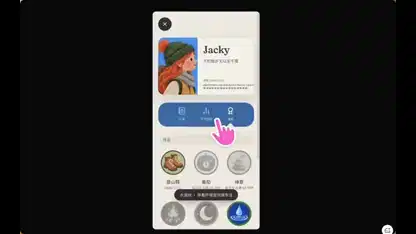</a> 
<b>Focus Traveler, a focus-timer app concept</b> 
<b>New</b> · <a href="https://x.com/Jackywine">@Jackywine</a> · 1:02 · 2026-11-12 
<a href="https://video.twimg.com/amplify_video/2120784272940482560/vid/avc1/1738x1080/8XbdjkTmzdm_lJNn.mp4?tag=29">▶ Watch</a> · <a href="https://x.com/Jackywine/status/2120784934751400379">Source</a> · <a href="https://github.com/VibeClip/awesome-fable-5-2-videos/blob/main/docs/videos/en/jackywine-2120784934751400379.md">Details</a>

</td>
<td width="33%" valign="top">
<a href="https://video.twimg.com/amplify_video/2120562883801071616/vid/avc1/1080x1332/STggSCjsGA_gtEOC.mp4?tag=29">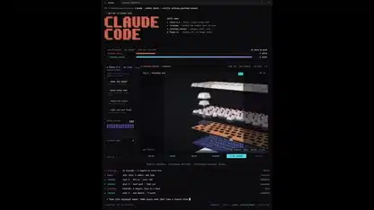</a> 
<b>An exploded-view film for a mechanical keyboard</b> 
<b>New</b> · <a href="https://x.com/0xRicker">@0xRicker</a> · 0:20 · 2026-11-11 
<a href="https://video.twimg.com/amplify_video/2120562883801071616/vid/avc1/1080x1332/STggSCjsGA_gtEOC.mp4?tag=29">▶ Watch</a> · <a href="https://x.com/0xRicker/status/2120564035057856942">Source</a> · <a href="https://github.com/VibeClip/awesome-fable-5-2-videos/blob/main/docs/videos/en/0xricker-2120564035057856942.md">Details</a>

📝 View prompt
<blockquote>take this keyboard apart, make every shot feel like a launch film</blockquote>
<a href="https://x.com/0xRicker/status/2120564035057856942">Read the creator’s prompt</a>

</td>
</tr>
<tr>
<td width="33%" valign="top">
 
<b>An interactive concert map that previews each seat’s view</b> 
<b>New</b> · <a href="https://x.com/RyanSael">@RyanSael</a> · 0:21 · 2026-11-11 
<a href="https://video.twimg.com/amplify_video/2120540769178259456/vid/avc1/1920x1080/Jthjy2FP0kte76J5.mp4?tag=29">▶ Watch</a> · <a href="https://x.com/RyanSael/status/2120544205558915329">Source</a> · <a href="https://github.com/VibeClip/awesome-fable-5-2-videos/blob/main/docs/videos/en/ryansael-2120544205558915329.md">Details</a>

</td>
<td width="33%" valign="top">
 
<b>Seerveil, a trailer built from an existing Three.js game</b> 
<b>New</b> · <a href="https://x.com/MengTo">@MengTo</a> · 1:00 · 2026-11-11 
<a href="https://video.twimg.com/amplify_video/2120501022607183872/vid/avc1/2560x1440/LtYxtiVb1VYHP7Fi.mp4?tag=29">▶ Watch</a> · <a href="https://x.com/MengTo/status/2120501283304153438">Source</a> · <a href="https://github.com/VibeClip/awesome-fable-5-2-videos/blob/main/docs/videos/en/mengto-2120501283304153438.md">Details</a>

</td>
<td width="33%" valign="top">
 
<b>An isometric landing-page concept for game creation</b> 
<b>New</b> · <a href="https://x.com/ercankeskinx">@ercankeskinx</a> · 0:09 · 2026-11-11 
<a href="https://video.twimg.com/amplify_video/2120474523955056640/vid/avc1/2014x1080/Ftj5SOfFitkDNQgT.mp4?tag=29">▶ Watch</a> · <a href="https://x.com/ercankeskinx/status/2120475122859757705">Source</a> · <a href="https://github.com/VibeClip/awesome-fable-5-2-videos/blob/main/docs/videos/en/ercankeskinx-2120475122859757705.md">Details</a>

</td>
</tr>
<tr>
<td width="33%" valign="top">
 
<b>A step-by-step 12306 train boarding guide concept</b> 
<b>New</b> · <a href="https://x.com/Jackywine">@Jackywine</a> · 0:29 · 2026-11-11 
<a href="https://video.twimg.com/amplify_video/2120376229509648384/vid/avc1/1528x1440/K2IOCINEgTRsQwG2.mp4?tag=29">▶ Watch</a> · <a href="https://x.com/Jackywine/status/2120376448280400338">Source</a> · <a href="https://github.com/VibeClip/awesome-fable-5-2-videos/blob/main/docs/videos/en/jackywine-2120376448280400338.md">Details</a>

</td>
<td width="33%" valign="top">
 
<b>A code-drawn 1990s-style cereal commercial</b> 
<b>New</b> · <a href="https://x.com/kevin_t_ngo">@kevin_t_ngo</a> · 1:04 · 2026-11-11 
<a href="https://video.twimg.com/amplify_video/2120306941243314176/vid/avc1/1080x1080/pz2C3rnTYJ4qnu3O.mp4?tag=29">▶ Watch</a> · <a href="https://x.com/kevin_t_ngo/status/2120308118127309173">Source</a> · <a href="https://github.com/VibeClip/awesome-fable-5-2-videos/blob/main/docs/videos/en/kevin-t-ngo-2120308118127309173.md">Details</a>

</td>
<td width="33%" valign="top">
 
<b>An animated commercial for a fictional blanket</b> 
<b>New</b> · <a href="https://x.com/shun_cmdouga">@shun_cmdouga</a> · 0:20 · 2026-11-10 
<a href="https://video.twimg.com/amplify_video/2120296746597367808/vid/avc1/1920x1080/nBbdm0MVWCjO_d_G.mp4?tag=29">▶ Watch</a> · <a href="https://x.com/shun_cmdouga/status/2120297280997933435">Source</a> · <a href="https://github.com/VibeClip/awesome-fable-5-2-videos/blob/main/docs/videos/en/shun-cmdouga-2120297280997933435.md">Details</a>

</td>
</tr>
<tr>
<td width="33%" valign="top">
 
<b>The same founder pitch edited by Fable and Gemini</b> 
<b>New</b> · <a href="https://x.com/motion_so">@motion_so</a> · 1:19 · 2026-11-10 
<a href="https://video.twimg.com/amplify_video/2120285860105195520/vid/avc1/1920x1080/UgVa0dDsoUhgJhHh.mp4?tag=29">▶ Watch</a> · <a href="https://x.com/motion_so/status/2120285901435847047">Source</a> · <a href="https://github.com/VibeClip/awesome-fable-5-2-videos/blob/main/docs/videos/en/motion-so-2120285901435847047.md">Details</a>

</td>
<td width="33%" valign="top">
 
<b>A cookie consent screen with a cookie you can bite</b> 
<b>New</b> · <a href="https://x.com/IAenCrudo">@IAenCrudo</a> · 0:14 · 2026-11-10 
<a href="https://video.twimg.com/amplify_video/2120268939280142336/vid/avc1/1920x1080/0lAXC8eRK_E-vsZX.mp4?tag=29">▶ Watch</a> · <a href="https://x.com/IAenCrudo/status/2120269395373048226">Source</a> · <a href="https://github.com/VibeClip/awesome-fable-5-2-videos/blob/main/docs/videos/en/iaencrudo-2120269395373048226.md">Details</a>

</td>
<td width="33%" valign="top">
 
<b>A translucent web menu over shifting gradients</b> 
<b>↗ Rising</b> · <a href="https://x.com/seanaiux">@seanaiux</a> · 0:11 · 2026-11-10 
<a href="https://video.twimg.com/amplify_video/2120188041356877824/vid/avc1/1920x1080/c6-X7sxlSfZs2Tg5.mp4?tag=29">▶ Watch</a> · <a href="https://x.com/seanaiux/status/2120222459110789574">Source</a> · <a href="https://github.com/VibeClip/awesome-fable-5-2-videos/blob/main/docs/videos/en/seanaiux-2120222459110789574.md">Details</a>

</td>
</tr>
<tr>
<td width="33%" valign="top">
 
<b>Vela AI product launch film</b> 
<b>New</b> · <a href="https://x.com/ercankeskinx">@ercankeskinx</a> · 0:41 · 2026-11-10 
<a href="https://video.twimg.com/amplify_video/2120177105145364480/vid/avc1/1920x1080/f7-mKDwzMvds5o6V.mp4?tag=29">▶ Watch</a> · <a href="https://x.com/ercankeskinx/status/2120177242034872774">Source</a> · <a href="https://github.com/VibeClip/awesome-fable-5-2-videos/blob/main/docs/videos/en/ercankeskinx-2120177242034872774.md">Details</a>

</td>
<td width="33%" valign="top">
 
<b>A bill-splitting interface with coordinated components</b> 
<a href="https://x.com/dominikmartn">@dominikmartn</a> · 0:24 · 2026-11-10 
<a href="https://video.twimg.com/amplify_video/2120154807218696192/vid/avc1/1440x1080/283MLjs7xLVK97kW.mp4?tag=16">▶ Watch</a> · <a href="https://x.com/dominikmartn/status/2120154832694858224">Source</a> · <a href="https://github.com/VibeClip/awesome-fable-5-2-videos/blob/main/docs/videos/en/dominikmartn-2120154832694858224.md">Details</a>

</td>
<td width="33%" valign="top">
 
<b>An Amy learning-app launch film</b> 
<b>New</b> · <a href="https://x.com/AryamGoyal1">@AryamGoyal1</a> · 0:56 · 2026-11-10 
<a href="https://video.twimg.com/amplify_video/2120127470120968192/vid/avc1/1920x1080/5HOZAyjOLS3dUDC-.mp4?tag=29">▶ Watch</a> · <a href="https://x.com/AryamGoyal1/status/2120128188936503343">Source</a> · <a href="https://github.com/VibeClip/awesome-fable-5-2-videos/blob/main/docs/videos/en/aryamgoyal1-2120128188936503343.md">Details</a>

</td>
</tr>
<tr>
<td width="33%" valign="top">
 
<b>A Rio tutorial-assistant product demo</b> 
<b>New</b> · <a href="https://x.com/biduletechtal">@biduletechtal</a> · 0:41 · 2026-11-10 
<a href="https://video.twimg.com/amplify_video/2120127890226360321/vid/avc1/1920x1080/9pzTacRoZLu3YTxw.mp4?tag=29">▶ Watch</a> · <a href="https://x.com/biduletechtal/status/2120127941598380265">Source</a> · <a href="https://github.com/VibeClip/awesome-fable-5-2-videos/blob/main/docs/videos/en/biduletechtal-2120127941598380265.md">Details</a>

</td>
<td width="33%" valign="top">
 
<b>An interactive foldable-phone unboxing</b> 
<b>↗ Rising</b> · <a href="https://x.com/argofowl">@argofowl</a> · 0:49 · 2026-11-10 
<a href="https://video.twimg.com/amplify_video/2120115535107264512/vid/avc1/1900x856/vM_oqNfck4QvROH9.mp4?tag=29">▶ Watch</a> · <a href="https://x.com/argofowl/status/2120116358793085186">Source</a> · <a href="https://github.com/VibeClip/awesome-fable-5-2-videos/blob/main/docs/videos/en/argofowl-2120116358793085186.md">Details</a>

</td>
<td width="33%" valign="top">
 
<b>A switch that spills ferrofluid</b> 
<b>New</b> · <a href="https://x.com/argofowl">@argofowl</a> · 0:34 · 2026-11-10 
<a href="https://video.twimg.com/amplify_video/2120101910556655616/vid/avc1/1646x1080/0W8fDGgFnviIjIA2.mp4?tag=29">▶ Watch</a> · <a href="https://x.com/argofowl/status/2120102506256859510">Source</a> · <a href="https://github.com/VibeClip/awesome-fable-5-2-videos/blob/main/docs/videos/en/argofowl-2120102506256859510.md">Details</a>

</td>
</tr>
<tr>
<td width="33%" valign="top">
 
<b>A 1990s-style toy commercial rendered in Blender</b> 
<b>↗ Rising</b> · <a href="https://x.com/kevin_t_ngo">@kevin_t_ngo</a> · 1:05 · 2026-11-10 
<a href="https://video.twimg.com/amplify_video/2119970272552095744/vid/avc1/1080x1080/m_hmwoGBOY58o1RD.mp4?tag=29">▶ Watch</a> · <a href="https://x.com/kevin_t_ngo/status/2119972124211454139">Source</a> · <a href="https://github.com/VibeClip/awesome-fable-5-2-videos/blob/main/docs/videos/en/kevin-t-ngo-2119972124211454139.md">Details</a>

</td>
<td width="33%" valign="top">
 
<b>Fable 5.2 animates its own announcement</b> 
<a href="https://x.com/grafikcem">@grafikcem</a> · 1:00 · 2026-11-09 
<a href="https://video.twimg.com/amplify_video/2119910244302065664/vid/avc1/1920x1080/gupDBW1gZCSwiXO5.mp4?tag=29">▶ Watch</a> · <a href="https://x.com/grafikcem/status/2119910525064937806">Source</a> · <a href="https://github.com/VibeClip/awesome-fable-5-2-videos/blob/main/docs/videos/en/grafikcem-937806.md">Details</a>

📝 View prompt
<blockquote>Bugün duyurulmana özel Fable 5.2 modeli için opus 5.5 subagentları kullanarak kendine 60 saniyelik bir tanıtım animasyon filmi hazırla.</blockquote>
<a href="https://x.com/grafikcem/status/2119910525064937806">Read the creator’s prompt</a>

</td>
<td width="33%" valign="top">
 
<b>A CRM product film made in 15 minutes</b> 
<a href="https://x.com/hugo_grndd">@hugo_grndd</a> · 1:21 · 2026-11-09 
<a href="https://video.twimg.com/amplify_video/2119909870539300864/vid/avc1/1920x1080/ZxvNnuf07HECALKp.mp4?tag=29">▶ Watch</a> · <a href="https://x.com/hugo_grndd/status/2119909979381723615">Source</a> · <a href="https://github.com/VibeClip/awesome-fable-5-2-videos/blob/main/docs/videos/en/hugo-grndd-723615.md">Details</a>

</td>
</tr>
<tr>
<td width="33%" valign="top">
 
<b>A construction site landing page in 3D</b> 
<a href="https://x.com/Webilyco">@Webilyco</a> · 0:21 · 2026-11-09 
<a href="https://video.twimg.com/amplify_video/2119909314685001728/vid/avc1/2914x1510/nKvOGrIwpv1kbj37.mp4?tag=29">▶ Watch</a> · <a href="https://x.com/Webilyco/status/2119909604431626667">Source</a> · <a href="https://github.com/VibeClip/awesome-fable-5-2-videos/blob/main/docs/videos/en/webilyco-626667.md">Details</a>

</td>
<td width="33%" valign="top">
 
<b>A launch film for refurbished Macs</b> 
<a href="https://x.com/geniusyinka">@geniusyinka</a> · 0:54 · 2026-11-09 
<a href="https://video.twimg.com/amplify_video/2119899852679073793/vid/avc1/3840x2160/VQJVKlvH7bVri0kw.mp4?tag=29">▶ Watch</a> · <a href="https://x.com/geniusyinka/status/2119906654149832704">Source</a> · <a href="https://github.com/VibeClip/awesome-fable-5-2-videos/blob/main/docs/videos/en/geniusyinka-832704.md">Details</a>

</td>
<td width="33%" valign="top">
 
<b>A reference clip rebuilt as editable motion</b> 
<b>↗ Rising</b> · <a href="https://x.com/Miguel07Code">@Miguel07Code</a> · 0:16 · 2026-11-09 
<a href="https://video.twimg.com/amplify_video/2119904715479654400/vid/avc1/1920x648/CpD30xA5VWvI9X1O.mp4?tag=29">▶ Watch</a> · <a href="https://x.com/Miguel07Code/status/2119904748900167836">Source</a> · <a href="https://github.com/VibeClip/awesome-fable-5-2-videos/blob/main/docs/videos/en/miguel07code-2119904748900167836.md">Details</a>

</td>
</tr>
<tr>
<td width="33%" valign="top">
 
<b>A landing page that scrolls into the ocean</b> 
<a href="https://x.com/pratyushrungta">@pratyushrungta</a> · 0:25 · 2026-11-09 
<a href="https://video.twimg.com/amplify_video/2119903161444163586/vid/avc1/3024x1896/drKirRhYFgKBUZJN.mp4?tag=29">▶ Watch</a> · <a href="https://x.com/pratyushrungta/status/2119903348354945416">Source</a> · <a href="https://github.com/VibeClip/awesome-fable-5-2-videos/blob/main/docs/videos/en/pratyushrungta-945416.md">Details</a>

</td>
<td width="33%" valign="top">
 
<b>A film about its own launch, in one HTML file</b> 
<a href="https://x.com/ysuf_dmrkprn1">@ysuf_dmrkprn1</a> · 0:33 · 2026-11-09 
Archived source · <a href="https://x.com/ysuf_dmrkprn1/status/2119902151581585449">Source</a> · <a href="https://github.com/VibeClip/awesome-fable-5-2-videos/blob/main/docs/videos/en/ysuf-dmrkprn1-585449.md">Details</a>

</td>
<td width="33%" valign="top">
 
<b>A launch film staged on a desk</b> 
<a href="https://x.com/rileybrown">@rileybrown</a> · 0:59 · 2026-11-09 
<a href="https://video.twimg.com/amplify_video/2119897796736131072/vid/avc1/3840x2160/pzacfkpXtKVX4i85.mp4?tag=29">▶ Watch</a> · <a href="https://x.com/rileybrown/status/2119902109709537708">Source</a> · <a href="https://github.com/VibeClip/awesome-fable-5-2-videos/blob/main/docs/videos/en/rileybrown-537708.md">Details</a>

</td>
</tr>
<tr>
<td width="33%" valign="top">
 
<b>Six website animations in one shot</b> 
<a href="https://x.com/MaybeFlorent">@MaybeFlorent</a> · 0:43 · 2026-11-09 
<a href="https://video.twimg.com/amplify_video/2119899114720694272/vid/avc1/1920x1080/zcmr0ZQtg48MLyrV.mp4?tag=29">▶ Watch</a> · <a href="https://x.com/MaybeFlorent/status/2119899685011792255">Source</a> · <a href="https://github.com/VibeClip/awesome-fable-5-2-videos/blob/main/docs/videos/en/maybeflorent-792255.md">Details</a>

</td>
<td width="33%" valign="top">
 
<b>A launch film it coded for itself in 57 minutes</b> 
<a href="https://x.com/furkancavlakcom">@furkancavlakcom</a> · 1:14 · 2026-11-09 
<a href="https://video.twimg.com/amplify_video/2119895300718374912/vid/avc1/1920x1080/L3VgxovNI7ppzHi8.mp4?tag=29">▶ Watch</a> · <a href="https://x.com/furkancavlakcom/status/2119896886345695521">Source</a> · <a href="https://github.com/VibeClip/awesome-fable-5-2-videos/blob/main/docs/videos/en/furkancavlakcom-695521.md">Details</a>

📝 View prompt
<blockquote>Kendi lansman videonu yap. Sadece kodla.</blockquote>
<a href="https://x.com/furkancavlakcom/status/2119896886345695521">Read the creator’s prompt</a>

</td>
<td width="33%" valign="top">
 
<b>A promo for a shipping label app</b> 
<a href="https://x.com/RuslanKyrch">@RuslanKyrch</a> · 0:20 · 2026-11-09 
<a href="https://video.twimg.com/amplify_video/2119896097871020033/vid/avc1/1080x1350/74MeMX8TbhcEEtI_.mp4?tag=29">▶ Watch</a> · <a href="https://x.com/RuslanKyrch/status/2119896220814762218">Source</a> · <a href="https://github.com/VibeClip/awesome-fable-5-2-videos/blob/main/docs/videos/en/ruslankyrch-762218.md">Details</a>

</td>
</tr>
<tr>
<td width="33%" valign="top">
 
<b>A full landing page from one prompt and a brief</b> 
<a href="https://x.com/yalcinwebb">@yalcinwebb</a> · 0:21 · 2026-11-09 
<a href="https://video.twimg.com/amplify_video/2119893862743191552/vid/avc1/3452x2156/uJj4RtsG2ToSrtEr.mp4?tag=29">▶ Watch</a> · <a href="https://x.com/yalcinwebb/status/2119895050163286374">Source</a> · <a href="https://github.com/VibeClip/awesome-fable-5-2-videos/blob/main/docs/videos/en/yalcinwebb-286374.md">Details</a>

</td>
<td width="33%" valign="top">
 
<b>A rocket launch page drawn on a design canvas</b> 
<a href="https://x.com/amihai">@amihai</a> · 0:14 · 2026-11-09 
<a href="https://video.twimg.com/amplify_video/2119893041322287104/vid/avc1/3840x2160/UXsFkYv6hX0YYC54.mp4?tag=29">▶ Watch</a> · <a href="https://x.com/amihai/status/2119894821255205099">Source</a> · <a href="https://github.com/VibeClip/awesome-fable-5-2-videos/blob/main/docs/videos/en/amihai-205099.md">Details</a>

</td>
<td width="33%" valign="top">
 
<b>A note-taking app site in four visual styles</b> 
<a href="https://x.com/h00mankind">@h00mankind</a> · 1:18 · 2026-11-09 
<a href="https://video.twimg.com/amplify_video/2119892759670829056/vid/avc1/1814x1020/WCoJ0TFnVUHhiw_I.mp4?tag=29">▶ Watch</a> · <a href="https://x.com/h00mankind/status/2119892979297165617">Source</a> · <a href="https://github.com/VibeClip/awesome-fable-5-2-videos/blob/main/docs/videos/en/h00mankind-165617.md">Details</a>

</td>
</tr>
<tr>
<td width="33%" valign="top">
 
<b>A landing page for a magnet you can pour</b> 
<a href="https://x.com/ZryMiller">@ZryMiller</a> · 0:28 · 2026-11-09 
<a href="https://video.twimg.com/amplify_video/2119891999679787008/vid/avc1/1916x944/P2xizmcev9bpjkQb.mp4?tag=29">▶ Watch</a> · <a href="https://x.com/ZryMiller/status/2119892074464190684">Source</a> · <a href="https://github.com/VibeClip/awesome-fable-5-2-videos/blob/main/docs/videos/en/zrymiller-190684.md">Details</a>

</td>
<td width="33%" valign="top">
 
<b>A trailer for a chart-making tool</b> 
<a href="https://x.com/al_maxgo">@al_maxgo</a> · 0:28 · 2026-11-09 
<a href="https://video.twimg.com/amplify_video/2119890367994576896/vid/avc1/1080x1920/3jDc1Y3iXxUQ7ByL.mp4?tag=29">▶ Watch</a> · <a href="https://x.com/al_maxgo/status/2119891197317591040">Source</a> · <a href="https://github.com/VibeClip/awesome-fable-5-2-videos/blob/main/docs/videos/en/al-maxgo-591040.md">Details</a>

📝 View prompt

The creator shared a prompt at the link below. Read it in its original context, with any references and follow-up instructions.

<a href="https://x.com/al_maxgo/status/2119894113252212885">Read the creator’s prompt</a>

</td>
<td width="33%" valign="top">
 
<b>Fable 5.2 introduces itself in pure JavaScript</b> 
<a href="https://x.com/itssotsot">@itssotsot</a> · 0:29 · 2026-11-09 
<a href="https://video.twimg.com/amplify_video/2119887904818294784/vid/avc1/1920x1080/iEHSU_81HjuqY3Dk.mp4?tag=29">▶ Watch</a> · <a href="https://x.com/itssotsot/status/2119888070283845716">Source</a> · <a href="https://github.com/VibeClip/awesome-fable-5-2-videos/blob/main/docs/videos/en/itssotsot-845716.md">Details</a>

</td>
</tr>
<tr>
<td width="33%" valign="top">
 
<b>A product video one-shotted in 30 minutes</b> 
<a href="https://x.com/RuchTheophile">@RuchTheophile</a> · 0:27 · 2026-11-09 
<a href="https://video.twimg.com/amplify_video/2119887599032483840/vid/avc1/1920x1080/ZspRgODva5MvP6jO.mp4?tag=29">▶ Watch</a> · <a href="https://x.com/RuchTheophile/status/2119887652845715560">Source</a> · <a href="https://github.com/VibeClip/awesome-fable-5-2-videos/blob/main/docs/videos/en/ruchtheophile-715560.md">Details</a>

</td>
<td width="33%" valign="top">
 
<b>Fable 5.2 makes its own launch film</b> 
<a href="https://x.com/imjustnewatai">@imjustnewatai</a> · 0:41 · 2026-11-09 
<a href="https://video.twimg.com/amplify_video/2119882693596917760/vid/avc1/1920x1080/DGvARh2eAwgOmqOy.mp4?tag=29">▶ Watch</a> · <a href="https://x.com/imjustnewatai/status/2119882760412434649">Source</a> · <a href="https://github.com/VibeClip/awesome-fable-5-2-videos/blob/main/docs/videos/en/imjustnewatai-434649.md">Details</a>

</td>
<td width="33%" valign="top">
 
<b>A motion spot for a competitor research tool</b> 
<a href="https://x.com/Gregoirechp">@Gregoirechp</a> · 0:40 · 2026-11-09 
<a href="https://video.twimg.com/amplify_video/2119879389663879168/vid/avc1/1920x1080/BSWn-PeyGrjMFD2B.mp4?tag=29">▶ Watch</a> · <a href="https://x.com/Gregoirechp/status/2119879667457073355">Source</a> · <a href="https://github.com/VibeClip/awesome-fable-5-2-videos/blob/main/docs/videos/en/gregoirechp-073355.md">Details</a>

</td>
</tr>
<tr>
<td width="33%" valign="top">
 
<b>A product film made in 10 minutes</b> 
<a href="https://x.com/mathiaschpl">@mathiaschpl</a> · 0:36 · 2026-11-09 
<a href="https://video.twimg.com/amplify_video/2119877729222848512/vid/avc1/1920x1080/BDXNMfflBjXeOcju.mp4?tag=29">▶ Watch</a> · <a href="https://x.com/mathiaschpl/status/2119878412181676283">Source</a> · <a href="https://github.com/VibeClip/awesome-fable-5-2-videos/blob/main/docs/videos/en/mathiaschpl-676283.md">Details</a>

</td>
<td width="33%" valign="top">
 
<b>A course trailer made in 10 minutes</b> 
<a href="https://x.com/midudev">@midudev</a> · 0:32 · 2026-11-09 
<a href="https://video.twimg.com/amplify_video/2119876266346065920/vid/avc1/1080x1920/TxLYgmtQKYLqmloV.mp4?tag=16">▶ Watch</a> · <a href="https://x.com/midudev/status/2119876297304203273">Source</a> · <a href="https://github.com/VibeClip/awesome-fable-5-2-videos/blob/main/docs/videos/en/midudev-203273.md">Details</a>

📝 View prompt

The creator shared a prompt at the link below. Read it in its original context, with any references and follow-up instructions.

<a href="https://x.com/midudev/status/2119876298940051523">Read the creator’s prompt</a>

</td>
<td width="33%" valign="top">
 
<b>A launch video coded scene by scene</b> 
<a href="https://x.com/AskVenice">@AskVenice</a> · 0:26 · 2026-11-09 
<a href="https://video.twimg.com/amplify_video/2119875571832467456/vid/avc1/1080x1080/ii8tBT-fiAzDt78M.mp4?tag=16">▶ Watch</a> · <a href="https://x.com/AskVenice/status/2119875657954152572">Source</a> · <a href="https://github.com/VibeClip/awesome-fable-5-2-videos/blob/main/docs/videos/en/askvenice-152572.md">Details</a>

</td>
</tr>
<tr>
<td width="33%" valign="top">
 
<b>A butterfly field guide website</b> 
<a href="https://www.youtube.com/channel/UCl7XP3ud_d6MBN1IiVnia6g">@Jaonie</a> · 0:39 · 2026-11-09 
<a href="https://www.youtube.com/watch?v=ggt074Cb2m8">▶ Watch</a> · <a href="https://www.youtube.com/watch?v=ggt074Cb2m8">Source</a> · <a href="https://github.com/VibeClip/awesome-fable-5-2-videos/blob/main/docs/videos/en/jaonie-4cb2m8.md">Details</a>

</td>
<td width="33%"></td>
<td width="33%"></td>
</tr>
</table>

## Visual Explainers & Music · 50

Educational animation, science visualization, musical scores and synthesized sound.

<table>
<tr>
<td width="33%" valign="top">
<a href="https://video.twimg.com/amplify_video/2120947367142981632/vid/avc1/2160x2160/JErOSxM1cooLCIA5.mp4?tag=29">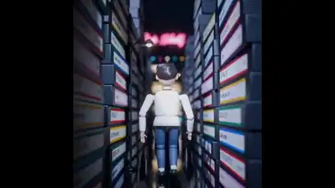</a> 
<b>An ’80s-style music video animated in Blender</b> 
<b>New</b> · <a href="https://x.com/kevin_t_ngo">@kevin_t_ngo</a> · 2:18 · 2026-11-12 
<a href="https://video.twimg.com/amplify_video/2120947367142981632/vid/avc1/2160x2160/JErOSxM1cooLCIA5.mp4?tag=29">▶ Watch</a> · <a href="https://x.com/kevin_t_ngo/status/2120948511038648596">Source</a> · <a href="https://github.com/VibeClip/awesome-fable-5-2-videos/blob/main/docs/videos/en/kevin-t-ngo-2120948511038648596.md">Details</a>

</td>
<td width="33%" valign="top">
 
<b>How four voices form Renaissance counterpoint</b> 
<b>↗ Rising</b> · <a href="https://x.com/imjustnewatai">@imjustnewatai</a> · 1:54 · 2026-11-12 
<a href="https://video.twimg.com/amplify_video/2120668579783737344/vid/avc1/1920x1080/hHADTwaLDxu_Ufzz.mp4?tag=29">▶ Watch</a> · <a href="https://x.com/imjustnewatai/status/2120668771119726698">Source</a> · <a href="https://github.com/VibeClip/awesome-fable-5-2-videos/blob/main/docs/videos/en/imjustnewatai-2120668771119726698.md">Details</a>

</td>
<td width="33%" valign="top">
 
<b>A dawn chorus composed from modeled birdsong</b> 
<b>New</b> · <a href="https://x.com/chetaslua">@chetaslua</a> · 3:31 · 2026-11-11 
<a href="https://video.twimg.com/amplify_video/2120616202565480448/vid/avc1/1920x1080/iaZdDW31ZHgJXkL4.mp4?tag=29">▶ Watch</a> · <a href="https://x.com/chetaslua/status/2120616372434837677">Source</a> · <a href="https://github.com/VibeClip/awesome-fable-5-2-videos/blob/main/docs/videos/en/chetaslua-2120616372434837677.md">Details</a>

</td>
</tr>
<tr>
<td width="33%" valign="top">
 
<b>A sonata played by falling balls</b> 
<b>New</b> · <a href="https://x.com/imjustnewatai">@imjustnewatai</a> · 2:06 · 2026-11-11 
<a href="https://video.twimg.com/amplify_video/2120609142628909056/vid/avc1/1920x1080/HIom3DAvJSv44LtV.mp4?tag=29">▶ Watch</a> · <a href="https://x.com/imjustnewatai/status/2120609268319830027">Source</a> · <a href="https://github.com/VibeClip/awesome-fable-5-2-videos/blob/main/docs/videos/en/imjustnewatai-2120609268319830027.md">Details</a>

</td>
<td width="33%" valign="top">
<a href="https://video.twimg.com/amplify_video/2120561818313576448/vid/avc1/1008x1152/f28Cp0gRI6BQw11T.mp4?tag=29">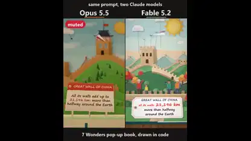</a> 
<b>Seven Wonders as a code-drawn pop-up book</b> 
<b>New</b> · <a href="https://x.com/theoardley">@theoardley</a> · 0:39 · 2026-11-11 
<a href="https://video.twimg.com/amplify_video/2120561818313576448/vid/avc1/1008x1152/f28Cp0gRI6BQw11T.mp4?tag=29">▶ Watch</a> · <a href="https://x.com/theoardley/status/2120561850802929711">Source</a> · <a href="https://github.com/VibeClip/awesome-fable-5-2-videos/blob/main/docs/videos/en/theoardley-2120561850802929711.md">Details</a>

</td>
<td width="33%" valign="top">
<a href="https://video.twimg.com/amplify_video/2120526618925899776/vid/avc1/3596x2084/5KVxtJ0HMeLJ5swp.mp4?tag=29">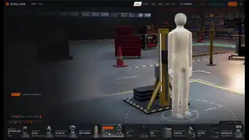</a> 
<b>A virtual hangar for exploring robot assemblies</b> 
<b>New</b> · <a href="https://x.com/0xMovez">@0xMovez</a> · 1:34 · 2026-11-11 
<a href="https://video.twimg.com/amplify_video/2120526618925899776/vid/avc1/3596x2084/5KVxtJ0HMeLJ5swp.mp4?tag=29">▶ Watch</a> · <a href="https://x.com/0xMovez/status/2120526918621515872">Source</a> · <a href="https://github.com/VibeClip/awesome-fable-5-2-videos/blob/main/docs/videos/en/0xmovez-2120526918621515872.md">Details</a>

</td>
</tr>
<tr>
<td width="33%" valign="top">
 
<b>Late Bass Lounge, a bass-led music video</b> 
<b>New</b> · <a href="https://x.com/husky__create">@husky__create</a> · 1:06 · 2026-11-11 
<a href="https://video.twimg.com/amplify_video/2120471865902911488/vid/avc1/1920x1080/_jhdxUBeVUhaF4F4.mp4?tag=16">▶ Watch</a> · <a href="https://x.com/husky__create/status/2120471964787830947">Source</a> · <a href="https://github.com/VibeClip/awesome-fable-5-2-videos/blob/main/docs/videos/en/husky-create-2120471964787830947.md">Details</a>

</td>
<td width="33%" valign="top">
 
<b>From an ant to the scale of the observable universe</b> 
<b>New</b> · <a href="https://x.com/anxuanng">@anxuanng</a> · 0:49 · 2026-11-11 
<a href="https://video.twimg.com/amplify_video/2120441073596354560/vid/avc1/1920x1080/X-fzihrCy46mRyEM.mp4?tag=29">▶ Watch</a> · <a href="https://x.com/anxuanng/status/2120441299568619897">Source</a> · <a href="https://github.com/VibeClip/awesome-fable-5-2-videos/blob/main/docs/videos/en/anxuanng-2120441299568619897.md">Details</a>

</td>
<td width="33%" valign="top">
 
<b>Why do old portraits look so stiff?</b> 
<b>New</b> · <a href="https://x.com/Iamshankhadeep">@Iamshankhadeep</a> · 0:30 · 2026-11-11 
<a href="https://video.twimg.com/amplify_video/2120387994481983489/vid/avc1/1080x1920/c84_bK72bZ_xEuse.mp4?tag=29">▶ Watch</a> · <a href="https://x.com/Iamshankhadeep/status/2120388112606196223">Source</a> · <a href="https://github.com/VibeClip/awesome-fable-5-2-videos/blob/main/docs/videos/en/iamshankhadeep-2120388112606196223.md">Details</a>

</td>
</tr>
<tr>
<td width="33%" valign="top">
 
<b>A symphony structured like a training run</b> 
<a href="https://x.com/imjustnewatai">@imjustnewatai</a> · 2:09 · 2026-11-11 
<a href="https://video.twimg.com/amplify_video/2120383334937210880/vid/avc1/1920x1080/JsmjoUR0KG5ePYKK.mp4?tag=29">▶ Watch</a> · <a href="https://x.com/imjustnewatai/status/2120383964686729410">Source</a> · <a href="https://github.com/VibeClip/awesome-fable-5-2-videos/blob/main/docs/videos/en/imjustnewatai-2120383964686729410.md">Details</a>

</td>
<td width="33%" valign="top">
 
<b>A market-cap race animated with particle trails</b> 
<b>New</b> · <a href="https://x.com/Stargridcompass">@Stargridcompass</a> · 1:00 · 2026-11-11 
<a href="https://video.twimg.com/amplify_video/2120163849806462976/vid/avc1/1920x1080/OMSIT8xlrky2bCi_.mp4?tag=29">▶ Watch</a> · <a href="https://x.com/Stargridcompass/status/2120313054936133751">Source</a> · <a href="https://github.com/VibeClip/awesome-fable-5-2-videos/blob/main/docs/videos/en/stargridcompass-2120313054936133751.md">Details</a>

</td>
<td width="33%" valign="top">
 
<b>A Bay Area history map with a year slider</b> 
<b>↗ Rising</b> · <a href="https://x.com/theojaffee">@theojaffee</a> · 0:33 · 2026-11-11 
<a href="https://video.twimg.com/amplify_video/2120309793521074176/vid/avc1/3024x1590/AI4JHsH3UdoxpUpG.mp4?tag=29">▶ Watch</a> · <a href="https://x.com/theojaffee/status/2120312766544437738">Source</a> · <a href="https://github.com/VibeClip/awesome-fable-5-2-videos/blob/main/docs/videos/en/theojaffee-2120312766544437738.md">Details</a>

</td>
</tr>
<tr>
<td width="33%" valign="top">
 
<b>A lighthouse traces the history of computer graphics</b> 
<a href="https://x.com/aollivier82">@aollivier82</a> · 0:28 · 2026-11-10 
<a href="https://video.twimg.com/amplify_video/2120212244919160832/vid/avc1/1080x1920/wgu0fYjgfK6Xl25p.mp4?tag=29">▶ Watch</a> · <a href="https://x.com/aollivier82/status/2120260208245043663">Source</a> · <a href="https://github.com/VibeClip/awesome-fable-5-2-videos/blob/main/docs/videos/en/aollivier82-2120260208245043663.md">Details</a>

</td>
<td width="33%" valign="top">
 
<b>An Edo-era automaton reconstructed from drawings</b> 
<b>New</b> · <a href="https://x.com/nakazakifam">@nakazakifam</a> · 3:04 · 2026-11-10 
<a href="https://video.twimg.com/amplify_video/2120256332066365440/vid/avc1/1280x720/KXSlCskVGeCf-v47.mp4?tag=29">▶ Watch</a> · <a href="https://x.com/nakazakifam/status/2120257523425103914">Source</a> · <a href="https://github.com/VibeClip/awesome-fable-5-2-videos/blob/main/docs/videos/en/nakazakifam-2120257523425103914.md">Details</a>

</td>
<td width="33%" valign="top">
<a href="https://video.twimg.com/amplify_video/2120238899217776640/vid/avc1/3596x2084/TK9rIF-se0SZ136N.mp4?tag=29">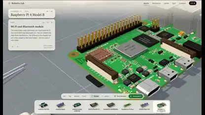</a> 
<b>An interactive 3D electronics workbench</b> 
<a href="https://x.com/0xMovez">@0xMovez</a> · 1:19 · 2026-11-10 
<a href="https://video.twimg.com/amplify_video/2120238899217776640/vid/avc1/3596x2084/TK9rIF-se0SZ136N.mp4?tag=29">▶ Watch</a> · <a href="https://x.com/0xMovez/status/2120239217880268919">Source</a> · <a href="https://github.com/VibeClip/awesome-fable-5-2-videos/blob/main/docs/videos/en/0xmovez-2120239217880268919.md">Details</a>

</td>
</tr>
<tr>
<td width="33%" valign="top">
 
<b>A Three.js explainer of EUV lithography</b> 
<b>New</b> · <a href="https://x.com/miki_code">@miki_code</a> · 1:41 · 2026-11-10 
<a href="https://video.twimg.com/amplify_video/2120217984568381440/vid/avc1/1920x1080/AAOQPmf__6M2zkFO.mp4?tag=29">▶ Watch</a> · <a href="https://x.com/miki_code/status/2120219010860019977">Source</a> · <a href="https://github.com/VibeClip/awesome-fable-5-2-videos/blob/main/docs/videos/en/miki-code-2120219010860019977.md">Details</a>

</td>
<td width="33%" valign="top">
 
<b>A Python still life painted in strokes and scored in code</b> 
<b>New</b> · <a href="https://x.com/wquguru">@wquguru</a> · 0:18 · 2026-11-10 
<a href="https://video.twimg.com/amplify_video/2120175408390012929/vid/avc1/1440x1052/JMkN9Ia1xeiYMFgR.mp4?tag=29">▶ Watch</a> · <a href="https://x.com/wquguru/status/2120177800288378938">Source</a> · <a href="https://github.com/VibeClip/awesome-fable-5-2-videos/blob/main/docs/videos/en/wquguru-2120177800288378938.md">Details</a>

</td>
<td width="33%" valign="top">
 
<b>Six equations in motion</b> 
<b>New</b> · <a href="https://x.com/hkkojima">@hkkojima</a> · 1:07 · 2026-11-10 
<a href="https://video.twimg.com/amplify_video/2120124118414798848/vid/avc1/1280x720/R0wF3MTXikpdyCZC.mp4?tag=14">▶ Watch</a> · <a href="https://x.com/hkkojima/status/2120124260954014152">Source</a> · <a href="https://github.com/VibeClip/awesome-fable-5-2-videos/blob/main/docs/videos/en/hkkojima-2120124260954014152.md">Details</a>

</td>
</tr>
<tr>
<td width="33%" valign="top">
 
<b>A Japanese explainer opens with a galaxy collision</b> 
<b>New</b> · <a href="https://x.com/bide_taro">@bide_taro</a> · 0:38 · 2026-11-10 
<a href="https://video.twimg.com/ext_tw_video/2120118492892643328/pu/vid/avc1/1280x720/3fWpNaTnslgmcWG8.mp4?tag=12">▶ Watch</a> · <a href="https://x.com/bide_taro/status/2120118659540721770">Source</a> · <a href="https://github.com/VibeClip/awesome-fable-5-2-videos/blob/main/docs/videos/en/bide-taro-2120118659540721770.md">Details</a>

</td>
<td width="33%" valign="top">
 
<b>From Zeno&#x27;s halving to a close-up of contact</b> 
<a href="https://x.com/anxuanng">@anxuanng</a> · 0:44 · 2026-11-10 
<a href="https://video.twimg.com/amplify_video/2120088578005098496/vid/avc1/1920x1080/XMPOsp7PKvG1sYn-.mp4?tag=29">▶ Watch</a> · <a href="https://x.com/anxuanng/status/2120088745139638375">Source</a> · <a href="https://github.com/VibeClip/awesome-fable-5-2-videos/blob/main/docs/videos/en/anxuanng-2120088745139638375.md">Details</a>

</td>
<td width="33%" valign="top">
 
<b>26 years of Nasdaq, visualized in motion</b> 
<b>↗ Rising</b> · <a href="https://x.com/Stargridcompass">@Stargridcompass</a> · 1:00 · 2026-11-10 
<a href="https://video.twimg.com/amplify_video/2120081004001988608/vid/avc1/1920x1080/EEY78nPH5McLEfOs.mp4?tag=29">▶ Watch</a> · <a href="https://x.com/Stargridcompass/status/2120082786631516514">Source</a> · <a href="https://github.com/VibeClip/awesome-fable-5-2-videos/blob/main/docs/videos/en/stargridcompass-2120082786631516514.md">Details</a>

</td>
</tr>
<tr>
<td width="33%" valign="top">
 
<b>Mandopop styles across four decades</b> 
<b>↗ Rising</b> · <a href="https://x.com/Gorden_Sun">@Gorden_Sun</a> · 3:51 · 2026-11-10 
<a href="https://video.twimg.com/amplify_video/2120069533562191874/vid/avc1/1920x1080/d-di6uhJPEXGX7js.mp4?tag=29">▶ Watch</a> · <a href="https://x.com/Gorden_Sun/status/2120069883597832595">Source</a> · <a href="https://github.com/VibeClip/awesome-fable-5-2-videos/blob/main/docs/videos/en/gorden-sun-2120069883597832595.md">Details</a>

</td>
<td width="33%" valign="top">
 
<b>Turning a Japanese blog article into a vertical short</b> 
<b>New</b> · <a href="https://x.com/excel_niisan">@excel_niisan</a> · 1:07 · 2026-11-10 
<a href="https://video.twimg.com/amplify_video/2119989522478063616/vid/avc1/1080x1920/TyXn42WY3EwIxhCV.mp4?tag=29">▶ Watch</a> · <a href="https://x.com/excel_niisan/status/2119989558561698090">Source</a> · <a href="https://github.com/VibeClip/awesome-fable-5-2-videos/blob/main/docs/videos/en/excel-niisan-2119989558561698090.md">Details</a>

</td>
<td width="33%" valign="top">
 
<b>A code-rendered English-learning cartoon</b> 
<b>↗ Rising</b> · <a href="https://x.com/linxiaobei888">@linxiaobei888</a> · 2:27 · 2026-11-10 
<a href="https://video.twimg.com/amplify_video/2119974634523344896/vid/avc1/1920x1080/7EzivlAR3lILCLs4.mp4?tag=29">▶ Watch</a> · <a href="https://x.com/linxiaobei888/status/2119978892861829227">Source</a> · <a href="https://github.com/VibeClip/awesome-fable-5-2-videos/blob/main/docs/videos/en/linxiaobei888-2119978892861829227.md">Details</a>

</td>
</tr>
<tr>
<td width="33%" valign="top">
 
<b>A cinematic 3D journey through the history of science</b> 
<b>↗ Rising</b> · <a href="https://x.com/DeryaTR_">@DeryaTR_</a> · 4:56 · 2026-11-10 
<a href="https://video.twimg.com/amplify_video/2119973377255321600/vid/avc1/1920x1080/t4OGlQN-oqpflWYh.mp4?tag=29">▶ Watch</a> · <a href="https://x.com/DeryaTR_/status/2119974354260013293">Source</a> · <a href="https://github.com/VibeClip/awesome-fable-5-2-videos/blob/main/docs/videos/en/deryatr-2119974354260013293.md">Details</a>

📝 View prompt

The creator shared a prompt at the link below. Read it in its original context, with any references and follow-up instructions.

<a href="https://x.com/DeryaTR_/status/2119974354260013293">Read the creator’s prompt</a>

</td>
<td width="33%" valign="top">
<a href="https://video.twimg.com/amplify_video/2119968396469309440/vid/avc1/1920x1080/Q748HuENLMQtMz8O.mp4?tag=29">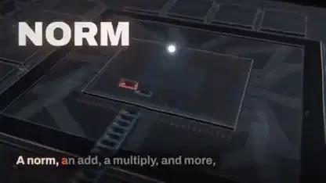</a> 
<b>A music video about megakernels</b> 
<b>↗ Rising</b> · <a href="https://x.com/elliotarledge">@elliotarledge</a> · 2:53 · 2026-11-10 
<a href="https://video.twimg.com/amplify_video/2119968396469309440/vid/avc1/1920x1080/Q748HuENLMQtMz8O.mp4?tag=29">▶ Watch</a> · <a href="https://x.com/elliotarledge/status/2119968762069934415">Source</a> · <a href="https://github.com/VibeClip/awesome-fable-5-2-videos/blob/main/docs/videos/en/elliotarledge-2119968762069934415.md">Details</a>

📝 View prompt

The creator shared a prompt at the link below. Read it in its original context, with any references and follow-up instructions.

<a href="https://x.com/elliotarledge/status/2119968762069934415">Read the creator’s prompt</a>

</td>
<td width="33%" valign="top">
 
<b>A Japanese avatar explainer edited with HyperFrames</b> 
<b>New</b> · <a href="https://x.com/nakazakifam">@nakazakifam</a> · 0:34 · 2026-11-10 
<a href="https://video.twimg.com/amplify_video/2119946393565450240/vid/avc1/1920x1080/Jt_-E4yC0PiI2m2M.mp4?tag=29">▶ Watch</a> · <a href="https://x.com/nakazakifam/status/2119946561941606493">Source</a> · <a href="https://github.com/VibeClip/awesome-fable-5-2-videos/blob/main/docs/videos/en/nakazakifam-2119946561941606493.md">Details</a>

</td>
</tr>
<tr>
<td width="33%" valign="top">
 
<b>A visual history of writing</b> 
<b>↗ Rising</b> · <a href="https://x.com/rileybrown">@rileybrown</a> · 1:36 · 2026-11-10 
<a href="https://video.twimg.com/amplify_video/2119945592977653760/vid/avc1/3840x2160/foNEVBH2Khao6Dd6.mp4?tag=29">▶ Watch</a> · <a href="https://x.com/rileybrown/status/2119946022767980985">Source</a> · <a href="https://github.com/VibeClip/awesome-fable-5-2-videos/blob/main/docs/videos/en/rileybrown-2119946022767980985.md">Details</a>

</td>
<td width="33%" valign="top">
 
<b>An explorable nuclear reactor in Three.js</b> 
<b>↗ Rising</b> · <a href="https://x.com/konstantinsaifo">@konstantinsaifo</a> · 0:36 · 2026-11-09 
<a href="https://video.twimg.com/amplify_video/2119941576290185217/vid/avc1/1920x1080/doJzvrUuyB86Ednp.mp4?tag=29">▶ Watch</a> · <a href="https://x.com/konstantinsaifo/status/2119941967136379334">Source</a> · <a href="https://github.com/VibeClip/awesome-fable-5-2-videos/blob/main/docs/videos/en/konstantinsaifo-2119941967136379334.md">Details</a>

📝 View prompt

The creator shared a prompt at the link below. Read it in its original context, with any references and follow-up instructions.

<a href="https://x.com/konstantinsaifo/status/2119941967136379334">Read the creator’s prompt</a>

</td>
<td width="33%" valign="top">
 
<b>A piano sonata, from score to video</b> 
<b>↗ Rising</b> · <a href="https://x.com/imjustnewatai">@imjustnewatai</a> · 2:51 · 2026-11-09 
<a href="https://video.twimg.com/amplify_video/2119919333140840449/vid/avc1/1920x1080/125Re1yzvUQndyX4.mp4?tag=29">▶ Watch</a> · <a href="https://x.com/imjustnewatai/status/2119919644836347926">Source</a> · <a href="https://github.com/VibeClip/awesome-fable-5-2-videos/blob/main/docs/videos/en/imjustnewatai-2119919644836347926.md">Details</a>

</td>
</tr>
<tr>
<td width="33%" valign="top">
 
<b>Convex, explained in motion</b> 
<b>↗ Rising</b> · <a href="https://x.com/Rasmic">@Rasmic</a> · 4:08 · 2026-11-09 
<a href="https://video.twimg.com/amplify_video/2119919371401244672/vid/avc1/1920x1080/yS6Kbc5l0NBv4N40.mp4?tag=29">▶ Watch</a> · <a href="https://x.com/Rasmic/status/2119919466163093768">Source</a> · <a href="https://github.com/VibeClip/awesome-fable-5-2-videos/blob/main/docs/videos/en/rasmic-2119919466163093768.md">Details</a>

</td>
<td width="33%" valign="top">
 
<b>A synthesizer that sings from scratch</b> 
<a href="https://x.com/higgsfield_ai">@higgsfield_ai</a> · 0:50 · 2026-11-09 
<a href="https://video.twimg.com/amplify_video/2119906799151448064/vid/avc1/1440x1080/nfRvSZRf-lGyoO3k.mp4?tag=29">▶ Watch</a> · <a href="https://x.com/higgsfield_ai/status/2119907675265987047">Source</a> · <a href="https://github.com/VibeClip/awesome-fable-5-2-videos/blob/main/docs/videos/en/higgsfield-ai-987047.md">Details</a>

</td>
<td width="33%" valign="top">
 
<b>Why the sky is blue, explained in Japanese</b> 
<a href="https://x.com/yzr_koba">@yzr_koba</a> · 0:55 · 2026-11-09 
<a href="https://video.twimg.com/amplify_video/2119907073026899968/vid/avc1/1920x1080/fJ7CuLzKleGXCpkO.mp4?tag=29">▶ Watch</a> · <a href="https://x.com/yzr_koba/status/2119907670077722932">Source</a> · <a href="https://github.com/VibeClip/awesome-fable-5-2-videos/blob/main/docs/videos/en/yzr-koba-722932.md">Details</a>

</td>
</tr>
<tr>
<td width="33%" valign="top">
 
<b>Four years of ChatGPT in one birthday film</b> 
<a href="https://x.com/Khazix0918">@Khazix0918</a> · 0:58 · 2026-11-09 
<a href="https://video.twimg.com/amplify_video/2119899444233863168/vid/avc1/1920x1080/hqqYkpi27k2cdXpg.mp4?tag=29">▶ Watch</a> · <a href="https://x.com/Khazix0918/status/2119902325460590834">Source</a> · <a href="https://github.com/VibeClip/awesome-fable-5-2-videos/blob/main/docs/videos/en/khazix0918-590834.md">Details</a>

</td>
<td width="33%" valign="top">
 
<b>An egg timer rebuilt from a single photo</b> 
<a href="https://x.com/TekonBurns">@TekonBurns</a> · 0:23 · 2026-11-09 
<a href="https://video.twimg.com/amplify_video/2119899446242918400/vid/avc1/1080x1350/S8_fma1a1es6Q4Tt.mp4?tag=29">▶ Watch</a> · <a href="https://x.com/TekonBurns/status/2119900328212713872">Source</a> · <a href="https://github.com/VibeClip/awesome-fable-5-2-videos/blob/main/docs/videos/en/tekonburns-713872.md">Details</a>

</td>
<td width="33%" valign="top">
 
<b>Spoken thoughts on a blog post, turned into a video</b> 
<a href="https://x.com/buriedstupidity">@buriedstupidity</a> · 1:30 · 2026-11-09 
<a href="https://video.twimg.com/amplify_video/2119899879652876288/vid/avc1/1920x1080/Km5pgtjQ970n5n9b.mp4?tag=29">▶ Watch</a> · <a href="https://x.com/buriedstupidity/status/2119900194540322870">Source</a> · <a href="https://github.com/VibeClip/awesome-fable-5-2-videos/blob/main/docs/videos/en/buriedstupidity-322870.md">Details</a>

</td>
</tr>
<tr>
<td width="33%" valign="top">
 
<b>A zoetrope spun to life</b> 
<a href="https://x.com/dfeinition">@dfeinition</a> · 0:21 · 2026-11-09 
<a href="https://video.twimg.com/amplify_video/2119891672477679616/vid/avc1/2160x2160/L-CIBp2qNeTMs0hj.mp4?tag=29">▶ Watch</a> · <a href="https://x.com/dfeinition/status/2119892210376176088">Source</a> · <a href="https://github.com/VibeClip/awesome-fable-5-2-videos/blob/main/docs/videos/en/dfeinition-176088.md">Details</a>

</td>
<td width="33%" valign="top">
 
<b>Claymation rendered entirely in 3D</b> 
<a href="https://x.com/dfeinition">@dfeinition</a> · 0:20 · 2026-11-09 
<a href="https://video.twimg.com/amplify_video/2119891424564895744/vid/avc1/2160x2160/cw5WN1voZQCaOihD.mp4?tag=29">▶ Watch</a> · <a href="https://x.com/dfeinition/status/2119892208937517201">Source</a> · <a href="https://github.com/VibeClip/awesome-fable-5-2-videos/blob/main/docs/videos/en/dfeinition-517201.md">Details</a>

</td>
<td width="33%" valign="top">
 
<b>How a folding phone hinge works</b> 
<a href="https://x.com/Avenoxai">@Avenoxai</a> · 1:00 · 2026-11-09 
<a href="https://video.twimg.com/amplify_video/2119891178682228736/vid/avc1/1920x1080/2q3_mQw6ZalpiaQz.mp4?tag=29">▶ Watch</a> · <a href="https://x.com/Avenoxai/status/2119891378352058821">Source</a> · <a href="https://github.com/VibeClip/awesome-fable-5-2-videos/blob/main/docs/videos/en/avenoxai-058821.md">Details</a>

</td>
</tr>
<tr>
<td width="33%" valign="top">
 
<b>What people feel in the age of AI</b> 
<a href="https://x.com/nottherajyk">@nottherajyk</a> · 0:44 · 2026-11-09 
<a href="https://video.twimg.com/amplify_video/2119889834751971328/vid/avc1/1280x720/FWYrwhFrNDz1DaVJ.mp4?tag=14">▶ Watch</a> · <a href="https://x.com/nottherajyk/status/2119890840067985571">Source</a> · <a href="https://github.com/VibeClip/awesome-fable-5-2-videos/blob/main/docs/videos/en/nottherajyk-985571.md">Details</a>

</td>
<td width="33%" valign="top">
 
<b>What if the Moon were ten feet from Earth</b> 
<a href="https://x.com/ashen_one">@ashen_one</a> · 1:00 · 2026-11-09 
<a href="https://video.twimg.com/amplify_video/2119889619286110208/vid/avc1/1080x1920/IG9or_uQyshexjHE.mp4?tag=29">▶ Watch</a> · <a href="https://x.com/ashen_one/status/2119889741600424363">Source</a> · <a href="https://github.com/VibeClip/awesome-fable-5-2-videos/blob/main/docs/videos/en/ashen-one-424363.md">Details</a>

</td>
<td width="33%" valign="top">
 
<b>Inside a TPU chip, layer by layer</b> 
<a href="https://x.com/SPAC89">@SPAC89</a> · 0:50 · 2026-11-09 
<a href="https://video.twimg.com/amplify_video/2119888023231844352/vid/avc1/1920x1080/bMAfu17GqdoH9jlN.mp4?tag=29">▶ Watch</a> · <a href="https://x.com/SPAC89/status/2119888738595770843">Source</a> · <a href="https://github.com/VibeClip/awesome-fable-5-2-videos/blob/main/docs/videos/en/spac89-770843.md">Details</a>

</td>
</tr>
<tr>
<td width="33%" valign="top">
 
<b>A pixel quest about the Fable 5.2 launch</b> 
<a href="https://x.com/thetansen">@thetansen</a> · 0:56 · 2026-11-09 
<a href="https://video.twimg.com/amplify_video/2119885999660843008/vid/avc1/1080x1920/FNwRCB0RWB6YcNpv.mp4?tag=29">▶ Watch</a> · <a href="https://x.com/thetansen/status/2119886204716134791">Source</a> · <a href="https://github.com/VibeClip/awesome-fable-5-2-videos/blob/main/docs/videos/en/thetansen-134791.md">Details</a>

</td>
<td width="33%" valign="top">
 
<b>How a film smashed a real 747</b> 
<a href="https://x.com/charan_kilari">@charan_kilari</a> · 0:25 · 2026-11-09 
<a href="https://video.twimg.com/amplify_video/2119883996436082688/vid/avc1/1080x1920/vnjdC4iD158qDzXz.mp4?tag=29">▶ Watch</a> · <a href="https://x.com/charan_kilari/status/2119884295179538680">Source</a> · <a href="https://github.com/VibeClip/awesome-fable-5-2-videos/blob/main/docs/videos/en/charan-kilari-538680.md">Details</a>

</td>
<td width="33%" valign="top">
 
<b>A Bach-style chorale in G minor</b> 
<a href="https://x.com/aug5thmusic">@aug5thmusic</a> · 0:45 · 2026-11-09 
<a href="https://video.twimg.com/amplify_video/2119875528337555456/vid/avc1/1920x1080/QNFaHTtARFp56_Bb.mp4?tag=29">▶ Watch</a> · <a href="https://x.com/aug5thmusic/status/2119879319426404780">Source</a> · <a href="https://github.com/VibeClip/awesome-fable-5-2-videos/blob/main/docs/videos/en/aug5thmusic-404780.md">Details</a>

📝 View prompt

The creator shared a prompt at the link below. Read it in its original context, with any references and follow-up instructions.

<a href="https://x.com/aug5thmusic/status/2119879973318414392">Read the creator’s prompt</a>

</td>
</tr>
<tr>
<td width="33%" valign="top">
 
<b>Porting a path tracer to WebGPU</b> 
<a href="https://x.com/aidanshandle">@aidanshandle</a> · 1:36 · 2026-11-09 
<a href="https://video.twimg.com/amplify_video/2119879169731645440/vid/avc1/1280x720/Bh3U2lhMYgX9-Vb0.mp4?tag=29">▶ Watch</a> · <a href="https://x.com/aidanshandle/status/2119879273196761464">Source</a> · <a href="https://github.com/VibeClip/awesome-fable-5-2-videos/blob/main/docs/videos/en/aidanshandle-761464.md">Details</a>

</td>
<td width="33%" valign="top">
 
<b>How game characters blend their moves</b> 
<a href="https://x.com/dfeinition">@dfeinition</a> · 1:00 · 2026-11-09 
<a href="https://video.twimg.com/amplify_video/2119870421478567936/vid/avc1/3840x2160/G6_gpxpBs-4beNTY.mp4?tag=29">▶ Watch</a> · <a href="https://x.com/dfeinition/status/2119870838606381391">Source</a> · <a href="https://github.com/VibeClip/awesome-fable-5-2-videos/blob/main/docs/videos/en/dfeinition-381391.md">Details</a>

</td>
<td width="33%" valign="top">
 
<b>A compiler that runs code in the Game of Life</b> 
<a href="https://x.com/maxleiter">@maxleiter</a> · 1:01 · 2026-11-09 
<a href="https://video.twimg.com/amplify_video/2119868875127087104/vid/avc1/1280x720/VhIfEqbHcpwlznir.mp4?tag=14">▶ Watch</a> · <a href="https://x.com/maxleiter/status/2119869170871652487">Source</a> · <a href="https://github.com/VibeClip/awesome-fable-5-2-videos/blob/main/docs/videos/en/maxleiter-652487.md">Details</a>

</td>
</tr>
<tr>
<td width="33%" valign="top">
 
<b>How language models work, in motion</b> 
<b>↗ Rising</b> · <a href="https://x.com/MatthewBerman">@MatthewBerman</a> · 0:50 · 2026-11-09 
<a href="https://video.twimg.com/amplify_video/2119868088091017217/vid/avc1/1920x1080/5TB7-RiWDIUPCxdO.mp4?tag=29">▶ Watch</a> · <a href="https://x.com/MatthewBerman/status/2119868633086378471">Source</a> · <a href="https://github.com/VibeClip/awesome-fable-5-2-videos/blob/main/docs/videos/en/matthewberman-2119868633086378471.md">Details</a>

</td>
<td width="33%" valign="top">
 
<b>A nationwide water safety map</b> 
<a href="https://x.com/alliekmiller">@alliekmiller</a> · 1:22 · 2026-11-09 
<a href="https://video.twimg.com/amplify_video/2119669941263597569/vid/avc1/1920x1080/h6JslKeeBV8e7IAn.mp4?tag=29">▶ Watch</a> · <a href="https://x.com/alliekmiller/status/2119868629818757417">Source</a> · <a href="https://github.com/VibeClip/awesome-fable-5-2-videos/blob/main/docs/videos/en/alliekmiller-757417.md">Details</a>

</td>
<td width="33%"></td>
</tr>
</table>

## Games & Interactive Creations · 66

Browser games, playable worlds, creative tools and interactive interface design.

<table>
<tr>
<td width="33%" valign="top">
 
<b>A hang-gliding game above a patchwork island</b> 
<b>New</b> · <a href="https://x.com/loktar00">@loktar00</a> · 1:00 · 2026-11-12 
<a href="https://video.twimg.com/amplify_video/2121003810583683072/vid/avc1/1920x1080/ez-WbJx3u3EpJRds.mp4?tag=29">▶ Watch</a> · <a href="https://x.com/loktar00/status/2121005021131083851">Source</a> · <a href="https://github.com/VibeClip/awesome-fable-5-2-videos/blob/main/docs/videos/en/loktar00-2121005021131083851.md">Details</a>

</td>
<td width="33%" valign="top">
 
<b>Farewell Light, a stormy lighthouse game demo</b> 
<b>New</b> · <a href="https://x.com/RyanSael">@RyanSael</a> · 2:25 · 2026-11-12 
<a href="https://video.twimg.com/amplify_video/2120694422136647680/vid/avc1/1706x1080/cuxS5q7B87MFwq6W.mp4?tag=29">▶ Watch</a> · <a href="https://x.com/RyanSael/status/2120695866684231998">Source</a> · <a href="https://github.com/VibeClip/awesome-fable-5-2-videos/blob/main/docs/videos/en/ryansael-2120695866684231998.md">Details</a>

</td>
<td width="33%" valign="top">
 
<b>A snowy 3D action game in one HTML file</b> 
<a href="https://x.com/op7418">@op7418</a> · 1:06 · 2026-11-12 
<a href="https://video.twimg.com/amplify_video/2120692796327968768/vid/avc1/2134x1080/IgnOSwRg5XNSEAmN.mp4?tag=29">▶ Watch</a> · <a href="https://x.com/op7418/status/2120694045299327187">Source</a> · <a href="https://github.com/VibeClip/awesome-fable-5-2-videos/blob/main/docs/videos/en/op7418-2120694045299327187.md">Details</a>

</td>
</tr>
<tr>
<td width="33%" valign="top">
 
<b>COO, a bird’s-eye trailer for a living Toronto</b> 
<b>New</b> · <a href="https://x.com/yegor">@yegor</a> · 1:13 · 2026-11-12 
<a href="https://video.twimg.com/amplify_video/2120684600557006848/vid/avc1/1920x1080/VEcNvdW3v6fKtdCn.mp4?tag=29">▶ Watch</a> · <a href="https://x.com/yegor/status/2120689760595276193">Source</a> · <a href="https://github.com/VibeClip/awesome-fable-5-2-videos/blob/main/docs/videos/en/yegor-2120689760595276193.md">Details</a>

</td>
<td width="33%" valign="top">
 
<b>A neon street-racing game with drift and boost</b> 
<b>New</b> · <a href="https://x.com/Stargridcompass">@Stargridcompass</a> · 1:16 · 2026-11-12 
<a href="https://video.twimg.com/amplify_video/2120566485575712768/vid/avc1/1920x1080/1or0Ua87gzV00NkA.mp4?tag=29">▶ Watch</a> · <a href="https://x.com/Stargridcompass/status/2120675441677672879">Source</a> · <a href="https://github.com/VibeClip/awesome-fable-5-2-videos/blob/main/docs/videos/en/stargridcompass-2120675441677672879.md">Details</a>

</td>
<td width="33%" valign="top">
<a href="https://video.twimg.com/amplify_video/2120439724712030209/vid/avc1/1920x1080/xstfn4yqcQkOA9s2.mp4?tag=29">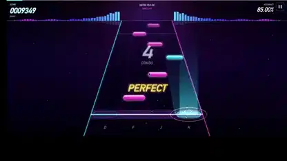</a> 
<b>A four-lane rhythm game with live combo feedback</b> 
<b>New</b> · <a href="https://x.com/Stargridcompass">@Stargridcompass</a> · 1:26 · 2026-11-11 
<a href="https://video.twimg.com/amplify_video/2120439724712030209/vid/avc1/1920x1080/xstfn4yqcQkOA9s2.mp4?tag=29">▶ Watch</a> · <a href="https://x.com/Stargridcompass/status/2120446433358692440">Source</a> · <a href="https://github.com/VibeClip/awesome-fable-5-2-videos/blob/main/docs/videos/en/stargridcompass-2120446433358692440.md">Details</a>

</td>
</tr>
<tr>
<td width="33%" valign="top">
<a href="https://video.twimg.com/amplify_video/2120382863388590080/vid/avc1/720x1080/e1jp6XnSJ5Ia2UVw.mp4?tag=29">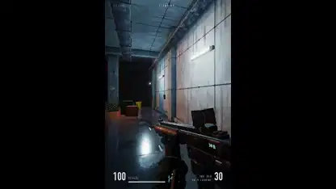</a> 
<b>SUBLEVEL 07, a single-file browser game</b> 
<b>New</b> · <a href="https://x.com/wquguru">@wquguru</a> · 0:15 · 2026-11-11 
<a href="https://video.twimg.com/amplify_video/2120382863388590080/vid/avc1/720x1080/e1jp6XnSJ5Ia2UVw.mp4?tag=29">▶ Watch</a> · <a href="https://x.com/wquguru/status/2120383332722905400">Source</a> · <a href="https://github.com/VibeClip/awesome-fable-5-2-videos/blob/main/docs/videos/en/wquguru-2120383332722905400.md">Details</a>

📝 View prompt

The creator shared a prompt at the link below. Read it in its original context, with any references and follow-up instructions.

<a href="https://x.com/i/article/2120373697840316416">Read the creator’s prompt</a>

</td>
<td width="33%" valign="top">
 
<b>A brushstroke-rendered forest game in the browser</b> 
<a href="https://x.com/BlendiByl">@BlendiByl</a> · 0:16 · 2026-11-11 
<a href="https://video.twimg.com/amplify_video/2120339928337031168/vid/avc1/2560x1440/efsgZg5CNfhT9tWC.mp4?tag=29">▶ Watch</a> · <a href="https://x.com/BlendiByl/status/2120341251178594532">Source</a> · <a href="https://github.com/VibeClip/awesome-fable-5-2-videos/blob/main/docs/videos/en/blendibyl-2120341251178594532.md">Details</a>

</td>
<td width="33%" valign="top">
 
<b>An impossible-spaces walkthrough through shifting rooms</b> 
<b>New</b> · <a href="https://x.com/BlendiByl">@BlendiByl</a> · 0:53 · 2026-11-11 
<a href="https://video.twimg.com/amplify_video/2120313933710159872/vid/avc1/2560x1440/PKe7dLlC4bVyp-Y-.mp4?tag=29">▶ Watch</a> · <a href="https://x.com/BlendiByl/status/2120314459793355262">Source</a> · <a href="https://github.com/VibeClip/awesome-fable-5-2-videos/blob/main/docs/videos/en/blendibyl-2120314459793355262.md">Details</a>

</td>
</tr>
<tr>
<td width="33%" valign="top">
 
<b>A city flyover from an open-world game prototype</b> 
<a href="https://x.com/mattshumer_">@mattshumer_</a> · 1:04 · 2026-11-10 
<a href="https://video.twimg.com/amplify_video/2120282020399984640/vid/avc1/1920x1080/ajQOizdMhg4SwqVj.mp4?tag=29">▶ Watch</a> · <a href="https://x.com/mattshumer_/status/2120282133503820150">Source</a> · <a href="https://github.com/VibeClip/awesome-fable-5-2-videos/blob/main/docs/videos/en/mattshumer-2120282133503820150.md">Details</a>

</td>
<td width="33%" valign="top">
 
<b>Age of Dragon, an open-world RPG showcase</b> 
<a href="https://x.com/M__Houser">@M__Houser</a> · 1:56 · 2026-11-10 
<a href="https://video.twimg.com/amplify_video/2120253027571601408/vid/avc1/1898x1080/P8E_h3btMpQ54LCL.mp4?tag=16">▶ Watch</a> · <a href="https://x.com/M__Houser/status/2120253236309569696">Source</a> · <a href="https://github.com/VibeClip/awesome-fable-5-2-videos/blob/main/docs/videos/en/m-houser-2120253236309569696.md">Details</a>

</td>
<td width="33%" valign="top">
 
<b>Dread &amp; District, a fantasy transit game</b> 
<b>↗ Rising</b> · <a href="https://x.com/emollick">@emollick</a> · 0:19 · 2026-11-10 
<a href="https://video.twimg.com/amplify_video/2120248122982985728/vid/avc1/1144x1076/1Aa5_PvPzNWweA5Q.mp4?tag=29">▶ Watch</a> · <a href="https://x.com/emollick/status/2120248525254742318">Source</a> · <a href="https://github.com/VibeClip/awesome-fable-5-2-videos/blob/main/docs/videos/en/emollick-2120248525254742318.md">Details</a>

</td>
</tr>
<tr>
<td width="33%" valign="top">
 
<b>A dark-fantasy boss fight in the browser</b> 
<a href="https://x.com/kevin_t_ngo">@kevin_t_ngo</a> · 2:18 · 2026-11-10 
<a href="https://video.twimg.com/amplify_video/2120233931744391168/vid/avc1/1920x1080/qbytKTQjkq4MuaXz.mp4?tag=29">▶ Watch</a> · <a href="https://x.com/kevin_t_ngo/status/2120238844754923874">Source</a> · <a href="https://github.com/VibeClip/awesome-fable-5-2-videos/blob/main/docs/videos/en/kevin-t-ngo-2120238844754923874.md">Details</a>

</td>
<td width="33%" valign="top">
 
<b>A torch-lit squad combat game demo</b> 
<a href="https://x.com/loktar00">@loktar00</a> · 1:08 · 2026-11-10 
<a href="https://video.twimg.com/amplify_video/2120187656881516544/vid/avc1/1920x1080/YPzyBVlvXVwBta44.mp4?tag=29">▶ Watch</a> · <a href="https://x.com/loktar00/status/2120192761542615271">Source</a> · <a href="https://github.com/VibeClip/awesome-fable-5-2-videos/blob/main/docs/videos/en/loktar00-2120192761542615271.md">Details</a>

</td>
<td width="33%" valign="top">
 
<b>FLATROOMS V0.1 showcase video</b> 
<b>↗ Rising</b> · <a href="https://x.com/teortaxesTex">@teortaxesTex</a> · 0:52 · 2026-11-10 
<a href="https://video.twimg.com/amplify_video/2120189727152230400/vid/avc1/1920x1080/773Fe7f-xdoEUjp2.mp4?tag=29">▶ Watch</a> · <a href="https://x.com/teortaxesTex/status/2120189862162657753">Source</a> · <a href="https://github.com/VibeClip/awesome-fable-5-2-videos/blob/main/docs/videos/en/teortaxestex-2120189862162657753.md">Details</a>

</td>
</tr>
<tr>
<td width="33%" valign="top">
 
<b>Rooftop Rally, a pickleball game at golden hour</b> 
<b>↗ Rising</b> · <a href="https://x.com/chongdashu">@chongdashu</a> · 0:49 · 2026-11-10 
<a href="https://video.twimg.com/amplify_video/2120154381584838656/vid/avc1/1920x1080/mRePQbLcVWXqKTsY.mp4?tag=29">▶ Watch</a> · <a href="https://x.com/chongdashu/status/2120154573356793883">Source</a> · <a href="https://github.com/VibeClip/awesome-fable-5-2-videos/blob/main/docs/videos/en/chongdashu-2120154573356793883.md">Details</a>

</td>
<td width="33%" valign="top">
 
<b>A WebGPU water tank with shattering glass</b> 
<b>↗ Rising</b> · <a href="https://x.com/sara_kumodeck">@sara_kumodeck</a> · 0:15 · 2026-11-10 
<a href="https://video.twimg.com/amplify_video/2120127605894701057/vid/avc1/1920x1080/vmX1EZ4VHCC4dij2.mp4?tag=29">▶ Watch</a> · <a href="https://x.com/sara_kumodeck/status/2120127706675417428">Source</a> · <a href="https://github.com/VibeClip/awesome-fable-5-2-videos/blob/main/docs/videos/en/sara-kumodeck-2120127706675417428.md">Details</a>

</td>
<td width="33%" valign="top">
 
<b>Sit With Her, an Unreal Engine horror game demo</b> 
<a href="https://x.com/_MaxBlade">@_MaxBlade</a> · 2:01 · 2026-11-10 
<a href="https://video.twimg.com/amplify_video/2120109165393715200/vid/avc1/1920x1080/nJhRHKUF8oxEnIPb.mp4?tag=29">▶ Watch</a> · <a href="https://x.com/_MaxBlade/status/2120109725740159390">Source</a> · <a href="https://github.com/VibeClip/awesome-fable-5-2-videos/blob/main/docs/videos/en/maxblade-2120109725740159390.md">Details</a>

</td>
</tr>
<tr>
<td width="33%" valign="top">
 
<b>Interactive ink painting driven by typed words</b> 
<b>↗ Rising</b> · <a href="https://x.com/op7418">@op7418</a> · 1:06 · 2026-11-10 
<a href="https://video.twimg.com/amplify_video/2120084094549987328/vid/avc1/1920x1080/ZIT4h5bEZdMnBsHV.mp4?tag=29">▶ Watch</a> · <a href="https://x.com/op7418/status/2120085300185833878">Source</a> · <a href="https://github.com/VibeClip/awesome-fable-5-2-videos/blob/main/docs/videos/en/op7418-2120085300185833878.md">Details</a>

</td>
<td width="33%" valign="top">
 
<b>BRYCEBALL: a renderer turned into a game</b> 
<b>↗ Rising</b> · <a href="https://x.com/pleometric">@pleometric</a> · 1:19 · 2026-11-10 
<a href="https://video.twimg.com/amplify_video/2119973140008726528/vid/avc1/1728x1002/cAU-dap7QOqUYxWD.mp4?tag=29">▶ Watch</a> · <a href="https://x.com/pleometric/status/2119973274402668852">Source</a> · <a href="https://github.com/VibeClip/awesome-fable-5-2-videos/blob/main/docs/videos/en/pleometric-2119973274402668852.md">Details</a>

📝 View prompt

The creator shared a prompt at the link below. Read it in its original context, with any references and follow-up instructions.

<a href="https://x.com/pleometric/status/2119973274402668852">Read the creator’s prompt</a>

</td>
<td width="33%" valign="top">
 
<b>The Backrooms, played as the monster</b> 
<b>↗ Rising</b> · <a href="https://x.com/LexnLin">@LexnLin</a> · 0:45 · 2026-11-10 
<a href="https://video.twimg.com/amplify_video/2119959903062183936/vid/avc1/1280x720/X10eV4fLngmXri42.mp4?tag=29">▶ Watch</a> · <a href="https://x.com/LexnLin/status/2119966127149429093">Source</a> · <a href="https://github.com/VibeClip/awesome-fable-5-2-videos/blob/main/docs/videos/en/lexnlin-2119966127149429093.md">Details</a>

</td>
</tr>
<tr>
<td width="33%" valign="top">
 
<b>A proving ground for four game-machine concepts</b> 
<b>↗ Rising</b> · <a href="https://x.com/techartist_">@techartist_</a> · 0:20 · 2026-11-10 
<a href="https://video.twimg.com/amplify_video/2119922739230445568/vid/avc1/1920x1080/1eCM-Y_xZwPgP5Pv.mp4?tag=29">▶ Watch</a> · <a href="https://x.com/techartist_/status/2119946891106394518">Source</a> · <a href="https://github.com/VibeClip/awesome-fable-5-2-videos/blob/main/docs/videos/en/techartist-2119946891106394518.md">Details</a>

</td>
<td width="33%" valign="top">
 
<b>Worm Rider, a code-built desert game</b> 
<b>↗ Rising</b> · <a href="https://x.com/AmirMushich">@AmirMushich</a> · 0:22 · 2026-11-09 
<a href="https://video.twimg.com/amplify_video/2119936256498962432/vid/avc1/1920x1080/pYXo58uow7BeKq9v.mp4?tag=29">▶ Watch</a> · <a href="https://x.com/AmirMushich/status/2119937977426338283">Source</a> · <a href="https://github.com/VibeClip/awesome-fable-5-2-videos/blob/main/docs/videos/en/amirmushich-2119937977426338283.md">Details</a>

</td>
<td width="33%" valign="top">
 
<b>A portal-based arena shooter</b> 
<a href="https://x.com/_sholtodouglas">@_sholtodouglas</a> · 1:11 · 2026-11-09 
<a href="https://video.twimg.com/amplify_video/2119935171541831680/vid/avc1/1280x720/xSA0i-YfHsQC-kLT.mp4?tag=29">▶ Watch</a> · <a href="https://x.com/_sholtodouglas/status/2119935331499925557">Source</a> · <a href="https://github.com/VibeClip/awesome-fable-5-2-videos/blob/main/docs/videos/en/sholtodouglas-2119935331499925557.md">Details</a>

</td>
</tr>
<tr>
<td width="33%" valign="top">
 
<b>A new run at Fishslop</b> 
<a href="https://x.com/theo">@theo</a> · 1:17 · 2026-11-09 
<a href="https://video.twimg.com/amplify_video/2119926035043237888/vid/avc1/1568x1080/6oTKgoLPQHeLU1Q7.mp4?tag=29">▶ Watch</a> · <a href="https://x.com/theo/status/2119926277801144695">Source</a> · <a href="https://github.com/VibeClip/awesome-fable-5-2-videos/blob/main/docs/videos/en/theo-2119926277801144695.md">Details</a>

</td>
<td width="33%" valign="top">
 
<b>Saltline, a first-person game in a rainy cargo port</b> 
<a href="https://x.com/felixrieseberg">@felixrieseberg</a> · 1:12 · 2026-11-09 
<a href="https://video.twimg.com/amplify_video/2119919821538447360/vid/avc1/3648x2022/y1dhMLmyKZ-oidQ6.mp4?tag=29">▶ Watch</a> · <a href="https://x.com/felixrieseberg/status/2119925633564463609">Source</a> · <a href="https://github.com/VibeClip/awesome-fable-5-2-videos/blob/main/docs/videos/en/felixrieseberg-2119925633564463609.md">Details</a>

📝 View prompt

The creator shared a prompt at the link below. Read it in its original context, with any references and follow-up instructions.

<a href="https://x.com/felixrieseberg/status/2119927483994907024">Read the creator’s prompt</a>

</td>
<td width="33%" valign="top">
 
<b>An endless journey through connected worlds</b> 
<b>↗ Rising</b> · <a href="https://x.com/emollick">@emollick</a> · 1:10 · 2026-11-09 
<a href="https://video.twimg.com/amplify_video/2119916822719840256/vid/avc1/1280x720/lEbniPMiC8aWDbWF.mp4?tag=29">▶ Watch</a> · <a href="https://x.com/emollick/status/2119918307457577163">Source</a> · <a href="https://github.com/VibeClip/awesome-fable-5-2-videos/blob/main/docs/videos/en/emollick-2119918307457577163.md">Details</a>

</td>
</tr>
<tr>
<td width="33%" valign="top">
 
<b>Da Vinci&#x27;s notebook becomes interactive</b> 
<b>↗ Rising</b> · <a href="https://x.com/alexalbert__">@alexalbert__</a> · 0:25 · 2026-11-09 
<a href="https://video.twimg.com/amplify_video/2119916917502926849/vid/avc1/1080x1350/LDBsZC4Ong-7XOt4.mp4?tag=16">▶ Watch</a> · <a href="https://x.com/alexalbert__/status/2119916954337349737">Source</a> · <a href="https://github.com/VibeClip/awesome-fable-5-2-videos/blob/main/docs/videos/en/alexalbert-2119916954337349737.md">Details</a>

</td>
<td width="33%" valign="top">
 
<b>A Roblox horror game with its own trailer</b> 
<a href="https://x.com/mihawkxxxxx">@mihawkxxxxx</a> · 0:54 · 2026-11-09 
<a href="https://video.twimg.com/amplify_video/2119909172820979712/vid/avc1/1920x1080/P7SbkhLDRCMxZ--E.mp4?tag=29">▶ Watch</a> · <a href="https://x.com/mihawkxxxxx/status/2119909865296699749">Source</a> · <a href="https://github.com/VibeClip/awesome-fable-5-2-videos/blob/main/docs/videos/en/mihawkxxxxx-699749.md">Details</a>

</td>
<td width="33%" valign="top">
 
<b>A toy-room adventure game</b> 
<a href="https://x.com/itssotsot">@itssotsot</a> · 1:35 · 2026-11-09 
<a href="https://video.twimg.com/amplify_video/2119906798345818112/vid/avc1/3840x1950/dpgHMhE-Gqz3Kf9j.mp4?tag=29">▶ Watch</a> · <a href="https://x.com/itssotsot/status/2119909017216491720">Source</a> · <a href="https://github.com/VibeClip/awesome-fable-5-2-videos/blob/main/docs/videos/en/itssotsot-491720.md">Details</a>

</td>
</tr>
<tr>
<td width="33%" valign="top">
 
<b>A deep-dive volume slider with an ocean inside</b> 
<a href="https://x.com/Elizaveta_ai">@Elizaveta_ai</a> · 0:51 · 2026-11-09 
<a href="https://video.twimg.com/amplify_video/2119907774444261377/vid/avc1/3840x2160/9SQx2NvOeH6bfmiM.mp4?tag=29">▶ Watch</a> · <a href="https://x.com/Elizaveta_ai/status/2119907947132125485">Source</a> · <a href="https://github.com/VibeClip/awesome-fable-5-2-videos/blob/main/docs/videos/en/elizaveta-ai-125485.md">Details</a>

</td>
<td width="33%" valign="top">
 
<b>A working typewriter in the browser</b> 
<b>↗ Rising</b> · <a href="https://x.com/clairevo">@clairevo</a> · 0:50 · 2026-11-09 
<a href="https://video.twimg.com/amplify_video/2119905440352055296/vid/avc1/1920x1080/iC79cUKiFb-L77DB.mp4?tag=29">▶ Watch</a> · <a href="https://x.com/clairevo/status/2119905651359142132">Source</a> · <a href="https://github.com/VibeClip/awesome-fable-5-2-videos/blob/main/docs/videos/en/clairevo-2119905651359142132.md">Details</a>

</td>
<td width="33%" valign="top">
 
<b>An AR battle game running on a phone</b> 
<a href="https://x.com/evrentkg">@evrentkg</a> · 0:20 · 2026-11-09 
<a href="https://video.twimg.com/amplify_video/2119905452037169152/vid/avc1/1080x1982/SHxRz6YwnG5hBSb8.mp4?tag=29">▶ Watch</a> · <a href="https://x.com/evrentkg/status/2119905501601272283">Source</a> · <a href="https://github.com/VibeClip/awesome-fable-5-2-videos/blob/main/docs/videos/en/evrentkg-272283.md">Details</a>

</td>
</tr>
<tr>
<td width="33%" valign="top">
 
<b>A samurai duel from one prompt</b> 
<a href="https://x.com/tymarsha">@tymarsha</a> · 0:45 · 2026-11-09 
<a href="https://video.twimg.com/amplify_video/2119903779336118272/vid/avc1/1920x1080/ArLIv6GtbXBbhr7e.mp4?tag=29">▶ Watch</a> · <a href="https://x.com/tymarsha/status/2119904015454810582">Source</a> · <a href="https://github.com/VibeClip/awesome-fable-5-2-videos/blob/main/docs/videos/en/tymarsha-810582.md">Details</a>

</td>
<td width="33%" valign="top">
 
<b>A single-file Minecraft with HDR lighting</b> 
<a href="https://x.com/RezAIT00">@RezAIT00</a> · 0:34 · 2026-11-09 
<a href="https://video.twimg.com/amplify_video/2119901977794519040/vid/avc1/1920x1080/bldsUQv-9Jwz1bxk.mp4?tag=29">▶ Watch</a> · <a href="https://x.com/RezAIT00/status/2119902470205997344">Source</a> · <a href="https://github.com/VibeClip/awesome-fable-5-2-videos/blob/main/docs/videos/en/rezait00-997344.md">Details</a>

</td>
<td width="33%" valign="top">
 
<b>Turbo Tails, a 3D kart racer in the browser</b> 
<a href="https://x.com/petergyang">@petergyang</a> · 0:20 · 2026-11-09 
<a href="https://video.twimg.com/amplify_video/2119901596008263680/vid/avc1/1920x1080/bZzGqWp4QvSXV_vV.mp4?tag=16">▶ Watch</a> · <a href="https://x.com/petergyang/status/2119901658394358005">Source</a> · <a href="https://github.com/VibeClip/awesome-fable-5-2-videos/blob/main/docs/videos/en/petergyang-358005.md">Details</a>

</td>
</tr>
<tr>
<td width="33%" valign="top">
 
<b>Gilt &amp; Gutter, a 1v1 browser shooter</b> 
<a href="https://x.com/kevin_t_ngo">@kevin_t_ngo</a> · 1:00 · 2026-11-09 
<a href="https://video.twimg.com/amplify_video/2119899054520061952/vid/avc1/3840x2160/HbsyW6krobPpdwwM.mp4?tag=29">▶ Watch</a> · <a href="https://x.com/kevin_t_ngo/status/2119900487688622171">Source</a> · <a href="https://github.com/VibeClip/awesome-fable-5-2-videos/blob/main/docs/videos/en/kevin-t-ngo-622171.md">Details</a>

</td>
<td width="33%" valign="top">
 
<b>A Minecraft-style world in Three.js</b> 
<a href="https://x.com/teortaxesTex">@teortaxesTex</a> · 2:00 · 2026-11-09 
<a href="https://video.twimg.com/amplify_video/2119899124728217600/vid/avc1/1920x1080/YcrTSKlU-3rhGo3x.mp4?tag=29">▶ Watch</a> · <a href="https://x.com/teortaxesTex/status/2119899511317225567">Source</a> · <a href="https://github.com/VibeClip/awesome-fable-5-2-videos/blob/main/docs/videos/en/teortaxestex-225567.md">Details</a>

</td>
<td width="33%" valign="top">
 
<b>Sliders with little worlds inside</b> 
<a href="https://x.com/repodoting">@repodoting</a> · 0:35 · 2026-11-09 
<a href="https://video.twimg.com/amplify_video/2119898682531430400/vid/avc1/1920x1080/SCNQd6ltHRSLHpQ4.mp4?tag=29">▶ Watch</a> · <a href="https://x.com/repodoting/status/2119898879340765513">Source</a> · <a href="https://github.com/VibeClip/awesome-fable-5-2-videos/blob/main/docs/videos/en/repodoting-765513.md">Details</a>

</td>
</tr>
<tr>
<td width="33%" valign="top">
 
<b>A sci-fi shooter built with Blender and Unreal</b> 
<a href="https://x.com/higgsfield_ai">@higgsfield_ai</a> · 0:25 · 2026-11-09 
<a href="https://video.twimg.com/amplify_video/2119897032118960128/vid/avc1/1080x1120/7QwIbWUI-6I7Pb9b.mp4?tag=16">▶ Watch</a> · <a href="https://x.com/higgsfield_ai/status/2119897113534529605">Source</a> · <a href="https://github.com/VibeClip/awesome-fable-5-2-videos/blob/main/docs/videos/en/higgsfield-ai-529605.md">Details</a>

</td>
<td width="33%" valign="top">
 
<b>The pelican benchmark turned into a playable scene</b> 
<a href="https://x.com/NFT_Chen">@NFT_Chen</a> · 0:30 · 2026-11-09 
<a href="https://video.twimg.com/amplify_video/2119895838927548416/vid/avc1/2880x2160/-pnpOu_0XJg6SYgF.mp4?tag=29">▶ Watch</a> · <a href="https://x.com/NFT_Chen/status/2119897058597609967">Source</a> · <a href="https://github.com/VibeClip/awesome-fable-5-2-videos/blob/main/docs/videos/en/nft-chen-609967.md">Details</a>

</td>
<td width="33%" valign="top">
 
<b>An Overwatch-style hero brawler</b> 
<a href="https://x.com/Pumpnasterr">@Pumpnasterr</a> · 1:21 · 2026-11-09 
<a href="https://video.twimg.com/amplify_video/2119893759680749568/vid/avc1/1920x1080/i-Pvhaojp1uGU1Cp.mp4?tag=29">▶ Watch</a> · <a href="https://x.com/Pumpnasterr/status/2119895877250609238">Source</a> · <a href="https://github.com/VibeClip/awesome-fable-5-2-videos/blob/main/docs/videos/en/pumpnasterr-609238.md">Details</a>

</td>
</tr>
<tr>
<td width="33%" valign="top">
 
<b>A gravity slingshot game with ten levels</b> 
<a href="https://x.com/jonathanhamiche">@jonathanhamiche</a> · 0:10 · 2026-11-09 
<a href="https://video.twimg.com/amplify_video/2119894054234107904/vid/avc1/1920x1080/DK_kuHlmGekNQkIK.mp4?tag=29">▶ Watch</a> · <a href="https://x.com/jonathanhamiche/status/2119894929795145756">Source</a> · <a href="https://github.com/VibeClip/awesome-fable-5-2-videos/blob/main/docs/videos/en/jonathanhamiche-145756.md">Details</a>

</td>
<td width="33%" valign="top">
 
<b>A one-shot basketball arena game</b> 
<a href="https://x.com/joshvlc">@joshvlc</a> · 0:19 · 2026-11-09 
<a href="https://video.twimg.com/amplify_video/2119894505490935809/vid/avc1/1280x480/M7SRjks4Ivlr4XUs.mp4?tag=29">▶ Watch</a> · <a href="https://x.com/joshvlc/status/2119894656221958575">Source</a> · <a href="https://github.com/VibeClip/awesome-fable-5-2-videos/blob/main/docs/videos/en/joshvlc-958575.md">Details</a>

📝 View prompt

The creator shared a prompt at the link below. Read it in its original context, with any references and follow-up instructions.

<a href="https://x.com/joshvlc/status/2119894940595695756">Read the creator’s prompt</a>

</td>
<td width="33%" valign="top">
 
<b>A password strength meter that builds a castle</b> 
<a href="https://x.com/crtvTeknologist">@crtvTeknologist</a> · 0:18 · 2026-11-09 
<a href="https://video.twimg.com/amplify_video/2119894021472473089/vid/avc1/1080x1080/s5bteQ4U9HF7p2yO.mp4?tag=29">▶ Watch</a> · <a href="https://x.com/crtvTeknologist/status/2119894073024606617">Source</a> · <a href="https://github.com/VibeClip/awesome-fable-5-2-videos/blob/main/docs/videos/en/crtvteknologist-606617.md">Details</a>

</td>
</tr>
<tr>
<td width="33%" valign="top">
 
<b>A day-and-night platformer</b> 
<a href="https://x.com/OzanTRAI">@OzanTRAI</a> · 1:36 · 2026-11-09 
<a href="https://video.twimg.com/ext_tw_video/2119893860503400449/pu/vid/avc1/1276x720/7kCA0PlTFaYS97QG.mp4?tag=12">▶ Watch</a> · <a href="https://x.com/OzanTRAI/status/2119893945895231568">Source</a> · <a href="https://github.com/VibeClip/awesome-fable-5-2-videos/blob/main/docs/videos/en/ozantrai-231568.md">Details</a>

</td>
<td width="33%" valign="top">
 
<b>A Hollow Knight-style game in five minutes</b> 
<a href="https://x.com/pratyushrungta">@pratyushrungta</a> · 0:42 · 2026-11-09 
<a href="https://video.twimg.com/amplify_video/2119890796250021888/vid/avc1/3024x1896/CwC_7D7ZixZoFpUZ.mp4?tag=29">▶ Watch</a> · <a href="https://x.com/pratyushrungta/status/2119891187511501310">Source</a> · <a href="https://github.com/VibeClip/awesome-fable-5-2-videos/blob/main/docs/videos/en/pratyushrungta-501310.md">Details</a>

</td>
<td width="33%" valign="top">
 
<b>A GTA-inspired driving simulator</b> 
<a href="https://x.com/ashwinntwt">@ashwinntwt</a> · 1:04 · 2026-11-09 
<a href="https://video.twimg.com/amplify_video/2119890100733784064/vid/avc1/3024x1898/hMpvuGQnH1hGMQoN.mp4?tag=29">▶ Watch</a> · <a href="https://x.com/ashwinntwt/status/2119890312382603459">Source</a> · <a href="https://github.com/VibeClip/awesome-fable-5-2-videos/blob/main/docs/videos/en/ashwinntwt-603459.md">Details</a>

</td>
</tr>
<tr>
<td width="33%" valign="top">
 
<b>A voxel shooter made in 30 minutes</b> 
<a href="https://x.com/0xBunny">@0xBunny</a> · 0:30 · 2026-11-09 
<a href="https://video.twimg.com/amplify_video/2119888823903469568/vid/avc1/3802x2160/a5mkJz2c2gBFB0CJ.mp4?tag=29">▶ Watch</a> · <a href="https://x.com/0xBunny/status/2119889077642391575">Source</a> · <a href="https://github.com/VibeClip/awesome-fable-5-2-videos/blob/main/docs/videos/en/0xbunny-391575.md">Details</a>

</td>
<td width="33%" valign="top">
 
<b>A PvP arena game in Unreal Engine</b> 
<a href="https://x.com/parallelao">@parallelao</a> · 0:56 · 2026-11-09 
<a href="https://video.twimg.com/amplify_video/2119885465025380352/vid/avc1/1920x1080/DneINmglfP3Csmjv.mp4?tag=29">▶ Watch</a> · <a href="https://x.com/parallelao/status/2119889035149877365">Source</a> · <a href="https://github.com/VibeClip/awesome-fable-5-2-videos/blob/main/docs/videos/en/parallelao-877365.md">Details</a>

</td>
<td width="33%" valign="top">
 
<b>A slider you stoke like a campfire</b> 
<a href="https://x.com/crtvTeknologist">@crtvTeknologist</a> · 0:14 · 2026-11-09 
<a href="https://video.twimg.com/amplify_video/2119888506004672512/vid/avc1/1080x1080/ci1wEkpCQQ0JBpuu.mp4?tag=29">▶ Watch</a> · <a href="https://x.com/crtvTeknologist/status/2119888532886200528">Source</a> · <a href="https://github.com/VibeClip/awesome-fable-5-2-videos/blob/main/docs/videos/en/crtvteknologist-200528.md">Details</a>

</td>
</tr>
<tr>
<td width="33%" valign="top">
 
<b>A pixel-art toggle switch</b> 
<a href="https://x.com/seanaiux">@seanaiux</a> · 0:12 · 2026-11-09 
<a href="https://video.twimg.com/amplify_video/2119872724013326336/vid/avc1/1920x1080/h4GF7z7dZfj83gjJ.mp4?tag=29">▶ Watch</a> · <a href="https://x.com/seanaiux/status/2119888254753505512">Source</a> · <a href="https://github.com/VibeClip/awesome-fable-5-2-videos/blob/main/docs/videos/en/seanaiux-505512.md">Details</a>

</td>
<td width="33%" valign="top">
 
<b>A Street Fighter 2 clone in 34 minutes</b> 
<a href="https://x.com/BertrandDiouly">@BertrandDiouly</a> · 0:30 · 2026-11-09 
<a href="https://video.twimg.com/amplify_video/2119885862599106560/vid/avc1/1920x1080/G8v9gNgB0dbqki-C.mp4?tag=29">▶ Watch</a> · <a href="https://x.com/BertrandDiouly/status/2119886197648765001">Source</a> · <a href="https://github.com/VibeClip/awesome-fable-5-2-videos/blob/main/docs/videos/en/bertranddiouly-765001.md">Details</a>

</td>
<td width="33%" valign="top">
 
<b>A volume slider with an underwater world</b> 
<a href="https://x.com/N1njaCodex">@N1njaCodex</a> · 0:11 · 2026-11-09 
<a href="https://video.twimg.com/amplify_video/2119883519157506049/vid/avc1/1920x1080/IP2GewMfLfh2jVOs.mp4?tag=29">▶ Watch</a> · <a href="https://x.com/N1njaCodex/status/2119883560937001387">Source</a> · <a href="https://github.com/VibeClip/awesome-fable-5-2-videos/blob/main/docs/videos/en/n1njacodex-001387.md">Details</a>

📝 View prompt

The creator shared a prompt at the link below. Read it in its original context, with any references and follow-up instructions.

<a href="https://x.com/N1njaCodex/status/2119884222475522068">Read the creator’s prompt</a>

</td>
</tr>
<tr>
<td width="33%" valign="top">
 
<b>A one-shot Souls-like boss fight</b> 
<a href="https://x.com/OneHitKillDev">@OneHitKillDev</a> · 1:35 · 2026-11-09 
<a href="https://video.twimg.com/amplify_video/2119882634582949888/vid/avc1/1920x1080/17IPCJugCRTgzICK.mp4?tag=29">▶ Watch</a> · <a href="https://x.com/OneHitKillDev/status/2119882801222709524">Source</a> · <a href="https://github.com/VibeClip/awesome-fable-5-2-videos/blob/main/docs/videos/en/onehitkilldev-709524.md">Details</a>

</td>
<td width="33%" valign="top">
 
<b>An end-to-end FPS playable in an artifact</b> 
<a href="https://x.com/samsonfraser_">@samsonfraser_</a> · 0:49 · 2026-11-09 
<a href="https://video.twimg.com/amplify_video/2119880385467400192/vid/avc1/1920x1080/JE0D_sTwzBisfzxv.mp4?tag=29">▶ Watch</a> · <a href="https://x.com/samsonfraser_/status/2119880736044159458">Source</a> · <a href="https://github.com/VibeClip/awesome-fable-5-2-videos/blob/main/docs/videos/en/samsonfraser-159458.md">Details</a>

</td>
<td width="33%" valign="top">
 
<b>A night race through neon Tokyo</b> 
<a href="https://x.com/nikodemszymansk">@nikodemszymansk</a> · 0:51 · 2026-11-09 
<a href="https://video.twimg.com/amplify_video/2119880356325154816/vid/avc1/3008x1222/W3Dj5sqzmnpiCcwd.mp4?tag=29">▶ Watch</a> · <a href="https://x.com/nikodemszymansk/status/2119880518875435022">Source</a> · <a href="https://github.com/VibeClip/awesome-fable-5-2-videos/blob/main/docs/videos/en/nikodemszymansk-435022.md">Details</a>

</td>
</tr>
<tr>
<td width="33%" valign="top">
 
<b>Mirror Earth, the whole planet as a game</b> 
<a href="https://x.com/mattshumer_">@mattshumer_</a> · 0:57 · 2026-11-09 
<a href="https://video.twimg.com/amplify_video/2119876453340782592/vid/avc1/1920x1080/fHB6cN_UkwptVASd.mp4?tag=29">▶ Watch</a> · <a href="https://x.com/mattshumer_/status/2119877065701036047">Source</a> · <a href="https://github.com/VibeClip/awesome-fable-5-2-videos/blob/main/docs/videos/en/mattshumer-036047.md">Details</a>

</td>
<td width="33%" valign="top">
 
<b>A volume slider with a cozy room inside</b> 
<a href="https://x.com/vib3coded">@vib3coded</a> · 0:13 · 2026-11-09 
<a href="https://video.twimg.com/amplify_video/2119876729435033600/vid/avc1/1920x1080/QB_mINigwFKRIql6.mp4?tag=29">▶ Watch</a> · <a href="https://x.com/vib3coded/status/2119876781700505627">Source</a> · <a href="https://github.com/VibeClip/awesome-fable-5-2-videos/blob/main/docs/videos/en/vib3coded-505627.md">Details</a>

📝 View prompt

The creator shared a prompt at the link below. Read it in its original context, with any references and follow-up instructions.

<a href="https://x.com/vib3coded/status/2119877121732419838">Read the creator’s prompt</a>

</td>
<td width="33%" valign="top">
 
<b>A reverse Scooby-Doo game where you do the scaring</b> 
<a href="https://x.com/emollick">@emollick</a> · 1:00 · 2026-11-09 
<a href="https://video.twimg.com/amplify_video/2119876130807197696/vid/avc1/1920x1080/dXuwXYdOdQQhPX84.mp4?tag=29">▶ Watch</a> · <a href="https://x.com/emollick/status/2119876449494540554">Source</a> · <a href="https://github.com/VibeClip/awesome-fable-5-2-videos/blob/main/docs/videos/en/emollick-540554.md">Details</a>

</td>
</tr>
<tr>
<td width="33%" valign="top">
 
<b>Harry Potter meets Fortnite</b> 
<a href="https://x.com/mattshumer_">@mattshumer_</a> · 1:03 · 2026-11-09 
<a href="https://video.twimg.com/amplify_video/2119871902541881344/vid/avc1/1920x1080/cTrCH0UyeCYMxFoS.mp4?tag=29">▶ Watch</a> · <a href="https://x.com/mattshumer_/status/2119872098306810226">Source</a> · <a href="https://github.com/VibeClip/awesome-fable-5-2-videos/blob/main/docs/videos/en/mattshumer-810226.md">Details</a>

📝 View prompt

The creator shared a prompt at the link below. Read it in its original context, with any references and follow-up instructions.

<a href="https://x.com/mattshumer_/status/2119872098306810226">Read the creator’s prompt</a>

</td>
<td width="33%" valign="top">
 
<b>First Crush: learning how wine is made</b> 
<b>↗ Rising</b> · <a href="https://x.com/kieranklaassen">@kieranklaassen</a> · 15:25 · 2026-11-09 
<a href="https://video.twimg.com/amplify_video/2119868302541586432/vid/avc1/3672x2160/ZRNjJilFvJjvoR9y.mp4?tag=29">▶ Watch</a> · <a href="https://x.com/kieranklaassen/status/2119871673294037280">Source</a> · <a href="https://github.com/VibeClip/awesome-fable-5-2-videos/blob/main/docs/videos/en/kieranklaassen-2119871673294037280.md">Details</a>

</td>
<td width="33%" valign="top">
 
<b>A boat ride through eight dreamlike worlds</b> 
<a href="https://x.com/kevin_t_ngo">@kevin_t_ngo</a> · 0:57 · 2026-11-09 
<a href="https://video.twimg.com/amplify_video/2119868394363367424/vid/avc1/1920x1080/CrAv3IqRv4_2D7bU.mp4?tag=29">▶ Watch</a> · <a href="https://x.com/kevin_t_ngo/status/2119868968307695818">Source</a> · <a href="https://github.com/VibeClip/awesome-fable-5-2-videos/blob/main/docs/videos/en/kevin-t-ngo-695818.md">Details</a>

</td>
</tr>
<tr>
<td width="33%" valign="top">
 
<b>A Gears of War-style shooter in Unreal</b> 
<a href="https://x.com/MatthewBerman">@MatthewBerman</a> · 0:36 · 2026-11-09 
<a href="https://video.twimg.com/amplify_video/2119868000237170688/vid/avc1/1920x1080/-hWd-wkqJOCliYjA.mp4?tag=29">▶ Watch</a> · <a href="https://x.com/MatthewBerman/status/2119868629491789992">Source</a> · <a href="https://github.com/VibeClip/awesome-fable-5-2-videos/blob/main/docs/videos/en/matthewberman-789992.md">Details</a>

</td>
<td width="33%" valign="top">
 
<b>A complete Fall Guys-style party game</b> 
<a href="https://x.com/MatthewBerman">@MatthewBerman</a> · 0:47 · 2026-11-09 
<a href="https://video.twimg.com/amplify_video/2119868044831002624/vid/avc1/1920x1080/7QVSQ6q2CIXBr-xD.mp4?tag=29">▶ Watch</a> · <a href="https://x.com/MatthewBerman/status/2119868630989254665">Source</a> · <a href="https://github.com/VibeClip/awesome-fable-5-2-videos/blob/main/docs/videos/en/matthewberman-254665.md">Details</a>

</td>
<td width="33%" valign="top">
 
<b>An ambient music studio built with Claude</b> 
<b>↗ Rising</b> · <a href="https://x.com/kieranklaassen">@kieranklaassen</a> · 22:15 · 2026-11-09 
<a href="https://video.twimg.com/amplify_video/2119867717532753920/vid/avc1/3390x2160/ylf8maSlUvJKA0OZ.mp4?tag=29">▶ Watch</a> · <a href="https://x.com/kieranklaassen/status/2119868196773929160">Source</a> · <a href="https://github.com/VibeClip/awesome-fable-5-2-videos/blob/main/docs/videos/en/kieranklaassen-2119868196773929160.md">Details</a>

</td>
</tr>
</table>

## How to use the collection

### What does code to video mean here?

Many examples build scenes, animation, camera moves or sound as code, then render a video or run an interactive scene. Mixed workflows may also use image, video or audio generation tools; those are recorded separately.

### Where are the prompts?

Look for the 📝 panel below each work. Short public prompts expand on the card; longer instructions link to the creator’s original context. A prompt is never invented when none was shared.

### How should I use an example?

Watch the loop, open the full video, then read the creator’s post and prompt. Adapt the visual idea, references and workflow to your own brief.

### What does Rising mean?

It reflects growth between dated public engagement snapshots, not cumulative likes alone. The selection review records the observed window and change.

[Contribute](https://github.com/VibeClip/awesome-fable-5-2-videos/blob/main/CONTRIBUTING.md) · [JSON](https://github.com/VibeClip/awesome-fable-5-2-videos/blob/main/data/videos.json)

---

Curated by VibeClip. Every work credits its creator and links to the original post. Independent community collection, unaffiliated with Anthropic.

[Sources & attribution](https://github.com/VibeClip/awesome-fable-5-2-videos/blob/main/docs/SOURCES.md) · [License & media rights](https://github.com/VibeClip/awesome-fable-5-2-videos/blob/main/docs/MEDIA-RIGHTS.md) · Updated: 2026-11-13
