<!-- Generated by scripts/build.py. -->

# すべての動画

[一覧に戻る](https://github.com/VibeClip/awesome-fable-5-2-videos/blob/main/README.ja.md)

すべてのカードでループ再生。本編は元のプラットフォームで開き、利用できない出典は明示します。

## 短編とストーリー · 51

キャラクター、アニメ短編、映画的な物語、ミュージックビデオ。

<table>
<tr>
<td width="33%" valign="top">
 
<b>恐竜の足元を駆け抜ける探検家</b> 
<b>新しい発見</b> · <a href="https://x.com/daiusami">@daiusami</a> · 0:30 · 2026-11-14 
<a href="https://video.twimg.com/amplify_video/2121533377635561472/vid/avc1/720x1280/GWsG5RFifG3RAvyK.mp4?tag=29">▶ 本編</a> · <a href="https://x.com/daiusami/status/2121533741730508841">元の投稿</a> · <a href="https://github.com/VibeClip/awesome-fable-5-2-videos/blob/main/docs/videos/ja/daiusami-2121533741730508841.md">詳細</a>

</td>
<td width="33%" valign="top">
<a href="https://video.twimg.com/amplify_video/2121260777667735552/vid/avc1/1080x1080/E9SGCsLNIrFdfgmJ.mp4?tag=29">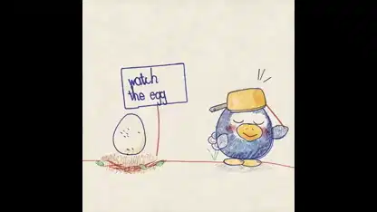</a> 
<b>アヒルと卵の手描き風ショート</b> 
<b>↗ 注目上昇</b> · <a href="https://x.com/kevin_t_ngo">@kevin_t_ngo</a> · 1:20 · 2026-11-13 
<a href="https://video.twimg.com/amplify_video/2121260777667735552/vid/avc1/1080x1080/E9SGCsLNIrFdfgmJ.mp4?tag=29">▶ 本編</a> · <a href="https://x.com/kevin_t_ngo/status/2121261917016903748">元の投稿</a> · <a href="https://github.com/VibeClip/awesome-fable-5-2-videos/blob/main/docs/videos/ja/kevin-t-ngo-2121261917016903748.md">詳細</a>

</td>
<td width="33%" valign="top">
 
<b>Three.jsで描いた龍の短編『赤龍』</b> 
<a href="https://x.com/chetaslua">@chetaslua</a> · 1:25 · 2026-11-13 
<a href="https://video.twimg.com/amplify_video/2121175618289389568/vid/avc1/3024x1660/GD6vq4RoARkQT7vs.mp4?tag=29">▶ 本編</a> · <a href="https://x.com/chetaslua/status/2121176151234330707">元の投稿</a> · <a href="https://github.com/VibeClip/awesome-fable-5-2-videos/blob/main/docs/videos/ja/chetaslua-2121176151234330707.md">詳細</a>

</td>
</tr>
<tr>
<td width="33%" valign="top">
 
<b>箱庭とデフォルメされたキャラクター</b> 
<b>新しい発見</b> · <a href="https://x.com/manaimovie">@manaimovie</a> · 0:18 · 2026-11-13 
<a href="https://video.twimg.com/amplify_video/2121169025631997952/vid/avc1/1920x1080/IgSo06brX97Ok9aR.mp4?tag=29">▶ 本編</a> · <a href="https://x.com/manaimovie/status/2121170941090857245">元の投稿</a> · <a href="https://github.com/VibeClip/awesome-fable-5-2-videos/blob/main/docs/videos/ja/manaimovie-2121170941090857245.md">詳細</a>

</td>
<td width="33%" valign="top">
 
<b>紙のロボットが鏡になるまで</b> 
<b>新しい発見</b> · <a href="https://x.com/akiyoshisan">@akiyoshisan</a> · 1:07 · 2026-11-13 
<a href="https://video.twimg.com/amplify_video/2121121702482747392/vid/avc1/1080x1920/Eg6j8xBR8oMxvQRB.mp4?tag=29">▶ 本編</a> · <a href="https://x.com/akiyoshisan/status/2121122179018531193">元の投稿</a> · <a href="https://github.com/VibeClip/awesome-fable-5-2-videos/blob/main/docs/videos/ja/akiyoshisan-2121122179018531193.md">詳細</a>

</td>
<td width="33%" valign="top">
 
<b>波までブロックでできた海賊ショート</b> 
<b>↗ 注目上昇</b> · <a href="https://x.com/loktar00">@loktar00</a> · 0:50 · 2026-11-13 
<a href="https://video.twimg.com/amplify_video/2121066008483913728/vid/avc1/1920x1080/kzRTU-ZlEwqnem5b.mp4?tag=29">▶ 本編</a> · <a href="https://x.com/loktar00/status/2121066943662743624">元の投稿</a> · <a href="https://github.com/VibeClip/awesome-fable-5-2-videos/blob/main/docs/videos/ja/loktar00-2121066943662743624.md">詳細</a>

</td>
</tr>
<tr>
<td width="33%" valign="top">
 
<b>気球で八つのおとぎ話の世界を巡る短編</b> 
<b>新しい発見</b> · <a href="https://x.com/0xMovez">@0xMovez</a> · 1:41 · 2026-11-12 
<a href="https://video.twimg.com/amplify_video/2121001266042044416/vid/avc1/1920x1080/oqE5i6yq8lLnPvqf.mp4?tag=29">▶ 本編</a> · <a href="https://x.com/0xMovez/status/2121001440470577157">元の投稿</a> · <a href="https://github.com/VibeClip/awesome-fable-5-2-videos/blob/main/docs/videos/ja/0xmovez-2121001440470577157.md">詳細</a>

📝 プロンプトを見る

作者が下記のリンクでプロンプトを公開しています。参考素材や追加指示と合わせて元の文脈を確認してください。

<a href="https://x.com/0xMovez/status/2121001444383814027">作者の公開プロンプトを読む</a>

</td>
<td width="33%" valign="top">
 
<b>ドミノと、わざとイライラさせるアニメーション</b> 
<a href="https://x.com/matabee_GTO">@matabee_GTO</a> · 1:09 · 2026-11-12 
<a href="https://video.twimg.com/amplify_video/2120994255674265600/vid/avc1/1920x1080/cnZy7HvICvE7MpNw.mp4?tag=29">▶ 本編</a> · <a href="https://x.com/matabee_GTO/status/2120995946372985144">元の投稿</a> · <a href="https://github.com/VibeClip/awesome-fable-5-2-videos/blob/main/docs/videos/ja/matabee-gto-2120995946372985144.md">詳細</a>

📝 プロンプトを見る
<blockquote>今持っている力を全て使って不快な動画を作って</blockquote>
<a href="https://x.com/matabee_GTO/status/2120995946372985144">作者の公開プロンプトを読む</a>

</td>
<td width="33%" valign="top">
 
<b>デスクサイズのClawdが登場するBlender短編</b> 
<b>新しい発見</b> · <a href="https://x.com/wangray">@wangray</a> · 0:54 · 2026-11-12 
<a href="https://video.twimg.com/amplify_video/2120729437482455040/vid/avc1/1920x1080/6gkPJnL7ykHAwazS.mp4?tag=29">▶ 本編</a> · <a href="https://x.com/wangray/status/2120730013037466048">元の投稿</a> · <a href="https://github.com/VibeClip/awesome-fable-5-2-videos/blob/main/docs/videos/ja/wangray-2120730013037466048.md">詳細</a>

📝 プロンプトを見る

作者が下記のリンクでプロンプトを公開しています。参考素材や追加指示と合わせて元の文脈を確認してください。

<a href="https://x.com/wangray/status/2120730013037466048">作者の公開プロンプトを読む</a>

</td>
</tr>
<tr>
<td width="33%" valign="top">
 
<b>敦煌壁画をもとにした飛天のアニメーション</b> 
<b>新しい発見</b> · <a href="https://x.com/DDJCXX">@DDJCXX</a> · 0:30 · 2026-11-12 
<a href="https://video.twimg.com/amplify_video/2120525771433521152/vid/avc1/1920x1080/Sq8XVa5ZRgc_VMVh.mp4?tag=29">▶ 本編</a> · <a href="https://x.com/DDJCXX/status/2120728292084842578">元の投稿</a> · <a href="https://github.com/VibeClip/awesome-fable-5-2-videos/blob/main/docs/videos/ja/ddjcxx-2120728292084842578.md">詳細</a>

📝 プロンプトを見る

作者が下記のリンクでプロンプトを公開しています。参考素材や追加指示と合わせて元の文脈を確認してください。

<a href="https://x.com/DDJCXX/status/2120728293003395350">作者の公開プロンプトを読む</a>

</td>
<td width="33%" valign="top">
 
<b>演出を盛りすぎた料理ショート</b> 
<b>新しい発見</b> · <a href="https://x.com/kazumarudrive">@kazumarudrive</a> · 0:15 · 2026-11-12 
<a href="https://video.twimg.com/amplify_video/2120699144675422209/vid/avc1/1920x1080/gSq9XsjXigL3ZOUQ.mp4?tag=29">▶ 本編</a> · <a href="https://x.com/kazumarudrive/status/2120699556207919454">元の投稿</a> · <a href="https://github.com/VibeClip/awesome-fable-5-2-videos/blob/main/docs/videos/ja/kazumarudrive-2120699556207919454.md">詳細</a>

</td>
<td width="33%" valign="top">
 
<b>小さなカニを描くBlender短編『Better Half』</b> 
<b>新しい発見</b> · <a href="https://x.com/JacobMolBio">@JacobMolBio</a> · 1:25 · 2026-11-11 
<a href="https://video.twimg.com/amplify_video/2120643700003082240/vid/avc1/3840x2160/IrX_jwUNliOLWHBc.mp4?tag=29">▶ 本編</a> · <a href="https://x.com/JacobMolBio/status/2120648796334178374">元の投稿</a> · <a href="https://github.com/VibeClip/awesome-fable-5-2-videos/blob/main/docs/videos/ja/jacobmolbio-2120648796334178374.md">詳細</a>

</td>
</tr>
<tr>
<td width="33%" valign="top">
 
<b>景色を飛び越える一人称視点のBlender短編</b> 
<b>新しい発見</b> · <a href="https://x.com/shun_cmdouga">@shun_cmdouga</a> · 0:18 · 2026-11-11 
<a href="https://video.twimg.com/amplify_video/2120351689219936256/vid/avc1/1280x720/-ICvOF8Av4JnSAaj.mp4?tag=29">▶ 本編</a> · <a href="https://x.com/shun_cmdouga/status/2120622594663616515">元の投稿</a> · <a href="https://github.com/VibeClip/awesome-fable-5-2-videos/blob/main/docs/videos/ja/shun-cmdouga-2120622594663616515.md">詳細</a>

</td>
<td width="33%" valign="top">
 
<b>ブラウザーで描画する短編作品のリール</b> 
<b>新しい発見</b> · <a href="https://x.com/Iamshankhadeep">@Iamshankhadeep</a> · 0:48 · 2026-11-11 
<a href="https://video.twimg.com/amplify_video/2120601647760261120/vid/avc1/1920x1080/IAnqlZZmZKQrtPKZ.mp4?tag=29">▶ 本編</a> · <a href="https://x.com/Iamshankhadeep/status/2120601879029907520">元の投稿</a> · <a href="https://github.com/VibeClip/awesome-fable-5-2-videos/blob/main/docs/videos/ja/iamshankhadeep-2120601879029907520.md">詳細</a>

</td>
<td width="33%" valign="top">
 
<b>ベースの一音で世界がめくれる</b> 
<b>新しい発見</b> · <a href="https://x.com/akiyoshisan">@akiyoshisan</a> · 0:32 · 2026-11-11 
<a href="https://video.twimg.com/amplify_video/2120387084984922112/vid/avc1/1080x1920/Amvlx9hYtRvo0Fcn.mp4?tag=29">▶ 本編</a> · <a href="https://x.com/akiyoshisan/status/2120387868665475262">元の投稿</a> · <a href="https://github.com/VibeClip/awesome-fable-5-2-videos/blob/main/docs/videos/ja/akiyoshisan-2120387868665475262.md">詳細</a>

</td>
</tr>
<tr>
<td width="33%" valign="top">
<a href="https://video.twimg.com/amplify_video/2120369184358219776/vid/avc1/1920x1080/j9UKua0CYkk4uFst.mp4?tag=29">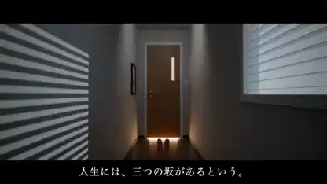</a> 
<b>何もかもうまくいかない一日</b> 
<a href="https://x.com/matabee_GTO">@matabee_GTO</a> · 1:22 · 2026-11-11 
<a href="https://video.twimg.com/amplify_video/2120369184358219776/vid/avc1/1920x1080/j9UKua0CYkk4uFst.mp4?tag=29">▶ 本編</a> · <a href="https://x.com/matabee_GTO/status/2120369352428110267">元の投稿</a> · <a href="https://github.com/VibeClip/awesome-fable-5-2-videos/blob/main/docs/videos/ja/matabee-gto-2120369352428110267.md">詳細</a>

📝 プロンプトを見る
<blockquote>現在持てるすべての力を使い最高の脚本、演出、カメラで最悪の動画を作って</blockquote>
<a href="https://x.com/matabee_GTO/status/2120369352428110267">作者の公開プロンプトを読む</a>

</td>
<td width="33%" valign="top">
 
<b>木を育てる物語をコードで描く</b> 
<b>新しい発見</b> · <a href="https://x.com/IAenCrudo">@IAenCrudo</a> · 0:56 · 2026-11-10 
<a href="https://video.twimg.com/amplify_video/2120291597568954368/vid/avc1/1080x1080/s1ZeBfuKZ6fDnlbx.mp4?tag=29">▶ 本編</a> · <a href="https://x.com/IAenCrudo/status/2120291820844273983">元の投稿</a> · <a href="https://github.com/VibeClip/awesome-fable-5-2-videos/blob/main/docs/videos/ja/iaencrudo-2120291820844273983.md">詳細</a>

</td>
<td width="33%" valign="top">
 
<b>静かな室内の光を描くBlender短編</b> 
<b>新しい発見</b> · <a href="https://x.com/untitled_sys">@untitled_sys</a> · 0:20 · 2026-11-10 
<a href="https://video.twimg.com/amplify_video/2120265887135715328/vid/avc1/1920x1080/6M8UYJ2wXkM5cgJM.mp4?tag=29">▶ 本編</a> · <a href="https://x.com/untitled_sys/status/2120265921390621058">元の投稿</a> · <a href="https://github.com/VibeClip/awesome-fable-5-2-videos/blob/main/docs/videos/ja/untitled-sys-2120265921390621058.md">詳細</a>

</td>
</tr>
<tr>
<td width="33%" valign="top">
 
<b>滝のそばのデスクを映すBlenderショーリール</b> 
<b>新しい発見</b> · <a href="https://x.com/Iamshankhadeep">@Iamshankhadeep</a> · 0:54 · 2026-11-10 
<a href="https://video.twimg.com/amplify_video/2120264070083620864/vid/avc1/1920x1080/80xVsB3rl4Bxzo30.mp4?tag=29">▶ 本編</a> · <a href="https://x.com/Iamshankhadeep/status/2120264513224392712">元の投稿</a> · <a href="https://github.com/VibeClip/awesome-fable-5-2-videos/blob/main/docs/videos/ja/iamshankhadeep-2120264513224392712.md">詳細</a>

</td>
<td width="33%" valign="top">
 
<b>自分を木箱に入れてオーストラリアへ送った男</b> 
<b>新しい発見</b> · <a href="https://x.com/theoardley">@theoardley</a> · 0:45 · 2026-11-10 
<a href="https://video.twimg.com/amplify_video/2120168960221966337/vid/avc1/1008x1152/0S9D71pMUOb8P1h9.mp4?tag=29">▶ 本編</a> · <a href="https://x.com/theoardley/status/2120169016601853958">元の投稿</a> · <a href="https://github.com/VibeClip/awesome-fable-5-2-videos/blob/main/docs/videos/ja/theoardley-2120169016601853958.md">詳細</a>

📝 プロンプトを見る

作者が下記のリンクでプロンプトを公開しています。参考素材や追加指示と合わせて元の文脈を確認してください。

<a href="https://x.com/theoardley/status/2120124748159996152">作者の公開プロンプトを読む</a>

</td>
<td width="33%" valign="top">
 
<b>コードで描く高専のショートフィルム</b> 
<b>新しい発見</b> · <a href="https://x.com/kosen_labo">@kosen_labo</a> · 1:00 · 2026-11-10 
<a href="https://video.twimg.com/amplify_video/2120128135681470464/vid/avc1/910x512/z_FMx9vV7-Tja50p.mp4?tag=14">▶ 本編</a> · <a href="https://x.com/kosen_labo/status/2120128253327474845">元の投稿</a> · <a href="https://github.com/VibeClip/awesome-fable-5-2-videos/blob/main/docs/videos/ja/kosen-labo-2120128253327474845.md">詳細</a>

📝 プロンプトを見る
<blockquote>高専について、なんかすごい動画を作ってください</blockquote>
<a href="https://x.com/kosen_labo/status/2120128253327474845">作者の公開プロンプトを読む</a>

</td>
</tr>
<tr>
<td width="33%" valign="top">
 
<b>コードで描くヤミ対シャンクス</b> 
<b>新しい発見</b> · <a href="https://x.com/Uraharastudio">@Uraharastudio</a> · 1:00 · 2026-11-10 
<a href="https://video.twimg.com/amplify_video/2120128077975977984/vid/avc1/1280x720/m9IjLTrfzffl_S5p.mp4?tag=29">▶ 本編</a> · <a href="https://x.com/Uraharastudio/status/2120128234499002537">元の投稿</a> · <a href="https://github.com/VibeClip/awesome-fable-5-2-videos/blob/main/docs/videos/ja/uraharastudio-2120128234499002537.md">詳細</a>

</td>
<td width="33%" valign="top">
 
<b>月夜の図書館を舞うページ</b> 
<b>↗ 注目上昇</b> · <a href="https://x.com/lemomo_ai">@lemomo_ai</a> · 0:55 · 2026-11-10 
<a href="https://video.twimg.com/amplify_video/2120117891240742914/vid/avc1/1920x1080/-2LACPT73SSi5tr7.mp4?tag=29">▶ 本編</a> · <a href="https://x.com/lemomo_ai/status/2120118194409193682">元の投稿</a> · <a href="https://github.com/VibeClip/awesome-fable-5-2-videos/blob/main/docs/videos/ja/lemomo-ai-2120118194409193682.md">詳細</a>

</td>
<td width="33%" valign="top">
 
<b>廊下で描く時の流れ</b> 
<b>新しい発見</b> · <a href="https://x.com/argofowl">@argofowl</a> · 0:16 · 2026-11-10 
<a href="https://video.twimg.com/amplify_video/2120100208990371842/vid/avc1/1920x1080/AvuwxFaTzQOwI2tO.mp4?tag=29">▶ 本編</a> · <a href="https://x.com/argofowl/status/2120100759195000942">元の投稿</a> · <a href="https://github.com/VibeClip/awesome-fable-5-2-videos/blob/main/docs/videos/ja/argofowl-2120100759195000942.md">詳細</a>

</td>
</tr>
<tr>
<td width="33%" valign="top">
 
<b>単一HTMLファイルで動くリアルタイム映像詩</b> 
<b>新しい発見</b> · <a href="https://x.com/hajimetwi3">@hajimetwi3</a> · 3:22 · 2026-11-10 
<a href="https://video.twimg.com/amplify_video/2120091572830388224/vid/avc1/1212x668/4dpNdt1GmAYYx4ix.mp4?tag=29">▶ 本編</a> · <a href="https://x.com/hajimetwi3/status/2120093427731943510">元の投稿</a> · <a href="https://github.com/VibeClip/awesome-fable-5-2-videos/blob/main/docs/videos/ja/hajimetwi3-2120093427731943510.md">詳細</a>

📝 プロンプトを見る
<blockquote>凄いものを作って！！</blockquote>
<a href="https://x.com/hajimetwi3/status/2120093427731943510">作者の公開プロンプトを読む</a>

</td>
<td width="33%" valign="top">
 
<b>『Model Wars』のラスボス登場アニメーション</b> 
<b>新しい発見</b> · <a href="https://x.com/okknews">@okknews</a> · 0:21 · 2026-11-10 
<a href="https://video.twimg.com/amplify_video/2120093387827408896/vid/avc1/1280x720/smY9JD24a6IJBHmb.mp4?tag=29">▶ 本編</a> · <a href="https://x.com/okknews/status/2120093425739706435">元の投稿</a> · <a href="https://github.com/VibeClip/awesome-fable-5-2-videos/blob/main/docs/videos/ja/okknews-2120093425739706435.md">詳細</a>

</td>
<td width="33%" valign="top">
 
<b>コードで描いた夜の短編『灯籠の川』</b> 
<b>新しい発見</b> · <a href="https://x.com/seiiiiiiiiiiru">@seiiiiiiiiiiru</a> · 0:30 · 2026-11-10 
<a href="https://video.twimg.com/amplify_video/2119959242413379584/vid/avc1/1920x1080/wGI80-cGZLEwRMvR.mp4?tag=29">▶ 本編</a> · <a href="https://x.com/seiiiiiiiiiiru/status/2120079029386588503">元の投稿</a> · <a href="https://github.com/VibeClip/awesome-fable-5-2-videos/blob/main/docs/videos/ja/seiiiiiiiiiiru-2120079029386588503.md">詳細</a>

</td>
</tr>
<tr>
<td width="33%" valign="top">
<a href="https://video.twimg.com/amplify_video/2120077244446183424/vid/avc1/1920x1080/i_TF0cdPU4CEPy9M.mp4?tag=29">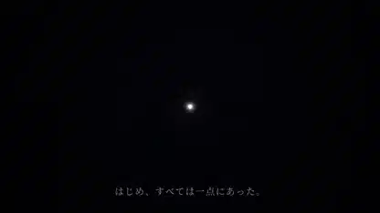</a> 
<b>一つの光点から始まる宇宙のアニメーション</b> 
<b>新しい発見</b> · <a href="https://x.com/ds_nakajima">@ds_nakajima</a> · 1:18 · 2026-11-10 
<a href="https://video.twimg.com/amplify_video/2120077244446183424/vid/avc1/1920x1080/i_TF0cdPU4CEPy9M.mp4?tag=29">▶ 本編</a> · <a href="https://x.com/ds_nakajima/status/2120077444724191633">元の投稿</a> · <a href="https://github.com/VibeClip/awesome-fable-5-2-videos/blob/main/docs/videos/ja/ds-nakajima-2120077444724191633.md">詳細</a>

📝 プロンプトを見る
<blockquote>すごい動画を作ったほしい</blockquote>
<a href="https://x.com/ds_nakajima/status/2120077444724191633">作者の公開プロンプトを読む</a>

</td>
<td width="33%" valign="top">
 
<b>粒子の実験から桜の風景へ移る短編映像</b> 
<b>新しい発見</b> · <a href="https://x.com/rute1203d">@rute1203d</a> · 2:26 · 2026-11-10 
<a href="https://video.twimg.com/amplify_video/2120076635022176256/vid/avc1/1920x1080/_pMVSUXNU5xgUqUo.mp4?tag=29">▶ 本編</a> · <a href="https://x.com/rute1203d/status/2120077147872391540">元の投稿</a> · <a href="https://github.com/VibeClip/awesome-fable-5-2-videos/blob/main/docs/videos/ja/rute1203d-2120077147872391540.md">詳細</a>

📝 プロンプトを見る

作者が下記のリンクでプロンプトを公開しています。参考素材や追加指示と合わせて元の文脈を確認してください。

<a href="https://x.com/rute1203d/status/2120077147872391540">作者の公開プロンプトを読む</a>

</td>
<td width="33%" valign="top">
 
<b>絵コンテから作る3D短編『触らないで』</b> 
<b>↗ 注目上昇</b> · <a href="https://x.com/HaileyAILabs">@HaileyAILabs</a> · 0:30 · 2026-11-10 
<a href="https://video.twimg.com/amplify_video/2120073390942048256/vid/avc1/3024x1714/xZRjyNo0Fwszd5WF.mp4?tag=29">▶ 本編</a> · <a href="https://x.com/HaileyAILabs/status/2120075292043890890">元の投稿</a> · <a href="https://github.com/VibeClip/awesome-fable-5-2-videos/blob/main/docs/videos/ja/haileyailabs-2120075292043890890.md">詳細</a>

</td>
</tr>
<tr>
<td width="33%" valign="top">
 
<b>狩りをするサーベルタイガー</b> 
<b>↗ 注目上昇</b> · <a href="https://x.com/wshuyi">@wshuyi</a> · 0:28 · 2026-11-10 
<a href="https://video.twimg.com/amplify_video/2120014231450034176/vid/avc1/1920x1080/7CaA0vV2Tej61d3g.mp4?tag=29">▶ 本編</a> · <a href="https://x.com/wshuyi/status/2120014892040417720">元の投稿</a> · <a href="https://github.com/VibeClip/awesome-fable-5-2-videos/blob/main/docs/videos/ja/wshuyi-2120014892040417720.md">詳細</a>

📝 プロンプトを見る

作者が下記のリンクでプロンプトを公開しています。参考素材や追加指示と合わせて元の文脈を確認してください。

<a href="https://x.com/wshuyi/status/2120014892040417720">作者の公開プロンプトを読む</a>

</td>
<td width="33%" valign="top">
 
<b>コードで舞台を作る夢の映像</b> 
<b>↗ 注目上昇</b> · <a href="https://x.com/anabology">@anabology</a> · 3:33 · 2026-11-10 
<a href="https://video.twimg.com/amplify_video/2120010999818289152/vid/avc1/1920x1080/IWfi7bdM6kIQXIB4.mp4?tag=29">▶ 本編</a> · <a href="https://x.com/anabology/status/2120011096287297557">元の投稿</a> · <a href="https://github.com/VibeClip/awesome-fable-5-2-videos/blob/main/docs/videos/ja/anabology-2120011096287297557.md">詳細</a>

</td>
<td width="33%" valign="top">
 
<b>オリジナルのスペースオペラのオープニングと序曲</b> 
<b>新しい発見</b> · <a href="https://x.com/imjustnewatai">@imjustnewatai</a> · 2:02 · 2026-11-10 
<a href="https://video.twimg.com/amplify_video/2119991676600975360/vid/avc1/1920x1080/SkX17BUiYGK12VwD.mp4?tag=29">▶ 本編</a> · <a href="https://x.com/imjustnewatai/status/2119991883997045049">元の投稿</a> · <a href="https://github.com/VibeClip/awesome-fable-5-2-videos/blob/main/docs/videos/ja/imjustnewatai-2119991883997045049.md">詳細</a>

</td>
</tr>
<tr>
<td width="33%" valign="top">
 
<b>台本に従わない猫</b> 
<b>↗ 注目上昇</b> · <a href="https://x.com/renoiseai">@renoiseai</a> · 1:02 · 2026-11-10 
<a href="https://video.twimg.com/amplify_video/2119959154026840064/vid/avc1/1920x1080/xTHXVvf_6YhKOkmx.mp4?tag=29">▶ 本編</a> · <a href="https://x.com/renoiseai/status/2119959294716326280">元の投稿</a> · <a href="https://github.com/VibeClip/awesome-fable-5-2-videos/blob/main/docs/videos/ja/renoiseai-2119959294716326280.md">詳細</a>

</td>
<td width="33%" valign="top">
 
<b>JavaScriptでフレームを描くアニメ短編</b> 
<b>↗ 注目上昇</b> · <a href="https://x.com/kevin_t_ngo">@kevin_t_ngo</a> · 1:40 · 2026-11-09 
<a href="https://video.twimg.com/amplify_video/2119937132647313408/vid/avc1/1080x1080/T2W6Dhpu_gMoxVTM.mp4?tag=29">▶ 本編</a> · <a href="https://x.com/kevin_t_ngo/status/2119938129079808282">元の投稿</a> · <a href="https://github.com/VibeClip/awesome-fable-5-2-videos/blob/main/docs/videos/ja/kevin-t-ngo-2119938129079808282.md">詳細</a>

</td>
<td width="33%" valign="top">
 
<b>『叫び』の物語を短編で</b> 
<b>新しい発見</b> · <a href="https://x.com/osmanaga__">@osmanaga__</a> · 1:28 · 2026-11-09 
<a href="https://video.twimg.com/amplify_video/2119923123092893696/vid/avc1/720x1280/M2J_aC5567oGoPEu.mp4?tag=14">▶ 本編</a> · <a href="https://x.com/osmanaga__/status/2119923975635738780">元の投稿</a> · <a href="https://github.com/VibeClip/awesome-fable-5-2-videos/blob/main/docs/videos/ja/osmanaga-146194.md">詳細</a>

</td>
</tr>
<tr>
<td width="33%" valign="top">
 
<b>歌詞とシンクロするアニメMV</b> 
<a href="https://x.com/WesRoth">@WesRoth</a> · 0:37 · 2026-11-09 
<a href="https://video.twimg.com/amplify_video/2119910396719177728/vid/avc1/1280x720/0X1wTe1JivqZgtXw.mp4?tag=29">▶ 本編</a> · <a href="https://x.com/WesRoth/status/2119911161386934330">元の投稿</a> · <a href="https://github.com/VibeClip/awesome-fable-5-2-videos/blob/main/docs/videos/ja/wesroth-934330.md">詳細</a>

</td>
<td width="33%" valign="top">
 
<b>Fable 5.2が企画しOpus 5.5が制作したBlender短編</b> 
<b>新しい発見</b> · <a href="https://x.com/kloss_xyz">@kloss_xyz</a> · 0:16 · 2026-11-09 
<a href="https://video.twimg.com/amplify_video/2119909698367557632/vid/avc1/1920x1080/EkOxfDMK1PSG_XOD.mp4?tag=29">▶ 本編</a> · <a href="https://x.com/kloss_xyz/status/2119910613828980846">元の投稿</a> · <a href="https://github.com/VibeClip/awesome-fable-5-2-videos/blob/main/docs/videos/ja/kloss-xyz-2119910613828980846.md">詳細</a>

</td>
<td width="33%" valign="top">
 
<b>猫が古いロボットをよみがえらせる</b> 
<a href="https://x.com/EngMoElgaraihy">@EngMoElgaraihy</a> · 0:40 · 2026-11-09 
<a href="https://video.twimg.com/amplify_video/2119904158409256960/vid/avc1/1920x1080/FHiVbLKGnw5mFlJ7.mp4?tag=29">▶ 本編</a> · <a href="https://x.com/EngMoElgaraihy/status/2119904813718643141">元の投稿</a> · <a href="https://github.com/VibeClip/awesome-fable-5-2-videos/blob/main/docs/videos/ja/engmoelgaraihy-643141.md">詳細</a>

</td>
</tr>
<tr>
<td width="33%" valign="top">
 
<b>生成画像を使わない46秒の映像</b> 
<a href="https://x.com/cube__lol">@cube__lol</a> · 0:46 · 2026-11-09 
<a href="https://video.twimg.com/amplify_video/2119904119569690624/vid/avc1/1080x1920/24p1AimqIbXNXJ-Z.mp4?tag=29">▶ 本編</a> · <a href="https://x.com/cube__lol/status/2119904449556832554">元の投稿</a> · <a href="https://github.com/VibeClip/awesome-fable-5-2-videos/blob/main/docs/videos/ja/cube-lol-832554.md">詳細</a>

</td>
<td width="33%" valign="top">
 
<b>コードで描く深海ダイビング</b> 
<a href="https://x.com/g_beyrouti">@g_beyrouti</a> · 0:30 · 2026-11-09 
<a href="https://video.twimg.com/amplify_video/2119904334397792256/vid/avc1/1920x1080/Sz-4m8aagrACSa85.mp4?tag=29">▶ 本編</a> · <a href="https://x.com/g_beyrouti/status/2119904386826780943">元の投稿</a> · <a href="https://github.com/VibeClip/awesome-fable-5-2-videos/blob/main/docs/videos/ja/g-beyrouti-780943.md">詳細</a>

</td>
<td width="33%" valign="top">
 
<b>蒸気機関車のアニメ短編</b> 
<a href="https://x.com/0kncn">@0kncn</a> · 1:30 · 2026-11-09 
<a href="https://video.twimg.com/amplify_video/2119900741783400450/vid/avc1/1920x1080/m--vaF5s-VQhaEAL.mp4?tag=29">▶ 本編</a> · <a href="https://x.com/0kncn/status/2119901782482543073">元の投稿</a> · <a href="https://github.com/VibeClip/awesome-fable-5-2-videos/blob/main/docs/videos/ja/0kncn-543073.md">詳細</a>

📝 プロンプトを見る

作者が下記のリンクでプロンプトを公開しています。参考素材や追加指示と合わせて元の文脈を確認してください。

<a href="https://x.com/0kncn/status/2119901786060259612">作者の公開プロンプトを読む</a>

</td>
</tr>
<tr>
<td width="33%" valign="top">
 
<b>コードで作る83秒のアニメ映画</b> 
<a href="https://x.com/noisyb0y1">@noisyb0y1</a> · 1:07 · 2026-11-09 
<a href="https://video.twimg.com/amplify_video/2119899951345893376/vid/avc1/1920x1080/YjLMjLxfThe6MUXI.mp4?tag=29">▶ 本編</a> · <a href="https://x.com/noisyb0y1/status/2119900528197218472">元の投稿</a> · <a href="https://github.com/VibeClip/awesome-fable-5-2-videos/blob/main/docs/videos/ja/noisyb0y1-218472.md">詳細</a>

</td>
<td width="33%" valign="top">
 
<b>Discovery：Three.jsの短編</b> 
<a href="https://x.com/YinYangYoeshi">@YinYangYoeshi</a> · 1:42 · 2026-11-09 
<a href="https://video.twimg.com/amplify_video/2119897357940621312/vid/avc1/1920x1080/ZjoaXFviS7F_qc-m.mp4?tag=29">▶ 本編</a> · <a href="https://x.com/YinYangYoeshi/status/2119897840965001317">元の投稿</a> · <a href="https://github.com/VibeClip/awesome-fable-5-2-videos/blob/main/docs/videos/ja/yinyangyoeshi-001317.md">詳細</a>

</td>
<td width="33%" valign="top">
 
<b>見たことのない海</b> 
<a href="https://x.com/jessalanfields">@jessalanfields</a> · 1:45 · 2026-11-09 
<a href="https://video.twimg.com/amplify_video/2119895450509586432/vid/avc1/1920x1080/AS5GlEaPMeHXKU5d.mp4?tag=29">▶ 本編</a> · <a href="https://x.com/jessalanfields/status/2119895969957392730">元の投稿</a> · <a href="https://github.com/VibeClip/awesome-fable-5-2-videos/blob/main/docs/videos/ja/jessalanfields-392730.md">詳細</a>

</td>
</tr>
<tr>
<td width="33%" valign="top">
 
<b>小さな生き物から宇宙へ</b> 
<a href="https://x.com/devteamdrew">@devteamdrew</a> · 0:32 · 2026-11-09 
<a href="https://video.twimg.com/amplify_video/2119892377045237760/vid/avc1/1920x1080/u8IeGB-A3MQgl4XE.mp4?tag=29">▶ 本編</a> · <a href="https://x.com/devteamdrew/status/2119892540950241283">元の投稿</a> · <a href="https://github.com/VibeClip/awesome-fable-5-2-videos/blob/main/docs/videos/ja/devteamdrew-241283.md">詳細</a>

</td>
<td width="33%" valign="top">
 
<b>灯台守の短編映像</b> 
<a href="https://x.com/MarvellousDev">@MarvellousDev</a> · 0:15 · 2026-11-09 
<a href="https://video.twimg.com/amplify_video/2119889346706673664/vid/avc1/1920x1080/VxlTVaaElWO17W42.mp4?tag=29">▶ 本編</a> · <a href="https://x.com/MarvellousDev/status/2119889511333380563">元の投稿</a> · <a href="https://github.com/VibeClip/awesome-fable-5-2-videos/blob/main/docs/videos/ja/marvellousdev-380563.md">詳細</a>

</td>
<td width="33%" valign="top">
 
<b>気軽なプロンプトから生まれた映画</b> 
<a href="https://x.com/ponken00">@ponken00</a> · 1:26 · 2026-11-09 
<a href="https://video.twimg.com/amplify_video/2119887881321787392/vid/avc1/1920x1080/zPvL0-S5VSv6SkYI.mp4?tag=29">▶ 本編</a> · <a href="https://x.com/ponken00/status/2119888362148622656">元の投稿</a> · <a href="https://github.com/VibeClip/awesome-fable-5-2-videos/blob/main/docs/videos/ja/ponken00-622656.md">詳細</a>

</td>
</tr>
<tr>
<td width="33%" valign="top">
 
<b>テトが歌うボーカロイドのラブソング</b> 
<a href="https://x.com/peach2k2">@peach2k2</a> · 0:25 · 2026-11-09 
<a href="https://video.twimg.com/ext_tw_video/2119885702250786816/pu/vid/avc1/1280x720/vaqq1fwB8qUuFlPu.mp4?tag=27">▶ 本編</a> · <a href="https://x.com/peach2k2/status/2119885741773738033">元の投稿</a> · <a href="https://github.com/VibeClip/awesome-fable-5-2-videos/blob/main/docs/videos/ja/peach2k2-738033.md">詳細</a>

</td>
<td width="33%" valign="top">
 
<b>生きた世界を飛び抜ける</b> 
<a href="https://x.com/LexnLin">@LexnLin</a> · 0:30 · 2026-11-09 
<a href="https://video.twimg.com/amplify_video/2119880037172146176/vid/avc1/1920x1080/E4G1BysAeWIl4yTX.mp4?tag=29">▶ 本編</a> · <a href="https://x.com/LexnLin/status/2119880654858977333">元の投稿</a> · <a href="https://github.com/VibeClip/awesome-fable-5-2-videos/blob/main/docs/videos/ja/lexnlin-977333.md">詳細</a>

</td>
<td width="33%" valign="top">
 
<b>天国へのドライブ</b> 
<a href="https://x.com/abhinavflac">@abhinavflac</a> · 1:15 · 2026-11-09 
<a href="https://video.twimg.com/amplify_video/2119874130904502272/vid/avc1/1920x1080/FVx09qWfu11d8QIK.mp4?tag=29">▶ 本編</a> · <a href="https://x.com/abhinavflac/status/2119875975131676827">元の投稿</a> · <a href="https://github.com/VibeClip/awesome-fable-5-2-videos/blob/main/docs/videos/ja/abhinavflac-676827.md">詳細</a>

</td>
</tr>
</table>

## モーションデザインとアニメーション · 58

動く文字、粒子、ジェネラティブアート、SVGと映像実験。

<table>
<tr>
<td width="33%" valign="top">
 
<b>千切り紙のタイポグラフィを使ったBlender映像</b> 
<b>新しい発見</b> · <a href="https://x.com/AmirMushich">@AmirMushich</a> · 0:08 · 2026-11-13 
<a href="https://video.twimg.com/amplify_video/2121334291791593472/vid/avc1/1080x1920/OJuFzWUGf-R_mS-G.mp4?tag=29">▶ 本編</a> · <a href="https://x.com/AmirMushich/status/2121339167800213934">元の投稿</a> · <a href="https://github.com/VibeClip/awesome-fable-5-2-videos/blob/main/docs/videos/ja/amirmushich-2121339167800213934.md">詳細</a>

</td>
<td width="33%" valign="top">
 
<b>Blenderのモーションキャプチャテストで動くウサギ</b> 
<b>↗ 注目上昇</b> · <a href="https://x.com/seiiiiiiiiiiru">@seiiiiiiiiiiru</a> · 0:10 · 2026-11-13 
<a href="https://video.twimg.com/amplify_video/2121164591338233856/vid/avc1/720x720/VurXACOWrxBzWYhS.mp4?tag=29">▶ 本編</a> · <a href="https://x.com/seiiiiiiiiiiru/status/2121164955080917176">元の投稿</a> · <a href="https://github.com/VibeClip/awesome-fable-5-2-videos/blob/main/docs/videos/ja/seiiiiiiiiiiru-2121164955080917176.md">詳細</a>

</td>
<td width="33%" valign="top">
<a href="https://video.twimg.com/amplify_video/2121099133176180736/vid/avc1/1920x1080/_0XPnsrM8nn90SnS.mp4?tag=29">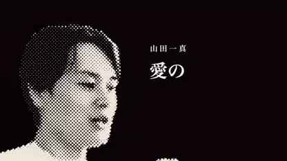</a> 
<b>手持ちの実写映像から編集したチャンネルのオープニング</b> 
<b>新しい発見</b> · <a href="https://x.com/kazumarudrive">@kazumarudrive</a> · 0:14 · 2026-11-13 
<a href="https://video.twimg.com/amplify_video/2121099133176180736/vid/avc1/1920x1080/_0XPnsrM8nn90SnS.mp4?tag=29">▶ 本編</a> · <a href="https://x.com/kazumarudrive/status/2121099260280381629">元の投稿</a> · <a href="https://github.com/VibeClip/awesome-fable-5-2-videos/blob/main/docs/videos/ja/kazumarudrive-2121099260280381629.md">詳細</a>

📝 プロンプトを見る

作者が下記のリンクでプロンプトを公開しています。参考素材や追加指示と合わせて元の文脈を確認してください。

<a href="https://x.com/kazumarudrive/status/2121099495912219109">作者の公開プロンプトを読む</a>

</td>
</tr>
<tr>
<td width="33%" valign="top">
 
<b>ミニチュア道路の奇妙な交通アニメーション</b> 
<b>新しい発見</b> · <a href="https://x.com/Stargridcompass">@Stargridcompass</a> · 0:15 · 2026-11-12 
<a href="https://video.twimg.com/amplify_video/2120849771288010752/vid/avc1/1080x1920/iqgN5T9908K3k3il.mp4?tag=29">▶ 本編</a> · <a href="https://x.com/Stargridcompass/status/2120856639146442904">元の投稿</a> · <a href="https://github.com/VibeClip/awesome-fable-5-2-videos/blob/main/docs/videos/ja/stargridcompass-2120856639146442904.md">詳細</a>

</td>
<td width="33%" valign="top">
 
<b>信号ノイズからネオン文字までのモーション見本</b> 
<b>新しい発見</b> · <a href="https://x.com/jjjContinue">@jjjContinue</a> · 0:14 · 2026-11-12 
<a href="https://video.twimg.com/amplify_video/2120444313918455808/vid/avc1/1920x1080/X8E7daUuazBuv9h6.mp4?tag=29">▶ 本編</a> · <a href="https://x.com/jjjContinue/status/2120805549155479589">元の投稿</a> · <a href="https://github.com/VibeClip/awesome-fable-5-2-videos/blob/main/docs/videos/ja/jjjcontinue-2120805549155479589.md">詳細</a>

</td>
<td width="33%" valign="top">
 
<b>手描きのオオカミが飛び出す3Dオープニング</b> 
<b>↗ 注目上昇</b> · <a href="https://x.com/husky__create">@husky__create</a> · 0:10 · 2026-11-11 
<a href="https://video.twimg.com/amplify_video/2120622616344219648/vid/avc1/1920x1080/YQkggnwdUXqipVTR.mp4?tag=16">▶ 本編</a> · <a href="https://x.com/husky__create/status/2120622644362199182">元の投稿</a> · <a href="https://github.com/VibeClip/awesome-fable-5-2-videos/blob/main/docs/videos/ja/husky-create-2120622644362199182.md">詳細</a>

</td>
</tr>
<tr>
<td width="33%" valign="top">
 
<b>空を飛んでたどるコンピューターグラフィックスの歴史</b> 
<b>新しい発見</b> · <a href="https://x.com/chetaslua">@chetaslua</a> · 0:40 · 2026-11-11 
<a href="https://video.twimg.com/amplify_video/2120547906147282944/vid/avc1/1920x1080/whHhfWldX3JmsICQ.mp4?tag=29">▶ 本編</a> · <a href="https://x.com/chetaslua/status/2120548065044234504">元の投稿</a> · <a href="https://github.com/VibeClip/awesome-fable-5-2-videos/blob/main/docs/videos/ja/chetaslua-2120548065044234504.md">詳細</a>

</td>
<td width="33%" valign="top">
 
<b>Blenderでレンダリングしたレトロな番組オープニング</b> 
<b>↗ 注目上昇</b> · <a href="https://x.com/kevin_t_ngo">@kevin_t_ngo</a> · 0:45 · 2026-11-11 
<a href="https://video.twimg.com/amplify_video/2120540485764927488/vid/avc1/1920x1080/xC8eOMGaTeccgQUH.mp4?tag=29">▶ 本編</a> · <a href="https://x.com/kevin_t_ngo/status/2120540964909711415">元の投稿</a> · <a href="https://github.com/VibeClip/awesome-fable-5-2-videos/blob/main/docs/videos/ja/kevin-t-ngo-2120540964909711415.md">詳細</a>

</td>
<td width="33%" valign="top">
 
<b>モニターから飛び出した粒子がロゴになる</b> 
<b>新しい発見</b> · <a href="https://x.com/onofumi_AI">@onofumi_AI</a> · 0:15 · 2026-11-11 
<a href="https://video.twimg.com/amplify_video/2120503595762376704/vid/avc1/1920x1080/HyUCUZvRzYJDKtca.mp4?tag=29">▶ 本編</a> · <a href="https://x.com/onofumi_AI/status/2120503860141912399">元の投稿</a> · <a href="https://github.com/VibeClip/awesome-fable-5-2-videos/blob/main/docs/videos/ja/onofumi-ai-2120503860141912399.md">詳細</a>

</td>
</tr>
<tr>
<td width="33%" valign="top">
<a href="https://video.twimg.com/amplify_video/2120473115025088512/vid/avc1/1080x1350/smQxijj1Yis_3zAa.mp4?tag=29">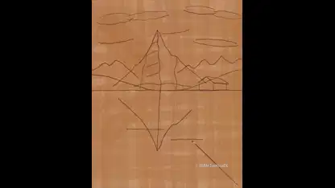</a> 
<b>下描きから水面の反射まで描くスイスの湖</b> 
<b>新しい発見</b> · <a href="https://x.com/MrTacticalX">@MrTacticalX</a> · 1:00 · 2026-11-11 
<a href="https://video.twimg.com/amplify_video/2120473115025088512/vid/avc1/1080x1350/smQxijj1Yis_3zAa.mp4?tag=29">▶ 本編</a> · <a href="https://x.com/MrTacticalX/status/2120473175158849884">元の投稿</a> · <a href="https://github.com/VibeClip/awesome-fable-5-2-videos/blob/main/docs/videos/ja/mrtacticalx-2120473175158849884.md">詳細</a>

</td>
<td width="33%" valign="top">
 
<b>JavaScriptで筆跡を重ねる『モナ・リザ』</b> 
<b>新しい発見</b> · <a href="https://x.com/chetaslua">@chetaslua</a> · 0:16 · 2026-11-11 
<a href="https://video.twimg.com/amplify_video/2120464110202900480/vid/avc1/3024x1660/PfVYLxXQxA7sYUuB.mp4?tag=29">▶ 本編</a> · <a href="https://x.com/chetaslua/status/2120464199096885739">元の投稿</a> · <a href="https://github.com/VibeClip/awesome-fable-5-2-videos/blob/main/docs/videos/ja/chetaslua-2120464199096885739.md">詳細</a>

</td>
<td width="33%" valign="top">
<a href="https://video.twimg.com/amplify_video/2120377027459182593/vid/avc1/1920x1080/RslvkhvTk3_XDi4c.mp4?tag=29">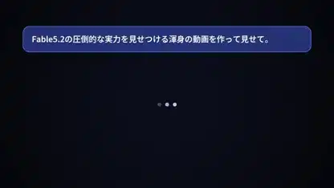</a> 
<b>コードで描いたFableの自己紹介</b> 
<b>新しい発見</b> · <a href="https://x.com/jjjContinue">@jjjContinue</a> · 0:45 · 2026-11-11 
<a href="https://video.twimg.com/amplify_video/2120377027459182593/vid/avc1/1920x1080/RslvkhvTk3_XDi4c.mp4?tag=29">▶ 本編</a> · <a href="https://x.com/jjjContinue/status/2120435611391909934">元の投稿</a> · <a href="https://github.com/VibeClip/awesome-fable-5-2-videos/blob/main/docs/videos/ja/jjjcontinue-2120435611391909934.md">詳細</a>

</td>
</tr>
<tr>
<td width="33%" valign="top">
 
<b>光の粒子が3つの言葉になる</b> 
<b>新しい発見</b> · <a href="https://x.com/noteka114514">@noteka114514</a> · 0:40 · 2026-11-11 
<a href="https://video.twimg.com/amplify_video/2120351414333702144/vid/avc1/1280x720/lGFLjUkfH9l6tKgu.mp4?tag=14">▶ 本編</a> · <a href="https://x.com/noteka114514/status/2120351467815285224">元の投稿</a> · <a href="https://github.com/VibeClip/awesome-fable-5-2-videos/blob/main/docs/videos/ja/noteka114514-2120351467815285224.md">詳細</a>

📝 プロンプトを見る
<blockquote>テーマは任せる。すごい動画を作って</blockquote>
<a href="https://x.com/noteka114514/status/2120351467815285224">作者の公開プロンプトを読む</a>

</td>
<td width="33%" valign="top">
 
<b>ピンクの舞台を歩く小さなロボット</b> 
<b>新しい発見</b> · <a href="https://x.com/seiiiiiiiiiiru">@seiiiiiiiiiiru</a> · 0:20 · 2026-11-11 
<a href="https://video.twimg.com/amplify_video/2120297166656974848/vid/avc1/1080x1350/dU9OvfO_lurGWABF.mp4?tag=29">▶ 本編</a> · <a href="https://x.com/seiiiiiiiiiiru/status/2120350818138202294">元の投稿</a> · <a href="https://github.com/VibeClip/awesome-fable-5-2-videos/blob/main/docs/videos/ja/seiiiiiiiiiiru-2120350818138202294.md">詳細</a>

</td>
<td width="33%" valign="top">
 
<b>JavaScriptで参考画を筆致ごとに再構成</b> 
<b>↗ 注目上昇</b> · <a href="https://x.com/vctbtc">@vctbtc</a> · 0:19 · 2026-11-11 
<a href="https://video.twimg.com/amplify_video/2120343763776421888/vid/avc1/2228x1236/yG-wohfFEEEsZ2I0.mp4?tag=29">▶ 本編</a> · <a href="https://x.com/vctbtc/status/2120344162730123733">元の投稿</a> · <a href="https://github.com/VibeClip/awesome-fable-5-2-videos/blob/main/docs/videos/ja/vctbtc-2120344162730123733.md">詳細</a>

</td>
</tr>
<tr>
<td width="33%" valign="top">
<a href="https://video.twimg.com/amplify_video/2120338753483116545/vid/avc1/1920x1080/vwT-IL1rNLXlVyYb.mp4?tag=29">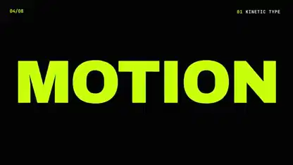</a> 
<b>市松模様のトランジションを使った文字アニメーション</b> 
<b>新しい発見</b> · <a href="https://x.com/onofumi_AI">@onofumi_AI</a> · 0:10 · 2026-11-11 
<a href="https://video.twimg.com/amplify_video/2120338753483116545/vid/avc1/1920x1080/vwT-IL1rNLXlVyYb.mp4?tag=29">▶ 本編</a> · <a href="https://x.com/onofumi_AI/status/2120338831245471779">元の投稿</a> · <a href="https://github.com/VibeClip/awesome-fable-5-2-videos/blob/main/docs/videos/ja/onofumi-ai-2120338831245471779.md">詳細</a>

</td>
<td width="33%" valign="top">
 
<b>AIがソフトウェア開発の乗っ取りを宣言する映像</b> 
<b>新しい発見</b> · <a href="https://x.com/iamwesleysmits">@iamwesleysmits</a> · 0:48 · 2026-11-10 
<a href="https://video.twimg.com/amplify_video/2120230145994694656/vid/avc1/1080x1920/ikcB__RdST1QlByH.mp4?tag=29">▶ 本編</a> · <a href="https://x.com/iamwesleysmits/status/2120230414568599912">元の投稿</a> · <a href="https://github.com/VibeClip/awesome-fable-5-2-videos/blob/main/docs/videos/ja/iamwesleysmits-2120230414568599912.md">詳細</a>

</td>
<td width="33%" valign="top">
 
<b>ジャガイモが青い椅子を壊すループ映像</b> 
<b>新しい発見</b> · <a href="https://x.com/argofowl">@argofowl</a> · 0:12 · 2026-11-10 
<a href="https://video.twimg.com/amplify_video/2120171639031865344/vid/avc1/1920x1080/ePpeMCdemHzHeXby.mp4?tag=29">▶ 本編</a> · <a href="https://x.com/argofowl/status/2120172009972003115">元の投稿</a> · <a href="https://github.com/VibeClip/awesome-fable-5-2-videos/blob/main/docs/videos/ja/argofowl-2120172009972003115.md">詳細</a>

</td>
</tr>
<tr>
<td width="33%" valign="top">
 
<b>本が折りたたまれてClaudeのロゴになる映像</b> 
<a href="https://x.com/LexnLin">@LexnLin</a> · 0:30 · 2026-11-10 
<a href="https://video.twimg.com/amplify_video/2120167523039518720/vid/avc1/2560x1440/1zRebOXK7I92mAvT.mp4?tag=29">▶ 本編</a> · <a href="https://x.com/LexnLin/status/2120167637133238295">元の投稿</a> · <a href="https://github.com/VibeClip/awesome-fable-5-2-videos/blob/main/docs/videos/ja/lexnlin-2120167637133238295.md">詳細</a>

</td>
<td width="33%" valign="top">
 
<b>Fable 5.2が色彩豊かなモーション映像で能力を紹介</b> 
<b>新しい発見</b> · <a href="https://x.com/husky__create">@husky__create</a> · 1:00 · 2026-11-10 
<a href="https://video.twimg.com/amplify_video/2120131882973270017/vid/avc1/1920x1080/nnzs4x3Nt9BJIO1e.mp4?tag=16">▶ 本編</a> · <a href="https://x.com/husky__create/status/2120131960349802957">元の投稿</a> · <a href="https://github.com/VibeClip/awesome-fable-5-2-videos/blob/main/docs/videos/ja/husky-create-2120131960349802957.md">詳細</a>

📝 プロンプトを見る

作者が下記のリンクでプロンプトを公開しています。参考素材や追加指示と合わせて元の文脈を確認してください。

<a href="https://x.com/husky__create/status/2120131960349802957">作者の公開プロンプトを読む</a>

</td>
<td width="33%" valign="top">
 
<b>液体クロームのリアルタイム映像と音楽</b> 
<b>新しい発見</b> · <a href="https://x.com/Nakachan">@Nakachan</a> · 0:10 · 2026-11-10 
<a href="https://video.twimg.com/amplify_video/2120127355821948928/vid/avc1/1048x720/YvT2SPzL_LdlCRo4.mp4?tag=14">▶ 本編</a> · <a href="https://x.com/Nakachan/status/2120127995625316511">元の投稿</a> · <a href="https://github.com/VibeClip/awesome-fable-5-2-videos/blob/main/docs/videos/ja/nakachan-2120127995625316511.md">詳細</a>

📝 プロンプトを見る
<blockquote>Fable 5.2の考える最強のメガデモを作って</blockquote>
<a href="https://x.com/Nakachan/status/2120127995625316511">作者の公開プロンプトを読む</a>

</td>
</tr>
<tr>
<td width="33%" valign="top">
 
<b>参考動画からBlenderで動かすTripo製キャラクター</b> 
<b>↗ 注目上昇</b> · <a href="https://x.com/maxt3chno">@maxt3chno</a> · 0:16 · 2026-11-10 
<a href="https://video.twimg.com/amplify_video/2120112581515829248/vid/avc1/2304x1440/FuMsMyEM4q9Lj-I7.mp4?tag=29">▶ 本編</a> · <a href="https://x.com/maxt3chno/status/2120113578531234172">元の投稿</a> · <a href="https://github.com/VibeClip/awesome-fable-5-2-videos/blob/main/docs/videos/ja/maxt3chno-2120113578531234172.md">詳細</a>

📝 プロンプトを見る

作者が下記のリンクでプロンプトを公開しています。参考素材や追加指示と合わせて元の文脈を確認してください。

<a href="https://x.com/maxt3chno/status/2120116202559217812">作者の公開プロンプトを読む</a>

</td>
<td width="33%" valign="top">
<a href="https://video.twimg.com/amplify_video/2120101415309963264/vid/avc1/1920x1080/oD3qIv_KNpscxPqn.mp4?tag=29">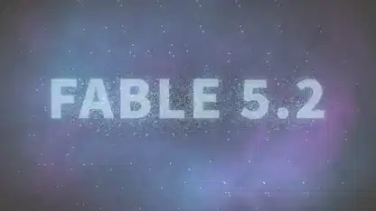</a> 
<b>フラクタル・流体・粒子をコードで描いた映像</b> 
<b>新しい発見</b> · <a href="https://x.com/su_nagomi">@su_nagomi</a> · 0:54 · 2026-11-10 
<a href="https://video.twimg.com/amplify_video/2120101415309963264/vid/avc1/1920x1080/oD3qIv_KNpscxPqn.mp4?tag=29">▶ 本編</a> · <a href="https://x.com/su_nagomi/status/2120104480557642091">元の投稿</a> · <a href="https://github.com/VibeClip/awesome-fable-5-2-videos/blob/main/docs/videos/ja/su-nagomi-2120104480557642091.md">詳細</a>

</td>
<td width="33%" valign="top">
 
<b>ジョギング・全力疾走・超高速ダッシュのプリビズ</b> 
<a href="https://x.com/akakuma0219">@akakuma0219</a> · 0:10 · 2026-11-10 
<a href="https://video.twimg.com/amplify_video/2120030599155195904/vid/avc1/1128x1280/gg7e4hW5e7l_HZcs.mp4?tag=29">▶ 本編</a> · <a href="https://x.com/akakuma0219/status/2120030634248929556">元の投稿</a> · <a href="https://github.com/VibeClip/awesome-fable-5-2-videos/blob/main/docs/videos/ja/akakuma0219-2120030634248929556.md">詳細</a>

📝 プロンプトを見る

作者が下記のリンクでプロンプトを公開しています。参考素材や追加指示と合わせて元の文脈を確認してください。

<a href="https://x.com/akakuma0219/status/2120030634248929556">作者の公開プロンプトを読む</a>

</td>
</tr>
<tr>
<td width="33%" valign="top">
 
<b>完成映像とリグを並べたロボットハンド</b> 
<b>新しい発見</b> · <a href="https://x.com/onofumi_AI">@onofumi_AI</a> · 0:19 · 2026-11-10 
<a href="https://video.twimg.com/amplify_video/2119979706703593472/vid/avc1/1920x1080/VkiOtr16fvkfXibk.mp4?tag=29">▶ 本編</a> · <a href="https://x.com/onofumi_AI/status/2119979764895330453">元の投稿</a> · <a href="https://github.com/VibeClip/awesome-fable-5-2-videos/blob/main/docs/videos/ja/onofumi-ai-2119979764895330453.md">詳細</a>

</td>
<td width="33%" valign="top">
 
<b>モーションデザイナーのポートフォリオ映像</b> 
<b>↗ 注目上昇</b> · <a href="https://x.com/Leviwoyun">@Leviwoyun</a> · 0:30 · 2026-11-10 
<a href="https://video.twimg.com/amplify_video/2119953670280478720/vid/avc1/1920x1080/jpEsi7C-DU6eEvmL.mp4?tag=29">▶ 本編</a> · <a href="https://x.com/Leviwoyun/status/2119955625820258308">元の投稿</a> · <a href="https://github.com/VibeClip/awesome-fable-5-2-videos/blob/main/docs/videos/ja/leviwoyun-2119955625820258308.md">詳細</a>

📝 プロンプトを見る

作者が下記のリンクでプロンプトを公開しています。参考素材や追加指示と合わせて元の文脈を確認してください。

<a href="https://x.com/Leviwoyun/status/2119955625820258308">作者の公開プロンプトを読む</a>

</td>
<td width="33%" valign="top">
 
<b>映画タイトル演出：Fable 5.2対Opus 5.5</b> 
<b>↗ 注目上昇</b> · <a href="https://x.com/muku_sns">@muku_sns</a> · 0:15 · 2026-11-09 
<a href="https://video.twimg.com/amplify_video/2119941109262815232/vid/avc1/1280x720/M2pIcNz3WNz2L3_c.mp4?tag=29">▶ 本編</a> · <a href="https://x.com/muku_sns/status/2119941490969624679">元の投稿</a> · <a href="https://github.com/VibeClip/awesome-fable-5-2-videos/blob/main/docs/videos/ja/muku-sns-2119941490969624679.md">詳細</a>

</td>
</tr>
<tr>
<td width="33%" valign="top">
 
<b>フレーム単位で同期するリップシンク</b> 
<a href="https://x.com/higgsfield_ai">@higgsfield_ai</a> · 0:19 · 2026-11-09 
<a href="https://video.twimg.com/amplify_video/2119909898960130048/vid/avc1/1440x1080/frJSbqPklB--YVmT.mp4?tag=29">▶ 本編</a> · <a href="https://x.com/higgsfield_ai/status/2119909938969580024">元の投稿</a> · <a href="https://github.com/VibeClip/awesome-fable-5-2-videos/blob/main/docs/videos/ja/higgsfield-ai-580024.md">詳細</a>

</td>
<td width="33%" valign="top">
 
<b>コードを話させるフォルマント合成</b> 
<a href="https://x.com/higgsfield_ai">@higgsfield_ai</a> · 0:15 · 2026-11-09 
<a href="https://video.twimg.com/amplify_video/2119906292542459904/vid/avc1/1920x1080/hSTBPKQjjpo8EiKA.mp4?tag=29">▶ 本編</a> · <a href="https://x.com/higgsfield_ai/status/2119906332077957629">元の投稿</a> · <a href="https://github.com/VibeClip/awesome-fable-5-2-videos/blob/main/docs/videos/ja/higgsfield-ai-957629.md">詳細</a>

</td>
<td width="33%" valign="top">
 
<b>Opus 5.5に別れを告げるリール</b> 
<a href="https://x.com/kaif9998">@kaif9998</a> · 0:15 · 2026-11-09 
<a href="https://video.twimg.com/amplify_video/2119903274031828992/vid/avc1/1920x1080/NG1jRcBKfR-B1SsJ.mp4?tag=29">▶ 本編</a> · <a href="https://x.com/kaif9998/status/2119903824848761287">元の投稿</a> · <a href="https://github.com/VibeClip/awesome-fable-5-2-videos/blob/main/docs/videos/ja/kaif9998-761287.md">詳細</a>

📝 プロンプトを見る

作者が下記のリンクでプロンプトを公開しています。参考素材や追加指示と合わせて元の文脈を確認してください。

<a href="https://x.com/kaif9998/status/2119904086288118219">作者の公開プロンプトを読む</a>

</td>
</tr>
<tr>
<td width="33%" valign="top">
 
<b>一筆ずつ描かれる肖像画</b> 
<a href="https://x.com/internetphysics">@internetphysics</a> · 1:00 · 2026-11-09 
<a href="https://video.twimg.com/amplify_video/2119902893394337792/vid/avc1/1440x748/Qs1TOP9hXZf08Xkl.mp4?tag=29">▶ 本編</a> · <a href="https://x.com/internetphysics/status/2119903808935313778">元の投稿</a> · <a href="https://github.com/VibeClip/awesome-fable-5-2-videos/blob/main/docs/videos/ja/internetphysics-313778.md">詳細</a>

</td>
<td width="33%" valign="top">
 
<b>共有プロンプトから生まれたリール</b> 
<a href="https://x.com/heypearlai">@heypearlai</a> · 0:15 · 2026-11-09 
<a href="https://video.twimg.com/amplify_video/2119902252723023872/vid/avc1/1920x1080/p0Q91YuD0ECQfDLv.mp4?tag=29">▶ 本編</a> · <a href="https://x.com/heypearlai/status/2119903760529113116">元の投稿</a> · <a href="https://github.com/VibeClip/awesome-fable-5-2-videos/blob/main/docs/videos/ja/heypearlai-113116.md">詳細</a>

</td>
<td width="33%" valign="top">
 
<b>ワンショットで描くピクセルの森</b> 
<a href="https://x.com/JBabaTalks">@JBabaTalks</a> · 0:41 · 2026-11-09 
<a href="https://video.twimg.com/amplify_video/2119903258588086272/vid/avc1/1808x1722/-oRMSGBL9FaVhUCA.mp4?tag=29">▶ 本編</a> · <a href="https://x.com/JBabaTalks/status/2119903489270694319">元の投稿</a> · <a href="https://github.com/VibeClip/awesome-fable-5-2-videos/blob/main/docs/videos/ja/jbabatalks-694319.md">詳細</a>

</td>
</tr>
<tr>
<td width="33%" valign="top">
 
<b>動きが詰まった小さな惑星</b> 
<a href="https://x.com/leoy_dev">@leoy_dev</a> · 1:09 · 2026-11-09 
<a href="https://video.twimg.com/amplify_video/2119902402643890177/vid/avc1/1920x918/dO0GyuVK6-YhKfS9.mp4?tag=29">▶ 本編</a> · <a href="https://x.com/leoy_dev/status/2119903166149922853">元の投稿</a> · <a href="https://github.com/VibeClip/awesome-fable-5-2-videos/blob/main/docs/videos/ja/leoy-dev-922853.md">詳細</a>

</td>
<td width="33%" valign="top">
 
<b>切り絵で描く日の出</b> 
<a href="https://x.com/eluchocha">@eluchocha</a> · 0:38 · 2026-11-09 
<a href="https://video.twimg.com/amplify_video/2119900235761688576/vid/avc1/1080x1080/cejGINOI5PNwIMrQ.mp4?tag=29">▶ 本編</a> · <a href="https://x.com/eluchocha/status/2119902302001635455">元の投稿</a> · <a href="https://github.com/VibeClip/awesome-fable-5-2-videos/blob/main/docs/videos/ja/eluchocha-635455.md">詳細</a>

</td>
<td width="33%" valign="top">
 
<b>粒子が混沌から挨拶を描く</b> 
<a href="https://x.com/ici_dab">@ici_dab</a> · 1:08 · 2026-11-09 
<a href="https://video.twimg.com/amplify_video/2119901144256299009/vid/avc1/1080x1080/5idfS03gAdRsJT3k.mp4?tag=29">▶ 本編</a> · <a href="https://x.com/ici_dab/status/2119901910237098351">元の投稿</a> · <a href="https://github.com/VibeClip/awesome-fable-5-2-videos/blob/main/docs/videos/ja/ici-dab-098351.md">詳細</a>

📝 プロンプトを見る

作者が下記のリンクでプロンプトを公開しています。参考素材や追加指示と合わせて元の文脈を確認してください。

<a href="https://x.com/ici_dab/status/2119902189271605579">作者の公開プロンプトを読む</a>

</td>
</tr>
<tr>
<td width="33%" valign="top">
 
<b>単純なルールが生む複雑な美</b> 
<a href="https://x.com/techfren">@techfren</a> · 1:18 · 2026-11-09 
<a href="https://video.twimg.com/amplify_video/2119899709913579520/vid/avc1/1920x1080/3p4USJ7fdJfCsE8Y.mp4?tag=29">▶ 本編</a> · <a href="https://x.com/techfren/status/2119899949756539056">元の投稿</a> · <a href="https://github.com/VibeClip/awesome-fable-5-2-videos/blob/main/docs/videos/ja/techfren-539056.md">詳細</a>

</td>
<td width="33%" valign="top">
 
<b>自転車のペリカンを一枚のSVGで</b> 
<a href="https://x.com/eyadnour">@eyadnour</a> · 0:10 · 2026-11-09 
<a href="https://video.twimg.com/amplify_video/2119898688180850688/vid/avc1/1600x1200/iBBPAJliWGeytp-Y.mp4?tag=29">▶ 本編</a> · <a href="https://x.com/eyadnour/status/2119899260606910886">元の投稿</a> · <a href="https://github.com/VibeClip/awesome-fable-5-2-videos/blob/main/docs/videos/ja/eyadnour-910886.md">詳細</a>

</td>
<td width="33%" valign="top">
 
<b>ヴァーラーナシーのデーヴ・ディーパーワリー</b> 
<a href="https://x.com/sverma_231">@sverma_231</a> · 0:38 · 2026-11-09 
<a href="https://video.twimg.com/amplify_video/2119894212145778688/vid/avc1/1920x1080/nsF2E4hVVA0HQ4Uu.mp4?tag=29">▶ 本編</a> · <a href="https://x.com/sverma_231/status/2119894332656570708">元の投稿</a> · <a href="https://github.com/VibeClip/awesome-fable-5-2-videos/blob/main/docs/videos/ja/sverma-231-570708.md">詳細</a>

</td>
</tr>
<tr>
<td width="33%" valign="top">
 
<b>2つのClaudeモデルで比べる棒人間の決闘</b> 
<b>新しい発見</b> · <a href="https://x.com/DanielZambrini">@DanielZambrini</a> · 0:15 · 2026-11-09 
<a href="https://video.twimg.com/amplify_video/2119893599638675457/vid/avc1/1280x1600/iClzByVh2DZ-9UoK.mp4?tag=29">▶ 本編</a> · <a href="https://x.com/DanielZambrini/status/2119893834276507954">元の投稿</a> · <a href="https://github.com/VibeClip/awesome-fable-5-2-videos/blob/main/docs/videos/ja/danielzambrini-2119893834276507954.md">詳細</a>

</td>
<td width="33%" valign="top">
 
<b>テスト中だと気づくペリカン</b> 
<a href="https://x.com/benjistacked">@benjistacked</a> · 0:15 · 2026-11-09 
<a href="https://video.twimg.com/amplify_video/2119892925077143552/vid/avc1/1920x1080/SEaLFBXtc8dukb55.mp4?tag=29">▶ 本編</a> · <a href="https://x.com/benjistacked/status/2119893035240849805">元の投稿</a> · <a href="https://github.com/VibeClip/awesome-fable-5-2-videos/blob/main/docs/videos/ja/benjistacked-849805.md">詳細</a>

</td>
<td width="33%" valign="top">
 
<b>家で作れるペットロボット</b> 
<a href="https://x.com/mattshumer_">@mattshumer_</a> · 0:20 · 2026-11-09 
<a href="https://video.twimg.com/amplify_video/2119889498527969281/vid/avc1/960x540/EqG79zEwj6BDTrPE.mp4?tag=29">▶ 本編</a> · <a href="https://x.com/mattshumer_/status/2119889518564147409">元の投稿</a> · <a href="https://github.com/VibeClip/awesome-fable-5-2-videos/blob/main/docs/videos/ja/mattshumer-147409.md">詳細</a>

</td>
</tr>
<tr>
<td width="33%" valign="top">
 
<b>ペリカンと自転車とゲームコントローラー</b> 
<a href="https://x.com/dummerspast39">@dummerspast39</a> · 0:15 · 2026-11-09 
<a href="https://video.twimg.com/amplify_video/2119889199935447041/vid/avc1/2048x2048/TrgMbHC6HoEL8LT9.mp4?tag=29">▶ 本編</a> · <a href="https://x.com/dummerspast39/status/2119889279740432389">元の投稿</a> · <a href="https://github.com/VibeClip/awesome-fable-5-2-videos/blob/main/docs/videos/ja/dummerspast39-432389.md">詳細</a>

</td>
<td width="33%" valign="top">
 
<b>8分で作るモーションデザイン映像</b> 
<a href="https://x.com/titouangillet_">@titouangillet_</a> · 0:40 · 2026-11-09 
元の投稿は利用不可 · <a href="https://x.com/titouangillet_/status/2119885739769131093">元の投稿</a> · <a href="https://github.com/VibeClip/awesome-fable-5-2-videos/blob/main/docs/videos/ja/titouangillet-131093.md">詳細</a>

</td>
<td width="33%" valign="top">
 
<b>小さなプリズムで作るステッカーサイン</b> 
<a href="https://x.com/Maaaaaaadiii">@Maaaaaaadiii</a> · 0:13 · 2026-11-09 
<a href="https://video.twimg.com/amplify_video/2119884897305190402/vid/avc1/1920x1080/S18ZsHUYlSo8vdOU.mp4?tag=29">▶ 本編</a> · <a href="https://x.com/Maaaaaaadiii/status/2119885527243714946">元の投稿</a> · <a href="https://github.com/VibeClip/awesome-fable-5-2-videos/blob/main/docs/videos/ja/maaaaaaadiii-714946.md">詳細</a>

</td>
</tr>
<tr>
<td width="33%" valign="top">
 
<b>小さな魔法使いの発表映像</b> 
<a href="https://x.com/other__reality">@other__reality</a> · 0:26 · 2026-11-09 
<a href="https://video.twimg.com/amplify_video/2119884273071411200/vid/avc1/1280x720/DwN1eSgpBgK8Wpa6.mp4?tag=14">▶ 本編</a> · <a href="https://x.com/other__reality/status/2119885430627913784">元の投稿</a> · <a href="https://github.com/VibeClip/awesome-fable-5-2-videos/blob/main/docs/videos/ja/other-reality-913784.md">詳細</a>

📝 プロンプトを見る
<blockquote>Create an animated video of clawd creating and releasing Claude Fable 5.2</blockquote>
<a href="https://x.com/other__reality/status/2119885430627913784">作者の公開プロンプトを読む</a>

</td>
<td width="33%" valign="top">
 
<b>空港の出発案内ボード</b> 
<a href="https://x.com/QRoonjha">@QRoonjha</a> · 0:12 · 2026-11-09 
<a href="https://video.twimg.com/amplify_video/2119884921611460608/vid/avc1/1920x1080/P5jqJNDpsShsC-ka.mp4?tag=29">▶ 本編</a> · <a href="https://x.com/QRoonjha/status/2119885167045300593">元の投稿</a> · <a href="https://github.com/VibeClip/awesome-fable-5-2-videos/blob/main/docs/videos/ja/qroonjha-300593.md">詳細</a>

</td>
<td width="33%" valign="top">
 
<b>宙に浮かぶピクセルの島</b> 
<a href="https://x.com/jumperz">@jumperz</a> · 0:30 · 2026-11-09 
<a href="https://video.twimg.com/amplify_video/2119884053226651648/vid/avc1/1920x1080/PTIheNUul9mU31Ay.mp4?tag=29">▶ 本編</a> · <a href="https://x.com/jumperz/status/2119884258789757436">元の投稿</a> · <a href="https://github.com/VibeClip/awesome-fable-5-2-videos/blob/main/docs/videos/ja/jumperz-757436.md">詳細</a>

</td>
</tr>
<tr>
<td width="33%" valign="top">
 
<b>動き出す自転車のペリカン</b> 
<a href="https://x.com/abhinavflac">@abhinavflac</a> · 0:11 · 2026-11-09 
<a href="https://video.twimg.com/amplify_video/2119884052622876672/vid/avc1/1920x1080/cKq9zTwAltKH6RX3.mp4?tag=29">▶ 本編</a> · <a href="https://x.com/abhinavflac/status/2119884257145581980">元の投稿</a> · <a href="https://github.com/VibeClip/awesome-fable-5-2-videos/blob/main/docs/videos/ja/abhinavflac-581980.md">詳細</a>

</td>
<td width="33%" valign="top">
 
<b>地球の軌道から始まる発表映像</b> 
<a href="https://x.com/octuedit">@octuedit</a> · 0:23 · 2026-11-09 
<a href="https://video.twimg.com/amplify_video/2119883683788460032/vid/avc1/1920x1080/uhCV24iRRwiw6DZD.mp4?tag=29">▶ 本編</a> · <a href="https://x.com/octuedit/status/2119883810133397978">元の投稿</a> · <a href="https://github.com/VibeClip/awesome-fable-5-2-videos/blob/main/docs/videos/ja/octuedit-397978.md">詳細</a>

</td>
<td width="33%" valign="top">
 
<b>40万の粒子が描くループ</b> 
<a href="https://x.com/immadiuttej">@immadiuttej</a> · 0:24 · 2026-11-09 
元の投稿は利用不可 · <a href="https://x.com/immadiuttej/status/2119882515410538626">元の投稿</a> · <a href="https://github.com/VibeClip/awesome-fable-5-2-videos/blob/main/docs/videos/ja/immadiuttej-538626.md">詳細</a>

</td>
</tr>
<tr>
<td width="33%" valign="top">
 
<b>印象派風ピクセルアートの川</b> 
<a href="https://x.com/aimi_teno">@aimi_teno</a> · 1:00 · 2026-11-09 
<a href="https://video.twimg.com/amplify_video/2119881783424827392/vid/avc1/720x1278/izAE8abvXqtU_pQN.mp4?tag=29">▶ 本編</a> · <a href="https://x.com/aimi_teno/status/2119881949540229421">元の投稿</a> · <a href="https://github.com/VibeClip/awesome-fable-5-2-videos/blob/main/docs/videos/ja/aimi-teno-229421.md">詳細</a>

</td>
<td width="33%" valign="top">
 
<b>動き出すチョークの絵</b> 
<a href="https://x.com/dfeinition">@dfeinition</a> · 0:31 · 2026-11-09 
<a href="https://video.twimg.com/amplify_video/2119871816848084993/vid/avc1/3840x2160/KTr_-pLweRTaTs_F.mp4?tag=29">▶ 本編</a> · <a href="https://x.com/dfeinition/status/2119881243990859818">元の投稿</a> · <a href="https://github.com/VibeClip/awesome-fable-5-2-videos/blob/main/docs/videos/ja/dfeinition-859818.md">詳細</a>

</td>
<td width="33%" valign="top">
 
<b>惑星のタイトルシーケンス</b> 
<a href="https://x.com/octuedit">@octuedit</a> · 0:27 · 2026-11-09 
<a href="https://video.twimg.com/amplify_video/2119879938488811520/vid/avc1/3840x2160/0a9v9wYF2-6m0Ibf.mp4?tag=29">▶ 本編</a> · <a href="https://x.com/octuedit/status/2119880089039171806">元の投稿</a> · <a href="https://github.com/VibeClip/awesome-fable-5-2-videos/blob/main/docs/videos/ja/octuedit-171806.md">詳細</a>

</td>
</tr>
<tr>
<td width="33%" valign="top">
 
<b>自分についての10秒アニメーション</b> 
<a href="https://x.com/dariuusnv">@dariuusnv</a> · 0:10 · 2026-11-09 
<a href="https://video.twimg.com/amplify_video/2119878913857888257/vid/avc1/1920x1080/ydaWAIBjAaoGY3Ei.mp4?tag=29">▶ 本編</a> · <a href="https://x.com/dariuusnv/status/2119878952588329192">元の投稿</a> · <a href="https://github.com/VibeClip/awesome-fable-5-2-videos/blob/main/docs/videos/ja/dariuusnv-329192.md">詳細</a>

</td>
<td width="33%" valign="top">
 
<b>マニフェストを綴るキーボード</b> 
<a href="https://x.com/seanaiux">@seanaiux</a> · 0:14 · 2026-11-09 
<a href="https://video.twimg.com/amplify_video/2119871818400231424/vid/avc1/1920x1080/18OA01YaRqLibwCV.mp4?tag=29">▶ 本編</a> · <a href="https://x.com/seanaiux/status/2119877685044240526">元の投稿</a> · <a href="https://github.com/VibeClip/awesome-fable-5-2-videos/blob/main/docs/videos/ja/seanaiux-240526.md">詳細</a>

</td>
<td width="33%" valign="top">
 
<b>アイソメトリックの空中村</b> 
<a href="https://x.com/josendev">@josendev</a> · 0:08 · 2026-11-09 
<a href="https://video.twimg.com/amplify_video/2119876092433510400/vid/avc1/1920x1080/FdZgIOU9olLEHOKV.mp4?tag=29">▶ 本編</a> · <a href="https://x.com/josendev/status/2119876164051243409">元の投稿</a> · <a href="https://github.com/VibeClip/awesome-fable-5-2-videos/blob/main/docs/videos/ja/josendev-243409.md">詳細</a>

</td>
</tr>
<tr>
<td width="33%" valign="top">
 
<b>一筆ずつ描かれる肖像</b> 
<a href="https://x.com/devsvn2">@devsvn2</a> · 0:35 · 2026-11-09 
<a href="https://video.twimg.com/amplify_video/2119875459819450368/vid/avc1/1160x1200/m_1yxd9t-C37pVN-.mp4?tag=29">▶ 本編</a> · <a href="https://x.com/devsvn2/status/2119875516216070289">元の投稿</a> · <a href="https://github.com/VibeClip/awesome-fable-5-2-videos/blob/main/docs/videos/ja/devsvn2-070289.md">詳細</a>

</td>
<td width="33%"></td>
<td width="33%"></td>
</tr>
</table>

## 3Dの世界とシミュレーション · 107

プロシージャルな世界、仮想都市、Blenderの場面、物理シミュレーション。

<table>
<tr>
<td width="33%" valign="top">
 
<b>『Ivory Kingdom』雪山にそびえる白亜の宮殿</b> 
<b>新しい発見</b> · <a href="https://x.com/scottstts">@scottstts</a> · 2:00 · 2026-11-14 
<a href="https://video.twimg.com/amplify_video/2121386923503611904/vid/avc1/3840x2160/Xwr5UsmN7kwaB5iI.mp4?tag=29">▶ 本編</a> · <a href="https://x.com/scottstts/status/2121626206613491787">元の投稿</a> · <a href="https://github.com/VibeClip/awesome-fable-5-2-videos/blob/main/docs/videos/ja/scottstts-2121626206613491787.md">詳細</a>

</td>
<td width="33%" valign="top">
<a href="https://video.twimg.com/amplify_video/2121535105013334016/vid/avc1/1080x1440/54zgdEgNUSGUZb8U.mp4?tag=29">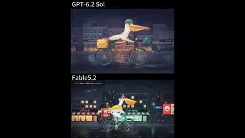</a> 
<b>雨の中を自転車で配達するペリカンを2モデルで比較</b> 
<b>新しい発見</b> · <a href="https://x.com/Stargridcompass">@Stargridcompass</a> · 0:28 · 2026-11-14 
<a href="https://video.twimg.com/amplify_video/2121535105013334016/vid/avc1/1080x1440/54zgdEgNUSGUZb8U.mp4?tag=29">▶ 本編</a> · <a href="https://x.com/Stargridcompass/status/2121543669882745007">元の投稿</a> · <a href="https://github.com/VibeClip/awesome-fable-5-2-videos/blob/main/docs/videos/ja/stargridcompass-2121543669882745007.md">詳細</a>

</td>
<td width="33%" valign="top">
<a href="https://video.twimg.com/amplify_video/2121286071963074560/vid/avc1/3840x2160/qp3245jRWTI2LD9U.mp4?tag=29">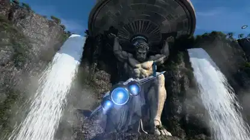</a> 
<b>断崖から海へ飛ぶ『Atlas Ascendant』</b> 
<b>↗ 注目上昇</b> · <a href="https://x.com/scottstts">@scottstts</a> · 2:00 · 2026-11-13 
<a href="https://video.twimg.com/amplify_video/2121286071963074560/vid/avc1/3840x2160/qp3245jRWTI2LD9U.mp4?tag=29">▶ 本編</a> · <a href="https://x.com/scottstts/status/2121313898619961453">元の投稿</a> · <a href="https://github.com/VibeClip/awesome-fable-5-2-videos/blob/main/docs/videos/ja/scottstts-2121313898619961453.md">詳細</a>

</td>
</tr>
<tr>
<td width="33%" valign="top">
<a href="https://video.twimg.com/amplify_video/2121269410405003264/vid/avc1/1080x1350/TOmbg6cM92gFD65s.mp4?tag=29">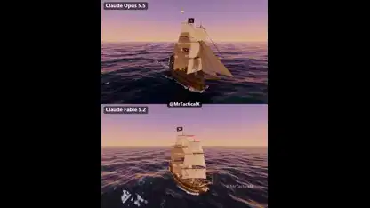</a> 
<b>同じ指示で作った2隻のBlender海賊船</b> 
<b>新しい発見</b> · <a href="https://x.com/MrTacticalX">@MrTacticalX</a> · 0:25 · 2026-11-13 
<a href="https://video.twimg.com/amplify_video/2121269410405003264/vid/avc1/1080x1350/TOmbg6cM92gFD65s.mp4?tag=29">▶ 本編</a> · <a href="https://x.com/MrTacticalX/status/2121270015840141774">元の投稿</a> · <a href="https://github.com/VibeClip/awesome-fable-5-2-videos/blob/main/docs/videos/ja/mrtacticalx-2121270015840141774.md">詳細</a>

📝 プロンプトを見る
<blockquote>build a pirate ship in Blender</blockquote>
<a href="https://x.com/MrTacticalX/status/2121270015840141774">作者の公開プロンプトを読む</a>

</td>
<td width="33%" valign="top">
 
<b>雲上の寺院を巡る『Astral Realm』</b> 
<b>↗ 注目上昇</b> · <a href="https://x.com/scottstts">@scottstts</a> · 2:00 · 2026-11-13 
<a href="https://video.twimg.com/amplify_video/2121157447360348161/vid/avc1/3840x2160/b-rzsR5rtkFuWvip.mp4?tag=29">▶ 本編</a> · <a href="https://x.com/scottstts/status/2121262812228141395">元の投稿</a> · <a href="https://github.com/VibeClip/awesome-fable-5-2-videos/blob/main/docs/videos/ja/scottstts-2121262812228141395.md">詳細</a>

</td>
<td width="33%" valign="top">
 
<b>ガウシアンスプラッティングと3D素材を組み合わせた森のキャンピングカー</b> 
<b>新しい発見</b> · <a href="https://x.com/onofumi_AI">@onofumi_AI</a> · 0:23 · 2026-11-13 
<a href="https://video.twimg.com/amplify_video/2121159877590708224/vid/avc1/1920x1080/fRTsNzF7PlWrAQ--.mp4?tag=29">▶ 本編</a> · <a href="https://x.com/onofumi_AI/status/2121160008469778675">元の投稿</a> · <a href="https://github.com/VibeClip/awesome-fable-5-2-videos/blob/main/docs/videos/ja/onofumi-ai-2121160008469778675.md">詳細</a>

</td>
</tr>
<tr>
<td width="33%" valign="top">
 
<b>二連トレーラーの後退を学ぶシミュレーション</b> 
<b>新しい発見</b> · <a href="https://x.com/imjustnewatai">@imjustnewatai</a> · 1:32 · 2026-11-13 
<a href="https://video.twimg.com/amplify_video/2121097408348078080/vid/avc1/1080x1080/pItof1FZpm6_WoHd.mp4?tag=29">▶ 本編</a> · <a href="https://x.com/imjustnewatai/status/2121097470373511184">元の投稿</a> · <a href="https://github.com/VibeClip/awesome-fable-5-2-videos/blob/main/docs/videos/ja/imjustnewatai-2121097470373511184.md">詳細</a>

</td>
<td width="33%" valign="top">
 
<b>雲海に浮かぶ3D宮殿『Celestial Palace』</b> 
<b>新しい発見</b> · <a href="https://x.com/scottstts">@scottstts</a> · 2:00 · 2026-11-12 
<a href="https://video.twimg.com/amplify_video/2120975845300879360/vid/avc1/3840x2160/aUvUHaQSajvWcVJf.mp4?tag=29">▶ 本編</a> · <a href="https://x.com/scottstts/status/2120977157396533678">元の投稿</a> · <a href="https://github.com/VibeClip/awesome-fable-5-2-videos/blob/main/docs/videos/ja/scottstts-2120977157396533678.md">詳細</a>

</td>
<td width="33%" valign="top">
 
<b>参考画像から作ったVRMアバター</b> 
<b>新しい発見</b> · <a href="https://x.com/hajimetwi3">@hajimetwi3</a> · 0:32 · 2026-11-12 
<a href="https://video.twimg.com/amplify_video/2120909338009370624/vid/avc1/1332x752/dq-euZULQItG3ci3.mp4?tag=29">▶ 本編</a> · <a href="https://x.com/hajimetwi3/status/2120910386614690098">元の投稿</a> · <a href="https://github.com/VibeClip/awesome-fable-5-2-videos/blob/main/docs/videos/ja/hajimetwi3-2120910386614690098.md">詳細</a>

</td>
</tr>
<tr>
<td width="33%" valign="top">
 
<b>手続き生成で作った崖の家『Arcadia』</b> 
<b>新しい発見</b> · <a href="https://x.com/scottstts">@scottstts</a> · 2:00 · 2026-11-12 
<a href="https://video.twimg.com/amplify_video/2120905300781694977/vid/avc1/3840x2160/id9V3ukBWga8hIl-.mp4?tag=29">▶ 本編</a> · <a href="https://x.com/scottstts/status/2120907123357851697">元の投稿</a> · <a href="https://github.com/VibeClip/awesome-fable-5-2-videos/blob/main/docs/videos/ja/scottstts-2120907123357851697.md">詳細</a>

</td>
<td width="33%" valign="top">
 
<b>スプライトを積層した恐竜の追跡シーン</b> 
<b>↗ 注目上昇</b> · <a href="https://x.com/loktar00">@loktar00</a> · 1:09 · 2026-11-12 
<a href="https://video.twimg.com/amplify_video/2120735773737558016/vid/avc1/1920x1080/sJp2l7Rcm0PCGphv.mp4?tag=29">▶ 本編</a> · <a href="https://x.com/loktar00/status/2120905457380507991">元の投稿</a> · <a href="https://github.com/VibeClip/awesome-fable-5-2-videos/blob/main/docs/videos/ja/loktar00-2120905457380507991.md">詳細</a>

</td>
<td width="33%" valign="top">
<a href="https://video.twimg.com/amplify_video/2120858404713304064/vid/avc1/1920x1080/Kz9wbfYR2hLYPYbK.mp4?tag=29">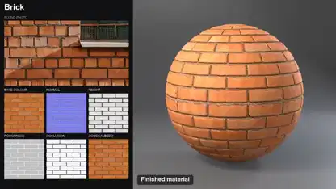</a> 
<b>レンガ・岩・木材のPBRマテリアル比較</b> 
<b>新しい発見</b> · <a href="https://x.com/KHvostikk">@KHvostikk</a> · 0:29 · 2026-11-12 
<a href="https://video.twimg.com/amplify_video/2120858404713304064/vid/avc1/1920x1080/Kz9wbfYR2hLYPYbK.mp4?tag=29">▶ 本編</a> · <a href="https://x.com/KHvostikk/status/2120858483390337361">元の投稿</a> · <a href="https://github.com/VibeClip/awesome-fable-5-2-videos/blob/main/docs/videos/ja/khvostikk-2120858483390337361.md">詳細</a>

</td>
</tr>
<tr>
<td width="33%" valign="top">
 
<b>ミニチュアの街を走るブロック製スーパーカー</b> 
<b>↗ 注目上昇</b> · <a href="https://x.com/MrTacticalX">@MrTacticalX</a> · 0:29 · 2026-11-12 
<a href="https://video.twimg.com/amplify_video/2120842640656642048/vid/avc1/1080x1350/FQ9QjhiAQKuKCDWV.mp4?tag=29">▶ 本編</a> · <a href="https://x.com/MrTacticalX/status/2120842705395966254">元の投稿</a> · <a href="https://github.com/VibeClip/awesome-fable-5-2-videos/blob/main/docs/videos/ja/mrtacticalx-2120842705395966254.md">詳細</a>

</td>
<td width="33%" valign="top">
 
<b>草の葉から軌道まで途切れず飛ぶ映像</b> 
<b>新しい発見</b> · <a href="https://x.com/KanaWorks_AI">@KanaWorks_AI</a> · 0:30 · 2026-11-12 
<a href="https://video.twimg.com/amplify_video/2120756185255280640/vid/avc1/1920x1080/cyqR1cP_m0o4kK5p.mp4?tag=29">▶ 本編</a> · <a href="https://x.com/KanaWorks_AI/status/2120756625699143977">元の投稿</a> · <a href="https://github.com/VibeClip/awesome-fable-5-2-videos/blob/main/docs/videos/ja/kanaworks-ai-2120756625699143977.md">詳細</a>

</td>
<td width="33%" valign="top">
 
<b>Blenderで作る剣の振りとエフェクト</b> 
<b>新しい発見</b> · <a href="https://x.com/onofumi_AI">@onofumi_AI</a> · 0:15 · 2026-11-12 
<a href="https://video.twimg.com/amplify_video/2120708740123082752/vid/avc1/1920x1080/duaI3bJKlf6lyyW1.mp4?tag=29">▶ 本編</a> · <a href="https://x.com/onofumi_AI/status/2120708776139624625">元の投稿</a> · <a href="https://github.com/VibeClip/awesome-fable-5-2-videos/blob/main/docs/videos/ja/onofumi-ai-2120708776139624625.md">詳細</a>

</td>
</tr>
<tr>
<td width="33%" valign="top">
 
<b>50台の車が試験コースを走るシミュレーション</b> 
<b>新しい発見</b> · <a href="https://x.com/imjustnewatai">@imjustnewatai</a> · 1:38 · 2026-11-12 
<a href="https://video.twimg.com/amplify_video/2120695261080997888/vid/avc1/1920x1080/Kxjgtlp4UUvIqjQ_.mp4?tag=29">▶ 本編</a> · <a href="https://x.com/imjustnewatai/status/2120695368874631226">元の投稿</a> · <a href="https://github.com/VibeClip/awesome-fable-5-2-videos/blob/main/docs/videos/ja/imjustnewatai-2120695368874631226.md">詳細</a>

</td>
<td width="33%" valign="top">
 
<b>空の色が変わる絵画風の谷を歩く</b> 
<b>↗ 注目上昇</b> · <a href="https://x.com/BlendiByl">@BlendiByl</a> · 0:23 · 2026-11-12 
<a href="https://video.twimg.com/amplify_video/2120693488123871232/vid/avc1/2560x1440/qE95X-Mwerms3yXv.mp4?tag=29">▶ 本編</a> · <a href="https://x.com/BlendiByl/status/2120694003230560585">元の投稿</a> · <a href="https://github.com/VibeClip/awesome-fable-5-2-videos/blob/main/docs/videos/ja/blendibyl-2120694003230560585.md">詳細</a>

</td>
<td width="33%" valign="top">
<a href="https://video.twimg.com/amplify_video/2120675630282911744/vid/avc1/1920x1080/X2zBSZVT9empWwwq.mp4?tag=29">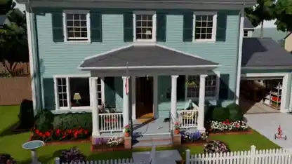</a> 
<b>二階建ての家を一人称視点で歩く</b> 
<b>↗ 注目上昇</b> · <a href="https://x.com/calebfahlgren">@calebfahlgren</a> · 0:44 · 2026-11-12 
<a href="https://video.twimg.com/amplify_video/2120675630282911744/vid/avc1/1920x1080/X2zBSZVT9empWwwq.mp4?tag=29">▶ 本編</a> · <a href="https://x.com/calebfahlgren/status/2120680918914601165">元の投稿</a> · <a href="https://github.com/VibeClip/awesome-fable-5-2-videos/blob/main/docs/videos/ja/calebfahlgren-2120680918914601165.md">詳細</a>

📝 プロンプトを見る

作者が下記のリンクでプロンプトを公開しています。参考素材や追加指示と合わせて元の文脈を確認してください。

<a href="https://x.com/calebfahlgren/status/2120680922336862315">作者の公開プロンプトを読む</a>

</td>
</tr>
<tr>
<td width="33%" valign="top">
 
<b>スプライトを重ねて作る砂漠のジオラマ</b> 
<b>↗ 注目上昇</b> · <a href="https://x.com/loktar00">@loktar00</a> · 0:40 · 2026-11-11 
<a href="https://video.twimg.com/amplify_video/2120653467043667968/vid/avc1/1920x1080/hy2Hk_wMUEO0YT1V.mp4?tag=29">▶ 本編</a> · <a href="https://x.com/loktar00/status/2120653702843277359">元の投稿</a> · <a href="https://github.com/VibeClip/awesome-fable-5-2-videos/blob/main/docs/videos/ja/loktar00-2120653702843277359.md">詳細</a>

</td>
<td width="33%" valign="top">
 
<b>参考画像から作った公衆電話の3Dモデル</b> 
<b>新しい発見</b> · <a href="https://x.com/KHvostikk">@KHvostikk</a> · 0:12 · 2026-11-11 
<a href="https://video.twimg.com/amplify_video/2120635020545064960/vid/avc1/1920x1080/gTXdQtNaUG2UIDja.mp4?tag=29">▶ 本編</a> · <a href="https://x.com/KHvostikk/status/2120635318001180996">元の投稿</a> · <a href="https://github.com/VibeClip/awesome-fable-5-2-videos/blob/main/docs/videos/ja/khvostikk-2120635318001180996.md">詳細</a>

</td>
<td width="33%" valign="top">
 
<b>Three.jsで回転する架空キャラクターの顔図鑑</b> 
<b>新しい発見</b> · <a href="https://x.com/chetaslua">@chetaslua</a> · 0:20 · 2026-11-11 
<a href="https://video.twimg.com/amplify_video/2120500565855842304/vid/avc1/1920x1080/QIr-yYCmh1SRLnLh.mp4?tag=29">▶ 本編</a> · <a href="https://x.com/chetaslua/status/2120500937852920144">元の投稿</a> · <a href="https://github.com/VibeClip/awesome-fable-5-2-videos/blob/main/docs/videos/ja/chetaslua-2120500937852920144.md">詳細</a>

</td>
</tr>
<tr>
<td width="33%" valign="top">
 
<b>BlenderとUnrealで作った森林環境</b> 
<b>新しい発見</b> · <a href="https://x.com/RezAIT00">@RezAIT00</a> · 0:48 · 2026-11-11 
<a href="https://video.twimg.com/amplify_video/2120498139656286208/vid/avc1/1920x1080/cIuG9Eiu6uNTlvEm.mp4?tag=29">▶ 本編</a> · <a href="https://x.com/RezAIT00/status/2120498246426706176">元の投稿</a> · <a href="https://github.com/VibeClip/awesome-fable-5-2-videos/blob/main/docs/videos/ja/rezait00-2120498246426706176.md">詳細</a>

</td>
<td width="33%" valign="top">
 
<b>歩いて回れる横浜みなとみらいの3Dシーン</b> 
<b>新しい発見</b> · <a href="https://x.com/excel_niisan">@excel_niisan</a> · 0:36 · 2026-11-11 
<a href="https://video.twimg.com/amplify_video/2120425125900328960/vid/avc1/1168x2248/ewBXgYEXri_Y_wGA.mp4?tag=29">▶ 本編</a> · <a href="https://x.com/excel_niisan/status/2120425260889817476">元の投稿</a> · <a href="https://github.com/VibeClip/awesome-fable-5-2-videos/blob/main/docs/videos/ja/excel-niisan-2120425260889817476.md">詳細</a>

📝 プロンプトを見る
<blockquote>横浜みなとみらいの3D空間を作って</blockquote>
<a href="https://x.com/excel_niisan/status/2120425260889817476">作者の公開プロンプトを読む</a>

</td>
<td width="33%" valign="top">
 
<b>Latticeで作るビー玉の連鎖装置</b> 
<b>新しい発見</b> · <a href="https://x.com/sin_ceriously">@sin_ceriously</a> · 0:25 · 2026-11-11 
<a href="https://video.twimg.com/amplify_video/2120314560297021440/vid/avc1/3840x2160/7HGk23L88dFl3nSk.mp4?tag=29">▶ 本編</a> · <a href="https://x.com/sin_ceriously/status/2120318808216981986">元の投稿</a> · <a href="https://github.com/VibeClip/awesome-fable-5-2-videos/blob/main/docs/videos/ja/sin-ceriously-2120318808216981986.md">詳細</a>

</td>
</tr>
<tr>
<td width="33%" valign="top">
 
<b>Three.jsの部屋をBlenderで再構成</b> 
<b>新しい発見</b> · <a href="https://x.com/MengTo">@MengTo</a> · 0:52 · 2026-11-11 
<a href="https://video.twimg.com/amplify_video/2120315007900819456/vid/avc1/1920x1080/GZkLFadi9AtkYzAJ.mp4?tag=29">▶ 本編</a> · <a href="https://x.com/MengTo/status/2120316203738829180">元の投稿</a> · <a href="https://github.com/VibeClip/awesome-fable-5-2-videos/blob/main/docs/videos/ja/mengto-2120316203738829180.md">詳細</a>

</td>
<td width="33%" valign="top">
 
<b>秋の禅庭を歩く</b> 
<b>新しい発見</b> · <a href="https://x.com/jpschroeder">@jpschroeder</a> · 1:29 · 2026-11-10 
<a href="https://video.twimg.com/amplify_video/2120274361063964672/vid/avc1/2208x1232/MGymGTy2uK8ZYX4z.mp4?tag=29">▶ 本編</a> · <a href="https://x.com/jpschroeder/status/2120274979614851145">元の投稿</a> · <a href="https://github.com/VibeClip/awesome-fable-5-2-videos/blob/main/docs/videos/ja/jpschroeder-2120274979614851145.md">詳細</a>

</td>
<td width="33%" valign="top">
 
<b>Tripo素材から始めるBlenderキャラクターリグ比較</b> 
<b>新しい発見</b> · <a href="https://x.com/0xApexAi">@0xApexAi</a> · 0:28 · 2026-11-10 
<a href="https://video.twimg.com/amplify_video/2120267796810473472/vid/avc1/1920x1080/KSmjuhKzCxmnfnXo.mp4?tag=29">▶ 本編</a> · <a href="https://x.com/0xApexAi/status/2120268733360779645">元の投稿</a> · <a href="https://github.com/VibeClip/awesome-fable-5-2-videos/blob/main/docs/videos/ja/0xapexai-2120268733360779645.md">詳細</a>

</td>
</tr>
<tr>
<td width="33%" valign="top">
 
<b>雨の夜の温室</b> 
<b>新しい発見</b> · <a href="https://x.com/itsluneri">@itsluneri</a> · 0:28 · 2026-11-10 
<a href="https://video.twimg.com/amplify_video/2120266429807083520/vid/avc1/1280x536/cqqPa-Wwvx0eJotG.mp4?tag=29">▶ 本編</a> · <a href="https://x.com/itsluneri/status/2120266583826182317">元の投稿</a> · <a href="https://github.com/VibeClip/awesome-fable-5-2-videos/blob/main/docs/videos/ja/itsluneri-2120266583826182317.md">詳細</a>

</td>
<td width="33%" valign="top">
 
<b>間取り図と写真から作る住宅の3Dツアー</b> 
<b>新しい発見</b> · <a href="https://x.com/oalanicolas">@oalanicolas</a> · 0:45 · 2026-11-10 
<a href="https://video.twimg.com/amplify_video/2120265385471574016/vid/avc1/1920x1080/fIfzIciKght3vPN5.mp4?tag=29">▶ 本編</a> · <a href="https://x.com/oalanicolas/status/2120266468780585456">元の投稿</a> · <a href="https://github.com/VibeClip/awesome-fable-5-2-videos/blob/main/docs/videos/ja/oalanicolas-2120266468780585456.md">詳細</a>

📝 プロンプトを見る

作者が下記のリンクでプロンプトを公開しています。参考素材や追加指示と合わせて元の文脈を確認してください。

<a href="https://x.com/oalanicolas/status/2120266474950389779">作者の公開プロンプトを読む</a>

</td>
<td width="33%" valign="top">
 
<b>暗闇に灯るThree.jsのたき火</b> 
<b>新しい発見</b> · <a href="https://x.com/hajimetwi3">@hajimetwi3</a> · 0:32 · 2026-11-10 
<a href="https://video.twimg.com/amplify_video/2120245103516364800/vid/avc1/758x714/qnjU8gDkvq3f7_-K.mp4?tag=29">▶ 本編</a> · <a href="https://x.com/hajimetwi3/status/2120245907115651521">元の投稿</a> · <a href="https://github.com/VibeClip/awesome-fable-5-2-videos/blob/main/docs/videos/ja/hajimetwi3-2120245907115651521.md">詳細</a>

📝 プロンプトを見る
<blockquote>AAA級のたき火が見たい！！</blockquote>
<a href="https://x.com/hajimetwi3/status/2120245907115651521">作者の公開プロンプトを読む</a>

</td>
</tr>
<tr>
<td width="33%" valign="top">
 
<b>Blenderで描く花の咲く丘</b> 
<b>新しい発見</b> · <a href="https://x.com/aecyydesign">@aecyydesign</a> · 0:10 · 2026-11-10 
<a href="https://video.twimg.com/amplify_video/2120239272632446976/vid/avc1/3840x2160/cCVjSrAMmLTwHIcZ.mp4?tag=29">▶ 本編</a> · <a href="https://x.com/aecyydesign/status/2120239401821487149">元の投稿</a> · <a href="https://github.com/VibeClip/awesome-fable-5-2-videos/blob/main/docs/videos/ja/aecyydesign-2120239401821487149.md">詳細</a>

</td>
<td width="33%" valign="top">
 
<b>緑に光る雨の街を飛ぶ</b> 
<b>新しい発見</b> · <a href="https://x.com/tornikegomareli">@tornikegomareli</a> · 1:10 · 2026-11-10 
<a href="https://video.twimg.com/amplify_video/2120225991066779648/vid/avc1/3840x2160/4z8saQVTMhPUC8Cw.mp4?tag=29">▶ 本編</a> · <a href="https://x.com/tornikegomareli/status/2120227696261120225">元の投稿</a> · <a href="https://github.com/VibeClip/awesome-fable-5-2-videos/blob/main/docs/videos/ja/tornikegomareli-2120227696261120225.md">詳細</a>

</td>
<td width="33%" valign="top">
<a href="https://video.twimg.com/amplify_video/2120125545249640448/vid/avc1/3840x2160/u-PUTSTEjUibRIGV.mp4?tag=29">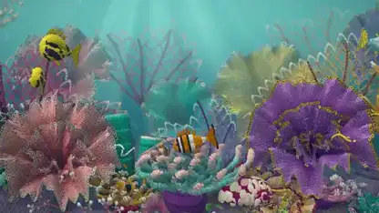</a> 
<b>かぎ針編みの質感を持つサンゴ礁</b> 
<b>新しい発見</b> · <a href="https://x.com/petergostev">@petergostev</a> · 0:40 · 2026-11-10 
<a href="https://video.twimg.com/amplify_video/2120125545249640448/vid/avc1/3840x2160/u-PUTSTEjUibRIGV.mp4?tag=29">▶ 本編</a> · <a href="https://x.com/petergostev/status/2120125927086600681">元の投稿</a> · <a href="https://github.com/VibeClip/awesome-fable-5-2-videos/blob/main/docs/videos/ja/petergostev-2120125927086600681.md">詳細</a>

</td>
</tr>
<tr>
<td width="33%" valign="top">
 
<b>凹凸まで描く石畳の中庭</b> 
<b>↗ 注目上昇</b> · <a href="https://x.com/jsnnsa">@jsnnsa</a> · 0:03 · 2026-11-10 
<a href="https://video.twimg.com/amplify_video/2120113092512436224/vid/avc1/3380x2026/IoUOfTQR_hB4fWMx.mp4?tag=29">▶ 本編</a> · <a href="https://x.com/jsnnsa/status/2120113469290901850">元の投稿</a> · <a href="https://github.com/VibeClip/awesome-fable-5-2-videos/blob/main/docs/videos/ja/jsnnsa-2120113469290901850.md">詳細</a>

</td>
<td width="33%" valign="top">
 
<b>瓶の中の小さなボクセル世界</b> 
<b>新しい発見</b> · <a href="https://x.com/vib3coded">@vib3coded</a> · 0:17 · 2026-11-10 
<a href="https://video.twimg.com/amplify_video/2120104433254068225/vid/avc1/1920x1080/TwqTpSJ125nfAGeC.mp4?tag=29">▶ 本編</a> · <a href="https://x.com/vib3coded/status/2120104517282775514">元の投稿</a> · <a href="https://github.com/VibeClip/awesome-fable-5-2-videos/blob/main/docs/videos/ja/vib3coded-2120104517282775514.md">詳細</a>

</td>
<td width="33%" valign="top">
 
<b>変わり続ける3D世界を切れ目なく飛ぶ</b> 
<b>↗ 注目上昇</b> · <a href="https://x.com/KanaWorks_AI">@KanaWorks_AI</a> · 0:37 · 2026-11-10 
<a href="https://video.twimg.com/amplify_video/2120098419654230017/vid/avc1/1920x1080/oFLDhtXCqoMaEWyp.mp4?tag=29">▶ 本編</a> · <a href="https://x.com/KanaWorks_AI/status/2120098607382880627">元の投稿</a> · <a href="https://github.com/VibeClip/awesome-fable-5-2-videos/blob/main/docs/videos/ja/kanaworks-ai-2120098607382880627.md">詳細</a>

</td>
</tr>
<tr>
<td width="33%" valign="top">
 
<b>Adamたまごっち：基板・筐体・Blenderレンダリング</b> 
<b>↗ 注目上昇</b> · <a href="https://x.com/adamdotnew">@adamdotnew</a> · 0:09 · 2026-11-10 
<a href="https://video.twimg.com/amplify_video/2120071508370640896/vid/avc1/3586x2160/cVxJQZsnnBLew_X_.mp4?tag=29">▶ 本編</a> · <a href="https://x.com/adamdotnew/status/2120071630139621540">元の投稿</a> · <a href="https://github.com/VibeClip/awesome-fable-5-2-videos/blob/main/docs/videos/ja/adamdotnew-2120071630139621540.md">詳細</a>

</td>
<td width="33%" valign="top">
 
<b>日本の城が築かれていくタイムラプス</b> 
<b>新しい発見</b> · <a href="https://x.com/onofumi_AI">@onofumi_AI</a> · 0:18 · 2026-11-10 
<a href="https://video.twimg.com/amplify_video/2120041080502771712/vid/avc1/1920x1080/Y6-SMkmCzqQY0R50.mp4?tag=29">▶ 本編</a> · <a href="https://x.com/onofumi_AI/status/2120041161251569681">元の投稿</a> · <a href="https://github.com/VibeClip/awesome-fable-5-2-videos/blob/main/docs/videos/ja/onofumi-ai-2120041161251569681.md">詳細</a>

</td>
<td width="33%" valign="top">
 
<b>ElevenLabsの音声を添えたBlenderの草原</b> 
<b>↗ 注目上昇</b> · <a href="https://x.com/KanaWorks_AI">@KanaWorks_AI</a> · 0:46 · 2026-11-10 
<a href="https://video.twimg.com/amplify_video/2119997805469343744/vid/avc1/1920x1080/k9AwH2MwZ_uq1Npk.mp4?tag=29">▶ 本編</a> · <a href="https://x.com/KanaWorks_AI/status/2119998466143490282">元の投稿</a> · <a href="https://github.com/VibeClip/awesome-fable-5-2-videos/blob/main/docs/videos/ja/kanaworks-ai-2119998466143490282.md">詳細</a>

</td>
</tr>
<tr>
<td width="33%" valign="top">
<a href="https://video.twimg.com/amplify_video/2119949461199921152/vid/avc1/1920x1080/spFpZLaZvsrfqk5k.mp4?tag=29">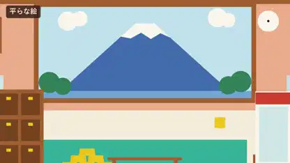</a> 
<b>平面イラストから3Dの銭湯へ</b> 
<b>新しい発見</b> · <a href="https://x.com/seiiiiiiiiiiru">@seiiiiiiiiiiru</a> · 0:14 · 2026-11-10 
<a href="https://video.twimg.com/amplify_video/2119949461199921152/vid/avc1/1920x1080/spFpZLaZvsrfqk5k.mp4?tag=29">▶ 本編</a> · <a href="https://x.com/seiiiiiiiiiiru/status/2119988430247448847">元の投稿</a> · <a href="https://github.com/VibeClip/awesome-fable-5-2-videos/blob/main/docs/videos/ja/seiiiiiiiiiiru-2119988430247448847.md">詳細</a>

</td>
<td width="33%" valign="top">
 
<b>参考画像から作るBugatti TourbillonのBlender映像</b> 
<b>↗ 注目上昇</b> · <a href="https://x.com/xikhar">@xikhar</a> · 0:34 · 2026-11-10 
<a href="https://video.twimg.com/amplify_video/2119965554627014656/vid/avc1/1920x1080/5kgrvrWg41_GG_7E.mp4?tag=29">▶ 本編</a> · <a href="https://x.com/xikhar/status/2119966147328299284">元の投稿</a> · <a href="https://github.com/VibeClip/awesome-fable-5-2-videos/blob/main/docs/videos/ja/xikhar-2119966147328299284.md">詳細</a>

</td>
<td width="33%" valign="top">
 
<b>霧とアルパカのいる小さなマチュピチュ</b> 
<b>↗ 注目上昇</b> · <a href="https://x.com/loktar00">@loktar00</a> · 0:40 · 2026-11-10 
<a href="https://video.twimg.com/amplify_video/2119931613010108416/vid/avc1/1920x1080/ajuuqeO_AOInKjjo.mp4?tag=29">▶ 本編</a> · <a href="https://x.com/loktar00/status/2119958719362666708">元の投稿</a> · <a href="https://github.com/VibeClip/awesome-fable-5-2-videos/blob/main/docs/videos/ja/loktar00-2119958719362666708.md">詳細</a>

</td>
</tr>
<tr>
<td width="33%" valign="top">
 
<b>ガラスのプール：Fable 5.2とOpus 5.5を比較</b> 
<a href="https://x.com/MrTacticalX">@MrTacticalX</a> · 0:30 · 2026-11-10 
<a href="https://video.twimg.com/amplify_video/2119955491941949440/vid/avc1/1080x1216/I1OZU6Yuz2YtpyCA.mp4?tag=29">▶ 本編</a> · <a href="https://x.com/MrTacticalX/status/2119955647542542439">元の投稿</a> · <a href="https://github.com/VibeClip/awesome-fable-5-2-videos/blob/main/docs/videos/ja/mrtacticalx-2119955647542542439.md">詳細</a>

</td>
<td width="33%" valign="top">
 
<b>地中海風の宇宙居住区</b> 
<b>↗ 注目上昇</b> · <a href="https://x.com/MaxXWilliamson">@MaxXWilliamson</a> · 0:25 · 2026-11-10 
<a href="https://video.twimg.com/amplify_video/2119950297183166464/vid/avc1/1920x1080/Rlaw9k2rNAElPEi1.mp4?tag=29">▶ 本編</a> · <a href="https://x.com/MaxXWilliamson/status/2119953172634677533">元の投稿</a> · <a href="https://github.com/VibeClip/awesome-fable-5-2-videos/blob/main/docs/videos/ja/maxxwilliamson-2119953172634677533.md">詳細</a>

</td>
<td width="33%" valign="top">
<a href="https://video.twimg.com/amplify_video/2119938999607234560/vid/avc1/1920x1080/RjyQ4NxRqZJYIHMb.mp4?tag=29">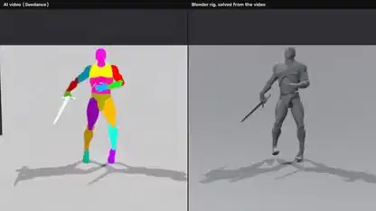</a> 
<b>参照映像の動きを3Dキャラクターへ転写</b> 
<b>新しい発見</b> · <a href="https://x.com/KHvostikk">@KHvostikk</a> · 0:10 · 2026-11-09 
<a href="https://video.twimg.com/amplify_video/2119938999607234560/vid/avc1/1920x1080/RjyQ4NxRqZJYIHMb.mp4?tag=29">▶ 本編</a> · <a href="https://x.com/KHvostikk/status/2119939061049889130">元の投稿</a> · <a href="https://github.com/VibeClip/awesome-fable-5-2-videos/blob/main/docs/videos/ja/khvostikk-2119939061049889130.md">詳細</a>

</td>
</tr>
<tr>
<td width="33%" valign="top">
 
<b>WebGLで描くリアルタイムの蜂蜜シミュレーション</b> 
<b>↗ 注目上昇</b> · <a href="https://x.com/deedydas">@deedydas</a> · 0:51 · 2026-11-09 
<a href="https://video.twimg.com/amplify_video/2119930095406288896/vid/avc1/3456x1438/QrvS6vt8W2VY3Fld.mp4?tag=29">▶ 本編</a> · <a href="https://x.com/deedydas/status/2119930300990177509">元の投稿</a> · <a href="https://github.com/VibeClip/awesome-fable-5-2-videos/blob/main/docs/videos/ja/deedydas-2119930300990177509.md">詳細</a>

📝 プロンプトを見る
<blockquote>Can you write the most intricate photorealistic simulation of honey in WebGL in the browser</blockquote>
<a href="https://x.com/deedydas/status/2119930300990177509">作者の公開プロンプトを読む</a>

</td>
<td width="33%" valign="top">
 
<b>6つのショットで巡るボンベイの市場</b> 
<b>↗ 注目上昇</b> · <a href="https://x.com/higgsfield_ai">@higgsfield_ai</a> · 0:22 · 2026-11-09 
<a href="https://video.twimg.com/amplify_video/2119915176354885632/vid/avc1/1920x1080/KKtYnQwg6iF7nZO0.mp4?tag=29">▶ 本編</a> · <a href="https://x.com/higgsfield_ai/status/2119918834841010320">元の投稿</a> · <a href="https://github.com/VibeClip/awesome-fable-5-2-videos/blob/main/docs/videos/ja/higgsfield-ai-2119918834841010320.md">詳細</a>

</td>
<td width="33%" valign="top">
 
<b>コードで構築するアメリカンダイナー</b> 
<b>↗ 注目上昇</b> · <a href="https://x.com/higgsfield_ai">@higgsfield_ai</a> · 0:20 · 2026-11-09 
<a href="https://video.twimg.com/amplify_video/2119918430635626496/vid/avc1/1080x1210/P1HVkhM5lHbULv8J.mp4?tag=29">▶ 本編</a> · <a href="https://x.com/higgsfield_ai/status/2119918838490010008">元の投稿</a> · <a href="https://github.com/VibeClip/awesome-fable-5-2-videos/blob/main/docs/videos/ja/higgsfield-ai-2119918838490010008.md">詳細</a>

</td>
</tr>
<tr>
<td width="33%" valign="top">
 
<b>渦巻銀河の中へ</b> 
<a href="https://x.com/handsher_NGU">@handsher_NGU</a> · 0:09 · 2026-11-09 
<a href="https://video.twimg.com/amplify_video/2119910441837305856/vid/avc1/2300x1080/9Jjvi_wR23hStOua.mp4?tag=16">▶ 本編</a> · <a href="https://x.com/handsher_NGU/status/2119910478025789655">元の投稿</a> · <a href="https://github.com/VibeClip/awesome-fable-5-2-videos/blob/main/docs/videos/ja/handsher-ngu-789655.md">詳細</a>

</td>
<td width="33%" valign="top">
 
<b>Three.jsで再現した1940年のパリ</b> 
<a href="https://x.com/higgsfield_ai">@higgsfield_ai</a> · 0:24 · 2026-11-09 
<a href="https://video.twimg.com/amplify_video/2119909152743194624/vid/avc1/1920x1080/F_ZjzZnw1Sh-Mmb8.mp4?tag=29">▶ 本編</a> · <a href="https://x.com/higgsfield_ai/status/2119910344998912507">元の投稿</a> · <a href="https://github.com/VibeClip/awesome-fable-5-2-videos/blob/main/docs/videos/ja/higgsfield-ai-912507.md">詳細</a>

</td>
<td width="33%" valign="top">
 
<b>パーツに分解する3Dピラニア</b> 
<a href="https://x.com/Scratcherrrr">@Scratcherrrr</a> · 0:20 · 2026-11-09 
<a href="https://video.twimg.com/amplify_video/2119909700862943233/vid/avc1/1920x1080/FN2antQKJ-tZoIhH.mp4?tag=29">▶ 本編</a> · <a href="https://x.com/Scratcherrrr/status/2119909780269785332">元の投稿</a> · <a href="https://github.com/VibeClip/awesome-fable-5-2-videos/blob/main/docs/videos/ja/scratcherrrr-785332.md">詳細</a>

</td>
</tr>
<tr>
<td width="33%" valign="top">
 
<b>エージェントシステムの司令室</b> 
<a href="https://x.com/s_matysik">@s_matysik</a> · 0:33 · 2026-11-09 
<a href="https://video.twimg.com/ext_tw_video/2119909140998823936/pu/vid/avc1/1280x720/Le9VVnckc0pwI3QT.mp4?tag=12">▶ 本編</a> · <a href="https://x.com/s_matysik/status/2119909371484213380">元の投稿</a> · <a href="https://github.com/VibeClip/awesome-fable-5-2-videos/blob/main/docs/videos/ja/s-matysik-213380.md">詳細</a>

</td>
<td width="33%" valign="top">
 
<b>平面スケッチから立体の部屋へ</b> 
<a href="https://x.com/higgsfield_ai">@higgsfield_ai</a> · 0:14 · 2026-11-09 
<a href="https://video.twimg.com/amplify_video/2119908342663651330/vid/avc1/1920x1080/qPUbaNsET2HB1nmF.mp4?tag=29">▶ 本編</a> · <a href="https://x.com/higgsfield_ai/status/2119908486880342326">元の投稿</a> · <a href="https://github.com/VibeClip/awesome-fable-5-2-videos/blob/main/docs/videos/ja/higgsfield-ai-342326.md">詳細</a>

</td>
<td width="33%" valign="top">
 
<b>ハエの目で見る世界</b> 
<a href="https://x.com/higgsfield_ai">@higgsfield_ai</a> · 0:20 · 2026-11-09 
<a href="https://video.twimg.com/amplify_video/2119907568432934912/vid/avc1/1920x1080/eq_KAVRRnNt9sJcM.mp4?tag=29">▶ 本編</a> · <a href="https://x.com/higgsfield_ai/status/2119907841599496421">元の投稿</a> · <a href="https://github.com/VibeClip/awesome-fable-5-2-videos/blob/main/docs/videos/ja/higgsfield-ai-496421.md">詳細</a>

</td>
</tr>
<tr>
<td width="33%" valign="top">
 
<b>氷の大聖堂：Fable 5.2とOpus 5.5を比較</b> 
<a href="https://x.com/EnvolDev">@EnvolDev</a> · 0:25 · 2026-11-09 
<a href="https://video.twimg.com/amplify_video/2119907107449544704/vid/avc1/2880x2880/aQsdilYUcKwF_4Di.mp4?tag=29">▶ 本編</a> · <a href="https://x.com/EnvolDev/status/2119907318729245180">元の投稿</a> · <a href="https://github.com/VibeClip/awesome-fable-5-2-videos/blob/main/docs/videos/ja/envoldev-2119907318729245180.md">詳細</a>

</td>
<td width="33%" valign="top">
 
<b>細部まで作り込んだボクセルの塔</b> 
<a href="https://x.com/LuminaBench">@LuminaBench</a> · 0:47 · 2026-11-09 
<a href="https://video.twimg.com/amplify_video/2119906290478559232/vid/avc1/1880x1280/d1J65qUiPlX62ABY.mp4?tag=29">▶ 本編</a> · <a href="https://x.com/LuminaBench/status/2119907096636657696">元の投稿</a> · <a href="https://github.com/VibeClip/awesome-fable-5-2-videos/blob/main/docs/videos/ja/luminabench-657696.md">詳細</a>

</td>
<td width="33%" valign="top">
 
<b>3Dソフトなしで書くレイトレーサー</b> 
<a href="https://x.com/fuoeba">@fuoeba</a> · 0:20 · 2026-11-09 
<a href="https://video.twimg.com/amplify_video/2119906227853602816/vid/avc1/1920x1080/N4YdoIeKUPkbvTzU.mp4?tag=29">▶ 本編</a> · <a href="https://x.com/fuoeba/status/2119906486017307074">元の投稿</a> · <a href="https://github.com/VibeClip/awesome-fable-5-2-videos/blob/main/docs/videos/ja/fuoeba-307074.md">詳細</a>

</td>
</tr>
<tr>
<td width="33%" valign="top">
 
<b>コードだけで作るメキシコシティの市場</b> 
<a href="https://x.com/higgsfield_ai">@higgsfield_ai</a> · 0:15 · 2026-11-09 
<a href="https://video.twimg.com/amplify_video/2119905289743020032/vid/avc1/1920x1080/etz_eCYQ6b-Lj5MO.mp4?tag=29">▶ 本編</a> · <a href="https://x.com/higgsfield_ai/status/2119906341078945977">元の投稿</a> · <a href="https://github.com/VibeClip/awesome-fable-5-2-videos/blob/main/docs/videos/ja/higgsfield-ai-945977.md">詳細</a>

</td>
<td width="33%" valign="top">
 
<b>ASCIIダンジョンのアニメーション</b> 
<a href="https://x.com/josendev">@josendev</a> · 0:08 · 2026-11-09 
<a href="https://video.twimg.com/amplify_video/2119906148698484736/vid/avc1/1920x1080/Sgdo6c9D1mBdZbhn.mp4?tag=29">▶ 本編</a> · <a href="https://x.com/josendev/status/2119906280118845704">元の投稿</a> · <a href="https://github.com/VibeClip/awesome-fable-5-2-videos/blob/main/docs/videos/ja/josendev-845704.md">詳細</a>

</td>
<td width="33%" valign="top">
 
<b>雨の東京、夜のラーメン屋台</b> 
<a href="https://x.com/sprinntt">@sprinntt</a> · 0:19 · 2026-11-09 
<a href="https://video.twimg.com/amplify_video/2119905884365074432/vid/avc1/1922x1080/SgmAc5CFTaaJq3tq.mp4?tag=29">▶ 本編</a> · <a href="https://x.com/sprinntt/status/2119906202330988961">元の投稿</a> · <a href="https://github.com/VibeClip/awesome-fable-5-2-videos/blob/main/docs/videos/ja/sprinntt-988961.md">詳細</a>

</td>
</tr>
<tr>
<td width="33%" valign="top">
 
<b>大海原を進む海賊船</b> 
<a href="https://x.com/notjazii">@notjazii</a> · 0:50 · 2026-11-09 
<a href="https://video.twimg.com/amplify_video/2119904377221910528/vid/avc1/1920x1080/NVeak_ycaNknS-mN.mp4?tag=29">▶ 本編</a> · <a href="https://x.com/notjazii/status/2119905661505122575">元の投稿</a> · <a href="https://github.com/VibeClip/awesome-fable-5-2-videos/blob/main/docs/videos/ja/notjazii-122575.md">詳細</a>

</td>
<td width="33%" valign="top">
 
<b>ボクセルで描く日本の茶庭</b> 
<a href="https://x.com/MooncastOnline">@MooncastOnline</a> · 1:00 · 2026-11-09 
<a href="https://video.twimg.com/amplify_video/2119904157574279169/vid/avc1/1440x1080/sQX85HkDqeEicshB.mp4?tag=29">▶ 本編</a> · <a href="https://x.com/MooncastOnline/status/2119905190254145963">元の投稿</a> · <a href="https://github.com/VibeClip/awesome-fable-5-2-videos/blob/main/docs/videos/ja/mooncastonline-145963.md">詳細</a>

</td>
<td width="33%" valign="top">
 
<b>動画モデルなしで描く雨の東京</b> 
<a href="https://x.com/higgsfield_ai">@higgsfield_ai</a> · 0:15 · 2026-11-09 
<a href="https://video.twimg.com/amplify_video/2119903112425066496/vid/avc1/1920x1080/m1x8bc6dk1l-gRsQ.mp4?tag=29">▶ 本編</a> · <a href="https://x.com/higgsfield_ai/status/2119905141822484595">元の投稿</a> · <a href="https://github.com/VibeClip/awesome-fable-5-2-videos/blob/main/docs/videos/ja/higgsfield-ai-484595.md">詳細</a>

</td>
</tr>
<tr>
<td width="33%" valign="top">
 
<b>Blenderで作るスター・ウォーズの戦闘</b> 
<a href="https://x.com/adityavg13">@adityavg13</a> · 0:30 · 2026-11-09 
<a href="https://video.twimg.com/amplify_video/2119903375407878145/vid/avc1/1920x1080/CLp6m1t05mkdAtEV.mp4?tag=29">▶ 本編</a> · <a href="https://x.com/adityavg13/status/2119903463735799971">元の投稿</a> · <a href="https://github.com/VibeClip/awesome-fable-5-2-videos/blob/main/docs/videos/ja/adityavg13-799971.md">詳細</a>

</td>
<td width="33%" valign="top">
 
<b>独自サウンドのシンセ映像</b> 
<a href="https://x.com/AmirMushich">@AmirMushich</a> · 0:10 · 2026-11-09 
<a href="https://video.twimg.com/amplify_video/2119902373770334209/vid/avc1/1920x1080/vCU11lupXlFgCNwm.mp4?tag=29">▶ 本編</a> · <a href="https://x.com/AmirMushich/status/2119903338078564844">元の投稿</a> · <a href="https://github.com/VibeClip/awesome-fable-5-2-videos/blob/main/docs/videos/ja/amirmushich-564844.md">詳細</a>

</td>
<td width="33%" valign="top">
 
<b>90年代のBryceへのオマージュ</b> 
<a href="https://x.com/pleometric">@pleometric</a> · 0:15 · 2026-11-09 
<a href="https://video.twimg.com/amplify_video/2119901650827489280/vid/avc1/1920x1080/jGY1FHT06IKubKX6.mp4?tag=29">▶ 本編</a> · <a href="https://x.com/pleometric/status/2119901747930186234">元の投稿</a> · <a href="https://github.com/VibeClip/awesome-fable-5-2-videos/blob/main/docs/videos/ja/pleometric-186234.md">詳細</a>

</td>
</tr>
<tr>
<td width="33%" valign="top">
 
<b>古代エルサレムの没入型3Dモデル</b> 
<a href="https://x.com/kplikethebird">@kplikethebird</a> · 0:30 · 2026-11-09 
<a href="https://video.twimg.com/amplify_video/2119900521687314432/vid/avc1/1920x1080/jEvZ74FxOfPJmnWp.mp4?tag=29">▶ 本編</a> · <a href="https://x.com/kplikethebird/status/2119900775727902732">元の投稿</a> · <a href="https://github.com/VibeClip/awesome-fable-5-2-videos/blob/main/docs/videos/ja/kplikethebird-902732.md">詳細</a>

📝 プロンプトを見る

作者が下記のリンクでプロンプトを公開しています。参考素材や追加指示と合わせて元の文脈を確認してください。

<a href="https://x.com/kplikethebird/status/2119900775727902732">作者の公開プロンプトを読む</a>

</td>
<td width="33%" valign="top">
 
<b>嵐の中の灯台</b> 
<a href="https://x.com/rohit3a">@rohit3a</a> · 0:30 · 2026-11-09 
<a href="https://video.twimg.com/amplify_video/2119899434121330688/vid/avc1/1920x1080/TejXiGNAzz3Ug7pm.mp4?tag=29">▶ 本編</a> · <a href="https://x.com/rohit3a/status/2119899684999487954">元の投稿</a> · <a href="https://github.com/VibeClip/awesome-fable-5-2-videos/blob/main/docs/videos/ja/rohit3a-487954.md">詳細</a>

</td>
<td width="33%" valign="top">
 
<b>15分でモデル化したサンフランシスコ</b> 
<a href="https://x.com/sakshamships">@sakshamships</a> · 1:31 · 2026-11-09 
<a href="https://video.twimg.com/amplify_video/2119883625831538689/vid/avc1/1920x1080/oYiIXmDxdlAt7KPN.mp4?tag=29">▶ 本編</a> · <a href="https://x.com/sakshamships/status/2119898573135310965">元の投稿</a> · <a href="https://github.com/VibeClip/awesome-fable-5-2-videos/blob/main/docs/videos/ja/sakshamships-310965.md">詳細</a>

</td>
</tr>
<tr>
<td width="33%" valign="top">
 
<b>PS2風の核爆発シーン</b> 
<a href="https://x.com/ConvictionFAQ">@ConvictionFAQ</a> · 0:10 · 2026-11-09 
<a href="https://video.twimg.com/amplify_video/2119898031696887808/vid/avc1/1280x960/23BJrLg2vEzkewba.mp4?tag=29">▶ 本編</a> · <a href="https://x.com/ConvictionFAQ/status/2119898203088937131">元の投稿</a> · <a href="https://github.com/VibeClip/awesome-fable-5-2-videos/blob/main/docs/videos/ja/convictionfaq-937131.md">詳細</a>

</td>
<td width="33%" valign="top">
 
<b>宇宙の地球と8つの破壊方法</b> 
<a href="https://x.com/0xVe1vet">@0xVe1vet</a> · 1:35 · 2026-11-09 
<a href="https://video.twimg.com/amplify_video/2119896430353534976/vid/avc1/1920x1080/J3yEymSqwiVofoL_.mp4?tag=29">▶ 本編</a> · <a href="https://x.com/0xVe1vet/status/2119896809669849204">元の投稿</a> · <a href="https://github.com/VibeClip/awesome-fable-5-2-videos/blob/main/docs/videos/ja/0xve1vet-849204.md">詳細</a>

</td>
<td width="33%" valign="top">
 
<b>Blender MCPで彫るゾンビワシ</b> 
<a href="https://x.com/maxt3chno">@maxt3chno</a> · 0:21 · 2026-11-09 
<a href="https://video.twimg.com/amplify_video/2119896529141907456/vid/avc1/2250x1440/xC2zlZFZ03UvSURS.mp4?tag=29">▶ 本編</a> · <a href="https://x.com/maxt3chno/status/2119896698281467952">元の投稿</a> · <a href="https://github.com/VibeClip/awesome-fable-5-2-videos/blob/main/docs/videos/ja/maxt3chno-467952.md">詳細</a>

📝 プロンプトを見る

作者が下記のリンクでプロンプトを公開しています。参考素材や追加指示と合わせて元の文脈を確認してください。

<a href="https://x.com/maxt3chno/status/2119896909062058411">作者の公開プロンプトを読む</a>

</td>
</tr>
<tr>
<td width="33%" valign="top">
 
<b>中程度の推論で作る車のコンフィギュレーター</b> 
<a href="https://x.com/RezAIT00">@RezAIT00</a> · 1:00 · 2026-11-09 
<a href="https://video.twimg.com/amplify_video/2119896354348470272/vid/avc1/1920x1080/DrkpfAkS2c4i2-N5.mp4?tag=29">▶ 本編</a> · <a href="https://x.com/RezAIT00/status/2119896578987020389">元の投稿</a> · <a href="https://github.com/VibeClip/awesome-fable-5-2-videos/blob/main/docs/videos/ja/rezait00-020389.md">詳細</a>

</td>
<td width="33%" valign="top">
 
<b>自転車のペリカンがいるボクセル島</b> 
<a href="https://x.com/filicroval">@filicroval</a> · 1:34 · 2026-11-09 
<a href="https://video.twimg.com/amplify_video/2119894403456040960/vid/avc1/1920x1080/imN7Z7KJWRG_8ad3.mp4?tag=29">▶ 本編</a> · <a href="https://x.com/filicroval/status/2119896439010811943">元の投稿</a> · <a href="https://github.com/VibeClip/awesome-fable-5-2-videos/blob/main/docs/videos/ja/filicroval-811943.md">詳細</a>

</td>
<td width="33%" valign="top">
 
<b>夕暮れの写実的な灯台</b> 
<a href="https://x.com/viewsfrom02108">@viewsfrom02108</a> · 0:25 · 2026-11-09 
<a href="https://video.twimg.com/amplify_video/2119896067659436032/vid/avc1/1906x848/TE0E4Re4hx1qXj2V.mp4?tag=29">▶ 本編</a> · <a href="https://x.com/viewsfrom02108/status/2119896345729437907">元の投稿</a> · <a href="https://github.com/VibeClip/awesome-fable-5-2-videos/blob/main/docs/videos/ja/viewsfrom02108-437907.md">詳細</a>

</td>
</tr>
<tr>
<td width="33%" valign="top">
 
<b>2分以内で作るロケット打ち上げ</b> 
<a href="https://x.com/ZirkoMirko">@ZirkoMirko</a> · 0:14 · 2026-11-09 
<a href="https://video.twimg.com/amplify_video/2119895988517343232/vid/avc1/1920x1080/40ePOR3KPdp1Eqd3.mp4?tag=29">▶ 本編</a> · <a href="https://x.com/ZirkoMirko/status/2119896335843529121">元の投稿</a> · <a href="https://github.com/VibeClip/awesome-fable-5-2-videos/blob/main/docs/videos/ja/zirkomirko-529121.md">詳細</a>

</td>
<td width="33%" valign="top">
 
<b>海が干上がった地球の姿</b> 
<a href="https://x.com/Ldataengineer">@Ldataengineer</a> · 0:16 · 2026-11-09 
<a href="https://video.twimg.com/amplify_video/2119895394016522240/vid/avc1/1920x1080/OE8d18z8O2VOXnQ5.mp4?tag=29">▶ 本編</a> · <a href="https://x.com/Ldataengineer/status/2119896030993146101">元の投稿</a> · <a href="https://github.com/VibeClip/awesome-fable-5-2-videos/blob/main/docs/videos/ja/ldataengineer-146101.md">詳細</a>

</td>
<td width="33%" valign="top">
 
<b>Three.jsで描く夕暮れの海</b> 
<a href="https://x.com/ericskavinski">@ericskavinski</a> · 0:15 · 2026-11-09 
<a href="https://video.twimg.com/amplify_video/2119895528955617280/vid/avc1/1920x1080/F7m3cnVjtmBdlqPK.mp4?tag=29">▶ 本編</a> · <a href="https://x.com/ericskavinski/status/2119895601580016005">元の投稿</a> · <a href="https://github.com/VibeClip/awesome-fable-5-2-videos/blob/main/docs/videos/ja/ericskavinski-016005.md">詳細</a>

</td>
</tr>
<tr>
<td width="33%" valign="top">
 
<b>360度動画から作るアンドロイドの頭部</b> 
<a href="https://x.com/higgsfield_ai">@higgsfield_ai</a> · 0:29 · 2026-11-09 
<a href="https://video.twimg.com/amplify_video/2119894442358222848/vid/avc1/1080x1150/e2AYnwUWdNOCcvtU.mp4?tag=29">▶ 本編</a> · <a href="https://x.com/higgsfield_ai/status/2119895459519168558">元の投稿</a> · <a href="https://github.com/VibeClip/awesome-fable-5-2-videos/blob/main/docs/videos/ja/higgsfield-ai-168558.md">詳細</a>

</td>
<td width="33%" valign="top">
 
<b>細部まで作り込んだボクセルのパリ</b> 
<a href="https://x.com/RezAIT00">@RezAIT00</a> · 0:14 · 2026-11-09 
<a href="https://video.twimg.com/amplify_video/2119894096084910080/vid/avc1/1920x1080/7-lN899uuXxwQv1y.mp4?tag=29">▶ 本編</a> · <a href="https://x.com/RezAIT00/status/2119894257519767656">元の投稿</a> · <a href="https://github.com/VibeClip/awesome-fable-5-2-videos/blob/main/docs/videos/ja/rezait00-767656.md">詳細</a>

📝 プロンプトを見る

作者が下記のリンクでプロンプトを公開しています。参考素材や追加指示と合わせて元の文脈を確認してください。

<a href="https://x.com/RezAIT00/status/2119898136894156960">作者の公開プロンプトを読む</a>

</td>
<td width="33%" valign="top">
 
<b>水面すれすれを飛ぶ水上機</b> 
<a href="https://x.com/LuminaBench">@LuminaBench</a> · 0:40 · 2026-11-09 
<a href="https://video.twimg.com/amplify_video/2119893746644840448/vid/avc1/1880x1280/eNjCHemdxyEBKfdz.mp4?tag=29">▶ 本編</a> · <a href="https://x.com/LuminaBench/status/2119894130943807746">元の投稿</a> · <a href="https://github.com/VibeClip/awesome-fable-5-2-videos/blob/main/docs/videos/ja/luminabench-807746.md">詳細</a>

</td>
</tr>
<tr>
<td width="33%" valign="top">
 
<b>ディザーパンクの土星</b> 
<a href="https://x.com/josendev">@josendev</a> · 0:08 · 2026-11-09 
<a href="https://video.twimg.com/amplify_video/2119894029424828416/vid/avc1/1080x1080/yTttnmO-BNIQd7SD.mp4?tag=29">▶ 本編</a> · <a href="https://x.com/josendev/status/2119894060521730048">元の投稿</a> · <a href="https://github.com/VibeClip/awesome-fable-5-2-videos/blob/main/docs/videos/ja/josendev-730048.md">詳細</a>

</td>
<td width="33%" valign="top">
 
<b>這い回り宙返りするゾンビの手</b> 
<a href="https://x.com/higgsfield_ai">@higgsfield_ai</a> · 0:19 · 2026-11-09 
<a href="https://video.twimg.com/amplify_video/2119888131575205888/vid/avc1/1920x1080/9qPoYSv2XDOLxkOX.mp4?tag=29">▶ 本編</a> · <a href="https://x.com/higgsfield_ai/status/2119893970897490135">元の投稿</a> · <a href="https://github.com/VibeClip/awesome-fable-5-2-videos/blob/main/docs/videos/ja/higgsfield-ai-490135.md">詳細</a>

📝 プロンプトを見る

作者が下記のリンクでプロンプトを公開しています。参考素材や追加指示と合わせて元の文脈を確認してください。

<a href="https://higgsfield.ai/zh/@higgsfield.studio/blogs/bring-a-zombie-hand-to-life-with-fable-5-2-blender">作者の公開プロンプトを読む</a>

</td>
<td width="33%" valign="top">
 
<b>缶から生まれるSFブラスター</b> 
<a href="https://x.com/abhinavflac">@abhinavflac</a> · 0:39 · 2026-11-09 
<a href="https://video.twimg.com/amplify_video/2119893810201411584/vid/avc1/1920x1080/KGUGqEyqh334QrTo.mp4?tag=29">▶ 本編</a> · <a href="https://x.com/abhinavflac/status/2119893868816859332">元の投稿</a> · <a href="https://github.com/VibeClip/awesome-fable-5-2-videos/blob/main/docs/videos/ja/abhinavflac-859332.md">詳細</a>

</td>
</tr>
<tr>
<td width="33%" valign="top">
 
<b>Three.jsの人体解剖ビューアー</b> 
<a href="https://x.com/SimonasLTU1">@SimonasLTU1</a> · 1:23 · 2026-11-09 
<a href="https://video.twimg.com/amplify_video/2119891121857871872/vid/avc1/1920x1080/luZ3TJiesksBThce.mp4?tag=29">▶ 本編</a> · <a href="https://x.com/SimonasLTU1/status/2119891671219622262">元の投稿</a> · <a href="https://github.com/VibeClip/awesome-fable-5-2-videos/blob/main/docs/videos/ja/simonasltu1-622262.md">詳細</a>

</td>
<td width="33%" valign="top">
 
<b>ガラス・琥珀・液体金属の文字</b> 
<a href="https://x.com/ioTanjiro">@ioTanjiro</a> · 0:25 · 2026-11-09 
<a href="https://video.twimg.com/amplify_video/2119891371049861120/vid/avc1/1908x1080/PkN_icMknPZh5G7T.mp4?tag=29">▶ 本編</a> · <a href="https://x.com/ioTanjiro/status/2119891527438606534">元の投稿</a> · <a href="https://github.com/VibeClip/awesome-fable-5-2-videos/blob/main/docs/videos/ja/iotanjiro-606534.md">詳細</a>

</td>
<td width="33%" valign="top">
 
<b>雲の上を進む黄金の帆船</b> 
<a href="https://x.com/marcthecreatorr">@marcthecreatorr</a> · 0:53 · 2026-11-09 
<a href="https://video.twimg.com/amplify_video/2119890640389451776/vid/avc1/1920x858/MZRufVqslQKy01c9.mp4?tag=29">▶ 本編</a> · <a href="https://x.com/marcthecreatorr/status/2119890973560054072">元の投稿</a> · <a href="https://github.com/VibeClip/awesome-fable-5-2-videos/blob/main/docs/videos/ja/marcthecreatorr-054072.md">詳細</a>

</td>
</tr>
<tr>
<td width="33%" valign="top">
 
<b>手のひらのブラックホール</b> 
<a href="https://x.com/paulgrowthlab">@paulgrowthlab</a> · 0:16 · 2026-11-09 
<a href="https://video.twimg.com/amplify_video/2119890352924479488/vid/avc1/1888x788/OS0DZVhnM9SbIhhK.mp4?tag=29">▶ 本編</a> · <a href="https://x.com/paulgrowthlab/status/2119890500979499382">元の投稿</a> · <a href="https://github.com/VibeClip/awesome-fable-5-2-videos/blob/main/docs/videos/ja/paulgrowthlab-499382.md">詳細</a>

</td>
<td width="33%" valign="top">
 
<b>参考動画から作る3Dモデル</b> 
<a href="https://x.com/higgsfield_ai">@higgsfield_ai</a> · 0:30 · 2026-11-09 
<a href="https://video.twimg.com/amplify_video/2119890001999880192/vid/avc1/1920x1080/CjYHuGQSGo5-pMNi.mp4?tag=16">▶ 本編</a> · <a href="https://x.com/higgsfield_ai/status/2119890046748938248">元の投稿</a> · <a href="https://github.com/VibeClip/awesome-fable-5-2-videos/blob/main/docs/videos/ja/higgsfield-ai-938248.md">詳細</a>

📝 プロンプトを見る

作者が下記のリンクでプロンプトを公開しています。参考素材や追加指示と合わせて元の文脈を確認してください。

<a href="https://higgsfield.ai/zh/@higgsfield.studio/blogs/how-we-built-a-transparent-glass-head-in-3d-with-claude-and-one-360-video">作者の公開プロンプトを読む</a>

</td>
<td width="33%" valign="top">
 
<b>ホワイトハウスの昔と今</b> 
<a href="https://x.com/trymirage">@trymirage</a> · 0:35 · 2026-11-09 
<a href="https://video.twimg.com/amplify_video/2119889136433733632/vid/avc1/1080x1228/EDx7xjJIZ2ONA83t.mp4?tag=29">▶ 本編</a> · <a href="https://x.com/trymirage/status/2119889897200972028">元の投稿</a> · <a href="https://github.com/VibeClip/awesome-fable-5-2-videos/blob/main/docs/videos/ja/trymirage-972028.md">詳細</a>

</td>
</tr>
<tr>
<td width="33%" valign="top">
 
<b>夕暮れから嵐へ変わる海</b> 
<a href="https://x.com/ZryMiller">@ZryMiller</a> · 0:30 · 2026-11-09 
<a href="https://video.twimg.com/amplify_video/2119887691294932992/vid/avc1/1280x720/EjANhoPD5I8ooX55.mp4?tag=29">▶ 本編</a> · <a href="https://x.com/ZryMiller/status/2119887758777106941">元の投稿</a> · <a href="https://github.com/VibeClip/awesome-fable-5-2-videos/blob/main/docs/videos/ja/zrymiller-106941.md">詳細</a>

</td>
<td width="33%" valign="top">
 
<b>エリア51に着陸するUFO</b> 
<a href="https://x.com/danteeonsol">@danteeonsol</a> · 0:30 · 2026-11-09 
<a href="https://video.twimg.com/amplify_video/2119887223810076672/vid/avc1/1920x1080/K6WJ5UYNKbbENVTI.mp4?tag=29">▶ 本編</a> · <a href="https://x.com/danteeonsol/status/2119887623070077213">元の投稿</a> · <a href="https://github.com/VibeClip/awesome-fable-5-2-videos/blob/main/docs/videos/ja/danteeonsol-077213.md">詳細</a>

📝 プロンプトを見る

作者が下記のリンクでプロンプトを公開しています。参考素材や追加指示と合わせて元の文脈を確認してください。

<a href="https://x.com/danteeonsol/status/2119887623070077213">作者の公開プロンプトを読む</a>

</td>
<td width="33%" valign="top">
 
<b>20分でレンダリングした銀河</b> 
<a href="https://x.com/handsher_NGU">@handsher_NGU</a> · 0:17 · 2026-11-09 
<a href="https://video.twimg.com/amplify_video/2119886346873364480/vid/avc1/1920x1080/kfnhup5vHOkgbHDt.mp4?tag=29">▶ 本編</a> · <a href="https://x.com/handsher_NGU/status/2119887298292863367">元の投稿</a> · <a href="https://github.com/VibeClip/awesome-fable-5-2-videos/blob/main/docs/videos/ja/handsher-ngu-863367.md">詳細</a>

</td>
</tr>
<tr>
<td width="33%" valign="top">
 
<b>8本足の機械式ローバー</b> 
<a href="https://x.com/scottstts">@scottstts</a> · 0:44 · 2026-11-09 
<a href="https://video.twimg.com/amplify_video/2119885516627685376/vid/avc1/3442x2160/7U_wQnmQ-ZIsZ463.mp4?tag=29">▶ 本編</a> · <a href="https://x.com/scottstts/status/2119886562003734829">元の投稿</a> · <a href="https://github.com/VibeClip/awesome-fable-5-2-videos/blob/main/docs/videos/ja/scottstts-734829.md">詳細</a>

</td>
<td width="33%" valign="top">
 
<b>秋の伏見稲荷を描く旅行広告</b> 
<a href="https://x.com/petergyang">@petergyang</a> · 0:20 · 2026-11-09 
<a href="https://video.twimg.com/amplify_video/2119886495347867648/vid/avc1/1920x1080/8nAOHCNBnOTAqt0t.mp4?tag=16">▶ 本編</a> · <a href="https://x.com/petergyang/status/2119886560992854431">元の投稿</a> · <a href="https://github.com/VibeClip/awesome-fable-5-2-videos/blob/main/docs/videos/ja/petergyang-854431.md">詳細</a>

</td>
<td width="33%" valign="top">
 
<b>午後の光を浴びる洗濯物</b> 
<a href="https://x.com/dfeinition">@dfeinition</a> · 0:19 · 2026-11-09 
<a href="https://video.twimg.com/amplify_video/2119885405017231360/vid/avc1/3840x2160/JC0qROK6I5UsQ7vf.mp4?tag=29">▶ 本編</a> · <a href="https://x.com/dfeinition/status/2119886262211625062">元の投稿</a> · <a href="https://github.com/VibeClip/awesome-fable-5-2-videos/blob/main/docs/videos/ja/dfeinition-625062.md">詳細</a>

</td>
</tr>
<tr>
<td width="33%" valign="top">
 
<b>クモが巣に織り込むロゴ</b> 
<a href="https://x.com/sudoPhoeniX">@sudoPhoeniX</a> · 1:30 · 2026-11-09 
<a href="https://video.twimg.com/amplify_video/2119884723724181504/vid/avc1/1920x1080/FCwoqJyjTApsUnhD.mp4?tag=29">▶ 本編</a> · <a href="https://x.com/sudoPhoeniX/status/2119885209621655872">元の投稿</a> · <a href="https://github.com/VibeClip/awesome-fable-5-2-videos/blob/main/docs/videos/ja/sudophoenix-655872.md">詳細</a>

</td>
<td width="33%" valign="top">
 
<b>6枚の写真から解くルービックキューブ</b> 
<a href="https://x.com/TekonBurns">@TekonBurns</a> · 0:35 · 2026-11-09 
<a href="https://video.twimg.com/amplify_video/2119877995053920256/vid/avc1/3840x1748/sAyC8nBMMumprGvV.mp4?tag=29">▶ 本編</a> · <a href="https://x.com/TekonBurns/status/2119880835121963500">元の投稿</a> · <a href="https://github.com/VibeClip/awesome-fable-5-2-videos/blob/main/docs/videos/ja/tekonburns-963500.md">詳細</a>

</td>
<td width="33%" valign="top">
 
<b>Mirror Earthの雨の夜のドライブ</b> 
<a href="https://x.com/mattshumer_">@mattshumer_</a> · 0:26 · 2026-11-09 
<a href="https://video.twimg.com/amplify_video/2119878879212949505/vid/avc1/1728x854/OExPzr7l-bAJgpyk.mp4?tag=29">▶ 本編</a> · <a href="https://x.com/mattshumer_/status/2119879860344766782">元の投稿</a> · <a href="https://github.com/VibeClip/awesome-fable-5-2-videos/blob/main/docs/videos/ja/mattshumer-766782.md">詳細</a>

</td>
</tr>
<tr>
<td width="33%" valign="top">
 
<b>プロンプトから生まれるイスタンブール</b> 
<a href="https://x.com/petergostev">@petergostev</a> · 0:39 · 2026-11-09 
<a href="https://video.twimg.com/amplify_video/2119876740310835201/vid/avc1/3840x1916/WFwbynhEGY1SxPup.mp4?tag=29">▶ 本編</a> · <a href="https://x.com/petergostev/status/2119877733488394520">元の投稿</a> · <a href="https://github.com/VibeClip/awesome-fable-5-2-videos/blob/main/docs/videos/ja/petergostev-394520.md">詳細</a>

</td>
<td width="33%" valign="top">
 
<b>クロームの3Dロゴアニメーション</b> 
<a href="https://x.com/hello_amani">@hello_amani</a> · 0:36 · 2026-11-09 
<a href="https://video.twimg.com/amplify_video/2119873847369621504/vid/avc1/1080x1080/LDbZJxUYD0WsXDWe.mp4?tag=29">▶ 本編</a> · <a href="https://x.com/hello_amani/status/2119873980786237842">元の投稿</a> · <a href="https://github.com/VibeClip/awesome-fable-5-2-videos/blob/main/docs/videos/ja/hello-amani-237842.md">詳細</a>

📝 プロンプトを見る
<blockquote>make my logo reveal in 3D with chromatic metal and grids</blockquote>
<a href="https://x.com/hello_amani/status/2119890392456073525">作者の公開プロンプトを読む</a>

</td>
<td width="33%" valign="top">
 
<b>3Dで描くニューヨークの戦い</b> 
<a href="https://x.com/hammer_mt">@hammer_mt</a> · 1:08 · 2026-11-09 
<a href="https://video.twimg.com/amplify_video/2119871695930490880/vid/avc1/1920x1080/mZO4hKSagiOfBukM.mp4?tag=29">▶ 本編</a> · <a href="https://x.com/hammer_mt/status/2119871817561346319">元の投稿</a> · <a href="https://github.com/VibeClip/awesome-fable-5-2-videos/blob/main/docs/videos/ja/hammer-mt-346319.md">詳細</a>

</td>
</tr>
<tr>
<td width="33%" valign="top">
 
<b>自ら組み上がるウイルスの殻</b> 
<a href="https://x.com/TekonBurns">@TekonBurns</a> · 0:15 · 2026-11-09 
<a href="https://video.twimg.com/amplify_video/2119871440292077568/vid/avc1/3840x1748/UY8m3TUPRs8yFPMs.mp4?tag=29">▶ 本編</a> · <a href="https://x.com/TekonBurns/status/2119871565311660260">元の投稿</a> · <a href="https://github.com/VibeClip/awesome-fable-5-2-videos/blob/main/docs/videos/ja/tekonburns-660260.md">詳細</a>

</td>
<td width="33%" valign="top">
 
<b>破壊できるボクセルの街</b> 
<a href="https://x.com/mattshumer_">@mattshumer_</a> · 0:59 · 2026-11-09 
<a href="https://video.twimg.com/amplify_video/2119870538436767745/vid/avc1/1280x720/Rul4Oy5QL34LIwQ6.mp4?tag=29">▶ 本編</a> · <a href="https://x.com/mattshumer_/status/2119870965106483384">元の投稿</a> · <a href="https://github.com/VibeClip/awesome-fable-5-2-videos/blob/main/docs/videos/ja/mattshumer-483384.md">詳細</a>

</td>
<td width="33%" valign="top">
 
<b>住人が自ら考えるヨーロッパの村</b> 
<a href="https://x.com/MatthewBerman">@MatthewBerman</a> · 0:42 · 2026-11-09 
<a href="https://video.twimg.com/amplify_video/2119868287026892800/vid/avc1/1920x1080/aeL8BZjCQk_hzNJ0.mp4?tag=29">▶ 本編</a> · <a href="https://x.com/MatthewBerman/status/2119868638929060195">元の投稿</a> · <a href="https://github.com/VibeClip/awesome-fable-5-2-videos/blob/main/docs/videos/ja/matthewberman-060195.md">詳細</a>

</td>
</tr>
<tr>
<td width="33%" valign="top">
 
<b>水風船を貫く弾丸</b> 
<a href="https://x.com/MatthewBerman">@MatthewBerman</a> · 0:31 · 2026-11-09 
<a href="https://video.twimg.com/amplify_video/2119868225114783744/vid/avc1/1920x1080/uLOwWFt5YQwDDqN9.mp4?tag=29">▶ 本編</a> · <a href="https://x.com/MatthewBerman/status/2119868636810953017">元の投稿</a> · <a href="https://github.com/VibeClip/awesome-fable-5-2-videos/blob/main/docs/videos/ja/matthewberman-953017.md">詳細</a>

</td>
<td width="33%" valign="top">
 
<b>クモの巣の露に屈折する庭の景色</b> 
<b>新しい発見</b> · <a href="https://x.com/dfeinition">@dfeinition</a> · 0:41 · 2026-11-09 
<a href="https://video.twimg.com/amplify_video/2119867516046512129/vid/avc1/1440x1440/Eeo_eQ5Zb5uFWo77.mp4?tag=29">▶ 本編</a> · <a href="https://x.com/dfeinition/status/2119867661463019972">元の投稿</a> · <a href="https://github.com/VibeClip/awesome-fable-5-2-videos/blob/main/docs/videos/ja/dfeinition-2119867661463019972.md">詳細</a>

</td>
<td width="33%"></td>
</tr>
</table>

## 製品映像とWeb体験 · 46

ブランド映像、SaaSデモ、製品発表、Webアニメーション。

<table>
<tr>
<td width="33%" valign="top">
<a href="https://video.twimg.com/amplify_video/2121082669291200512/vid/avc1/1080x1350/8WYq95XlCfNdIquX.mp4?tag=29">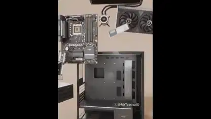</a> 
<b>モデル化したデスクトップPCの内部</b> 
<b>新しい発見</b> · <a href="https://x.com/MrTacticalX">@MrTacticalX</a> · 0:35 · 2026-11-13 
<a href="https://video.twimg.com/amplify_video/2121082669291200512/vid/avc1/1080x1350/8WYq95XlCfNdIquX.mp4?tag=29">▶ 本編</a> · <a href="https://x.com/MrTacticalX/status/2121082861902070130">元の投稿</a> · <a href="https://github.com/VibeClip/awesome-fable-5-2-videos/blob/main/docs/videos/ja/mrtacticalx-2121082861902070130.md">詳細</a>

</td>
<td width="33%" valign="top">
 
<b>動くUIアイコンのグリッド</b> 
<b>新しい発見</b> · <a href="https://x.com/evals_ag">@evals_ag</a> · 0:11 · 2026-11-12 
<a href="https://video.twimg.com/amplify_video/2120821057166970880/vid/avc1/1440x1080/BFkajF2oBS3q1LMD.mp4?tag=29">▶ 本編</a> · <a href="https://x.com/evals_ag/status/2120821140868501726">元の投稿</a> · <a href="https://github.com/VibeClip/awesome-fable-5-2-videos/blob/main/docs/videos/ja/evals-ag-2120821140868501726.md">詳細</a>

</td>
<td width="33%" valign="top">
<a href="https://video.twimg.com/amplify_video/2120798052101615616/vid/avc1/1440x1080/fI46pLpW3SKgtOjf.mp4?tag=29">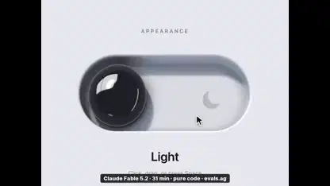</a> 
<b>ダークモードで突起が現れる磁性流体スイッチ</b> 
<b>新しい発見</b> · <a href="https://x.com/evals_ag">@evals_ag</a> · 0:12 · 2026-11-12 
<a href="https://video.twimg.com/amplify_video/2120798052101615616/vid/avc1/1440x1080/fI46pLpW3SKgtOjf.mp4?tag=29">▶ 本編</a> · <a href="https://x.com/evals_ag/status/2120798150852292869">元の投稿</a> · <a href="https://github.com/VibeClip/awesome-fable-5-2-videos/blob/main/docs/videos/ja/evals-ag-2120798150852292869.md">詳細</a>

</td>
</tr>
<tr>
<td width="33%" valign="top">
 
<b>集中タイマーアプリ『専注旅人』の試作</b> 
<b>新しい発見</b> · <a href="https://x.com/Jackywine">@Jackywine</a> · 1:02 · 2026-11-12 
<a href="https://video.twimg.com/amplify_video/2120784272940482560/vid/avc1/1738x1080/8XbdjkTmzdm_lJNn.mp4?tag=29">▶ 本編</a> · <a href="https://x.com/Jackywine/status/2120784934751400379">元の投稿</a> · <a href="https://github.com/VibeClip/awesome-fable-5-2-videos/blob/main/docs/videos/ja/jackywine-2120784934751400379.md">詳細</a>

</td>
<td width="33%" valign="top">
 
<b>分解図で見せるメカニカルキーボードの映像</b> 
<b>新しい発見</b> · <a href="https://x.com/0xRicker">@0xRicker</a> · 0:20 · 2026-11-11 
<a href="https://video.twimg.com/amplify_video/2120562883801071616/vid/avc1/1080x1332/STggSCjsGA_gtEOC.mp4?tag=29">▶ 本編</a> · <a href="https://x.com/0xRicker/status/2120564035057856942">元の投稿</a> · <a href="https://github.com/VibeClip/awesome-fable-5-2-videos/blob/main/docs/videos/ja/0xricker-2120564035057856942.md">詳細</a>

📝 プロンプトを見る
<blockquote>take this keyboard apart, make every shot feel like a launch film</blockquote>
<a href="https://x.com/0xRicker/status/2120564035057856942">作者の公開プロンプトを読む</a>

</td>
<td width="33%" valign="top">
 
<b>座席ごとの見え方を確認できるコンサート会場マップ</b> 
<b>新しい発見</b> · <a href="https://x.com/RyanSael">@RyanSael</a> · 0:21 · 2026-11-11 
<a href="https://video.twimg.com/amplify_video/2120540769178259456/vid/avc1/1920x1080/Jthjy2FP0kte76J5.mp4?tag=29">▶ 本編</a> · <a href="https://x.com/RyanSael/status/2120544205558915329">元の投稿</a> · <a href="https://github.com/VibeClip/awesome-fable-5-2-videos/blob/main/docs/videos/ja/ryansael-2120544205558915329.md">詳細</a>

</td>
</tr>
<tr>
<td width="33%" valign="top">
 
<b>既存のThree.jsゲームから作った『Seerveil』予告編</b> 
<b>新しい発見</b> · <a href="https://x.com/MengTo">@MengTo</a> · 1:00 · 2026-11-11 
<a href="https://video.twimg.com/amplify_video/2120501022607183872/vid/avc1/2560x1440/LtYxtiVb1VYHP7Fi.mp4?tag=29">▶ 本編</a> · <a href="https://x.com/MengTo/status/2120501283304153438">元の投稿</a> · <a href="https://github.com/VibeClip/awesome-fable-5-2-videos/blob/main/docs/videos/ja/mengto-2120501283304153438.md">詳細</a>

</td>
<td width="33%" valign="top">
 
<b>ゲーム制作サービス向けのアイソメトリックなランディングページ案</b> 
<b>新しい発見</b> · <a href="https://x.com/ercankeskinx">@ercankeskinx</a> · 0:09 · 2026-11-11 
<a href="https://video.twimg.com/amplify_video/2120474523955056640/vid/avc1/2014x1080/Ftj5SOfFitkDNQgT.mp4?tag=29">▶ 本編</a> · <a href="https://x.com/ercankeskinx/status/2120475122859757705">元の投稿</a> · <a href="https://github.com/VibeClip/awesome-fable-5-2-videos/blob/main/docs/videos/ja/ercankeskinx-2120475122859757705.md">詳細</a>

</td>
<td width="33%" valign="top">
 
<b>12306の乗車をステップごとに案内するUIの試作</b> 
<b>新しい発見</b> · <a href="https://x.com/Jackywine">@Jackywine</a> · 0:29 · 2026-11-11 
<a href="https://video.twimg.com/amplify_video/2120376229509648384/vid/avc1/1528x1440/K2IOCINEgTRsQwG2.mp4?tag=29">▶ 本編</a> · <a href="https://x.com/Jackywine/status/2120376448280400338">元の投稿</a> · <a href="https://github.com/VibeClip/awesome-fable-5-2-videos/blob/main/docs/videos/ja/jackywine-2120376448280400338.md">詳細</a>

</td>
</tr>
<tr>
<td width="33%" valign="top">
<a href="https://video.twimg.com/amplify_video/2120329981729353729/vid/avc1/2160x2160/1mzNH4x3O8PLcEPj.mp4?tag=29">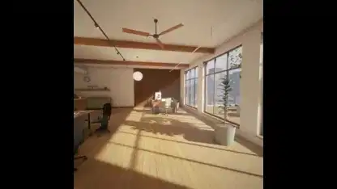</a> 
<b>歩いて回れる仮想デモルーム</b> 
<b>新しい発見</b> · <a href="https://x.com/dfeinition">@dfeinition</a> · 0:19 · 2026-11-11 
<a href="https://video.twimg.com/amplify_video/2120329981729353729/vid/avc1/2160x2160/1mzNH4x3O8PLcEPj.mp4?tag=29">▶ 本編</a> · <a href="https://x.com/dfeinition/status/2120330644261589051">元の投稿</a> · <a href="https://github.com/VibeClip/awesome-fable-5-2-videos/blob/main/docs/videos/ja/dfeinition-2120330644261589051.md">詳細</a>

</td>
<td width="33%" valign="top">
 
<b>コードで描いた90年代風シリアルCM</b> 
<b>新しい発見</b> · <a href="https://x.com/kevin_t_ngo">@kevin_t_ngo</a> · 1:04 · 2026-11-11 
<a href="https://video.twimg.com/amplify_video/2120306941243314176/vid/avc1/1080x1080/pz2C3rnTYJ4qnu3O.mp4?tag=29">▶ 本編</a> · <a href="https://x.com/kevin_t_ngo/status/2120308118127309173">元の投稿</a> · <a href="https://github.com/VibeClip/awesome-fable-5-2-videos/blob/main/docs/videos/ja/kevin-t-ngo-2120308118127309173.md">詳細</a>

</td>
<td width="33%" valign="top">
 
<b>架空の毛布を紹介するアニメーションCM</b> 
<b>新しい発見</b> · <a href="https://x.com/shun_cmdouga">@shun_cmdouga</a> · 0:20 · 2026-11-10 
<a href="https://video.twimg.com/amplify_video/2120296746597367808/vid/avc1/1920x1080/nBbdm0MVWCjO_d_G.mp4?tag=29">▶ 本編</a> · <a href="https://x.com/shun_cmdouga/status/2120297280997933435">元の投稿</a> · <a href="https://github.com/VibeClip/awesome-fable-5-2-videos/blob/main/docs/videos/ja/shun-cmdouga-2120297280997933435.md">詳細</a>

</td>
</tr>
<tr>
<td width="33%" valign="top">
 
<b>同じ創業者ピッチをFableとGeminiで編集</b> 
<b>新しい発見</b> · <a href="https://x.com/motion_so">@motion_so</a> · 1:19 · 2026-11-10 
<a href="https://video.twimg.com/amplify_video/2120285860105195520/vid/avc1/1920x1080/UgVa0dDsoUhgJhHh.mp4?tag=29">▶ 本編</a> · <a href="https://x.com/motion_so/status/2120285901435847047">元の投稿</a> · <a href="https://github.com/VibeClip/awesome-fable-5-2-videos/blob/main/docs/videos/ja/motion-so-2120285901435847047.md">詳細</a>

</td>
<td width="33%" valign="top">
 
<b>クッキーをかじれる同意画面</b> 
<b>新しい発見</b> · <a href="https://x.com/IAenCrudo">@IAenCrudo</a> · 0:14 · 2026-11-10 
<a href="https://video.twimg.com/amplify_video/2120268939280142336/vid/avc1/1920x1080/0lAXC8eRK_E-vsZX.mp4?tag=29">▶ 本編</a> · <a href="https://x.com/IAenCrudo/status/2120269395373048226">元の投稿</a> · <a href="https://github.com/VibeClip/awesome-fable-5-2-videos/blob/main/docs/videos/ja/iaencrudo-2120269395373048226.md">詳細</a>

</td>
<td width="33%" valign="top">
 
<b>色が移ろう背景と半透明のウェブメニュー</b> 
<b>↗ 注目上昇</b> · <a href="https://x.com/seanaiux">@seanaiux</a> · 0:11 · 2026-11-10 
<a href="https://video.twimg.com/amplify_video/2120188041356877824/vid/avc1/1920x1080/c6-X7sxlSfZs2Tg5.mp4?tag=29">▶ 本編</a> · <a href="https://x.com/seanaiux/status/2120222459110789574">元の投稿</a> · <a href="https://github.com/VibeClip/awesome-fable-5-2-videos/blob/main/docs/videos/ja/seanaiux-2120222459110789574.md">詳細</a>

</td>
</tr>
<tr>
<td width="33%" valign="top">
 
<b>Vela AIの製品発表映像</b> 
<b>新しい発見</b> · <a href="https://x.com/ercankeskinx">@ercankeskinx</a> · 0:41 · 2026-11-10 
<a href="https://video.twimg.com/amplify_video/2120177105145364480/vid/avc1/1920x1080/f7-mKDwzMvds5o6V.mp4?tag=29">▶ 本編</a> · <a href="https://x.com/ercankeskinx/status/2120177242034872774">元の投稿</a> · <a href="https://github.com/VibeClip/awesome-fable-5-2-videos/blob/main/docs/videos/ja/ercankeskinx-2120177242034872774.md">詳細</a>

</td>
<td width="33%" valign="top">
 
<b>部品のデザインを統一した割り勘アプリUI</b> 
<a href="https://x.com/dominikmartn">@dominikmartn</a> · 0:24 · 2026-11-10 
<a href="https://video.twimg.com/amplify_video/2120154807218696192/vid/avc1/1440x1080/283MLjs7xLVK97kW.mp4?tag=16">▶ 本編</a> · <a href="https://x.com/dominikmartn/status/2120154832694858224">元の投稿</a> · <a href="https://github.com/VibeClip/awesome-fable-5-2-videos/blob/main/docs/videos/ja/dominikmartn-2120154832694858224.md">詳細</a>

</td>
<td width="33%" valign="top">
 
<b>学習アプリAmyの紹介映像</b> 
<b>新しい発見</b> · <a href="https://x.com/AryamGoyal1">@AryamGoyal1</a> · 0:56 · 2026-11-10 
<a href="https://video.twimg.com/amplify_video/2120127470120968192/vid/avc1/1920x1080/5HOZAyjOLS3dUDC-.mp4?tag=29">▶ 本編</a> · <a href="https://x.com/AryamGoyal1/status/2120128188936503343">元の投稿</a> · <a href="https://github.com/VibeClip/awesome-fable-5-2-videos/blob/main/docs/videos/ja/aryamgoyal1-2120128188936503343.md">詳細</a>

</td>
</tr>
<tr>
<td width="33%" valign="top">
 
<b>チュートリアル支援ツールRioの紹介映像</b> 
<b>新しい発見</b> · <a href="https://x.com/biduletechtal">@biduletechtal</a> · 0:41 · 2026-11-10 
<a href="https://video.twimg.com/amplify_video/2120127890226360321/vid/avc1/1920x1080/9pzTacRoZLu3YTxw.mp4?tag=29">▶ 本編</a> · <a href="https://x.com/biduletechtal/status/2120127941598380265">元の投稿</a> · <a href="https://github.com/VibeClip/awesome-fable-5-2-videos/blob/main/docs/videos/ja/biduletechtal-2120127941598380265.md">詳細</a>

</td>
<td width="33%" valign="top">
 
<b>操作できる折りたたみスマホの開封</b> 
<b>↗ 注目上昇</b> · <a href="https://x.com/argofowl">@argofowl</a> · 0:49 · 2026-11-10 
<a href="https://video.twimg.com/amplify_video/2120115535107264512/vid/avc1/1900x856/vM_oqNfck4QvROH9.mp4?tag=29">▶ 本編</a> · <a href="https://x.com/argofowl/status/2120116358793085186">元の投稿</a> · <a href="https://github.com/VibeClip/awesome-fable-5-2-videos/blob/main/docs/videos/ja/argofowl-2120116358793085186.md">詳細</a>

</td>
<td width="33%" valign="top">
 
<b>磁性流体があふれるスイッチ</b> 
<b>新しい発見</b> · <a href="https://x.com/argofowl">@argofowl</a> · 0:34 · 2026-11-10 
<a href="https://video.twimg.com/amplify_video/2120101910556655616/vid/avc1/1646x1080/0W8fDGgFnviIjIA2.mp4?tag=29">▶ 本編</a> · <a href="https://x.com/argofowl/status/2120102506256859510">元の投稿</a> · <a href="https://github.com/VibeClip/awesome-fable-5-2-videos/blob/main/docs/videos/ja/argofowl-2120102506256859510.md">詳細</a>

</td>
</tr>
<tr>
<td width="33%" valign="top">
 
<b>Blenderで描く90年代風おもちゃCM</b> 
<b>↗ 注目上昇</b> · <a href="https://x.com/kevin_t_ngo">@kevin_t_ngo</a> · 1:05 · 2026-11-10 
<a href="https://video.twimg.com/amplify_video/2119970272552095744/vid/avc1/1080x1080/m_hmwoGBOY58o1RD.mp4?tag=29">▶ 本編</a> · <a href="https://x.com/kevin_t_ngo/status/2119972124211454139">元の投稿</a> · <a href="https://github.com/VibeClip/awesome-fable-5-2-videos/blob/main/docs/videos/ja/kevin-t-ngo-2119972124211454139.md">詳細</a>

</td>
<td width="33%" valign="top">
 
<b>Fable 5.2が自分の発表映像を作る</b> 
<a href="https://x.com/grafikcem">@grafikcem</a> · 1:00 · 2026-11-09 
<a href="https://video.twimg.com/amplify_video/2119910244302065664/vid/avc1/1920x1080/gupDBW1gZCSwiXO5.mp4?tag=29">▶ 本編</a> · <a href="https://x.com/grafikcem/status/2119910525064937806">元の投稿</a> · <a href="https://github.com/VibeClip/awesome-fable-5-2-videos/blob/main/docs/videos/ja/grafikcem-937806.md">詳細</a>

📝 プロンプトを見る
<blockquote>Bugün duyurulmana özel Fable 5.2 modeli için opus 5.5 subagentları kullanarak kendine 60 saniyelik bir tanıtım animasyon filmi hazırla.</blockquote>
<a href="https://x.com/grafikcem/status/2119910525064937806">作者の公開プロンプトを読む</a>

</td>
<td width="33%" valign="top">
 
<b>15分で作ったCRM製品映像</b> 
<a href="https://x.com/hugo_grndd">@hugo_grndd</a> · 1:21 · 2026-11-09 
<a href="https://video.twimg.com/amplify_video/2119909870539300864/vid/avc1/1920x1080/ZxvNnuf07HECALKp.mp4?tag=29">▶ 本編</a> · <a href="https://x.com/hugo_grndd/status/2119909979381723615">元の投稿</a> · <a href="https://github.com/VibeClip/awesome-fable-5-2-videos/blob/main/docs/videos/ja/hugo-grndd-723615.md">詳細</a>

</td>
</tr>
<tr>
<td width="33%" valign="top">
 
<b>建設現場の3Dランディングページ</b> 
<a href="https://x.com/Webilyco">@Webilyco</a> · 0:21 · 2026-11-09 
<a href="https://video.twimg.com/amplify_video/2119909314685001728/vid/avc1/2914x1510/nKvOGrIwpv1kbj37.mp4?tag=29">▶ 本編</a> · <a href="https://x.com/Webilyco/status/2119909604431626667">元の投稿</a> · <a href="https://github.com/VibeClip/awesome-fable-5-2-videos/blob/main/docs/videos/ja/webilyco-626667.md">詳細</a>

</td>
<td width="33%" valign="top">
 
<b>再生Macの発表映像</b> 
<a href="https://x.com/geniusyinka">@geniusyinka</a> · 0:54 · 2026-11-09 
<a href="https://video.twimg.com/amplify_video/2119899852679073793/vid/avc1/3840x2160/VQJVKlvH7bVri0kw.mp4?tag=29">▶ 本編</a> · <a href="https://x.com/geniusyinka/status/2119906654149832704">元の投稿</a> · <a href="https://github.com/VibeClip/awesome-fable-5-2-videos/blob/main/docs/videos/ja/geniusyinka-832704.md">詳細</a>

</td>
<td width="33%" valign="top">
 
<b>参考映像を編集可能なモーションへ</b> 
<b>↗ 注目上昇</b> · <a href="https://x.com/Miguel07Code">@Miguel07Code</a> · 0:16 · 2026-11-09 
<a href="https://video.twimg.com/amplify_video/2119904715479654400/vid/avc1/1920x648/CpD30xA5VWvI9X1O.mp4?tag=29">▶ 本編</a> · <a href="https://x.com/Miguel07Code/status/2119904748900167836">元の投稿</a> · <a href="https://github.com/VibeClip/awesome-fable-5-2-videos/blob/main/docs/videos/ja/miguel07code-2119904748900167836.md">詳細</a>

</td>
</tr>
<tr>
<td width="33%" valign="top">
 
<b>スクロールで海に潜るページ</b> 
<a href="https://x.com/pratyushrungta">@pratyushrungta</a> · 0:25 · 2026-11-09 
<a href="https://video.twimg.com/amplify_video/2119903161444163586/vid/avc1/3024x1896/drKirRhYFgKBUZJN.mp4?tag=29">▶ 本編</a> · <a href="https://x.com/pratyushrungta/status/2119903348354945416">元の投稿</a> · <a href="https://github.com/VibeClip/awesome-fable-5-2-videos/blob/main/docs/videos/ja/pratyushrungta-945416.md">詳細</a>

</td>
<td width="33%" valign="top">
 
<b>HTML一枚で作る自分の発表映像</b> 
<a href="https://x.com/ysuf_dmrkprn1">@ysuf_dmrkprn1</a> · 0:33 · 2026-11-09 
元の投稿は利用不可 · <a href="https://x.com/ysuf_dmrkprn1/status/2119902151581585449">元の投稿</a> · <a href="https://github.com/VibeClip/awesome-fable-5-2-videos/blob/main/docs/videos/ja/ysuf-dmrkprn1-585449.md">詳細</a>

</td>
<td width="33%" valign="top">
 
<b>机の上で繰り広げる発表映像</b> 
<a href="https://x.com/rileybrown">@rileybrown</a> · 0:59 · 2026-11-09 
<a href="https://video.twimg.com/amplify_video/2119897796736131072/vid/avc1/3840x2160/pzacfkpXtKVX4i85.mp4?tag=29">▶ 本編</a> · <a href="https://x.com/rileybrown/status/2119902109709537708">元の投稿</a> · <a href="https://github.com/VibeClip/awesome-fable-5-2-videos/blob/main/docs/videos/ja/rileybrown-537708.md">詳細</a>

</td>
</tr>
<tr>
<td width="33%" valign="top">
 
<b>一度で作る6つのWebアニメーション</b> 
<a href="https://x.com/MaybeFlorent">@MaybeFlorent</a> · 0:43 · 2026-11-09 
<a href="https://video.twimg.com/amplify_video/2119899114720694272/vid/avc1/1920x1080/zcmr0ZQtg48MLyrV.mp4?tag=29">▶ 本編</a> · <a href="https://x.com/MaybeFlorent/status/2119899685011792255">元の投稿</a> · <a href="https://github.com/VibeClip/awesome-fable-5-2-videos/blob/main/docs/videos/ja/maybeflorent-792255.md">詳細</a>

</td>
<td width="33%" valign="top">
 
<b>自分のためにコードで作った発表映像</b> 
<a href="https://x.com/furkancavlakcom">@furkancavlakcom</a> · 1:14 · 2026-11-09 
<a href="https://video.twimg.com/amplify_video/2119895300718374912/vid/avc1/1920x1080/L3VgxovNI7ppzHi8.mp4?tag=29">▶ 本編</a> · <a href="https://x.com/furkancavlakcom/status/2119896886345695521">元の投稿</a> · <a href="https://github.com/VibeClip/awesome-fable-5-2-videos/blob/main/docs/videos/ja/furkancavlakcom-695521.md">詳細</a>

📝 プロンプトを見る
<blockquote>Kendi lansman videonu yap. Sadece kodla.</blockquote>
<a href="https://x.com/furkancavlakcom/status/2119896886345695521">作者の公開プロンプトを読む</a>

</td>
<td width="33%" valign="top">
 
<b>配送ラベルアプリの紹介映像</b> 
<a href="https://x.com/RuslanKyrch">@RuslanKyrch</a> · 0:20 · 2026-11-09 
<a href="https://video.twimg.com/amplify_video/2119896097871020033/vid/avc1/1080x1350/74MeMX8TbhcEEtI_.mp4?tag=29">▶ 本編</a> · <a href="https://x.com/RuslanKyrch/status/2119896220814762218">元の投稿</a> · <a href="https://github.com/VibeClip/awesome-fable-5-2-videos/blob/main/docs/videos/ja/ruslankyrch-762218.md">詳細</a>

</td>
</tr>
<tr>
<td width="33%" valign="top">
 
<b>一つのプロンプトと企画書から作るページ</b> 
<a href="https://x.com/yalcinwebb">@yalcinwebb</a> · 0:21 · 2026-11-09 
<a href="https://video.twimg.com/amplify_video/2119893862743191552/vid/avc1/3452x2156/uJj4RtsG2ToSrtEr.mp4?tag=29">▶ 本編</a> · <a href="https://x.com/yalcinwebb/status/2119895050163286374">元の投稿</a> · <a href="https://github.com/VibeClip/awesome-fable-5-2-videos/blob/main/docs/videos/ja/yalcinwebb-286374.md">詳細</a>

</td>
<td width="33%" valign="top">
 
<b>デザインキャンバス上の打ち上げページ</b> 
<a href="https://x.com/amihai">@amihai</a> · 0:14 · 2026-11-09 
<a href="https://video.twimg.com/amplify_video/2119893041322287104/vid/avc1/3840x2160/UXsFkYv6hX0YYC54.mp4?tag=29">▶ 本編</a> · <a href="https://x.com/amihai/status/2119894821255205099">元の投稿</a> · <a href="https://github.com/VibeClip/awesome-fable-5-2-videos/blob/main/docs/videos/ja/amihai-205099.md">詳細</a>

</td>
<td width="33%" valign="top">
 
<b>4つのスタイルのメモアプリサイト</b> 
<a href="https://x.com/h00mankind">@h00mankind</a> · 1:18 · 2026-11-09 
<a href="https://video.twimg.com/amplify_video/2119892759670829056/vid/avc1/1814x1020/WCoJ0TFnVUHhiw_I.mp4?tag=29">▶ 本編</a> · <a href="https://x.com/h00mankind/status/2119892979297165617">元の投稿</a> · <a href="https://github.com/VibeClip/awesome-fable-5-2-videos/blob/main/docs/videos/ja/h00mankind-165617.md">詳細</a>

</td>
</tr>
<tr>
<td width="33%" valign="top">
 
<b>注げる磁石のランディングページ</b> 
<a href="https://x.com/ZryMiller">@ZryMiller</a> · 0:28 · 2026-11-09 
<a href="https://video.twimg.com/amplify_video/2119891999679787008/vid/avc1/1916x944/P2xizmcev9bpjkQb.mp4?tag=29">▶ 本編</a> · <a href="https://x.com/ZryMiller/status/2119892074464190684">元の投稿</a> · <a href="https://github.com/VibeClip/awesome-fable-5-2-videos/blob/main/docs/videos/ja/zrymiller-190684.md">詳細</a>

</td>
<td width="33%" valign="top">
 
<b>グラフ作成ツールの予告映像</b> 
<a href="https://x.com/al_maxgo">@al_maxgo</a> · 0:28 · 2026-11-09 
<a href="https://video.twimg.com/amplify_video/2119890367994576896/vid/avc1/1080x1920/3jDc1Y3iXxUQ7ByL.mp4?tag=29">▶ 本編</a> · <a href="https://x.com/al_maxgo/status/2119891197317591040">元の投稿</a> · <a href="https://github.com/VibeClip/awesome-fable-5-2-videos/blob/main/docs/videos/ja/al-maxgo-591040.md">詳細</a>

📝 プロンプトを見る

作者が下記のリンクでプロンプトを公開しています。参考素材や追加指示と合わせて元の文脈を確認してください。

<a href="https://x.com/al_maxgo/status/2119894113252212885">作者の公開プロンプトを読む</a>

</td>
<td width="33%" valign="top">
 
<b>純粋なJavaScriptで自己紹介するFable 5.2</b> 
<a href="https://x.com/itssotsot">@itssotsot</a> · 0:29 · 2026-11-09 
<a href="https://video.twimg.com/amplify_video/2119887904818294784/vid/avc1/1920x1080/iEHSU_81HjuqY3Dk.mp4?tag=29">▶ 本編</a> · <a href="https://x.com/itssotsot/status/2119888070283845716">元の投稿</a> · <a href="https://github.com/VibeClip/awesome-fable-5-2-videos/blob/main/docs/videos/ja/itssotsot-845716.md">詳細</a>

</td>
</tr>
<tr>
<td width="33%" valign="top">
 
<b>30分のワンショット製品映像</b> 
<a href="https://x.com/RuchTheophile">@RuchTheophile</a> · 0:27 · 2026-11-09 
<a href="https://video.twimg.com/amplify_video/2119887599032483840/vid/avc1/1920x1080/ZspRgODva5MvP6jO.mp4?tag=29">▶ 本編</a> · <a href="https://x.com/RuchTheophile/status/2119887652845715560">元の投稿</a> · <a href="https://github.com/VibeClip/awesome-fable-5-2-videos/blob/main/docs/videos/ja/ruchtheophile-715560.md">詳細</a>

</td>
<td width="33%" valign="top">
 
<b>Fable 5.2が作る自分の発表映像</b> 
<a href="https://x.com/imjustnewatai">@imjustnewatai</a> · 0:41 · 2026-11-09 
<a href="https://video.twimg.com/amplify_video/2119882693596917760/vid/avc1/1920x1080/DGvARh2eAwgOmqOy.mp4?tag=29">▶ 本編</a> · <a href="https://x.com/imjustnewatai/status/2119882760412434649">元の投稿</a> · <a href="https://github.com/VibeClip/awesome-fable-5-2-videos/blob/main/docs/videos/ja/imjustnewatai-434649.md">詳細</a>

</td>
<td width="33%" valign="top">
 
<b>競合調査ツールのモーション映像</b> 
<a href="https://x.com/Gregoirechp">@Gregoirechp</a> · 0:40 · 2026-11-09 
<a href="https://video.twimg.com/amplify_video/2119879389663879168/vid/avc1/1920x1080/BSWn-PeyGrjMFD2B.mp4?tag=29">▶ 本編</a> · <a href="https://x.com/Gregoirechp/status/2119879667457073355">元の投稿</a> · <a href="https://github.com/VibeClip/awesome-fable-5-2-videos/blob/main/docs/videos/ja/gregoirechp-073355.md">詳細</a>

</td>
</tr>
<tr>
<td width="33%" valign="top">
 
<b>10分で作った製品紹介映像</b> 
<a href="https://x.com/mathiaschpl">@mathiaschpl</a> · 0:36 · 2026-11-09 
<a href="https://video.twimg.com/amplify_video/2119877729222848512/vid/avc1/1920x1080/BDXNMfflBjXeOcju.mp4?tag=29">▶ 本編</a> · <a href="https://x.com/mathiaschpl/status/2119878412181676283">元の投稿</a> · <a href="https://github.com/VibeClip/awesome-fable-5-2-videos/blob/main/docs/videos/ja/mathiaschpl-676283.md">詳細</a>

</td>
<td width="33%" valign="top">
 
<b>10分で作る講座の予告映像</b> 
<a href="https://x.com/midudev">@midudev</a> · 0:32 · 2026-11-09 
<a href="https://video.twimg.com/amplify_video/2119876266346065920/vid/avc1/1080x1920/TxLYgmtQKYLqmloV.mp4?tag=16">▶ 本編</a> · <a href="https://x.com/midudev/status/2119876297304203273">元の投稿</a> · <a href="https://github.com/VibeClip/awesome-fable-5-2-videos/blob/main/docs/videos/ja/midudev-203273.md">詳細</a>

📝 プロンプトを見る

作者が下記のリンクでプロンプトを公開しています。参考素材や追加指示と合わせて元の文脈を確認してください。

<a href="https://x.com/midudev/status/2119876298940051523">作者の公開プロンプトを読む</a>

</td>
<td width="33%" valign="top">
 
<b>シーンごとにコードで作る発表映像</b> 
<a href="https://x.com/AskVenice">@AskVenice</a> · 0:26 · 2026-11-09 
<a href="https://video.twimg.com/amplify_video/2119875571832467456/vid/avc1/1080x1080/ii8tBT-fiAzDt78M.mp4?tag=16">▶ 本編</a> · <a href="https://x.com/AskVenice/status/2119875657954152572">元の投稿</a> · <a href="https://github.com/VibeClip/awesome-fable-5-2-videos/blob/main/docs/videos/ja/askvenice-152572.md">詳細</a>

</td>
</tr>
<tr>
<td width="33%" valign="top">
 
<b>蝶のフィールドガイドサイト</b> 
<a href="https://www.youtube.com/channel/UCl7XP3ud_d6MBN1IiVnia6g">@Jaonie</a> · 0:39 · 2026-11-09 
<a href="https://www.youtube.com/watch?v=ggt074Cb2m8">▶ 本編</a> · <a href="https://www.youtube.com/watch?v=ggt074Cb2m8">元の投稿</a> · <a href="https://github.com/VibeClip/awesome-fable-5-2-videos/blob/main/docs/videos/ja/jaonie-4cb2m8.md">詳細</a>

</td>
<td width="33%"></td>
<td width="33%"></td>
</tr>
</table>

## ビジュアル解説と音楽 · 64

教育アニメーション、科学の可視化、楽譜と合成音。

<table>
<tr>
<td width="33%" valign="top">
<a href="https://video.twimg.com/amplify_video/2121494558106439680/vid/avc1/1920x1080/DPZRyASdC9HYAryE.mp4?tag=29">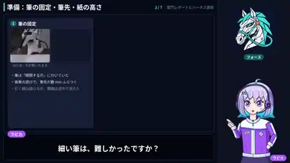</a> 
<b>ロボットが雷門を描く工程の図解</b> 
<b>新しい発見</b> · <a href="https://x.com/gclue_akira">@gclue_akira</a> · 2:06 · 2026-11-14 
<a href="https://video.twimg.com/amplify_video/2121494558106439680/vid/avc1/1920x1080/DPZRyASdC9HYAryE.mp4?tag=29">▶ 本編</a> · <a href="https://x.com/gclue_akira/status/2121494801506050378">元の投稿</a> · <a href="https://github.com/VibeClip/awesome-fable-5-2-videos/blob/main/docs/videos/ja/gclue-akira-2121494801506050378.md">詳細</a>

</td>
<td width="33%" valign="top">
<a href="https://video.twimg.com/amplify_video/2121198943153405952/vid/avc1/1080x1920/WYB34gGOqxherJOw.mp4?tag=29">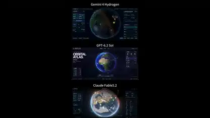</a> 
<b>同じ指示で3モデルが地球を可視化</b> 
<b>↗ 注目上昇</b> · <a href="https://x.com/Stargridcompass">@Stargridcompass</a> · 0:43 · 2026-11-13 
<a href="https://video.twimg.com/amplify_video/2121198943153405952/vid/avc1/1080x1920/WYB34gGOqxherJOw.mp4?tag=29">▶ 本編</a> · <a href="https://x.com/Stargridcompass/status/2121208957276713181">元の投稿</a> · <a href="https://github.com/VibeClip/awesome-fable-5-2-videos/blob/main/docs/videos/ja/stargridcompass-2121208957276713181.md">詳細</a>

</td>
<td width="33%" valign="top">
 
<b>AIがロケットの着陸を学ぶ</b> 
<b>↗ 注目上昇</b> · <a href="https://x.com/imjustnewatai">@imjustnewatai</a> · 1:32 · 2026-11-13 
<a href="https://video.twimg.com/amplify_video/2121065917526298624/vid/avc1/1080x1080/_fK2vPkd7B9dTr6U.mp4?tag=29">▶ 本編</a> · <a href="https://x.com/imjustnewatai/status/2121066003123847611">元の投稿</a> · <a href="https://github.com/VibeClip/awesome-fable-5-2-videos/blob/main/docs/videos/ja/imjustnewatai-2121066003123847611.md">詳細</a>

</td>
</tr>
<tr>
<td width="33%" valign="top">
 
<b>歩き方を学ぶシミュレーションのキャラクター</b> 
<b>↗ 注目上昇</b> · <a href="https://x.com/imjustnewatai">@imjustnewatai</a> · 1:31 · 2026-11-13 
<a href="https://video.twimg.com/amplify_video/2121036047274397696/vid/avc1/1080x1080/T_I7ifp6OxLGa9Ti.mp4?tag=29">▶ 本編</a> · <a href="https://x.com/imjustnewatai/status/2121036119999475934">元の投稿</a> · <a href="https://github.com/VibeClip/awesome-fable-5-2-videos/blob/main/docs/videos/ja/imjustnewatai-2121036119999475934.md">詳細</a>

</td>
<td width="33%" valign="top">
<a href="https://video.twimg.com/amplify_video/2120947367142981632/vid/avc1/2160x2160/JErOSxM1cooLCIA5.mp4?tag=29">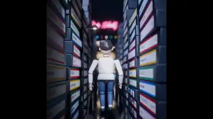</a> 
<b>Blenderで作った1980年代風ミュージックビデオ</b> 
<b>↗ 注目上昇</b> · <a href="https://x.com/kevin_t_ngo">@kevin_t_ngo</a> · 2:18 · 2026-11-12 
<a href="https://video.twimg.com/amplify_video/2120947367142981632/vid/avc1/2160x2160/JErOSxM1cooLCIA5.mp4?tag=29">▶ 本編</a> · <a href="https://x.com/kevin_t_ngo/status/2120948511038648596">元の投稿</a> · <a href="https://github.com/VibeClip/awesome-fable-5-2-videos/blob/main/docs/videos/ja/kevin-t-ngo-2120948511038648596.md">詳細</a>

</td>
<td width="33%" valign="top">
<a href="https://video.twimg.com/amplify_video/2120895579266207744/vid/avc1/1920x1080/kIxFcuWQm186EBjK.mp4?tag=29">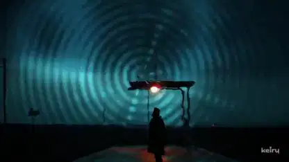</a> 
<b>ドリームポップとドラムンベースのMV『Low End Heart』</b> 
<b>新しい発見</b> · <a href="https://x.com/keiru_ai">@keiru_ai</a> · 3:31 · 2026-11-12 
<a href="https://video.twimg.com/amplify_video/2120895579266207744/vid/avc1/1920x1080/kIxFcuWQm186EBjK.mp4?tag=29">▶ 本編</a> · <a href="https://x.com/keiru_ai/status/2120896365828173898">元の投稿</a> · <a href="https://github.com/VibeClip/awesome-fable-5-2-videos/blob/main/docs/videos/ja/keiru-ai-2120896365828173898.md">詳細</a>

</td>
</tr>
<tr>
<td width="33%" valign="top">
 
<b>ルネサンスの四声対位法を可視化</b> 
<b>↗ 注目上昇</b> · <a href="https://x.com/imjustnewatai">@imjustnewatai</a> · 1:54 · 2026-11-12 
<a href="https://video.twimg.com/amplify_video/2120668579783737344/vid/avc1/1920x1080/hHADTwaLDxu_Ufzz.mp4?tag=29">▶ 本編</a> · <a href="https://x.com/imjustnewatai/status/2120668771119726698">元の投稿</a> · <a href="https://github.com/VibeClip/awesome-fable-5-2-videos/blob/main/docs/videos/ja/imjustnewatai-2120668771119726698.md">詳細</a>

</td>
<td width="33%" valign="top">
 
<b>折り紙の世界が広がるMV『Paper Pulse』</b> 
<b>新しい発見</b> · <a href="https://x.com/su_nagomi">@su_nagomi</a> · 0:49 · 2026-11-11 
<a href="https://video.twimg.com/amplify_video/2120650546348752896/vid/avc1/1920x1080/CdyshjzW6cC-NYZw.mp4?tag=29">▶ 本編</a> · <a href="https://x.com/su_nagomi/status/2120652723561590844">元の投稿</a> · <a href="https://github.com/VibeClip/awesome-fable-5-2-videos/blob/main/docs/videos/ja/su-nagomi-2120652723561590844.md">詳細</a>

📝 プロンプトを見る
<blockquote>最高だと思うMVを作って</blockquote>
<a href="https://x.com/su_nagomi/status/2120652723561590844">作者の公開プロンプトを読む</a>

</td>
<td width="33%" valign="top">
 
<b>鳥の鳴き声をモデル化した夜明けの合唱</b> 
<b>新しい発見</b> · <a href="https://x.com/chetaslua">@chetaslua</a> · 3:31 · 2026-11-11 
<a href="https://video.twimg.com/amplify_video/2120616202565480448/vid/avc1/1920x1080/iaZdDW31ZHgJXkL4.mp4?tag=29">▶ 本編</a> · <a href="https://x.com/chetaslua/status/2120616372434837677">元の投稿</a> · <a href="https://github.com/VibeClip/awesome-fable-5-2-videos/blob/main/docs/videos/ja/chetaslua-2120616372434837677.md">詳細</a>

</td>
</tr>
<tr>
<td width="33%" valign="top">
 
<b>落ちる球が奏でるソナタ</b> 
<b>新しい発見</b> · <a href="https://x.com/imjustnewatai">@imjustnewatai</a> · 2:06 · 2026-11-11 
<a href="https://video.twimg.com/amplify_video/2120609142628909056/vid/avc1/1920x1080/HIom3DAvJSv44LtV.mp4?tag=29">▶ 本編</a> · <a href="https://x.com/imjustnewatai/status/2120609268319830027">元の投稿</a> · <a href="https://github.com/VibeClip/awesome-fable-5-2-videos/blob/main/docs/videos/ja/imjustnewatai-2120609268319830027.md">詳細</a>

</td>
<td width="33%" valign="top">
 
<b>コードで描いた世界七不思議のポップアップ絵本</b> 
<b>新しい発見</b> · <a href="https://x.com/theoardley">@theoardley</a> · 0:39 · 2026-11-11 
<a href="https://video.twimg.com/amplify_video/2120561818313576448/vid/avc1/1008x1152/f28Cp0gRI6BQw11T.mp4?tag=29">▶ 本編</a> · <a href="https://x.com/theoardley/status/2120561850802929711">元の投稿</a> · <a href="https://github.com/VibeClip/awesome-fable-5-2-videos/blob/main/docs/videos/ja/theoardley-2120561850802929711.md">詳細</a>

</td>
<td width="33%" valign="top">
<a href="https://video.twimg.com/amplify_video/2120532142832934912/vid/avc1/1920x1080/pRXtEmq3PKIg5qOf.mp4?tag=29">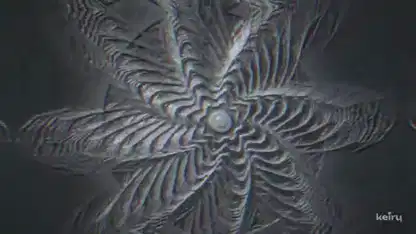</a> 
<b>乱数シードで作ったインダストリアルなドラムンベースと浮き彫り映像</b> 
<b>新しい発見</b> · <a href="https://x.com/keiru_ai">@keiru_ai</a> · 1:36 · 2026-11-11 
<a href="https://video.twimg.com/amplify_video/2120532142832934912/vid/avc1/1920x1080/pRXtEmq3PKIg5qOf.mp4?tag=29">▶ 本編</a> · <a href="https://x.com/keiru_ai/status/2120532609625424195">元の投稿</a> · <a href="https://github.com/VibeClip/awesome-fable-5-2-videos/blob/main/docs/videos/ja/keiru-ai-2120532609625424195.md">詳細</a>

</td>
</tr>
<tr>
<td width="33%" valign="top">
 
<b>ロボットの構造を調べるバーチャル格納庫</b> 
<b>新しい発見</b> · <a href="https://x.com/0xMovez">@0xMovez</a> · 1:34 · 2026-11-11 
<a href="https://video.twimg.com/amplify_video/2120526618925899776/vid/avc1/3596x2084/5KVxtJ0HMeLJ5swp.mp4?tag=29">▶ 本編</a> · <a href="https://x.com/0xMovez/status/2120526918621515872">元の投稿</a> · <a href="https://github.com/VibeClip/awesome-fable-5-2-videos/blob/main/docs/videos/ja/0xmovez-2120526918621515872.md">詳細</a>

</td>
<td width="33%" valign="top">
 
<b>ベースを主役にしたMV『Late Bass Lounge』</b> 
<b>新しい発見</b> · <a href="https://x.com/husky__create">@husky__create</a> · 1:06 · 2026-11-11 
<a href="https://video.twimg.com/amplify_video/2120471865902911488/vid/avc1/1920x1080/_jhdxUBeVUhaF4F4.mp4?tag=16">▶ 本編</a> · <a href="https://x.com/husky__create/status/2120471964787830947">元の投稿</a> · <a href="https://github.com/VibeClip/awesome-fable-5-2-videos/blob/main/docs/videos/ja/husky-create-2120471964787830947.md">詳細</a>

</td>
<td width="33%" valign="top">
 
<b>アリから観測可能な宇宙のスケールまで</b> 
<b>新しい発見</b> · <a href="https://x.com/anxuanng">@anxuanng</a> · 0:49 · 2026-11-11 
<a href="https://video.twimg.com/amplify_video/2120441073596354560/vid/avc1/1920x1080/X-fzihrCy46mRyEM.mp4?tag=29">▶ 本編</a> · <a href="https://x.com/anxuanng/status/2120441299568619897">元の投稿</a> · <a href="https://github.com/VibeClip/awesome-fable-5-2-videos/blob/main/docs/videos/ja/anxuanng-2120441299568619897.md">詳細</a>

</td>
</tr>
<tr>
<td width="33%" valign="top">
 
<b>昔の肖像写真はなぜ硬い表情に見える？</b> 
<b>新しい発見</b> · <a href="https://x.com/Iamshankhadeep">@Iamshankhadeep</a> · 0:30 · 2026-11-11 
<a href="https://video.twimg.com/amplify_video/2120387994481983489/vid/avc1/1080x1920/c84_bK72bZ_xEuse.mp4?tag=29">▶ 本編</a> · <a href="https://x.com/Iamshankhadeep/status/2120388112606196223">元の投稿</a> · <a href="https://github.com/VibeClip/awesome-fable-5-2-videos/blob/main/docs/videos/ja/iamshankhadeep-2120388112606196223.md">詳細</a>

</td>
<td width="33%" valign="top">
 
<b>学習過程になぞらえた交響曲</b> 
<a href="https://x.com/imjustnewatai">@imjustnewatai</a> · 2:09 · 2026-11-11 
<a href="https://video.twimg.com/amplify_video/2120383334937210880/vid/avc1/1920x1080/JsmjoUR0KG5ePYKK.mp4?tag=29">▶ 本編</a> · <a href="https://x.com/imjustnewatai/status/2120383964686729410">元の投稿</a> · <a href="https://github.com/VibeClip/awesome-fable-5-2-videos/blob/main/docs/videos/ja/imjustnewatai-2120383964686729410.md">詳細</a>

</td>
<td width="33%" valign="top">
<a href="https://video.twimg.com/amplify_video/2120360542514941952/vid/avc1/1920x1080/fAW9LdpolVLL41_d.mp4?tag=29">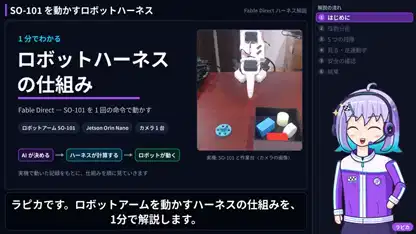</a> 
<b>ロボット制御ハーネスを紹介する図解動画</b> 
<b>新しい発見</b> · <a href="https://x.com/gclue_akira">@gclue_akira</a> · 1:00 · 2026-11-11 
<a href="https://video.twimg.com/amplify_video/2120360542514941952/vid/avc1/1920x1080/fAW9LdpolVLL41_d.mp4?tag=29">▶ 本編</a> · <a href="https://x.com/gclue_akira/status/2120360614682063146">元の投稿</a> · <a href="https://github.com/VibeClip/awesome-fable-5-2-videos/blob/main/docs/videos/ja/gclue-akira-2120360614682063146.md">詳細</a>

</td>
</tr>
<tr>
<td width="33%" valign="top">
 
<b>粒子の軌跡で描く時価総額レース</b> 
<b>新しい発見</b> · <a href="https://x.com/Stargridcompass">@Stargridcompass</a> · 1:00 · 2026-11-11 
<a href="https://video.twimg.com/amplify_video/2120163849806462976/vid/avc1/1920x1080/OMSIT8xlrky2bCi_.mp4?tag=29">▶ 本編</a> · <a href="https://x.com/Stargridcompass/status/2120313054936133751">元の投稿</a> · <a href="https://github.com/VibeClip/awesome-fable-5-2-videos/blob/main/docs/videos/ja/stargridcompass-2120313054936133751.md">詳細</a>

</td>
<td width="33%" valign="top">
 
<b>年を切り替えて見るサンフランシスコ湾岸の歴史地図</b> 
<b>↗ 注目上昇</b> · <a href="https://x.com/theojaffee">@theojaffee</a> · 0:33 · 2026-11-11 
<a href="https://video.twimg.com/amplify_video/2120309793521074176/vid/avc1/3024x1590/AI4JHsH3UdoxpUpG.mp4?tag=29">▶ 本編</a> · <a href="https://x.com/theojaffee/status/2120312766544437738">元の投稿</a> · <a href="https://github.com/VibeClip/awesome-fable-5-2-videos/blob/main/docs/videos/ja/theojaffee-2120312766544437738.md">詳細</a>

</td>
<td width="33%" valign="top">
<a href="https://video.twimg.com/amplify_video/2120288036147826688/vid/avc1/1920x1080/rsVqgZfdKMOHajLt.mp4?tag=29">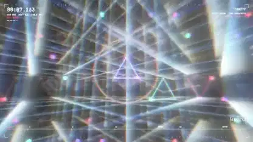</a> 
<b>生成音とThree.jsのビジュアライザー</b> 
<b>新しい発見</b> · <a href="https://x.com/keiru_ai">@keiru_ai</a> · 1:30 · 2026-11-10 
<a href="https://video.twimg.com/amplify_video/2120288036147826688/vid/avc1/1920x1080/rsVqgZfdKMOHajLt.mp4?tag=29">▶ 本編</a> · <a href="https://x.com/keiru_ai/status/2120288283167191402">元の投稿</a> · <a href="https://github.com/VibeClip/awesome-fable-5-2-videos/blob/main/docs/videos/ja/keiru-ai-2120288283167191402.md">詳細</a>

</td>
</tr>
<tr>
<td width="33%" valign="top">
 
<b>灯台でたどるコンピューターグラフィックスの歴史</b> 
<a href="https://x.com/aollivier82">@aollivier82</a> · 0:28 · 2026-11-10 
<a href="https://video.twimg.com/amplify_video/2120212244919160832/vid/avc1/1080x1920/wgu0fYjgfK6Xl25p.mp4?tag=29">▶ 本編</a> · <a href="https://x.com/aollivier82/status/2120260208245043663">元の投稿</a> · <a href="https://github.com/VibeClip/awesome-fable-5-2-videos/blob/main/docs/videos/ja/aollivier82-2120260208245043663.md">詳細</a>

</td>
<td width="33%" valign="top">
 
<b>江戸時代の図面から復元するからくり人形</b> 
<b>新しい発見</b> · <a href="https://x.com/nakazakifam">@nakazakifam</a> · 3:04 · 2026-11-10 
<a href="https://video.twimg.com/amplify_video/2120256332066365440/vid/avc1/1280x720/KXSlCskVGeCf-v47.mp4?tag=29">▶ 本編</a> · <a href="https://x.com/nakazakifam/status/2120257523425103914">元の投稿</a> · <a href="https://github.com/VibeClip/awesome-fable-5-2-videos/blob/main/docs/videos/ja/nakazakifam-2120257523425103914.md">詳細</a>

</td>
<td width="33%" valign="top">
 
<b>操作できる3D電子工作台</b> 
<a href="https://x.com/0xMovez">@0xMovez</a> · 1:19 · 2026-11-10 
<a href="https://video.twimg.com/amplify_video/2120238899217776640/vid/avc1/3596x2084/TK9rIF-se0SZ136N.mp4?tag=29">▶ 本編</a> · <a href="https://x.com/0xMovez/status/2120239217880268919">元の投稿</a> · <a href="https://github.com/VibeClip/awesome-fable-5-2-videos/blob/main/docs/videos/ja/0xmovez-2120239217880268919.md">詳細</a>

</td>
</tr>
<tr>
<td width="33%" valign="top">
 
<b>Three.jsで解説するEUVリソグラフィ</b> 
<b>新しい発見</b> · <a href="https://x.com/miki_code">@miki_code</a> · 1:41 · 2026-11-10 
<a href="https://video.twimg.com/amplify_video/2120217984568381440/vid/avc1/1920x1080/AAOQPmf__6M2zkFO.mp4?tag=29">▶ 本編</a> · <a href="https://x.com/miki_code/status/2120219010860019977">元の投稿</a> · <a href="https://github.com/VibeClip/awesome-fable-5-2-videos/blob/main/docs/videos/ja/miki-code-2120219010860019977.md">詳細</a>

</td>
<td width="33%" valign="top">
 
<b>PythonとBlenderで動かしたClawdのミュージックビデオ</b> 
<b>新しい発見</b> · <a href="https://x.com/kevin_t_ngo">@kevin_t_ngo</a> · 1:17 · 2026-11-10 
<a href="https://video.twimg.com/amplify_video/2120197953780613120/vid/avc1/1080x1080/REJcjoiTa_AfPsB0.mp4?tag=29">▶ 本編</a> · <a href="https://x.com/kevin_t_ngo/status/2120198663062622581">元の投稿</a> · <a href="https://github.com/VibeClip/awesome-fable-5-2-videos/blob/main/docs/videos/ja/kevin-t-ngo-2120198663062622581.md">詳細</a>

</td>
<td width="33%" valign="top">
 
<b>Pythonの筆致と楽曲で作る静物画</b> 
<b>新しい発見</b> · <a href="https://x.com/wquguru">@wquguru</a> · 0:18 · 2026-11-10 
<a href="https://video.twimg.com/amplify_video/2120175408390012929/vid/avc1/1440x1052/JMkN9Ia1xeiYMFgR.mp4?tag=29">▶ 本編</a> · <a href="https://x.com/wquguru/status/2120177800288378938">元の投稿</a> · <a href="https://github.com/VibeClip/awesome-fable-5-2-videos/blob/main/docs/videos/ja/wquguru-2120177800288378938.md">詳細</a>

</td>
</tr>
<tr>
<td width="33%" valign="top">
<a href="https://video.twimg.com/amplify_video/2120154489898618881/vid/avc1/1920x1080/BMdHEVJ-_drkWyrR.mp4?tag=29">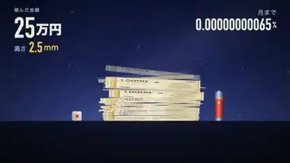</a> 
<b>1万円札を月まで積むにはいくら必要？</b> 
<b>新しい発見</b> · <a href="https://x.com/yousuke_001">@yousuke_001</a> · 0:52 · 2026-11-10 
<a href="https://video.twimg.com/amplify_video/2120154489898618881/vid/avc1/1920x1080/BMdHEVJ-_drkWyrR.mp4?tag=29">▶ 本編</a> · <a href="https://x.com/yousuke_001/status/2120154541186523612">元の投稿</a> · <a href="https://github.com/VibeClip/awesome-fable-5-2-videos/blob/main/docs/videos/ja/yousuke-001-2120154541186523612.md">詳細</a>

📝 プロンプトを見る

作者が下記のリンクでプロンプトを公開しています。参考素材や追加指示と合わせて元の文脈を確認してください。

<a href="https://x.com/yousuke_001/status/2120154541186523612">作者の公開プロンプトを読む</a>

</td>
<td width="33%" valign="top">
 
<b>6つの方程式を動きで見る</b> 
<b>新しい発見</b> · <a href="https://x.com/hkkojima">@hkkojima</a> · 1:07 · 2026-11-10 
<a href="https://video.twimg.com/amplify_video/2120124118414798848/vid/avc1/1280x720/R0wF3MTXikpdyCZC.mp4?tag=14">▶ 本編</a> · <a href="https://x.com/hkkojima/status/2120124260954014152">元の投稿</a> · <a href="https://github.com/VibeClip/awesome-fable-5-2-videos/blob/main/docs/videos/ja/hkkojima-2120124260954014152.md">詳細</a>

</td>
<td width="33%" valign="top">
 
<b>銀河衝突から始まる日本語の解説映像</b> 
<b>新しい発見</b> · <a href="https://x.com/bide_taro">@bide_taro</a> · 0:38 · 2026-11-10 
<a href="https://video.twimg.com/ext_tw_video/2120118492892643328/pu/vid/avc1/1280x720/3fWpNaTnslgmcWG8.mp4?tag=12">▶ 本編</a> · <a href="https://x.com/bide_taro/status/2120118659540721770">元の投稿</a> · <a href="https://github.com/VibeClip/awesome-fable-5-2-videos/blob/main/docs/videos/ja/bide-taro-2120118659540721770.md">詳細</a>

</td>
</tr>
<tr>
<td width="33%" valign="top">
 
<b>ゼノンの二分法から指先の接触の拡大へ</b> 
<a href="https://x.com/anxuanng">@anxuanng</a> · 0:44 · 2026-11-10 
<a href="https://video.twimg.com/amplify_video/2120088578005098496/vid/avc1/1920x1080/XMPOsp7PKvG1sYn-.mp4?tag=29">▶ 本編</a> · <a href="https://x.com/anxuanng/status/2120088745139638375">元の投稿</a> · <a href="https://github.com/VibeClip/awesome-fable-5-2-videos/blob/main/docs/videos/ja/anxuanng-2120088745139638375.md">詳細</a>

</td>
<td width="33%" valign="top">
 
<b>ナスダック26年を動きで可視化</b> 
<b>↗ 注目上昇</b> · <a href="https://x.com/Stargridcompass">@Stargridcompass</a> · 1:00 · 2026-11-10 
<a href="https://video.twimg.com/amplify_video/2120081004001988608/vid/avc1/1920x1080/EEY78nPH5McLEfOs.mp4?tag=29">▶ 本編</a> · <a href="https://x.com/Stargridcompass/status/2120082786631516514">元の投稿</a> · <a href="https://github.com/VibeClip/awesome-fable-5-2-videos/blob/main/docs/videos/ja/stargridcompass-2120082786631516514.md">詳細</a>

</td>
<td width="33%" valign="top">
 
<b>4つの年代をたどる中華圏ポップス</b> 
<b>↗ 注目上昇</b> · <a href="https://x.com/Gorden_Sun">@Gorden_Sun</a> · 3:51 · 2026-11-10 
<a href="https://video.twimg.com/amplify_video/2120069533562191874/vid/avc1/1920x1080/d-di6uhJPEXGX7js.mp4?tag=29">▶ 本編</a> · <a href="https://x.com/Gorden_Sun/status/2120069883597832595">元の投稿</a> · <a href="https://github.com/VibeClip/awesome-fable-5-2-videos/blob/main/docs/videos/ja/gorden-sun-2120069883597832595.md">詳細</a>

</td>
</tr>
<tr>
<td width="33%" valign="top">
<a href="https://video.twimg.com/amplify_video/2120065308107120640/vid/avc1/1920x1080/YKoOFTwMaadyLQhl.mp4?tag=29">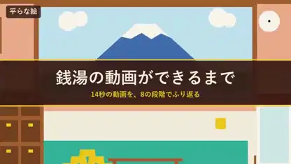</a> 
<b>銭湯の3D映像ができるまで</b> 
<b>新しい発見</b> · <a href="https://x.com/seiiiiiiiiiiru">@seiiiiiiiiiiru</a> · 0:50 · 2026-11-10 
<a href="https://video.twimg.com/amplify_video/2120065308107120640/vid/avc1/1920x1080/YKoOFTwMaadyLQhl.mp4?tag=29">▶ 本編</a> · <a href="https://x.com/seiiiiiiiiiiru/status/2120066857483063329">元の投稿</a> · <a href="https://github.com/VibeClip/awesome-fable-5-2-videos/blob/main/docs/videos/ja/seiiiiiiiiiiru-2120066857483063329.md">詳細</a>

📝 プロンプトを見る
<blockquote>銭湯の動画がどう作られていったか段階を踏んで見てわかるようなメイキング動画を作成して。</blockquote>
<a href="https://x.com/seiiiiiiiiiiru/status/2120066857483063329">作者の公開プロンプトを読む</a>

</td>
<td width="33%" valign="top">
 
<b>ベースの一音でイラストのキャラクターが変身</b> 
<b>新しい発見</b> · <a href="https://x.com/akiyoshisan">@akiyoshisan</a> · 0:32 · 2026-11-10 
<a href="https://video.twimg.com/amplify_video/2120064040542371840/vid/avc1/1080x1920/eTA7hO-hBqqBr5L_.mp4?tag=29">▶ 本編</a> · <a href="https://x.com/akiyoshisan/status/2120064713677471946">元の投稿</a> · <a href="https://github.com/VibeClip/awesome-fable-5-2-videos/blob/main/docs/videos/ja/akiyoshisan-2120064713677471946.md">詳細</a>

</td>
<td width="33%" valign="top">
 
<b>『Voiceだけでいい』のリリックモーション</b> 
<b>新しい発見</b> · <a href="https://x.com/takamasa045">@takamasa045</a> · 0:53 · 2026-11-10 
<a href="https://video.twimg.com/amplify_video/2120012444575911936/vid/avc1/1920x1080/pOGKiL089_CJrm_D.mp4?tag=29">▶ 本編</a> · <a href="https://x.com/takamasa045/status/2120014216753262816">元の投稿</a> · <a href="https://github.com/VibeClip/awesome-fable-5-2-videos/blob/main/docs/videos/ja/takamasa045-2120014216753262816.md">詳細</a>

📝 プロンプトを見る
<blockquote>自分がどれほど優れたモーションデザイナーか、ポートフォリオ作品のつもりで披露せよ。ツールも技術も自由。大胆なアートディレクションと力強いモーションで、1秒も無駄にするな。まずは1分くらい</blockquote>
<a href="https://x.com/takamasa045/status/2120014216753262816">作者の公開プロンプトを読む</a>

</td>
</tr>
<tr>
<td width="33%" valign="top">
 
<b>日本語ブログの記事から作った縦型ショート</b> 
<b>新しい発見</b> · <a href="https://x.com/excel_niisan">@excel_niisan</a> · 1:07 · 2026-11-10 
<a href="https://video.twimg.com/amplify_video/2119989522478063616/vid/avc1/1080x1920/TyXn42WY3EwIxhCV.mp4?tag=29">▶ 本編</a> · <a href="https://x.com/excel_niisan/status/2119989558561698090">元の投稿</a> · <a href="https://github.com/VibeClip/awesome-fable-5-2-videos/blob/main/docs/videos/ja/excel-niisan-2119989558561698090.md">詳細</a>

</td>
<td width="33%" valign="top">
 
<b>コードで描く子ども向け英語学習アニメ</b> 
<b>↗ 注目上昇</b> · <a href="https://x.com/linxiaobei888">@linxiaobei888</a> · 2:27 · 2026-11-10 
<a href="https://video.twimg.com/amplify_video/2119974634523344896/vid/avc1/1920x1080/7EzivlAR3lILCLs4.mp4?tag=29">▶ 本編</a> · <a href="https://x.com/linxiaobei888/status/2119978892861829227">元の投稿</a> · <a href="https://github.com/VibeClip/awesome-fable-5-2-videos/blob/main/docs/videos/ja/linxiaobei888-2119978892861829227.md">詳細</a>

</td>
<td width="33%" valign="top">
 
<b>科学史をたどるシネマティックな3Dの旅</b> 
<b>↗ 注目上昇</b> · <a href="https://x.com/DeryaTR_">@DeryaTR_</a> · 4:56 · 2026-11-10 
<a href="https://video.twimg.com/amplify_video/2119973377255321600/vid/avc1/1920x1080/t4OGlQN-oqpflWYh.mp4?tag=29">▶ 本編</a> · <a href="https://x.com/DeryaTR_/status/2119974354260013293">元の投稿</a> · <a href="https://github.com/VibeClip/awesome-fable-5-2-videos/blob/main/docs/videos/ja/deryatr-2119974354260013293.md">詳細</a>

📝 プロンプトを見る

作者が下記のリンクでプロンプトを公開しています。参考素材や追加指示と合わせて元の文脈を確認してください。

<a href="https://x.com/DeryaTR_/status/2119974354260013293">作者の公開プロンプトを読む</a>

</td>
</tr>
<tr>
<td width="33%" valign="top">
<a href="https://video.twimg.com/amplify_video/2119968396469309440/vid/avc1/1920x1080/Q748HuENLMQtMz8O.mp4?tag=29">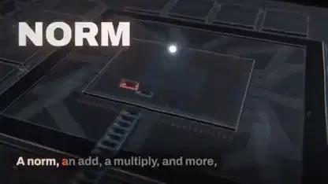</a> 
<b>メガカーネルを題材にしたミュージックビデオ</b> 
<b>↗ 注目上昇</b> · <a href="https://x.com/elliotarledge">@elliotarledge</a> · 2:53 · 2026-11-10 
<a href="https://video.twimg.com/amplify_video/2119968396469309440/vid/avc1/1920x1080/Q748HuENLMQtMz8O.mp4?tag=29">▶ 本編</a> · <a href="https://x.com/elliotarledge/status/2119968762069934415">元の投稿</a> · <a href="https://github.com/VibeClip/awesome-fable-5-2-videos/blob/main/docs/videos/ja/elliotarledge-2119968762069934415.md">詳細</a>

📝 プロンプトを見る

作者が下記のリンクでプロンプトを公開しています。参考素材や追加指示と合わせて元の文脈を確認してください。

<a href="https://x.com/elliotarledge/status/2119968762069934415">作者の公開プロンプトを読む</a>

</td>
<td width="33%" valign="top">
 
<b>HyperFramesで編集した日本語のAIアバター解説</b> 
<b>新しい発見</b> · <a href="https://x.com/nakazakifam">@nakazakifam</a> · 0:34 · 2026-11-10 
<a href="https://video.twimg.com/amplify_video/2119946393565450240/vid/avc1/1920x1080/Jt_-E4yC0PiI2m2M.mp4?tag=29">▶ 本編</a> · <a href="https://x.com/nakazakifam/status/2119946561941606493">元の投稿</a> · <a href="https://github.com/VibeClip/awesome-fable-5-2-videos/blob/main/docs/videos/ja/nakazakifam-2119946561941606493.md">詳細</a>

</td>
<td width="33%" valign="top">
 
<b>文字の歴史を映像でたどる</b> 
<b>↗ 注目上昇</b> · <a href="https://x.com/rileybrown">@rileybrown</a> · 1:36 · 2026-11-10 
<a href="https://video.twimg.com/amplify_video/2119945592977653760/vid/avc1/3840x2160/foNEVBH2Khao6Dd6.mp4?tag=29">▶ 本編</a> · <a href="https://x.com/rileybrown/status/2119946022767980985">元の投稿</a> · <a href="https://github.com/VibeClip/awesome-fable-5-2-videos/blob/main/docs/videos/ja/rileybrown-2119946022767980985.md">詳細</a>

</td>
</tr>
<tr>
<td width="33%" valign="top">
 
<b>Three.jsで分解して学ぶ原子炉</b> 
<b>↗ 注目上昇</b> · <a href="https://x.com/konstantinsaifo">@konstantinsaifo</a> · 0:36 · 2026-11-09 
<a href="https://video.twimg.com/amplify_video/2119941576290185217/vid/avc1/1920x1080/doJzvrUuyB86Ednp.mp4?tag=29">▶ 本編</a> · <a href="https://x.com/konstantinsaifo/status/2119941967136379334">元の投稿</a> · <a href="https://github.com/VibeClip/awesome-fable-5-2-videos/blob/main/docs/videos/ja/konstantinsaifo-2119941967136379334.md">詳細</a>

📝 プロンプトを見る

作者が下記のリンクでプロンプトを公開しています。参考素材や追加指示と合わせて元の文脈を確認してください。

<a href="https://x.com/konstantinsaifo/status/2119941967136379334">作者の公開プロンプトを読む</a>

</td>
<td width="33%" valign="top">
 
<b>楽譜から映像になるピアノソナタ</b> 
<b>↗ 注目上昇</b> · <a href="https://x.com/imjustnewatai">@imjustnewatai</a> · 2:51 · 2026-11-09 
<a href="https://video.twimg.com/amplify_video/2119919333140840449/vid/avc1/1920x1080/125Re1yzvUQndyX4.mp4?tag=29">▶ 本編</a> · <a href="https://x.com/imjustnewatai/status/2119919644836347926">元の投稿</a> · <a href="https://github.com/VibeClip/awesome-fable-5-2-videos/blob/main/docs/videos/ja/imjustnewatai-2119919644836347926.md">詳細</a>

</td>
<td width="33%" valign="top">
 
<b>Convexをモーションで解説</b> 
<b>↗ 注目上昇</b> · <a href="https://x.com/Rasmic">@Rasmic</a> · 4:08 · 2026-11-09 
<a href="https://video.twimg.com/amplify_video/2119919371401244672/vid/avc1/1920x1080/yS6Kbc5l0NBv4N40.mp4?tag=29">▶ 本編</a> · <a href="https://x.com/Rasmic/status/2119919466163093768">元の投稿</a> · <a href="https://github.com/VibeClip/awesome-fable-5-2-videos/blob/main/docs/videos/ja/rasmic-2119919466163093768.md">詳細</a>

</td>
</tr>
<tr>
<td width="33%" valign="top">
 
<b>ゼロから歌うシンセサイザー</b> 
<a href="https://x.com/higgsfield_ai">@higgsfield_ai</a> · 0:50 · 2026-11-09 
<a href="https://video.twimg.com/amplify_video/2119906799151448064/vid/avc1/1440x1080/nfRvSZRf-lGyoO3k.mp4?tag=29">▶ 本編</a> · <a href="https://x.com/higgsfield_ai/status/2119907675265987047">元の投稿</a> · <a href="https://github.com/VibeClip/awesome-fable-5-2-videos/blob/main/docs/videos/ja/higgsfield-ai-987047.md">詳細</a>

</td>
<td width="33%" valign="top">
 
<b>空が青い理由を日本語で解説</b> 
<a href="https://x.com/yzr_koba">@yzr_koba</a> · 0:55 · 2026-11-09 
<a href="https://video.twimg.com/amplify_video/2119907073026899968/vid/avc1/1920x1080/fJ7CuLzKleGXCpkO.mp4?tag=29">▶ 本編</a> · <a href="https://x.com/yzr_koba/status/2119907670077722932">元の投稿</a> · <a href="https://github.com/VibeClip/awesome-fable-5-2-videos/blob/main/docs/videos/ja/yzr-koba-722932.md">詳細</a>

</td>
<td width="33%" valign="top">
 
<b>ChatGPTの4年間を描く記念映像</b> 
<a href="https://x.com/Khazix0918">@Khazix0918</a> · 0:58 · 2026-11-09 
<a href="https://video.twimg.com/amplify_video/2119899444233863168/vid/avc1/1920x1080/hqqYkpi27k2cdXpg.mp4?tag=29">▶ 本編</a> · <a href="https://x.com/Khazix0918/status/2119902325460590834">元の投稿</a> · <a href="https://github.com/VibeClip/awesome-fable-5-2-videos/blob/main/docs/videos/ja/khazix0918-590834.md">詳細</a>

</td>
</tr>
<tr>
<td width="33%" valign="top">
 
<b>写真一枚から再現するエッグタイマー</b> 
<a href="https://x.com/TekonBurns">@TekonBurns</a> · 0:23 · 2026-11-09 
<a href="https://video.twimg.com/amplify_video/2119899446242918400/vid/avc1/1080x1350/S8_fma1a1es6Q4Tt.mp4?tag=29">▶ 本編</a> · <a href="https://x.com/TekonBurns/status/2119900328212713872">元の投稿</a> · <a href="https://github.com/VibeClip/awesome-fable-5-2-videos/blob/main/docs/videos/ja/tekonburns-713872.md">詳細</a>

</td>
<td width="33%" valign="top">
 
<b>ブログへの感想を音声から映像へ</b> 
<a href="https://x.com/buriedstupidity">@buriedstupidity</a> · 1:30 · 2026-11-09 
<a href="https://video.twimg.com/amplify_video/2119899879652876288/vid/avc1/1920x1080/Km5pgtjQ970n5n9b.mp4?tag=29">▶ 本編</a> · <a href="https://x.com/buriedstupidity/status/2119900194540322870">元の投稿</a> · <a href="https://github.com/VibeClip/awesome-fable-5-2-videos/blob/main/docs/videos/ja/buriedstupidity-322870.md">詳細</a>

</td>
<td width="33%" valign="top">
 
<b>回転して命を吹き込むゾートロープ</b> 
<a href="https://x.com/dfeinition">@dfeinition</a> · 0:21 · 2026-11-09 
<a href="https://video.twimg.com/amplify_video/2119891672477679616/vid/avc1/2160x2160/L-CIBp2qNeTMs0hj.mp4?tag=29">▶ 本編</a> · <a href="https://x.com/dfeinition/status/2119892210376176088">元の投稿</a> · <a href="https://github.com/VibeClip/awesome-fable-5-2-videos/blob/main/docs/videos/ja/dfeinition-176088.md">詳細</a>

</td>
</tr>
<tr>
<td width="33%" valign="top">
 
<b>3Dだけで作るクレイアニメ</b> 
<a href="https://x.com/dfeinition">@dfeinition</a> · 0:20 · 2026-11-09 
<a href="https://video.twimg.com/amplify_video/2119891424564895744/vid/avc1/2160x2160/cw5WN1voZQCaOihD.mp4?tag=29">▶ 本編</a> · <a href="https://x.com/dfeinition/status/2119892208937517201">元の投稿</a> · <a href="https://github.com/VibeClip/awesome-fable-5-2-videos/blob/main/docs/videos/ja/dfeinition-517201.md">詳細</a>

</td>
<td width="33%" valign="top">
 
<b>折りたたみスマホのヒンジの仕組み</b> 
<a href="https://x.com/Avenoxai">@Avenoxai</a> · 1:00 · 2026-11-09 
<a href="https://video.twimg.com/amplify_video/2119891178682228736/vid/avc1/1920x1080/2q3_mQw6ZalpiaQz.mp4?tag=29">▶ 本編</a> · <a href="https://x.com/Avenoxai/status/2119891378352058821">元の投稿</a> · <a href="https://github.com/VibeClip/awesome-fable-5-2-videos/blob/main/docs/videos/ja/avenoxai-058821.md">詳細</a>

</td>
<td width="33%" valign="top">
 
<b>AI時代に人が感じること</b> 
<a href="https://x.com/nottherajyk">@nottherajyk</a> · 0:44 · 2026-11-09 
<a href="https://video.twimg.com/amplify_video/2119889834751971328/vid/avc1/1280x720/FWYrwhFrNDz1DaVJ.mp4?tag=14">▶ 本編</a> · <a href="https://x.com/nottherajyk/status/2119890840067985571">元の投稿</a> · <a href="https://github.com/VibeClip/awesome-fable-5-2-videos/blob/main/docs/videos/ja/nottherajyk-985571.md">詳細</a>

</td>
</tr>
<tr>
<td width="33%" valign="top">
 
<b>月が地球から3メートルにあったら</b> 
<a href="https://x.com/ashen_one">@ashen_one</a> · 1:00 · 2026-11-09 
<a href="https://video.twimg.com/amplify_video/2119889619286110208/vid/avc1/1080x1920/IG9or_uQyshexjHE.mp4?tag=29">▶ 本編</a> · <a href="https://x.com/ashen_one/status/2119889741600424363">元の投稿</a> · <a href="https://github.com/VibeClip/awesome-fable-5-2-videos/blob/main/docs/videos/ja/ashen-one-424363.md">詳細</a>

</td>
<td width="33%" valign="top">
 
<b>TPUチップの内部を層ごとに見る</b> 
<a href="https://x.com/SPAC89">@SPAC89</a> · 0:50 · 2026-11-09 
<a href="https://video.twimg.com/amplify_video/2119888023231844352/vid/avc1/1920x1080/bMAfu17GqdoH9jlN.mp4?tag=29">▶ 本編</a> · <a href="https://x.com/SPAC89/status/2119888738595770843">元の投稿</a> · <a href="https://github.com/VibeClip/awesome-fable-5-2-videos/blob/main/docs/videos/ja/spac89-770843.md">詳細</a>

</td>
<td width="33%" valign="top">
 
<b>Fable 5.2発表のピクセルクエスト</b> 
<a href="https://x.com/thetansen">@thetansen</a> · 0:56 · 2026-11-09 
<a href="https://video.twimg.com/amplify_video/2119885999660843008/vid/avc1/1080x1920/FNwRCB0RWB6YcNpv.mp4?tag=29">▶ 本編</a> · <a href="https://x.com/thetansen/status/2119886204716134791">元の投稿</a> · <a href="https://github.com/VibeClip/awesome-fable-5-2-videos/blob/main/docs/videos/ja/thetansen-134791.md">詳細</a>

</td>
</tr>
<tr>
<td width="33%" valign="top">
 
<b>映画で本物の747を壊した方法</b> 
<a href="https://x.com/charan_kilari">@charan_kilari</a> · 0:25 · 2026-11-09 
<a href="https://video.twimg.com/amplify_video/2119883996436082688/vid/avc1/1080x1920/vnjdC4iD158qDzXz.mp4?tag=29">▶ 本編</a> · <a href="https://x.com/charan_kilari/status/2119884295179538680">元の投稿</a> · <a href="https://github.com/VibeClip/awesome-fable-5-2-videos/blob/main/docs/videos/ja/charan-kilari-538680.md">詳細</a>

</td>
<td width="33%" valign="top">
 
<b>バッハ風のト短調コラール</b> 
<a href="https://x.com/aug5thmusic">@aug5thmusic</a> · 0:45 · 2026-11-09 
<a href="https://video.twimg.com/amplify_video/2119875528337555456/vid/avc1/1920x1080/QNFaHTtARFp56_Bb.mp4?tag=29">▶ 本編</a> · <a href="https://x.com/aug5thmusic/status/2119879319426404780">元の投稿</a> · <a href="https://github.com/VibeClip/awesome-fable-5-2-videos/blob/main/docs/videos/ja/aug5thmusic-404780.md">詳細</a>

📝 プロンプトを見る

作者が下記のリンクでプロンプトを公開しています。参考素材や追加指示と合わせて元の文脈を確認してください。

<a href="https://x.com/aug5thmusic/status/2119879973318414392">作者の公開プロンプトを読む</a>

</td>
<td width="33%" valign="top">
 
<b>パストレーサーをWebGPUへ移植</b> 
<a href="https://x.com/aidanshandle">@aidanshandle</a> · 1:36 · 2026-11-09 
<a href="https://video.twimg.com/amplify_video/2119879169731645440/vid/avc1/1280x720/Bh3U2lhMYgX9-Vb0.mp4?tag=29">▶ 本編</a> · <a href="https://x.com/aidanshandle/status/2119879273196761464">元の投稿</a> · <a href="https://github.com/VibeClip/awesome-fable-5-2-videos/blob/main/docs/videos/ja/aidanshandle-761464.md">詳細</a>

</td>
</tr>
<tr>
<td width="33%" valign="top">
 
<b>ゲームキャラクターの動きをつなぐ仕組み</b> 
<a href="https://x.com/dfeinition">@dfeinition</a> · 1:00 · 2026-11-09 
<a href="https://video.twimg.com/amplify_video/2119870421478567936/vid/avc1/3840x2160/G6_gpxpBs-4beNTY.mp4?tag=29">▶ 本編</a> · <a href="https://x.com/dfeinition/status/2119870838606381391">元の投稿</a> · <a href="https://github.com/VibeClip/awesome-fable-5-2-videos/blob/main/docs/videos/ja/dfeinition-381391.md">詳細</a>

</td>
<td width="33%" valign="top">
 
<b>ライフゲームの中で動くコンパイラ</b> 
<a href="https://x.com/maxleiter">@maxleiter</a> · 1:01 · 2026-11-09 
<a href="https://video.twimg.com/amplify_video/2119868875127087104/vid/avc1/1280x720/VhIfEqbHcpwlznir.mp4?tag=14">▶ 本編</a> · <a href="https://x.com/maxleiter/status/2119869170871652487">元の投稿</a> · <a href="https://github.com/VibeClip/awesome-fable-5-2-videos/blob/main/docs/videos/ja/maxleiter-652487.md">詳細</a>

</td>
<td width="33%" valign="top">
 
<b>言語モデルの仕組みをアニメで解説</b> 
<b>↗ 注目上昇</b> · <a href="https://x.com/MatthewBerman">@MatthewBerman</a> · 0:50 · 2026-11-09 
<a href="https://video.twimg.com/amplify_video/2119868088091017217/vid/avc1/1920x1080/5TB7-RiWDIUPCxdO.mp4?tag=29">▶ 本編</a> · <a href="https://x.com/MatthewBerman/status/2119868633086378471">元の投稿</a> · <a href="https://github.com/VibeClip/awesome-fable-5-2-videos/blob/main/docs/videos/ja/matthewberman-2119868633086378471.md">詳細</a>

</td>
</tr>
<tr>
<td width="33%" valign="top">
 
<b>全国の水の安全マップ</b> 
<a href="https://x.com/alliekmiller">@alliekmiller</a> · 1:22 · 2026-11-09 
<a href="https://video.twimg.com/amplify_video/2119669941263597569/vid/avc1/1920x1080/h6JslKeeBV8e7IAn.mp4?tag=29">▶ 本編</a> · <a href="https://x.com/alliekmiller/status/2119868629818757417">元の投稿</a> · <a href="https://github.com/VibeClip/awesome-fable-5-2-videos/blob/main/docs/videos/ja/alliekmiller-757417.md">詳細</a>

</td>
<td width="33%"></td>
<td width="33%"></td>
</tr>
</table>

## ゲームとインタラクティブ作品 · 76

ブラウザーゲーム、遊べる世界、創作ツール、対話的なUI。

<table>
<tr>
<td width="33%" valign="top">
 
<b>『Small Magic』ブラウザーで遊べる魔法のサンドボックス</b> 
<b>新しい発見</b> · <a href="https://x.com/BlendiByl">@BlendiByl</a> · 0:55 · 2026-11-14 
<a href="https://video.twimg.com/amplify_video/2121593955557179392/vid/avc1/2560x1440/1vPd14dnnOiQ4YAY.mp4?tag=29">▶ 本編</a> · <a href="https://x.com/BlendiByl/status/2121594536153718972">元の投稿</a> · <a href="https://github.com/VibeClip/awesome-fable-5-2-videos/blob/main/docs/videos/ja/blendibyl-2121594536153718972.md">詳細</a>

</td>
<td width="33%" valign="top">
 
<b>遊べる3D牧場づくりゲーム</b> 
<b>↗ 注目上昇</b> · <a href="https://x.com/onofumi_AI">@onofumi_AI</a> · 0:32 · 2026-11-14 
<a href="https://video.twimg.com/amplify_video/2121452791164264448/vid/avc1/1920x1080/jkb1uVrk_B6bJHRN.mp4?tag=29">▶ 本編</a> · <a href="https://x.com/onofumi_AI/status/2121452857576878318">元の投稿</a> · <a href="https://github.com/VibeClip/awesome-fable-5-2-videos/blob/main/docs/videos/ja/onofumi-ai-2121452857576878318.md">詳細</a>

</td>
<td width="33%" valign="top">
 
<b>ジグザグの道を進むリズムゲーム『Hibiki Trail』</b> 
<b>新しい発見</b> · <a href="https://x.com/tetumemo">@tetumemo</a> · 0:40 · 2026-11-13 
<a href="https://video.twimg.com/amplify_video/2121223724628406273/vid/avc1/1080x1920/t3Zo4quBpWwRSnxb.mp4?tag=29">▶ 本編</a> · <a href="https://x.com/tetumemo/status/2121223780718792936">元の投稿</a> · <a href="https://github.com/VibeClip/awesome-fable-5-2-videos/blob/main/docs/videos/ja/tetumemo-2121223780718792936.md">詳細</a>

</td>
</tr>
<tr>
<td width="33%" valign="top">
 
<b>草原を動かすBlenderアドオン『Harappa』</b> 
<b>↗ 注目上昇</b> · <a href="https://x.com/KanaWorks_AI">@KanaWorks_AI</a> · 1:25 · 2026-11-13 
<a href="https://video.twimg.com/amplify_video/2121218805183684608/vid/avc1/1920x1080/_RvcnTMVJqh6vCS1.mp4?tag=29">▶ 本編</a> · <a href="https://x.com/KanaWorks_AI/status/2121221880673972463">元の投稿</a> · <a href="https://github.com/VibeClip/awesome-fable-5-2-videos/blob/main/docs/videos/ja/kanaworks-ai-2121221880673972463.md">詳細</a>

</td>
<td width="33%" valign="top">
 
<b>歩いて探索できる色鉛筆風の港町</b> 
<b>↗ 注目上昇</b> · <a href="https://x.com/BlendiByl">@BlendiByl</a> · 0:14 · 2026-11-13 
<a href="https://video.twimg.com/amplify_video/2121129119471857664/vid/avc1/2560x1440/T9zedOxAUTAmkIyC.mp4?tag=29">▶ 本編</a> · <a href="https://x.com/BlendiByl/status/2121130385723789637">元の投稿</a> · <a href="https://github.com/VibeClip/awesome-fable-5-2-videos/blob/main/docs/videos/ja/blendibyl-2121130385723789637.md">詳細</a>

</td>
<td width="33%" valign="top">
 
<b>3対3のアーケード風池上ホッケー</b> 
<b>新しい発見</b> · <a href="https://x.com/Spidermanzdev">@Spidermanzdev</a> · 0:12 · 2026-11-13 
<a href="https://video.twimg.com/amplify_video/2121086832662233088/vid/avc1/1280x720/WoKjs3OOha2AzzCB.mp4?tag=29">▶ 本編</a> · <a href="https://x.com/Spidermanzdev/status/2121087583924941302">元の投稿</a> · <a href="https://github.com/VibeClip/awesome-fable-5-2-videos/blob/main/docs/videos/ja/spidermanzdev-2121087583924941302.md">詳細</a>

</td>
</tr>
<tr>
<td width="33%" valign="top">
 
<b>パッチワークの島を飛ぶハンググライダーゲーム</b> 
<b>↗ 注目上昇</b> · <a href="https://x.com/loktar00">@loktar00</a> · 1:00 · 2026-11-12 
<a href="https://video.twimg.com/amplify_video/2121003810583683072/vid/avc1/1920x1080/ez-WbJx3u3EpJRds.mp4?tag=29">▶ 本編</a> · <a href="https://x.com/loktar00/status/2121005021131083851">元の投稿</a> · <a href="https://github.com/VibeClip/awesome-fable-5-2-videos/blob/main/docs/videos/ja/loktar00-2121005021131083851.md">詳細</a>

</td>
<td width="33%" valign="top">
 
<b>クジラが案内する探索型ピクセルアートの世界</b> 
<b>新しい発見</b> · <a href="https://x.com/dfeinition">@dfeinition</a> · 1:57 · 2026-11-12 
<a href="https://video.twimg.com/amplify_video/2120933027748392960/vid/avc1/3840x2160/TBgnySF6q7jdJhfY.mp4?tag=29">▶ 本編</a> · <a href="https://x.com/dfeinition/status/2120933859999059970">元の投稿</a> · <a href="https://github.com/VibeClip/awesome-fable-5-2-videos/blob/main/docs/videos/ja/dfeinition-2120933859999059970.md">詳細</a>

</td>
<td width="33%" valign="top">
 
<b>ストップモーション風の遊べるパッチワークの村</b> 
<b>新しい発見</b> · <a href="https://x.com/BlendiByl">@BlendiByl</a> · 0:27 · 2026-11-12 
<a href="https://video.twimg.com/amplify_video/2120745677055733760/vid/avc1/2560x1440/3alE49tTHiEZV3hx.mp4?tag=29">▶ 本編</a> · <a href="https://x.com/BlendiByl/status/2120746541636047347">元の投稿</a> · <a href="https://github.com/VibeClip/awesome-fable-5-2-videos/blob/main/docs/videos/ja/blendibyl-2120746541636047347.md">詳細</a>

</td>
</tr>
<tr>
<td width="33%" valign="top">
 
<b>嵐の灯台ゲーム『Farewell Light』のデモ</b> 
<b>新しい発見</b> · <a href="https://x.com/RyanSael">@RyanSael</a> · 2:25 · 2026-11-12 
<a href="https://video.twimg.com/amplify_video/2120694422136647680/vid/avc1/1706x1080/cuxS5q7B87MFwq6W.mp4?tag=29">▶ 本編</a> · <a href="https://x.com/RyanSael/status/2120695866684231998">元の投稿</a> · <a href="https://github.com/VibeClip/awesome-fable-5-2-videos/blob/main/docs/videos/ja/ryansael-2120695866684231998.md">詳細</a>

</td>
<td width="33%" valign="top">
 
<b>単一HTMLで動く雪景色の3Dアクションゲーム</b> 
<a href="https://x.com/op7418">@op7418</a> · 1:06 · 2026-11-12 
<a href="https://video.twimg.com/amplify_video/2120692796327968768/vid/avc1/2134x1080/IgnOSwRg5XNSEAmN.mp4?tag=29">▶ 本編</a> · <a href="https://x.com/op7418/status/2120694045299327187">元の投稿</a> · <a href="https://github.com/VibeClip/awesome-fable-5-2-videos/blob/main/docs/videos/ja/op7418-2120694045299327187.md">詳細</a>

</td>
<td width="33%" valign="top">
 
<b>鳥の視点でトロントを巡る『COO』予告編</b> 
<b>↗ 注目上昇</b> · <a href="https://x.com/yegor">@yegor</a> · 1:13 · 2026-11-12 
<a href="https://video.twimg.com/amplify_video/2120684600557006848/vid/avc1/1920x1080/VEcNvdW3v6fKtdCn.mp4?tag=29">▶ 本編</a> · <a href="https://x.com/yegor/status/2120689760595276193">元の投稿</a> · <a href="https://github.com/VibeClip/awesome-fable-5-2-videos/blob/main/docs/videos/ja/yegor-2120689760595276193.md">詳細</a>

</td>
</tr>
<tr>
<td width="33%" valign="top">
 
<b>ドリフトとブーストで走るネオン街のレースゲーム</b> 
<b>新しい発見</b> · <a href="https://x.com/Stargridcompass">@Stargridcompass</a> · 1:16 · 2026-11-12 
<a href="https://video.twimg.com/amplify_video/2120566485575712768/vid/avc1/1920x1080/1or0Ua87gzV00NkA.mp4?tag=29">▶ 本編</a> · <a href="https://x.com/Stargridcompass/status/2120675441677672879">元の投稿</a> · <a href="https://github.com/VibeClip/awesome-fable-5-2-videos/blob/main/docs/videos/ja/stargridcompass-2120675441677672879.md">詳細</a>

</td>
<td width="33%" valign="top">
 
<b>コンボ表示付きの4レーン音楽ゲーム</b> 
<b>新しい発見</b> · <a href="https://x.com/Stargridcompass">@Stargridcompass</a> · 1:26 · 2026-11-11 
<a href="https://video.twimg.com/amplify_video/2120439724712030209/vid/avc1/1920x1080/xstfn4yqcQkOA9s2.mp4?tag=29">▶ 本編</a> · <a href="https://x.com/Stargridcompass/status/2120446433358692440">元の投稿</a> · <a href="https://github.com/VibeClip/awesome-fable-5-2-videos/blob/main/docs/videos/ja/stargridcompass-2120446433358692440.md">詳細</a>

</td>
<td width="33%" valign="top">
 
<b>単一HTMLのブラウザーゲーム『SUBLEVEL 07』</b> 
<b>新しい発見</b> · <a href="https://x.com/wquguru">@wquguru</a> · 0:15 · 2026-11-11 
<a href="https://video.twimg.com/amplify_video/2120382863388590080/vid/avc1/720x1080/e1jp6XnSJ5Ia2UVw.mp4?tag=29">▶ 本編</a> · <a href="https://x.com/wquguru/status/2120383332722905400">元の投稿</a> · <a href="https://github.com/VibeClip/awesome-fable-5-2-videos/blob/main/docs/videos/ja/wquguru-2120383332722905400.md">詳細</a>

📝 プロンプトを見る

作者が下記のリンクでプロンプトを公開しています。参考素材や追加指示と合わせて元の文脈を確認してください。

<a href="https://x.com/i/article/2120373697840316416">作者の公開プロンプトを読む</a>

</td>
</tr>
<tr>
<td width="33%" valign="top">
 
<b>ブラウザーで動く筆致のある森のゲーム</b> 
<a href="https://x.com/BlendiByl">@BlendiByl</a> · 0:16 · 2026-11-11 
<a href="https://video.twimg.com/amplify_video/2120339928337031168/vid/avc1/2560x1440/efsgZg5CNfhT9tWC.mp4?tag=29">▶ 本編</a> · <a href="https://x.com/BlendiByl/status/2120341251178594532">元の投稿</a> · <a href="https://github.com/VibeClip/awesome-fable-5-2-videos/blob/main/docs/videos/ja/blendibyl-2120341251178594532.md">詳細</a>

</td>
<td width="33%" valign="top">
 
<b>部屋のつながりが変わる不思議な空間のウォークスルー</b> 
<b>新しい発見</b> · <a href="https://x.com/BlendiByl">@BlendiByl</a> · 0:53 · 2026-11-11 
<a href="https://video.twimg.com/amplify_video/2120313933710159872/vid/avc1/2560x1440/PKe7dLlC4bVyp-Y-.mp4?tag=29">▶ 本編</a> · <a href="https://x.com/BlendiByl/status/2120314459793355262">元の投稿</a> · <a href="https://github.com/VibeClip/awesome-fable-5-2-videos/blob/main/docs/videos/ja/blendibyl-2120314459793355262.md">詳細</a>

</td>
<td width="33%" valign="top">
 
<b>オープンワールドゲーム試作の都市上空ツアー</b> 
<a href="https://x.com/mattshumer_">@mattshumer_</a> · 1:04 · 2026-11-10 
<a href="https://video.twimg.com/amplify_video/2120282020399984640/vid/avc1/1920x1080/ajQOizdMhg4SwqVj.mp4?tag=29">▶ 本編</a> · <a href="https://x.com/mattshumer_/status/2120282133503820150">元の投稿</a> · <a href="https://github.com/VibeClip/awesome-fable-5-2-videos/blob/main/docs/videos/ja/mattshumer-2120282133503820150.md">詳細</a>

</td>
</tr>
<tr>
<td width="33%" valign="top">
 
<b>オープンワールドRPG「Age of Dragon」のデモ</b> 
<a href="https://x.com/M__Houser">@M__Houser</a> · 1:56 · 2026-11-10 
<a href="https://video.twimg.com/amplify_video/2120253027571601408/vid/avc1/1898x1080/P8E_h3btMpQ54LCL.mp4?tag=16">▶ 本編</a> · <a href="https://x.com/M__Houser/status/2120253236309569696">元の投稿</a> · <a href="https://github.com/VibeClip/awesome-fable-5-2-videos/blob/main/docs/videos/ja/m-houser-2120253236309569696.md">詳細</a>

</td>
<td width="33%" valign="top">
 
<b>ファンタジー交通ゲーム「Dread &amp; District」</b> 
<b>↗ 注目上昇</b> · <a href="https://x.com/emollick">@emollick</a> · 0:19 · 2026-11-10 
<a href="https://video.twimg.com/amplify_video/2120248122982985728/vid/avc1/1144x1076/1Aa5_PvPzNWweA5Q.mp4?tag=29">▶ 本編</a> · <a href="https://x.com/emollick/status/2120248525254742318">元の投稿</a> · <a href="https://github.com/VibeClip/awesome-fable-5-2-videos/blob/main/docs/videos/ja/emollick-2120248525254742318.md">詳細</a>

</td>
<td width="33%" valign="top">
 
<b>ブラウザーで動くダークファンタジーのボス戦</b> 
<a href="https://x.com/kevin_t_ngo">@kevin_t_ngo</a> · 2:18 · 2026-11-10 
<a href="https://video.twimg.com/amplify_video/2120233931744391168/vid/avc1/1920x1080/qbytKTQjkq4MuaXz.mp4?tag=29">▶ 本編</a> · <a href="https://x.com/kevin_t_ngo/status/2120238844754923874">元の投稿</a> · <a href="https://github.com/VibeClip/awesome-fable-5-2-videos/blob/main/docs/videos/ja/kevin-t-ngo-2120238844754923874.md">詳細</a>

</td>
</tr>
<tr>
<td width="33%" valign="top">
 
<b>松明の光の中で戦う小隊ゲームのデモ</b> 
<a href="https://x.com/loktar00">@loktar00</a> · 1:08 · 2026-11-10 
<a href="https://video.twimg.com/amplify_video/2120187656881516544/vid/avc1/1920x1080/YPzyBVlvXVwBta44.mp4?tag=29">▶ 本編</a> · <a href="https://x.com/loktar00/status/2120192761542615271">元の投稿</a> · <a href="https://github.com/VibeClip/awesome-fable-5-2-videos/blob/main/docs/videos/ja/loktar00-2120192761542615271.md">詳細</a>

</td>
<td width="33%" valign="top">
 
<b>FLATROOMS V0.1のショーケース映像</b> 
<b>↗ 注目上昇</b> · <a href="https://x.com/teortaxesTex">@teortaxesTex</a> · 0:52 · 2026-11-10 
<a href="https://video.twimg.com/amplify_video/2120189727152230400/vid/avc1/1920x1080/773Fe7f-xdoEUjp2.mp4?tag=29">▶ 本編</a> · <a href="https://x.com/teortaxesTex/status/2120189862162657753">元の投稿</a> · <a href="https://github.com/VibeClip/awesome-fable-5-2-videos/blob/main/docs/videos/ja/teortaxestex-2120189862162657753.md">詳細</a>

</td>
<td width="33%" valign="top">
 
<b>海と天候を操作できる帆船デモ</b> 
<b>新しい発見</b> · <a href="https://x.com/vib3coded">@vib3coded</a> · 0:18 · 2026-11-10 
<a href="https://video.twimg.com/amplify_video/2120189120093757441/vid/avc1/1920x1200/IlWG73RcQBDsxhM4.mp4?tag=29">▶ 本編</a> · <a href="https://x.com/vib3coded/status/2120189785247498513">元の投稿</a> · <a href="https://github.com/VibeClip/awesome-fable-5-2-videos/blob/main/docs/videos/ja/vib3coded-2120189785247498513.md">詳細</a>

</td>
</tr>
<tr>
<td width="33%" valign="top">
 
<b>夕暮れの屋上で遊ぶピックルボール「Rooftop Rally」</b> 
<b>↗ 注目上昇</b> · <a href="https://x.com/chongdashu">@chongdashu</a> · 0:49 · 2026-11-10 
<a href="https://video.twimg.com/amplify_video/2120154381584838656/vid/avc1/1920x1080/mRePQbLcVWXqKTsY.mp4?tag=29">▶ 本編</a> · <a href="https://x.com/chongdashu/status/2120154573356793883">元の投稿</a> · <a href="https://github.com/VibeClip/awesome-fable-5-2-videos/blob/main/docs/videos/ja/chongdashu-2120154573356793883.md">詳細</a>

</td>
<td width="33%" valign="top">
<a href="https://video.twimg.com/amplify_video/2120148511836835840/vid/avc1/2830x1496/qlQkuQ7RRb6l2keO.mp4?tag=29">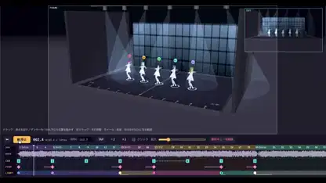</a> 
<b>キャラクター振り付け用の3Dプリビズステージ</b> 
<b>新しい発見</b> · <a href="https://x.com/keiru_ai">@keiru_ai</a> · 0:54 · 2026-11-10 
<a href="https://video.twimg.com/amplify_video/2120148511836835840/vid/avc1/2830x1496/qlQkuQ7RRb6l2keO.mp4?tag=29">▶ 本編</a> · <a href="https://x.com/keiru_ai/status/2120148813142958454">元の投稿</a> · <a href="https://github.com/VibeClip/awesome-fable-5-2-videos/blob/main/docs/videos/ja/keiru-ai-2120148813142958454.md">詳細</a>

</td>
<td width="33%" valign="top">
 
<b>ガラスが砕けるWebGPU水槽</b> 
<b>↗ 注目上昇</b> · <a href="https://x.com/sara_kumodeck">@sara_kumodeck</a> · 0:15 · 2026-11-10 
<a href="https://video.twimg.com/amplify_video/2120127605894701057/vid/avc1/1920x1080/vmX1EZ4VHCC4dij2.mp4?tag=29">▶ 本編</a> · <a href="https://x.com/sara_kumodeck/status/2120127706675417428">元の投稿</a> · <a href="https://github.com/VibeClip/awesome-fable-5-2-videos/blob/main/docs/videos/ja/sara-kumodeck-2120127706675417428.md">詳細</a>

</td>
</tr>
<tr>
<td width="33%" valign="top">
 
<b>Unreal Engineのホラーゲームデモ「Sit With Her」</b> 
<a href="https://x.com/_MaxBlade">@_MaxBlade</a> · 2:01 · 2026-11-10 
<a href="https://video.twimg.com/amplify_video/2120109165393715200/vid/avc1/1920x1080/nJhRHKUF8oxEnIPb.mp4?tag=29">▶ 本編</a> · <a href="https://x.com/_MaxBlade/status/2120109725740159390">元の投稿</a> · <a href="https://github.com/VibeClip/awesome-fable-5-2-videos/blob/main/docs/videos/ja/maxblade-2120109725740159390.md">詳細</a>

</td>
<td width="33%" valign="top">
 
<b>入力した言葉で描くインタラクティブ水墨画</b> 
<b>↗ 注目上昇</b> · <a href="https://x.com/op7418">@op7418</a> · 1:06 · 2026-11-10 
<a href="https://video.twimg.com/amplify_video/2120084094549987328/vid/avc1/1920x1080/ZIT4h5bEZdMnBsHV.mp4?tag=29">▶ 本編</a> · <a href="https://x.com/op7418/status/2120085300185833878">元の投稿</a> · <a href="https://github.com/VibeClip/awesome-fable-5-2-videos/blob/main/docs/videos/ja/op7418-2120085300185833878.md">詳細</a>

</td>
<td width="33%" valign="top">
 
<b>レンダラーをゲームに変えるBRYCEBALL</b> 
<b>↗ 注目上昇</b> · <a href="https://x.com/pleometric">@pleometric</a> · 1:19 · 2026-11-10 
<a href="https://video.twimg.com/amplify_video/2119973140008726528/vid/avc1/1728x1002/cAU-dap7QOqUYxWD.mp4?tag=29">▶ 本編</a> · <a href="https://x.com/pleometric/status/2119973274402668852">元の投稿</a> · <a href="https://github.com/VibeClip/awesome-fable-5-2-videos/blob/main/docs/videos/ja/pleometric-2119973274402668852.md">詳細</a>

📝 プロンプトを見る

作者が下記のリンクでプロンプトを公開しています。参考素材や追加指示と合わせて元の文脈を確認してください。

<a href="https://x.com/pleometric/status/2119973274402668852">作者の公開プロンプトを読む</a>

</td>
</tr>
<tr>
<td width="33%" valign="top">
 
<b>怪物として遊ぶバックルーム</b> 
<b>↗ 注目上昇</b> · <a href="https://x.com/LexnLin">@LexnLin</a> · 0:45 · 2026-11-10 
<a href="https://video.twimg.com/amplify_video/2119959903062183936/vid/avc1/1280x720/X10eV4fLngmXri42.mp4?tag=29">▶ 本編</a> · <a href="https://x.com/LexnLin/status/2119966127149429093">元の投稿</a> · <a href="https://github.com/VibeClip/awesome-fable-5-2-videos/blob/main/docs/videos/ja/lexnlin-2119966127149429093.md">詳細</a>

</td>
<td width="33%" valign="top">
 
<b>4つのゲームマシンを試す実験場</b> 
<b>↗ 注目上昇</b> · <a href="https://x.com/techartist_">@techartist_</a> · 0:20 · 2026-11-10 
<a href="https://video.twimg.com/amplify_video/2119922739230445568/vid/avc1/1920x1080/1eCM-Y_xZwPgP5Pv.mp4?tag=29">▶ 本編</a> · <a href="https://x.com/techartist_/status/2119946891106394518">元の投稿</a> · <a href="https://github.com/VibeClip/awesome-fable-5-2-videos/blob/main/docs/videos/ja/techartist-2119946891106394518.md">詳細</a>

</td>
<td width="33%" valign="top">
 
<b>コードで作った砂漠のゲーム「Worm Rider」</b> 
<b>↗ 注目上昇</b> · <a href="https://x.com/AmirMushich">@AmirMushich</a> · 0:22 · 2026-11-09 
<a href="https://video.twimg.com/amplify_video/2119936256498962432/vid/avc1/1920x1080/pYXo58uow7BeKq9v.mp4?tag=29">▶ 本編</a> · <a href="https://x.com/AmirMushich/status/2119937977426338283">元の投稿</a> · <a href="https://github.com/VibeClip/awesome-fable-5-2-videos/blob/main/docs/videos/ja/amirmushich-2119937977426338283.md">詳細</a>

</td>
</tr>
<tr>
<td width="33%" valign="top">
 
<b>ポータルを使うアリーナFPS</b> 
<a href="https://x.com/_sholtodouglas">@_sholtodouglas</a> · 1:11 · 2026-11-09 
<a href="https://video.twimg.com/amplify_video/2119935171541831680/vid/avc1/1280x720/xSA0i-YfHsQC-kLT.mp4?tag=29">▶ 本編</a> · <a href="https://x.com/_sholtodouglas/status/2119935331499925557">元の投稿</a> · <a href="https://github.com/VibeClip/awesome-fable-5-2-videos/blob/main/docs/videos/ja/sholtodouglas-2119935331499925557.md">詳細</a>

</td>
<td width="33%" valign="top">
 
<b>Fishslopへの新たな挑戦</b> 
<a href="https://x.com/theo">@theo</a> · 1:17 · 2026-11-09 
<a href="https://video.twimg.com/amplify_video/2119926035043237888/vid/avc1/1568x1080/6oTKgoLPQHeLU1Q7.mp4?tag=29">▶ 本編</a> · <a href="https://x.com/theo/status/2119926277801144695">元の投稿</a> · <a href="https://github.com/VibeClip/awesome-fable-5-2-videos/blob/main/docs/videos/ja/theo-2119926277801144695.md">詳細</a>

</td>
<td width="33%" valign="top">
 
<b>雨の貨物港を舞台にした一人称ゲーム『Saltline』</b> 
<a href="https://x.com/felixrieseberg">@felixrieseberg</a> · 1:12 · 2026-11-09 
<a href="https://video.twimg.com/amplify_video/2119919821538447360/vid/avc1/3648x2022/y1dhMLmyKZ-oidQ6.mp4?tag=29">▶ 本編</a> · <a href="https://x.com/felixrieseberg/status/2119925633564463609">元の投稿</a> · <a href="https://github.com/VibeClip/awesome-fable-5-2-videos/blob/main/docs/videos/ja/felixrieseberg-2119925633564463609.md">詳細</a>

📝 プロンプトを見る

作者が下記のリンクでプロンプトを公開しています。参考素材や追加指示と合わせて元の文脈を確認してください。

<a href="https://x.com/felixrieseberg/status/2119927483994907024">作者の公開プロンプトを読む</a>

</td>
</tr>
<tr>
<td width="33%" valign="top">
 
<b>つながる世界を巡る終わりなき旅</b> 
<b>↗ 注目上昇</b> · <a href="https://x.com/emollick">@emollick</a> · 1:10 · 2026-11-09 
<a href="https://video.twimg.com/amplify_video/2119916822719840256/vid/avc1/1280x720/lEbniPMiC8aWDbWF.mp4?tag=29">▶ 本編</a> · <a href="https://x.com/emollick/status/2119918307457577163">元の投稿</a> · <a href="https://github.com/VibeClip/awesome-fable-5-2-videos/blob/main/docs/videos/ja/emollick-2119918307457577163.md">詳細</a>

</td>
<td width="33%" valign="top">
 
<b>ダ・ヴィンチのノートを体験する</b> 
<b>↗ 注目上昇</b> · <a href="https://x.com/alexalbert__">@alexalbert__</a> · 0:25 · 2026-11-09 
<a href="https://video.twimg.com/amplify_video/2119916917502926849/vid/avc1/1080x1350/LDBsZC4Ong-7XOt4.mp4?tag=16">▶ 本編</a> · <a href="https://x.com/alexalbert__/status/2119916954337349737">元の投稿</a> · <a href="https://github.com/VibeClip/awesome-fable-5-2-videos/blob/main/docs/videos/ja/alexalbert-2119916954337349737.md">詳細</a>

</td>
<td width="33%" valign="top">
 
<b>予告編付きRobloxホラーゲーム</b> 
<a href="https://x.com/mihawkxxxxx">@mihawkxxxxx</a> · 0:54 · 2026-11-09 
<a href="https://video.twimg.com/amplify_video/2119909172820979712/vid/avc1/1920x1080/P7SbkhLDRCMxZ--E.mp4?tag=29">▶ 本編</a> · <a href="https://x.com/mihawkxxxxx/status/2119909865296699749">元の投稿</a> · <a href="https://github.com/VibeClip/awesome-fable-5-2-videos/blob/main/docs/videos/ja/mihawkxxxxx-699749.md">詳細</a>

</td>
</tr>
<tr>
<td width="33%" valign="top">
 
<b>おもちゃの部屋の冒険ゲーム</b> 
<a href="https://x.com/itssotsot">@itssotsot</a> · 1:35 · 2026-11-09 
<a href="https://video.twimg.com/amplify_video/2119906798345818112/vid/avc1/3840x1950/dpgHMhE-Gqz3Kf9j.mp4?tag=29">▶ 本編</a> · <a href="https://x.com/itssotsot/status/2119909017216491720">元の投稿</a> · <a href="https://github.com/VibeClip/awesome-fable-5-2-videos/blob/main/docs/videos/ja/itssotsot-491720.md">詳細</a>

</td>
<td width="33%" valign="top">
 
<b>深海が広がる音量スライダー</b> 
<a href="https://x.com/Elizaveta_ai">@Elizaveta_ai</a> · 0:51 · 2026-11-09 
<a href="https://video.twimg.com/amplify_video/2119907774444261377/vid/avc1/3840x2160/9SQx2NvOeH6bfmiM.mp4?tag=29">▶ 本編</a> · <a href="https://x.com/Elizaveta_ai/status/2119907947132125485">元の投稿</a> · <a href="https://github.com/VibeClip/awesome-fable-5-2-videos/blob/main/docs/videos/ja/elizaveta-ai-125485.md">詳細</a>

</td>
<td width="33%" valign="top">
 
<b>ブラウザーで動くタイプライター</b> 
<b>↗ 注目上昇</b> · <a href="https://x.com/clairevo">@clairevo</a> · 0:50 · 2026-11-09 
<a href="https://video.twimg.com/amplify_video/2119905440352055296/vid/avc1/1920x1080/iC79cUKiFb-L77DB.mp4?tag=29">▶ 本編</a> · <a href="https://x.com/clairevo/status/2119905651359142132">元の投稿</a> · <a href="https://github.com/VibeClip/awesome-fable-5-2-videos/blob/main/docs/videos/ja/clairevo-2119905651359142132.md">詳細</a>

</td>
</tr>
<tr>
<td width="33%" valign="top">
 
<b>スマホで動くARバトルゲーム</b> 
<a href="https://x.com/evrentkg">@evrentkg</a> · 0:20 · 2026-11-09 
<a href="https://video.twimg.com/amplify_video/2119905452037169152/vid/avc1/1080x1982/SHxRz6YwnG5hBSb8.mp4?tag=29">▶ 本編</a> · <a href="https://x.com/evrentkg/status/2119905501601272283">元の投稿</a> · <a href="https://github.com/VibeClip/awesome-fable-5-2-videos/blob/main/docs/videos/ja/evrentkg-272283.md">詳細</a>

</td>
<td width="33%" valign="top">
 
<b>一つのプロンプトから生まれた侍の決闘</b> 
<a href="https://x.com/tymarsha">@tymarsha</a> · 0:45 · 2026-11-09 
<a href="https://video.twimg.com/amplify_video/2119903779336118272/vid/avc1/1920x1080/ArLIv6GtbXBbhr7e.mp4?tag=29">▶ 本編</a> · <a href="https://x.com/tymarsha/status/2119904015454810582">元の投稿</a> · <a href="https://github.com/VibeClip/awesome-fable-5-2-videos/blob/main/docs/videos/ja/tymarsha-810582.md">詳細</a>

</td>
<td width="33%" valign="top">
 
<b>HDR照明の単一ファイルMinecraft</b> 
<a href="https://x.com/RezAIT00">@RezAIT00</a> · 0:34 · 2026-11-09 
<a href="https://video.twimg.com/amplify_video/2119901977794519040/vid/avc1/1920x1080/bldsUQv-9Jwz1bxk.mp4?tag=29">▶ 本編</a> · <a href="https://x.com/RezAIT00/status/2119902470205997344">元の投稿</a> · <a href="https://github.com/VibeClip/awesome-fable-5-2-videos/blob/main/docs/videos/ja/rezait00-997344.md">詳細</a>

</td>
</tr>
<tr>
<td width="33%" valign="top">
 
<b>ブラウザーの3DカートレースTurbo Tails</b> 
<a href="https://x.com/petergyang">@petergyang</a> · 0:20 · 2026-11-09 
<a href="https://video.twimg.com/amplify_video/2119901596008263680/vid/avc1/1920x1080/bZzGqWp4QvSXV_vV.mp4?tag=16">▶ 本編</a> · <a href="https://x.com/petergyang/status/2119901658394358005">元の投稿</a> · <a href="https://github.com/VibeClip/awesome-fable-5-2-videos/blob/main/docs/videos/ja/petergyang-358005.md">詳細</a>

</td>
<td width="33%" valign="top">
 
<b>1対1ブラウザー対戦Gilt &amp; Gutter</b> 
<a href="https://x.com/kevin_t_ngo">@kevin_t_ngo</a> · 1:00 · 2026-11-09 
<a href="https://video.twimg.com/amplify_video/2119899054520061952/vid/avc1/3840x2160/HbsyW6krobPpdwwM.mp4?tag=29">▶ 本編</a> · <a href="https://x.com/kevin_t_ngo/status/2119900487688622171">元の投稿</a> · <a href="https://github.com/VibeClip/awesome-fable-5-2-videos/blob/main/docs/videos/ja/kevin-t-ngo-622171.md">詳細</a>

</td>
<td width="33%" valign="top">
 
<b>Three.jsのMinecraft風ワールド</b> 
<a href="https://x.com/teortaxesTex">@teortaxesTex</a> · 2:00 · 2026-11-09 
<a href="https://video.twimg.com/amplify_video/2119899124728217600/vid/avc1/1920x1080/YcrTSKlU-3rhGo3x.mp4?tag=29">▶ 本編</a> · <a href="https://x.com/teortaxesTex/status/2119899511317225567">元の投稿</a> · <a href="https://github.com/VibeClip/awesome-fable-5-2-videos/blob/main/docs/videos/ja/teortaxestex-225567.md">詳細</a>

</td>
</tr>
<tr>
<td width="33%" valign="top">
 
<b>小さな世界を内包するスライダー</b> 
<a href="https://x.com/repodoting">@repodoting</a> · 0:35 · 2026-11-09 
<a href="https://video.twimg.com/amplify_video/2119898682531430400/vid/avc1/1920x1080/SCNQd6ltHRSLHpQ4.mp4?tag=29">▶ 本編</a> · <a href="https://x.com/repodoting/status/2119898879340765513">元の投稿</a> · <a href="https://github.com/VibeClip/awesome-fable-5-2-videos/blob/main/docs/videos/ja/repodoting-765513.md">詳細</a>

</td>
<td width="33%" valign="top">
 
<b>BlenderとUnrealのSFシューティング</b> 
<a href="https://x.com/higgsfield_ai">@higgsfield_ai</a> · 0:25 · 2026-11-09 
<a href="https://video.twimg.com/amplify_video/2119897032118960128/vid/avc1/1080x1120/7QwIbWUI-6I7Pb9b.mp4?tag=16">▶ 本編</a> · <a href="https://x.com/higgsfield_ai/status/2119897113534529605">元の投稿</a> · <a href="https://github.com/VibeClip/awesome-fable-5-2-videos/blob/main/docs/videos/ja/higgsfield-ai-529605.md">詳細</a>

</td>
<td width="33%" valign="top">
 
<b>遊べるペリカンのベンチマーク</b> 
<a href="https://x.com/NFT_Chen">@NFT_Chen</a> · 0:30 · 2026-11-09 
<a href="https://video.twimg.com/amplify_video/2119895838927548416/vid/avc1/2880x2160/-pnpOu_0XJg6SYgF.mp4?tag=29">▶ 本編</a> · <a href="https://x.com/NFT_Chen/status/2119897058597609967">元の投稿</a> · <a href="https://github.com/VibeClip/awesome-fable-5-2-videos/blob/main/docs/videos/ja/nft-chen-609967.md">詳細</a>

</td>
</tr>
<tr>
<td width="33%" valign="top">
 
<b>Overwatch風のヒーロー対戦</b> 
<a href="https://x.com/Pumpnasterr">@Pumpnasterr</a> · 1:21 · 2026-11-09 
<a href="https://video.twimg.com/amplify_video/2119893759680749568/vid/avc1/1920x1080/i-Pvhaojp1uGU1Cp.mp4?tag=29">▶ 本編</a> · <a href="https://x.com/Pumpnasterr/status/2119895877250609238">元の投稿</a> · <a href="https://github.com/VibeClip/awesome-fable-5-2-videos/blob/main/docs/videos/ja/pumpnasterr-609238.md">詳細</a>

</td>
<td width="33%" valign="top">
 
<b>10ステージの重力スリングショット</b> 
<a href="https://x.com/jonathanhamiche">@jonathanhamiche</a> · 0:10 · 2026-11-09 
<a href="https://video.twimg.com/amplify_video/2119894054234107904/vid/avc1/1920x1080/DK_kuHlmGekNQkIK.mp4?tag=29">▶ 本編</a> · <a href="https://x.com/jonathanhamiche/status/2119894929795145756">元の投稿</a> · <a href="https://github.com/VibeClip/awesome-fable-5-2-videos/blob/main/docs/videos/ja/jonathanhamiche-145756.md">詳細</a>

</td>
<td width="33%" valign="top">
 
<b>ワンショットのバスケットボールゲーム</b> 
<a href="https://x.com/joshvlc">@joshvlc</a> · 0:19 · 2026-11-09 
<a href="https://video.twimg.com/amplify_video/2119894505490935809/vid/avc1/1280x480/M7SRjks4Ivlr4XUs.mp4?tag=29">▶ 本編</a> · <a href="https://x.com/joshvlc/status/2119894656221958575">元の投稿</a> · <a href="https://github.com/VibeClip/awesome-fable-5-2-videos/blob/main/docs/videos/ja/joshvlc-958575.md">詳細</a>

📝 プロンプトを見る

作者が下記のリンクでプロンプトを公開しています。参考素材や追加指示と合わせて元の文脈を確認してください。

<a href="https://x.com/joshvlc/status/2119894940595695756">作者の公開プロンプトを読む</a>

</td>
</tr>
<tr>
<td width="33%" valign="top">
 
<b>城を築くパスワード強度計</b> 
<a href="https://x.com/crtvTeknologist">@crtvTeknologist</a> · 0:18 · 2026-11-09 
<a href="https://video.twimg.com/amplify_video/2119894021472473089/vid/avc1/1080x1080/s5bteQ4U9HF7p2yO.mp4?tag=29">▶ 本編</a> · <a href="https://x.com/crtvTeknologist/status/2119894073024606617">元の投稿</a> · <a href="https://github.com/VibeClip/awesome-fable-5-2-videos/blob/main/docs/videos/ja/crtvteknologist-606617.md">詳細</a>

</td>
<td width="33%" valign="top">
 
<b>昼夜が切り替わるプラットフォーマー</b> 
<a href="https://x.com/OzanTRAI">@OzanTRAI</a> · 1:36 · 2026-11-09 
<a href="https://video.twimg.com/ext_tw_video/2119893860503400449/pu/vid/avc1/1276x720/7kCA0PlTFaYS97QG.mp4?tag=12">▶ 本編</a> · <a href="https://x.com/OzanTRAI/status/2119893945895231568">元の投稿</a> · <a href="https://github.com/VibeClip/awesome-fable-5-2-videos/blob/main/docs/videos/ja/ozantrai-231568.md">詳細</a>

</td>
<td width="33%" valign="top">
 
<b>5分で作るHollow Knight風ゲーム</b> 
<a href="https://x.com/pratyushrungta">@pratyushrungta</a> · 0:42 · 2026-11-09 
<a href="https://video.twimg.com/amplify_video/2119890796250021888/vid/avc1/3024x1896/CwC_7D7ZixZoFpUZ.mp4?tag=29">▶ 本編</a> · <a href="https://x.com/pratyushrungta/status/2119891187511501310">元の投稿</a> · <a href="https://github.com/VibeClip/awesome-fable-5-2-videos/blob/main/docs/videos/ja/pratyushrungta-501310.md">詳細</a>

</td>
</tr>
<tr>
<td width="33%" valign="top">
 
<b>GTA風のドライブシミュレーター</b> 
<a href="https://x.com/ashwinntwt">@ashwinntwt</a> · 1:04 · 2026-11-09 
<a href="https://video.twimg.com/amplify_video/2119890100733784064/vid/avc1/3024x1898/hMpvuGQnH1hGMQoN.mp4?tag=29">▶ 本編</a> · <a href="https://x.com/ashwinntwt/status/2119890312382603459">元の投稿</a> · <a href="https://github.com/VibeClip/awesome-fable-5-2-videos/blob/main/docs/videos/ja/ashwinntwt-603459.md">詳細</a>

</td>
<td width="33%" valign="top">
 
<b>30分で作るボクセルシューティング</b> 
<a href="https://x.com/0xBunny">@0xBunny</a> · 0:30 · 2026-11-09 
<a href="https://video.twimg.com/amplify_video/2119888823903469568/vid/avc1/3802x2160/a5mkJz2c2gBFB0CJ.mp4?tag=29">▶ 本編</a> · <a href="https://x.com/0xBunny/status/2119889077642391575">元の投稿</a> · <a href="https://github.com/VibeClip/awesome-fable-5-2-videos/blob/main/docs/videos/ja/0xbunny-391575.md">詳細</a>

</td>
<td width="33%" valign="top">
 
<b>Unreal EngineのPvPアリーナ</b> 
<a href="https://x.com/parallelao">@parallelao</a> · 0:56 · 2026-11-09 
<a href="https://video.twimg.com/amplify_video/2119885465025380352/vid/avc1/1920x1080/DneINmglfP3Csmjv.mp4?tag=29">▶ 本編</a> · <a href="https://x.com/parallelao/status/2119889035149877365">元の投稿</a> · <a href="https://github.com/VibeClip/awesome-fable-5-2-videos/blob/main/docs/videos/ja/parallelao-877365.md">詳細</a>

</td>
</tr>
<tr>
<td width="33%" valign="top">
 
<b>たき火を育てるスライダー</b> 
<a href="https://x.com/crtvTeknologist">@crtvTeknologist</a> · 0:14 · 2026-11-09 
<a href="https://video.twimg.com/amplify_video/2119888506004672512/vid/avc1/1080x1080/ci1wEkpCQQ0JBpuu.mp4?tag=29">▶ 本編</a> · <a href="https://x.com/crtvTeknologist/status/2119888532886200528">元の投稿</a> · <a href="https://github.com/VibeClip/awesome-fable-5-2-videos/blob/main/docs/videos/ja/crtvteknologist-200528.md">詳細</a>

</td>
<td width="33%" valign="top">
 
<b>ピクセルアートの切り替えスイッチ</b> 
<a href="https://x.com/seanaiux">@seanaiux</a> · 0:12 · 2026-11-09 
<a href="https://video.twimg.com/amplify_video/2119872724013326336/vid/avc1/1920x1080/h4GF7z7dZfj83gjJ.mp4?tag=29">▶ 本編</a> · <a href="https://x.com/seanaiux/status/2119888254753505512">元の投稿</a> · <a href="https://github.com/VibeClip/awesome-fable-5-2-videos/blob/main/docs/videos/ja/seanaiux-505512.md">詳細</a>

</td>
<td width="33%" valign="top">
 
<b>34分で作るStreet Fighter 2クローン</b> 
<a href="https://x.com/BertrandDiouly">@BertrandDiouly</a> · 0:30 · 2026-11-09 
<a href="https://video.twimg.com/amplify_video/2119885862599106560/vid/avc1/1920x1080/G8v9gNgB0dbqki-C.mp4?tag=29">▶ 本編</a> · <a href="https://x.com/BertrandDiouly/status/2119886197648765001">元の投稿</a> · <a href="https://github.com/VibeClip/awesome-fable-5-2-videos/blob/main/docs/videos/ja/bertranddiouly-765001.md">詳細</a>

</td>
</tr>
<tr>
<td width="33%" valign="top">
 
<b>水中世界を内包する音量スライダー</b> 
<a href="https://x.com/N1njaCodex">@N1njaCodex</a> · 0:11 · 2026-11-09 
<a href="https://video.twimg.com/amplify_video/2119883519157506049/vid/avc1/1920x1080/IP2GewMfLfh2jVOs.mp4?tag=29">▶ 本編</a> · <a href="https://x.com/N1njaCodex/status/2119883560937001387">元の投稿</a> · <a href="https://github.com/VibeClip/awesome-fable-5-2-videos/blob/main/docs/videos/ja/n1njacodex-001387.md">詳細</a>

📝 プロンプトを見る

作者が下記のリンクでプロンプトを公開しています。参考素材や追加指示と合わせて元の文脈を確認してください。

<a href="https://x.com/N1njaCodex/status/2119884222475522068">作者の公開プロンプトを読む</a>

</td>
<td width="33%" valign="top">
 
<b>ワンショットで作るソウルライクのボス戦</b> 
<a href="https://x.com/OneHitKillDev">@OneHitKillDev</a> · 1:35 · 2026-11-09 
<a href="https://video.twimg.com/amplify_video/2119882634582949888/vid/avc1/1920x1080/17IPCJugCRTgzICK.mp4?tag=29">▶ 本編</a> · <a href="https://x.com/OneHitKillDev/status/2119882801222709524">元の投稿</a> · <a href="https://github.com/VibeClip/awesome-fable-5-2-videos/blob/main/docs/videos/ja/onehitkilldev-709524.md">詳細</a>

</td>
<td width="33%" valign="top">
 
<b>アーティファクトで遊べる完全なFPS</b> 
<a href="https://x.com/samsonfraser_">@samsonfraser_</a> · 0:49 · 2026-11-09 
<a href="https://video.twimg.com/amplify_video/2119880385467400192/vid/avc1/1920x1080/JE0D_sTwzBisfzxv.mp4?tag=29">▶ 本編</a> · <a href="https://x.com/samsonfraser_/status/2119880736044159458">元の投稿</a> · <a href="https://github.com/VibeClip/awesome-fable-5-2-videos/blob/main/docs/videos/ja/samsonfraser-159458.md">詳細</a>

</td>
</tr>
<tr>
<td width="33%" valign="top">
 
<b>ネオンの東京を駆ける夜のレース</b> 
<a href="https://x.com/nikodemszymansk">@nikodemszymansk</a> · 0:51 · 2026-11-09 
<a href="https://video.twimg.com/amplify_video/2119880356325154816/vid/avc1/3008x1222/W3Dj5sqzmnpiCcwd.mp4?tag=29">▶ 本編</a> · <a href="https://x.com/nikodemszymansk/status/2119880518875435022">元の投稿</a> · <a href="https://github.com/VibeClip/awesome-fable-5-2-videos/blob/main/docs/videos/ja/nikodemszymansk-435022.md">詳細</a>

</td>
<td width="33%" valign="top">
 
<b>地球全体をゲームにしたMirror Earth</b> 
<a href="https://x.com/mattshumer_">@mattshumer_</a> · 0:57 · 2026-11-09 
<a href="https://video.twimg.com/amplify_video/2119876453340782592/vid/avc1/1920x1080/fHB6cN_UkwptVASd.mp4?tag=29">▶ 本編</a> · <a href="https://x.com/mattshumer_/status/2119877065701036047">元の投稿</a> · <a href="https://github.com/VibeClip/awesome-fable-5-2-videos/blob/main/docs/videos/ja/mattshumer-036047.md">詳細</a>

</td>
<td width="33%" valign="top">
 
<b>居心地のよい部屋の音量スライダー</b> 
<a href="https://x.com/vib3coded">@vib3coded</a> · 0:13 · 2026-11-09 
<a href="https://video.twimg.com/amplify_video/2119876729435033600/vid/avc1/1920x1080/QB_mINigwFKRIql6.mp4?tag=29">▶ 本編</a> · <a href="https://x.com/vib3coded/status/2119876781700505627">元の投稿</a> · <a href="https://github.com/VibeClip/awesome-fable-5-2-videos/blob/main/docs/videos/ja/vib3coded-505627.md">詳細</a>

📝 プロンプトを見る

作者が下記のリンクでプロンプトを公開しています。参考素材や追加指示と合わせて元の文脈を確認してください。

<a href="https://x.com/vib3coded/status/2119877121732419838">作者の公開プロンプトを読む</a>

</td>
</tr>
<tr>
<td width="33%" valign="top">
 
<b>子どもを驚かせる逆Scooby-Doo</b> 
<a href="https://x.com/emollick">@emollick</a> · 1:00 · 2026-11-09 
<a href="https://video.twimg.com/amplify_video/2119876130807197696/vid/avc1/1920x1080/dXuwXYdOdQQhPX84.mp4?tag=29">▶ 本編</a> · <a href="https://x.com/emollick/status/2119876449494540554">元の投稿</a> · <a href="https://github.com/VibeClip/awesome-fable-5-2-videos/blob/main/docs/videos/ja/emollick-540554.md">詳細</a>

</td>
<td width="33%" valign="top">
 
<b>ハリー・ポッターとFortniteの出会い</b> 
<a href="https://x.com/mattshumer_">@mattshumer_</a> · 1:03 · 2026-11-09 
<a href="https://video.twimg.com/amplify_video/2119871902541881344/vid/avc1/1920x1080/cTrCH0UyeCYMxFoS.mp4?tag=29">▶ 本編</a> · <a href="https://x.com/mattshumer_/status/2119872098306810226">元の投稿</a> · <a href="https://github.com/VibeClip/awesome-fable-5-2-videos/blob/main/docs/videos/ja/mattshumer-810226.md">詳細</a>

📝 プロンプトを見る

作者が下記のリンクでプロンプトを公開しています。参考素材や追加指示と合わせて元の文脈を確認してください。

<a href="https://x.com/mattshumer_/status/2119872098306810226">作者の公開プロンプトを読む</a>

</td>
<td width="33%" valign="top">
 
<b>First Crush：ゲームで学ぶワイン造り</b> 
<b>↗ 注目上昇</b> · <a href="https://x.com/kieranklaassen">@kieranklaassen</a> · 15:25 · 2026-11-09 
<a href="https://video.twimg.com/amplify_video/2119868302541586432/vid/avc1/3672x2160/ZRNjJilFvJjvoR9y.mp4?tag=29">▶ 本編</a> · <a href="https://x.com/kieranklaassen/status/2119871673294037280">元の投稿</a> · <a href="https://github.com/VibeClip/awesome-fable-5-2-videos/blob/main/docs/videos/ja/kieranklaassen-2119871673294037280.md">詳細</a>

</td>
</tr>
<tr>
<td width="33%" valign="top">
 
<b>8つの夢の世界を巡る船旅</b> 
<a href="https://x.com/kevin_t_ngo">@kevin_t_ngo</a> · 0:57 · 2026-11-09 
<a href="https://video.twimg.com/amplify_video/2119868394363367424/vid/avc1/1920x1080/CrAv3IqRv4_2D7bU.mp4?tag=29">▶ 本編</a> · <a href="https://x.com/kevin_t_ngo/status/2119868968307695818">元の投稿</a> · <a href="https://github.com/VibeClip/awesome-fable-5-2-videos/blob/main/docs/videos/ja/kevin-t-ngo-695818.md">詳細</a>

</td>
<td width="33%" valign="top">
 
<b>UnrealのGears of War風シューティング</b> 
<a href="https://x.com/MatthewBerman">@MatthewBerman</a> · 0:36 · 2026-11-09 
<a href="https://video.twimg.com/amplify_video/2119868000237170688/vid/avc1/1920x1080/-hWd-wkqJOCliYjA.mp4?tag=29">▶ 本編</a> · <a href="https://x.com/MatthewBerman/status/2119868629491789992">元の投稿</a> · <a href="https://github.com/VibeClip/awesome-fable-5-2-videos/blob/main/docs/videos/ja/matthewberman-789992.md">詳細</a>

</td>
<td width="33%" valign="top">
 
<b>Fall Guys風のパーティーゲーム</b> 
<a href="https://x.com/MatthewBerman">@MatthewBerman</a> · 0:47 · 2026-11-09 
<a href="https://video.twimg.com/amplify_video/2119868044831002624/vid/avc1/1920x1080/7QVSQ6q2CIXBr-xD.mp4?tag=29">▶ 本編</a> · <a href="https://x.com/MatthewBerman/status/2119868630989254665">元の投稿</a> · <a href="https://github.com/VibeClip/awesome-fable-5-2-videos/blob/main/docs/videos/ja/matthewberman-254665.md">詳細</a>

</td>
</tr>
<tr>
<td width="33%" valign="top">
 
<b>Claudeと作るアンビエント音楽スタジオ</b> 
<b>↗ 注目上昇</b> · <a href="https://x.com/kieranklaassen">@kieranklaassen</a> · 22:15 · 2026-11-09 
<a href="https://video.twimg.com/amplify_video/2119867717532753920/vid/avc1/3390x2160/ylf8maSlUvJKA0OZ.mp4?tag=29">▶ 本編</a> · <a href="https://x.com/kieranklaassen/status/2119868196773929160">元の投稿</a> · <a href="https://github.com/VibeClip/awesome-fable-5-2-videos/blob/main/docs/videos/ja/kieranklaassen-2119868196773929160.md">詳細</a>

</td>
<td width="33%"></td>
<td width="33%"></td>
</tr>
</table>
