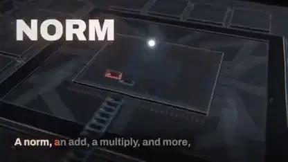

<!-- Generated by scripts/build.py. -->

# 全部视频

[返回合集](https://github.com/VibeClip/awesome-fable-5-2-videos/blob/main/README.zh-CN.md)

每张卡片都能直接循环预览，完整视频在原平台打开；失效来源会单独标记。

## 短片与叙事 · 26

角色故事、动漫短片、电影感叙事与音乐视频。

<table>
<tr>
<td width="33%" valign="top">
 
<b>代码绘制的日本高专主题短片</b> 
<b>新发现</b> · <a href="https://x.com/kosen_labo">@kosen_labo</a> · 1:00 · 2026-11-10 
<a href="https://video.twimg.com/amplify_video/2120128135681470464/vid/avc1/910x512/z_FMx9vV7-Tja50p.mp4?tag=14">▶ 完整视频</a> · <a href="https://x.com/kosen_labo/status/2120128253327474845">原帖</a> · <a href="https://github.com/VibeClip/awesome-fable-5-2-videos/blob/main/docs/videos/zh-CN/kosen-labo-2120128253327474845.md">作品详情</a>

📝 展开提示词
<blockquote>高専について、なんかすごい動画を作ってください</blockquote>
<a href="https://x.com/kosen_labo/status/2120128253327474845">查看作者公开提示词</a>

</td>
<td width="33%" valign="top">
 
<b>用代码制作的夜见与香克斯对决动画</b> 
<b>新发现</b> · <a href="https://x.com/Uraharastudio">@Uraharastudio</a> · 1:00 · 2026-11-10 
<a href="https://video.twimg.com/amplify_video/2120128077975977984/vid/avc1/1280x720/m9IjLTrfzffl_S5p.mp4?tag=29">▶ 完整视频</a> · <a href="https://x.com/Uraharastudio/status/2120128234499002537">原帖</a> · <a href="https://github.com/VibeClip/awesome-fable-5-2-videos/blob/main/docs/videos/zh-CN/uraharastudio-2120128234499002537.md">作品详情</a>

</td>
<td width="33%" valign="top">
 
<b>月光下书页飞舞的图书馆</b> 
<b>↗ 正在起量</b> · <a href="https://x.com/lemomo_ai">@lemomo_ai</a> · 0:55 · 2026-11-10 
<a href="https://video.twimg.com/amplify_video/2120117891240742914/vid/avc1/1920x1080/-2LACPT73SSi5tr7.mp4?tag=29">▶ 完整视频</a> · <a href="https://x.com/lemomo_ai/status/2120118194409193682">原帖</a> · <a href="https://github.com/VibeClip/awesome-fable-5-2-videos/blob/main/docs/videos/zh-CN/lemomo-ai-2120118194409193682.md">作品详情</a>

</td>
</tr>
<tr>
<td width="33%" valign="top">
 
<b>一条走廊里的时间流逝</b> 
<b>新发现</b> · <a href="https://x.com/argofowl">@argofowl</a> · 0:16 · 2026-11-10 
<a href="https://video.twimg.com/amplify_video/2120100208990371842/vid/avc1/1920x1080/AvuwxFaTzQOwI2tO.mp4?tag=29">▶ 完整视频</a> · <a href="https://x.com/argofowl/status/2120100759195000942">原帖</a> · <a href="https://github.com/VibeClip/awesome-fable-5-2-videos/blob/main/docs/videos/zh-CN/argofowl-2120100759195000942.md">作品详情</a>

</td>
<td width="33%" valign="top">
 
<b>从粒子实验走向樱花场景的日语短片</b> 
<b>新发现</b> · <a href="https://x.com/rute1203d">@rute1203d</a> · 2:26 · 2026-11-10 
<a href="https://video.twimg.com/amplify_video/2120076635022176256/vid/avc1/1920x1080/_pMVSUXNU5xgUqUo.mp4?tag=29">▶ 完整视频</a> · <a href="https://x.com/rute1203d/status/2120077147872391540">原帖</a> · <a href="https://github.com/VibeClip/awesome-fable-5-2-videos/blob/main/docs/videos/zh-CN/rute1203d-2120077147872391540.md">作品详情</a>

📝 展开提示词

作者在下方链接分享了提示词，请结合原始上下文、参考素材和后续指令阅读。

<a href="https://x.com/rute1203d/status/2120077147872391540">查看作者公开提示词</a>

</td>
<td width="33%" valign="top">
 
<b>《禁止触碰》：分镜图驱动的 3D 短片</b> 
<b>↗ 正在起量</b> · <a href="https://x.com/HaileyAILabs">@HaileyAILabs</a> · 0:30 · 2026-11-10 
<a href="https://video.twimg.com/amplify_video/2120073390942048256/vid/avc1/3024x1714/xZRjyNo0Fwszd5WF.mp4?tag=29">▶ 完整视频</a> · <a href="https://x.com/HaileyAILabs/status/2120075292043890890">原帖</a> · <a href="https://github.com/VibeClip/awesome-fable-5-2-videos/blob/main/docs/videos/zh-CN/haileyailabs-2120075292043890890.md">作品详情</a>

</td>
</tr>
<tr>
<td width="33%" valign="top">
 
<b>剑齿虎捕猎的代码动画</b> 
<b>↗ 正在起量</b> · <a href="https://x.com/wshuyi">@wshuyi</a> · 0:28 · 2026-11-10 
<a href="https://video.twimg.com/amplify_video/2120014231450034176/vid/avc1/1920x1080/7CaA0vV2Tej61d3g.mp4?tag=29">▶ 完整视频</a> · <a href="https://x.com/wshuyi/status/2120014892040417720">原帖</a> · <a href="https://github.com/VibeClip/awesome-fable-5-2-videos/blob/main/docs/videos/zh-CN/wshuyi-2120014892040417720.md">作品详情</a>

📝 展开提示词

作者在下方链接分享了提示词，请结合原始上下文、参考素材和后续指令阅读。

<a href="https://x.com/wshuyi/status/2120014892040417720">查看作者公开提示词</a>

</td>
<td width="33%" valign="top">
 
<b>用代码搭景的梦境短片</b> 
<b>↗ 正在起量</b> · <a href="https://x.com/anabology">@anabology</a> · 3:33 · 2026-11-10 
<a href="https://video.twimg.com/amplify_video/2120010999818289152/vid/avc1/1920x1080/IWfi7bdM6kIQXIB4.mp4?tag=29">▶ 完整视频</a> · <a href="https://x.com/anabology/status/2120011096287297557">原帖</a> · <a href="https://github.com/VibeClip/awesome-fable-5-2-videos/blob/main/docs/videos/zh-CN/anabology-2120011096287297557.md">作品详情</a>

</td>
<td width="33%" valign="top">
 
<b>一只不肯照剧本演的猫</b> 
<b>↗ 正在起量</b> · <a href="https://x.com/renoiseai">@renoiseai</a> · 1:02 · 2026-11-10 
<a href="https://video.twimg.com/amplify_video/2119959154026840064/vid/avc1/1920x1080/xTHXVvf_6YhKOkmx.mp4?tag=29">▶ 完整视频</a> · <a href="https://x.com/renoiseai/status/2119959294716326280">原帖</a> · <a href="https://github.com/VibeClip/awesome-fable-5-2-videos/blob/main/docs/videos/zh-CN/renoiseai-2119959294716326280.md">作品详情</a>

</td>
</tr>
<tr>
<td width="33%" valign="top">
 
<b>逐帧用 JavaScript 绘制的动画短片</b> 
<b>↗ 正在起量</b> · <a href="https://x.com/kevin_t_ngo">@kevin_t_ngo</a> · 1:40 · 2026-11-09 
<a href="https://video.twimg.com/amplify_video/2119937132647313408/vid/avc1/1080x1080/T2W6Dhpu_gMoxVTM.mp4?tag=29">▶ 完整视频</a> · <a href="https://x.com/kevin_t_ngo/status/2119938129079808282">原帖</a> · <a href="https://github.com/VibeClip/awesome-fable-5-2-videos/blob/main/docs/videos/zh-CN/kevin-t-ngo-2119938129079808282.md">作品详情</a>

</td>
<td width="33%" valign="top">
 
<b>歌词卡点的动漫风音乐视频</b> 
<a href="https://x.com/WesRoth">@WesRoth</a> · 0:37 · 2026-11-09 
<a href="https://video.twimg.com/amplify_video/2119910396719177728/vid/avc1/1280x720/0X1wTe1JivqZgtXw.mp4?tag=29">▶ 完整视频</a> · <a href="https://x.com/WesRoth/status/2119911161386934330">原帖</a> · <a href="https://github.com/VibeClip/awesome-fable-5-2-videos/blob/main/docs/videos/zh-CN/wesroth-934330.md">作品详情</a>

</td>
<td width="33%" valign="top">
 
<b>Fable 5.2 策划、Opus 5.5 制作的 Blender 短片</b> 
<b>新发现</b> · <a href="https://x.com/kloss_xyz">@kloss_xyz</a> · 0:16 · 2026-11-09 
<a href="https://video.twimg.com/amplify_video/2119909698367557632/vid/avc1/1920x1080/EkOxfDMK1PSG_XOD.mp4?tag=29">▶ 完整视频</a> · <a href="https://x.com/kloss_xyz/status/2119910613828980846">原帖</a> · <a href="https://github.com/VibeClip/awesome-fable-5-2-videos/blob/main/docs/videos/zh-CN/kloss-xyz-2119910613828980846.md">作品详情</a>

</td>
</tr>
<tr>
<td width="33%" valign="top">
 
<b>一只猫唤醒了一台旧机器人</b> 
<a href="https://x.com/EngMoElgaraihy">@EngMoElgaraihy</a> · 0:40 · 2026-11-09 
<a href="https://video.twimg.com/amplify_video/2119904158409256960/vid/avc1/1920x1080/FHiVbLKGnw5mFlJ7.mp4?tag=29">▶ 完整视频</a> · <a href="https://x.com/EngMoElgaraihy/status/2119904813718643141">原帖</a> · <a href="https://github.com/VibeClip/awesome-fable-5-2-videos/blob/main/docs/videos/zh-CN/engmoelgaraihy-643141.md">作品详情</a>

</td>
<td width="33%" valign="top">
 
<b>没有一张生成图的 46 秒短片</b> 
<a href="https://x.com/cube__lol">@cube__lol</a> · 0:46 · 2026-11-09 
<a href="https://video.twimg.com/amplify_video/2119904119569690624/vid/avc1/1080x1920/24p1AimqIbXNXJ-Z.mp4?tag=29">▶ 完整视频</a> · <a href="https://x.com/cube__lol/status/2119904449556832554">原帖</a> · <a href="https://github.com/VibeClip/awesome-fable-5-2-videos/blob/main/docs/videos/zh-CN/cube-lol-832554.md">作品详情</a>

</td>
<td width="33%" valign="top">
 
<b>代码渲染的深海潜水</b> 
<a href="https://x.com/g_beyrouti">@g_beyrouti</a> · 0:30 · 2026-11-09 
<a href="https://video.twimg.com/amplify_video/2119904334397792256/vid/avc1/1920x1080/Sz-4m8aagrACSa85.mp4?tag=29">▶ 完整视频</a> · <a href="https://x.com/g_beyrouti/status/2119904386826780943">原帖</a> · <a href="https://github.com/VibeClip/awesome-fable-5-2-videos/blob/main/docs/videos/zh-CN/g-beyrouti-780943.md">作品详情</a>

</td>
</tr>
<tr>
<td width="33%" valign="top">
 
<b>蒸汽机车动漫短片</b> 
<a href="https://x.com/0kncn">@0kncn</a> · 1:30 · 2026-11-09 
<a href="https://video.twimg.com/amplify_video/2119900741783400450/vid/avc1/1920x1080/m--vaF5s-VQhaEAL.mp4?tag=29">▶ 完整视频</a> · <a href="https://x.com/0kncn/status/2119901782482543073">原帖</a> · <a href="https://github.com/VibeClip/awesome-fable-5-2-videos/blob/main/docs/videos/zh-CN/0kncn-543073.md">作品详情</a>

📝 展开提示词

作者在下方链接分享了提示词，请结合原始上下文、参考素材和后续指令阅读。

<a href="https://x.com/0kncn/status/2119901786060259612">查看作者公开提示词</a>

</td>
<td width="33%" valign="top">
 
<b>83 秒、全由代码生成的动漫短片</b> 
<a href="https://x.com/noisyb0y1">@noisyb0y1</a> · 1:07 · 2026-11-09 
<a href="https://video.twimg.com/amplify_video/2119899951345893376/vid/avc1/1920x1080/YjLMjLxfThe6MUXI.mp4?tag=29">▶ 完整视频</a> · <a href="https://x.com/noisyb0y1/status/2119900528197218472">原帖</a> · <a href="https://github.com/VibeClip/awesome-fable-5-2-videos/blob/main/docs/videos/zh-CN/noisyb0y1-218472.md">作品详情</a>

</td>
<td width="33%" valign="top">
 
<b>Three.js 短片《Discovery》</b> 
<a href="https://x.com/YinYangYoeshi">@YinYangYoeshi</a> · 1:42 · 2026-11-09 
<a href="https://video.twimg.com/amplify_video/2119897357940621312/vid/avc1/1920x1080/ZjoaXFviS7F_qc-m.mp4?tag=29">▶ 完整视频</a> · <a href="https://x.com/YinYangYoeshi/status/2119897840965001317">原帖</a> · <a href="https://github.com/VibeClip/awesome-fable-5-2-videos/blob/main/docs/videos/zh-CN/yinyangyoeshi-001317.md">作品详情</a>

</td>
</tr>
<tr>
<td width="33%" valign="top">
 
<b>《我从未见过的海》</b> 
<a href="https://x.com/jessalanfields">@jessalanfields</a> · 1:45 · 2026-11-09 
<a href="https://video.twimg.com/amplify_video/2119895450509586432/vid/avc1/1920x1080/AS5GlEaPMeHXKU5d.mp4?tag=29">▶ 完整视频</a> · <a href="https://x.com/jessalanfields/status/2119895969957392730">原帖</a> · <a href="https://github.com/VibeClip/awesome-fable-5-2-videos/blob/main/docs/videos/zh-CN/jessalanfields-392730.md">作品详情</a>

</td>
<td width="33%" valign="top">
 
<b>从一只小生物到整个宇宙</b> 
<a href="https://x.com/devteamdrew">@devteamdrew</a> · 0:32 · 2026-11-09 
<a href="https://video.twimg.com/amplify_video/2119892377045237760/vid/avc1/1920x1080/u8IeGB-A3MQgl4XE.mp4?tag=29">▶ 完整视频</a> · <a href="https://x.com/devteamdrew/status/2119892540950241283">原帖</a> · <a href="https://github.com/VibeClip/awesome-fable-5-2-videos/blob/main/docs/videos/zh-CN/devteamdrew-241283.md">作品详情</a>

</td>
<td width="33%" valign="top">
 
<b>《呐喊》背后的故事短片</b> 
<a href="https://x.com/osmanaga__">@osmanaga__</a> · 0:38 · 2026-11-09 
原帖暂不可用 · <a href="https://x.com/osmanaga__/status/2119892099437146194">原帖</a> · <a href="https://github.com/VibeClip/awesome-fable-5-2-videos/blob/main/docs/videos/zh-CN/osmanaga-146194.md">作品详情</a>

</td>
</tr>
<tr>
<td width="33%" valign="top">
 
<b>灯塔守护人的短片</b> 
<a href="https://x.com/MarvellousDev">@MarvellousDev</a> · 0:15 · 2026-11-09 
<a href="https://video.twimg.com/amplify_video/2119889346706673664/vid/avc1/1920x1080/VxlTVaaElWO17W42.mp4?tag=29">▶ 完整视频</a> · <a href="https://x.com/MarvellousDev/status/2119889511333380563">原帖</a> · <a href="https://github.com/VibeClip/awesome-fable-5-2-videos/blob/main/docs/videos/zh-CN/marvellousdev-380563.md">作品详情</a>

</td>
<td width="33%" valign="top">
 
<b>一句最懒的提示词做出的整条片子</b> 
<a href="https://x.com/ponken00">@ponken00</a> · 1:26 · 2026-11-09 
<a href="https://video.twimg.com/amplify_video/2119887881321787392/vid/avc1/1920x1080/zPvL0-S5VSv6SkYI.mp4?tag=29">▶ 完整视频</a> · <a href="https://x.com/ponken00/status/2119888362148622656">原帖</a> · <a href="https://github.com/VibeClip/awesome-fable-5-2-videos/blob/main/docs/videos/zh-CN/ponken00-622656.md">作品详情</a>

</td>
<td width="33%" valign="top">
 
<b>重音 Teto 主唱的 Vocaloid 情歌</b> 
<a href="https://x.com/peach2k2">@peach2k2</a> · 0:25 · 2026-11-09 
<a href="https://video.twimg.com/ext_tw_video/2119885702250786816/pu/vid/avc1/1280x720/vaqq1fwB8qUuFlPu.mp4?tag=27">▶ 完整视频</a> · <a href="https://x.com/peach2k2/status/2119885741773738033">原帖</a> · <a href="https://github.com/VibeClip/awesome-fable-5-2-videos/blob/main/docs/videos/zh-CN/peach2k2-738033.md">作品详情</a>

</td>
</tr>
<tr>
<td width="33%" valign="top">
 
<b>飞越一片生机勃勃的世界</b> 
<a href="https://x.com/LexnLin">@LexnLin</a> · 0:30 · 2026-11-09 
<a href="https://video.twimg.com/amplify_video/2119880037172146176/vid/avc1/1920x1080/E4G1BysAeWIl4yTX.mp4?tag=29">▶ 完整视频</a> · <a href="https://x.com/LexnLin/status/2119880654858977333">原帖</a> · <a href="https://github.com/VibeClip/awesome-fable-5-2-videos/blob/main/docs/videos/zh-CN/lexnlin-977333.md">作品详情</a>

</td>
<td width="33%" valign="top">
 
<b>开往天堂的公路</b> 
<a href="https://x.com/abhinavflac">@abhinavflac</a> · 1:15 · 2026-11-09 
<a href="https://video.twimg.com/amplify_video/2119874130904502272/vid/avc1/1920x1080/FVx09qWfu11d8QIK.mp4?tag=29">▶ 完整视频</a> · <a href="https://x.com/abhinavflac/status/2119875975131676827">原帖</a> · <a href="https://github.com/VibeClip/awesome-fable-5-2-videos/blob/main/docs/videos/zh-CN/abhinavflac-676827.md">作品详情</a>

</td>
<td width="33%"></td>
</tr>
</table>

## 动态设计与动画 · 37

动态字体、粒子动画、生成艺术、SVG 动画与视觉实验。

<table>
<tr>
<td width="33%" valign="top">
 
<b>AI 宣布接管软件工程的动效短片</b> 
<b>新发现</b> · <a href="https://x.com/iamwesleysmits">@iamwesleysmits</a> · 0:48 · 2026-11-10 
<a href="https://video.twimg.com/amplify_video/2120230145994694656/vid/avc1/1080x1920/ikcB__RdST1QlByH.mp4?tag=29">▶ 完整视频</a> · <a href="https://x.com/iamwesleysmits/status/2120230414568599912">原帖</a> · <a href="https://github.com/VibeClip/awesome-fable-5-2-videos/blob/main/docs/videos/zh-CN/iamwesleysmits-2120230414568599912.md">作品详情</a>

</td>
<td width="33%" valign="top">
 
<b>土豆大战一屋蓝椅子</b> 
<b>新发现</b> · <a href="https://x.com/argofowl">@argofowl</a> · 0:12 · 2026-11-10 
<a href="https://video.twimg.com/amplify_video/2120171639031865344/vid/avc1/1920x1080/ePpeMCdemHzHeXby.mp4?tag=29">▶ 完整视频</a> · <a href="https://x.com/argofowl/status/2120172009972003115">原帖</a> · <a href="https://github.com/VibeClip/awesome-fable-5-2-videos/blob/main/docs/videos/zh-CN/argofowl-2120172009972003115.md">作品详情</a>

</td>
<td width="33%" valign="top">
 
<b>液态金属实时视听演示</b> 
<b>新发现</b> · <a href="https://x.com/Nakachan">@Nakachan</a> · 0:10 · 2026-11-10 
<a href="https://video.twimg.com/amplify_video/2120127355821948928/vid/avc1/1048x720/YvT2SPzL_LdlCRo4.mp4?tag=14">▶ 完整视频</a> · <a href="https://x.com/Nakachan/status/2120127995625316511">原帖</a> · <a href="https://github.com/VibeClip/awesome-fable-5-2-videos/blob/main/docs/videos/zh-CN/nakachan-2120127995625316511.md">作品详情</a>

📝 展开提示词
<blockquote>Fable 5.2の考える最強のメガデモを作って</blockquote>
<a href="https://x.com/Nakachan/status/2120127995625316511">查看作者公开提示词</a>

</td>
</tr>
<tr>
<td width="33%" valign="top">
 
<b>用参考视频驱动 Blender 中的 Tripo 角色动画</b> 
<b>↗ 正在起量</b> · <a href="https://x.com/maxt3chno">@maxt3chno</a> · 0:16 · 2026-11-10 
<a href="https://video.twimg.com/amplify_video/2120112581515829248/vid/avc1/2304x1440/FuMsMyEM4q9Lj-I7.mp4?tag=29">▶ 完整视频</a> · <a href="https://x.com/maxt3chno/status/2120113578531234172">原帖</a> · <a href="https://github.com/VibeClip/awesome-fable-5-2-videos/blob/main/docs/videos/zh-CN/maxt3chno-2120113578531234172.md">作品详情</a>

📝 展开提示词

作者在下方链接分享了提示词，请结合原始上下文、参考素材和后续指令阅读。

<a href="https://x.com/maxt3chno/status/2120116202559217812">查看作者公开提示词</a>

</td>
<td width="33%" valign="top">
 
<b>慢跑、冲刺与高速突进的动作预演</b> 
<a href="https://x.com/akakuma0219">@akakuma0219</a> · 0:10 · 2026-11-10 
<a href="https://video.twimg.com/amplify_video/2120030599155195904/vid/avc1/1128x1280/gg7e4hW5e7l_HZcs.mp4?tag=29">▶ 完整视频</a> · <a href="https://x.com/akakuma0219/status/2120030634248929556">原帖</a> · <a href="https://github.com/VibeClip/awesome-fable-5-2-videos/blob/main/docs/videos/zh-CN/akakuma0219-2120030634248929556.md">作品详情</a>

📝 展开提示词

作者在下方链接分享了提示词，请结合原始上下文、参考素材和后续指令阅读。

<a href="https://x.com/akakuma0219/status/2120030634248929556">查看作者公开提示词</a>

</td>
<td width="33%" valign="top">
 
<b>动态设计师作品集短片</b> 
<b>↗ 正在起量</b> · <a href="https://x.com/Leviwoyun">@Leviwoyun</a> · 0:30 · 2026-11-10 
<a href="https://video.twimg.com/amplify_video/2119953670280478720/vid/avc1/1920x1080/jpEsi7C-DU6eEvmL.mp4?tag=29">▶ 完整视频</a> · <a href="https://x.com/Leviwoyun/status/2119955625820258308">原帖</a> · <a href="https://github.com/VibeClip/awesome-fable-5-2-videos/blob/main/docs/videos/zh-CN/leviwoyun-2119955625820258308.md">作品详情</a>

📝 展开提示词

作者在下方链接分享了提示词，请结合原始上下文、参考素材和后续指令阅读。

<a href="https://x.com/Leviwoyun/status/2119955625820258308">查看作者公开提示词</a>

</td>
</tr>
<tr>
<td width="33%" valign="top">
 
<b>电影片头设计：Fable 5.2 与 Opus 5.5</b> 
<b>↗ 正在起量</b> · <a href="https://x.com/muku_sns">@muku_sns</a> · 0:15 · 2026-11-09 
<a href="https://video.twimg.com/amplify_video/2119941109262815232/vid/avc1/1280x720/M2pIcNz3WNz2L3_c.mp4?tag=29">▶ 完整视频</a> · <a href="https://x.com/muku_sns/status/2119941490969624679">原帖</a> · <a href="https://github.com/VibeClip/awesome-fable-5-2-videos/blob/main/docs/videos/zh-CN/muku-sns-2119941490969624679.md">作品详情</a>

</td>
<td width="33%" valign="top">
 
<b>逐帧对上口型的语音</b> 
<a href="https://x.com/higgsfield_ai">@higgsfield_ai</a> · 0:19 · 2026-11-09 
<a href="https://video.twimg.com/amplify_video/2119909898960130048/vid/avc1/1440x1080/frJSbqPklB--YVmT.mp4?tag=29">▶ 完整视频</a> · <a href="https://x.com/higgsfield_ai/status/2119909938969580024">原帖</a> · <a href="https://github.com/VibeClip/awesome-fable-5-2-videos/blob/main/docs/videos/zh-CN/higgsfield-ai-580024.md">作品详情</a>

</td>
<td width="33%" valign="top">
 
<b>让代码开口说话的共振峰合成器</b> 
<a href="https://x.com/higgsfield_ai">@higgsfield_ai</a> · 0:15 · 2026-11-09 
<a href="https://video.twimg.com/amplify_video/2119906292542459904/vid/avc1/1920x1080/hSTBPKQjjpo8EiKA.mp4?tag=29">▶ 完整视频</a> · <a href="https://x.com/higgsfield_ai/status/2119906332077957629">原帖</a> · <a href="https://github.com/VibeClip/awesome-fable-5-2-videos/blob/main/docs/videos/zh-CN/higgsfield-ai-957629.md">作品详情</a>

</td>
</tr>
<tr>
<td width="33%" valign="top">
 
<b>一条向 Opus 5.5 道别的样片</b> 
<a href="https://x.com/kaif9998">@kaif9998</a> · 0:15 · 2026-11-09 
<a href="https://video.twimg.com/amplify_video/2119903274031828992/vid/avc1/1920x1080/NG1jRcBKfR-B1SsJ.mp4?tag=29">▶ 完整视频</a> · <a href="https://x.com/kaif9998/status/2119903824848761287">原帖</a> · <a href="https://github.com/VibeClip/awesome-fable-5-2-videos/blob/main/docs/videos/zh-CN/kaif9998-761287.md">作品详情</a>

📝 展开提示词

作者在下方链接分享了提示词，请结合原始上下文、参考素材和后续指令阅读。

<a href="https://x.com/kaif9998/status/2119904086288118219">查看作者公开提示词</a>

</td>
<td width="33%" valign="top">
 
<b>一笔一笔画出一幅肖像</b> 
<a href="https://x.com/internetphysics">@internetphysics</a> · 1:00 · 2026-11-09 
<a href="https://video.twimg.com/amplify_video/2119902893394337792/vid/avc1/1440x748/Qs1TOP9hXZf08Xkl.mp4?tag=29">▶ 完整视频</a> · <a href="https://x.com/internetphysics/status/2119903808935313778">原帖</a> · <a href="https://github.com/VibeClip/awesome-fable-5-2-videos/blob/main/docs/videos/zh-CN/internetphysics-313778.md">作品详情</a>

</td>
<td width="33%" valign="top">
 
<b>同一条提示词做出的动效样片</b> 
<a href="https://x.com/heypearlai">@heypearlai</a> · 0:15 · 2026-11-09 
<a href="https://video.twimg.com/amplify_video/2119902252723023872/vid/avc1/1920x1080/p0Q91YuD0ECQfDLv.mp4?tag=29">▶ 完整视频</a> · <a href="https://x.com/heypearlai/status/2119903760529113116">原帖</a> · <a href="https://github.com/VibeClip/awesome-fable-5-2-videos/blob/main/docs/videos/zh-CN/heypearlai-113116.md">作品详情</a>

</td>
</tr>
<tr>
<td width="33%" valign="top">
 
<b>一次生成的像素风树林</b> 
<a href="https://x.com/JBabaTalks">@JBabaTalks</a> · 0:41 · 2026-11-09 
<a href="https://video.twimg.com/amplify_video/2119903258588086272/vid/avc1/1808x1722/-oRMSGBL9FaVhUCA.mp4?tag=29">▶ 完整视频</a> · <a href="https://x.com/JBabaTalks/status/2119903489270694319">原帖</a> · <a href="https://github.com/VibeClip/awesome-fable-5-2-videos/blob/main/docs/videos/zh-CN/jbabatalks-694319.md">作品详情</a>

</td>
<td width="33%" valign="top">
 
<b>零件转个不停的小星球</b> 
<a href="https://x.com/leoy_dev">@leoy_dev</a> · 1:09 · 2026-11-09 
<a href="https://video.twimg.com/amplify_video/2119902402643890177/vid/avc1/1920x918/dO0GyuVK6-YhKfS9.mp4?tag=29">▶ 完整视频</a> · <a href="https://x.com/leoy_dev/status/2119903166149922853">原帖</a> · <a href="https://github.com/VibeClip/awesome-fable-5-2-videos/blob/main/docs/videos/zh-CN/leoy-dev-922853.md">作品详情</a>

</td>
<td width="33%" valign="top">
 
<b>剪纸风的日出动画</b> 
<a href="https://x.com/eluchocha">@eluchocha</a> · 0:38 · 2026-11-09 
<a href="https://video.twimg.com/amplify_video/2119900235761688576/vid/avc1/1080x1080/cejGINOI5PNwIMrQ.mp4?tag=29">▶ 完整视频</a> · <a href="https://x.com/eluchocha/status/2119902302001635455">原帖</a> · <a href="https://github.com/VibeClip/awesome-fable-5-2-videos/blob/main/docs/videos/zh-CN/eluchocha-635455.md">作品详情</a>

</td>
</tr>
<tr>
<td width="33%" valign="top">
 
<b>粒子从混沌拼成一句 hello</b> 
<a href="https://x.com/ici_dab">@ici_dab</a> · 1:08 · 2026-11-09 
<a href="https://video.twimg.com/amplify_video/2119901144256299009/vid/avc1/1080x1080/5idfS03gAdRsJT3k.mp4?tag=29">▶ 完整视频</a> · <a href="https://x.com/ici_dab/status/2119901910237098351">原帖</a> · <a href="https://github.com/VibeClip/awesome-fable-5-2-videos/blob/main/docs/videos/zh-CN/ici-dab-098351.md">作品详情</a>

📝 展开提示词

作者在下方链接分享了提示词，请结合原始上下文、参考素材和后续指令阅读。

<a href="https://x.com/ici_dab/status/2119902189271605579">查看作者公开提示词</a>

</td>
<td width="33%" valign="top">
 
<b>简单规则，复杂之美</b> 
<a href="https://x.com/techfren">@techfren</a> · 1:18 · 2026-11-09 
<a href="https://video.twimg.com/amplify_video/2119899709913579520/vid/avc1/1920x1080/3p4USJ7fdJfCsE8Y.mp4?tag=29">▶ 完整视频</a> · <a href="https://x.com/techfren/status/2119899949756539056">原帖</a> · <a href="https://github.com/VibeClip/awesome-fable-5-2-videos/blob/main/docs/videos/zh-CN/techfren-539056.md">作品详情</a>

</td>
<td width="33%" valign="top">
 
<b>一个 SVG 做成的鹈鹕骑车动画</b> 
<a href="https://x.com/eyadnour">@eyadnour</a> · 0:10 · 2026-11-09 
<a href="https://video.twimg.com/amplify_video/2119898688180850688/vid/avc1/1600x1200/iBBPAJliWGeytp-Y.mp4?tag=29">▶ 完整视频</a> · <a href="https://x.com/eyadnour/status/2119899260606910886">原帖</a> · <a href="https://github.com/VibeClip/awesome-fable-5-2-videos/blob/main/docs/videos/zh-CN/eyadnour-910886.md">作品详情</a>

</td>
</tr>
<tr>
<td width="33%" valign="top">
 
<b>瓦拉纳西河岸的天神排灯节</b> 
<a href="https://x.com/sverma_231">@sverma_231</a> · 0:38 · 2026-11-09 
<a href="https://video.twimg.com/amplify_video/2119894212145778688/vid/avc1/1920x1080/nsF2E4hVVA0HQ4Uu.mp4?tag=29">▶ 完整视频</a> · <a href="https://x.com/sverma_231/status/2119894332656570708">原帖</a> · <a href="https://github.com/VibeClip/awesome-fable-5-2-videos/blob/main/docs/videos/zh-CN/sverma-231-570708.md">作品详情</a>

</td>
<td width="33%" valign="top">
 
<b>鹈鹕知道自己在被测试</b> 
<a href="https://x.com/benjistacked">@benjistacked</a> · 0:15 · 2026-11-09 
<a href="https://video.twimg.com/amplify_video/2119892925077143552/vid/avc1/1920x1080/SEaLFBXtc8dukb55.mp4?tag=29">▶ 完整视频</a> · <a href="https://x.com/benjistacked/status/2119893035240849805">原帖</a> · <a href="https://github.com/VibeClip/awesome-fable-5-2-videos/blob/main/docs/videos/zh-CN/benjistacked-849805.md">作品详情</a>

</td>
<td width="33%" valign="top">
 
<b>在家就能造的宠物机器人</b> 
<a href="https://x.com/mattshumer_">@mattshumer_</a> · 0:20 · 2026-11-09 
<a href="https://video.twimg.com/amplify_video/2119889498527969281/vid/avc1/960x540/EqG79zEwj6BDTrPE.mp4?tag=29">▶ 完整视频</a> · <a href="https://x.com/mattshumer_/status/2119889518564147409">原帖</a> · <a href="https://github.com/VibeClip/awesome-fable-5-2-videos/blob/main/docs/videos/zh-CN/mattshumer-147409.md">作品详情</a>

</td>
</tr>
<tr>
<td width="33%" valign="top">
 
<b>鹈鹕、自行车和一只手柄</b> 
<a href="https://x.com/dummerspast39">@dummerspast39</a> · 0:15 · 2026-11-09 
<a href="https://video.twimg.com/amplify_video/2119889199935447041/vid/avc1/2048x2048/TrgMbHC6HoEL8LT9.mp4?tag=29">▶ 完整视频</a> · <a href="https://x.com/dummerspast39/status/2119889279740432389">原帖</a> · <a href="https://github.com/VibeClip/awesome-fable-5-2-videos/blob/main/docs/videos/zh-CN/dummerspast39-432389.md">作品详情</a>

</td>
<td width="33%" valign="top">
 
<b>八分钟做出的动效设计片</b> 
<a href="https://x.com/titouangillet_">@titouangillet_</a> · 0:40 · 2026-11-09 
原帖暂不可用 · <a href="https://x.com/titouangillet_/status/2119885739769131093">原帖</a> · <a href="https://github.com/VibeClip/awesome-fable-5-2-videos/blob/main/docs/videos/zh-CN/titouangillet-131093.md">作品详情</a>

</td>
<td width="33%" valign="top">
 
<b>由细小棱镜组成的贴纸招牌</b> 
<a href="https://x.com/Maaaaaaadiii">@Maaaaaaadiii</a> · 0:13 · 2026-11-09 
<a href="https://video.twimg.com/amplify_video/2119884897305190402/vid/avc1/1920x1080/S18ZsHUYlSo8vdOU.mp4?tag=29">▶ 完整视频</a> · <a href="https://x.com/Maaaaaaadiii/status/2119885527243714946">原帖</a> · <a href="https://github.com/VibeClip/awesome-fable-5-2-videos/blob/main/docs/videos/zh-CN/maaaaaaadiii-714946.md">作品详情</a>

</td>
</tr>
<tr>
<td width="33%" valign="top">
 
<b>小巫师放飞了 Fable 5.2</b> 
<a href="https://x.com/other__reality">@other__reality</a> · 0:26 · 2026-11-09 
<a href="https://video.twimg.com/amplify_video/2119884273071411200/vid/avc1/1280x720/DwN1eSgpBgK8Wpa6.mp4?tag=14">▶ 完整视频</a> · <a href="https://x.com/other__reality/status/2119885430627913784">原帖</a> · <a href="https://github.com/VibeClip/awesome-fable-5-2-videos/blob/main/docs/videos/zh-CN/other-reality-913784.md">作品详情</a>

📝 展开提示词
<blockquote>Create an animated video of clawd creating and releasing Claude Fable 5.2</blockquote>
<a href="https://x.com/other__reality/status/2119885430627913784">查看作者公开提示词</a>

</td>
<td width="33%" valign="top">
 
<b>一块机场出发信息牌</b> 
<a href="https://x.com/QRoonjha">@QRoonjha</a> · 0:12 · 2026-11-09 
<a href="https://video.twimg.com/amplify_video/2119884921611460608/vid/avc1/1920x1080/P5jqJNDpsShsC-ka.mp4?tag=29">▶ 完整视频</a> · <a href="https://x.com/QRoonjha/status/2119885167045300593">原帖</a> · <a href="https://github.com/VibeClip/awesome-fable-5-2-videos/blob/main/docs/videos/zh-CN/qroonjha-300593.md">作品详情</a>

</td>
<td width="33%" valign="top">
 
<b>一座漂浮的像素小岛</b> 
<a href="https://x.com/jumperz">@jumperz</a> · 0:30 · 2026-11-09 
<a href="https://video.twimg.com/amplify_video/2119884053226651648/vid/avc1/1920x1080/PTIheNUul9mU31Ay.mp4?tag=29">▶ 完整视频</a> · <a href="https://x.com/jumperz/status/2119884258789757436">原帖</a> · <a href="https://github.com/VibeClip/awesome-fable-5-2-videos/blob/main/docs/videos/zh-CN/jumperz-757436.md">作品详情</a>

</td>
</tr>
<tr>
<td width="33%" valign="top">
 
<b>完整动起来的鹈鹕骑车</b> 
<a href="https://x.com/abhinavflac">@abhinavflac</a> · 0:11 · 2026-11-09 
<a href="https://video.twimg.com/amplify_video/2119884052622876672/vid/avc1/1920x1080/cKq9zTwAltKH6RX3.mp4?tag=29">▶ 完整视频</a> · <a href="https://x.com/abhinavflac/status/2119884257145581980">原帖</a> · <a href="https://github.com/VibeClip/awesome-fable-5-2-videos/blob/main/docs/videos/zh-CN/abhinavflac-581980.md">作品详情</a>

</td>
<td width="33%" valign="top">
 
<b>从轨道俯瞰地球的发布视频</b> 
<a href="https://x.com/octuedit">@octuedit</a> · 0:23 · 2026-11-09 
<a href="https://video.twimg.com/amplify_video/2119883683788460032/vid/avc1/1920x1080/uhCV24iRRwiw6DZD.mp4?tag=29">▶ 完整视频</a> · <a href="https://x.com/octuedit/status/2119883810133397978">原帖</a> · <a href="https://github.com/VibeClip/awesome-fable-5-2-videos/blob/main/docs/videos/zh-CN/octuedit-397978.md">作品详情</a>

</td>
<td width="33%" valign="top">
 
<b>40 万粒子的完美循环</b> 
<a href="https://x.com/immadiuttej">@immadiuttej</a> · 0:24 · 2026-11-09 
原帖暂不可用 · <a href="https://x.com/immadiuttej/status/2119882515410538626">原帖</a> · <a href="https://github.com/VibeClip/awesome-fable-5-2-videos/blob/main/docs/videos/zh-CN/immadiuttej-538626.md">作品详情</a>

</td>
</tr>
<tr>
<td width="33%" valign="top">
 
<b>印象派像素画里的小河</b> 
<a href="https://x.com/aimi_teno">@aimi_teno</a> · 1:00 · 2026-11-09 
<a href="https://video.twimg.com/amplify_video/2119881783424827392/vid/avc1/720x1278/izAE8abvXqtU_pQN.mp4?tag=29">▶ 完整视频</a> · <a href="https://x.com/aimi_teno/status/2119881949540229421">原帖</a> · <a href="https://github.com/VibeClip/awesome-fable-5-2-videos/blob/main/docs/videos/zh-CN/aimi-teno-229421.md">作品详情</a>

</td>
<td width="33%" valign="top">
 
<b>活过来的粉笔画</b> 
<a href="https://x.com/dfeinition">@dfeinition</a> · 0:31 · 2026-11-09 
<a href="https://video.twimg.com/amplify_video/2119871816848084993/vid/avc1/3840x2160/KTr_-pLweRTaTs_F.mp4?tag=29">▶ 完整视频</a> · <a href="https://x.com/dfeinition/status/2119881243990859818">原帖</a> · <a href="https://github.com/VibeClip/awesome-fable-5-2-videos/blob/main/docs/videos/zh-CN/dfeinition-859818.md">作品详情</a>

</td>
<td width="33%" valign="top">
 
<b>一段行星主题的片头</b> 
<a href="https://x.com/octuedit">@octuedit</a> · 0:27 · 2026-11-09 
<a href="https://video.twimg.com/amplify_video/2119879938488811520/vid/avc1/3840x2160/0a9v9wYF2-6m0Ibf.mp4?tag=29">▶ 完整视频</a> · <a href="https://x.com/octuedit/status/2119880089039171806">原帖</a> · <a href="https://github.com/VibeClip/awesome-fable-5-2-videos/blob/main/docs/videos/zh-CN/octuedit-171806.md">作品详情</a>

</td>
</tr>
<tr>
<td width="33%" valign="top">
 
<b>一段讲自己的十秒动画</b> 
<a href="https://x.com/dariuusnv">@dariuusnv</a> · 0:10 · 2026-11-09 
<a href="https://video.twimg.com/amplify_video/2119878913857888257/vid/avc1/1920x1080/ydaWAIBjAaoGY3Ei.mp4?tag=29">▶ 完整视频</a> · <a href="https://x.com/dariuusnv/status/2119878952588329192">原帖</a> · <a href="https://github.com/VibeClip/awesome-fable-5-2-videos/blob/main/docs/videos/zh-CN/dariuusnv-329192.md">作品详情</a>

</td>
<td width="33%" valign="top">
 
<b>拼出一段宣言的键帽</b> 
<a href="https://x.com/seanaiux">@seanaiux</a> · 0:14 · 2026-11-09 
<a href="https://video.twimg.com/amplify_video/2119871818400231424/vid/avc1/1920x1080/18OA01YaRqLibwCV.mp4?tag=29">▶ 完整视频</a> · <a href="https://x.com/seanaiux/status/2119877685044240526">原帖</a> · <a href="https://github.com/VibeClip/awesome-fable-5-2-videos/blob/main/docs/videos/zh-CN/seanaiux-240526.md">作品详情</a>

</td>
<td width="33%" valign="top">
 
<b>等距视角的漂浮村庄</b> 
<a href="https://x.com/josendev">@josendev</a> · 0:08 · 2026-11-09 
<a href="https://video.twimg.com/amplify_video/2119876092433510400/vid/avc1/1920x1080/FdZgIOU9olLEHOKV.mp4?tag=29">▶ 完整视频</a> · <a href="https://x.com/josendev/status/2119876164051243409">原帖</a> · <a href="https://github.com/VibeClip/awesome-fable-5-2-videos/blob/main/docs/videos/zh-CN/josendev-243409.md">作品详情</a>

</td>
</tr>
<tr>
<td width="33%" valign="top">
 
<b>一笔一笔画成的人像</b> 
<a href="https://x.com/devsvn2">@devsvn2</a> · 0:35 · 2026-11-09 
<a href="https://video.twimg.com/amplify_video/2119875459819450368/vid/avc1/1160x1200/m_1yxd9t-C37pVN-.mp4?tag=29">▶ 完整视频</a> · <a href="https://x.com/devsvn2/status/2119875516216070289">原帖</a> · <a href="https://github.com/VibeClip/awesome-fable-5-2-videos/blob/main/docs/videos/zh-CN/devsvn2-070289.md">作品详情</a>

</td>
<td width="33%"></td>
<td width="33%"></td>
</tr>
</table>

## 3D 世界与模拟 · 70

程序化世界、虚拟城市、Blender 场景与物理模拟。

<table>
<tr>
<td width="33%" valign="top">
 
<b>从平面图和照片生成 3D 住宅漫游</b> 
<b>新发现</b> · <a href="https://x.com/oalanicolas">@oalanicolas</a> · 0:45 · 2026-11-10 
<a href="https://video.twimg.com/amplify_video/2120265385471574016/vid/avc1/1920x1080/fIfzIciKght3vPN5.mp4?tag=29">▶ 完整视频</a> · <a href="https://x.com/oalanicolas/status/2120266468780585456">原帖</a> · <a href="https://github.com/VibeClip/awesome-fable-5-2-videos/blob/main/docs/videos/zh-CN/oalanicolas-2120266468780585456.md">作品详情</a>

📝 展开提示词

作者在下方链接分享了提示词，请结合原始上下文、参考素材和后续指令阅读。

<a href="https://x.com/oalanicolas/status/2120266474950389779">查看作者公开提示词</a>

</td>
<td width="33%" valign="top">
 
<b>雨夜绿光城市的飞行漫游</b> 
<b>新发现</b> · <a href="https://x.com/tornikegomareli">@tornikegomareli</a> · 1:10 · 2026-11-10 
<a href="https://video.twimg.com/amplify_video/2120225991066779648/vid/avc1/3840x2160/4z8saQVTMhPUC8Cw.mp4?tag=29">▶ 完整视频</a> · <a href="https://x.com/tornikegomareli/status/2120227696261120225">原帖</a> · <a href="https://github.com/VibeClip/awesome-fable-5-2-videos/blob/main/docs/videos/zh-CN/tornikegomareli-2120227696261120225.md">作品详情</a>

</td>
<td width="33%" valign="top">
 
<b>带有细腻石面起伏的鹅卵石庭院</b> 
<b>↗ 正在起量</b> · <a href="https://x.com/jsnnsa">@jsnnsa</a> · 0:03 · 2026-11-10 
<a href="https://video.twimg.com/amplify_video/2120113092512436224/vid/avc1/3380x2026/IoUOfTQR_hB4fWMx.mp4?tag=29">▶ 完整视频</a> · <a href="https://x.com/jsnnsa/status/2120113469290901850">原帖</a> · <a href="https://github.com/VibeClip/awesome-fable-5-2-videos/blob/main/docs/videos/zh-CN/jsnnsa-2120113469290901850.md">作品详情</a>

</td>
</tr>
<tr>
<td width="33%" valign="top">
 
<b>穿越不断变换的 3D 世界的连续飞行</b> 
<b>↗ 正在起量</b> · <a href="https://x.com/KanaWorks_AI">@KanaWorks_AI</a> · 0:37 · 2026-11-10 
<a href="https://video.twimg.com/amplify_video/2120098419654230017/vid/avc1/1920x1080/oFLDhtXCqoMaEWyp.mp4?tag=29">▶ 完整视频</a> · <a href="https://x.com/KanaWorks_AI/status/2120098607382880627">原帖</a> · <a href="https://github.com/VibeClip/awesome-fable-5-2-videos/blob/main/docs/videos/zh-CN/kanaworks-ai-2120098607382880627.md">作品详情</a>

</td>
<td width="33%" valign="top">
 
<b>Adam 电子宠物：电路板、外壳与 Blender 渲染</b> 
<b>↗ 正在起量</b> · <a href="https://x.com/adamdotnew">@adamdotnew</a> · 0:09 · 2026-11-10 
<a href="https://video.twimg.com/amplify_video/2120071508370640896/vid/avc1/3586x2160/cVxJQZsnnBLew_X_.mp4?tag=29">▶ 完整视频</a> · <a href="https://x.com/adamdotnew/status/2120071630139621540">原帖</a> · <a href="https://github.com/VibeClip/awesome-fable-5-2-videos/blob/main/docs/videos/zh-CN/adamdotnew-2120071630139621540.md">作品详情</a>

</td>
<td width="33%" valign="top">
 
<b>搭配 ElevenLabs 音频的 Blender 草地世界</b> 
<b>↗ 正在起量</b> · <a href="https://x.com/KanaWorks_AI">@KanaWorks_AI</a> · 0:46 · 2026-11-10 
<a href="https://video.twimg.com/amplify_video/2119997805469343744/vid/avc1/1920x1080/k9AwH2MwZ_uq1Npk.mp4?tag=29">▶ 完整视频</a> · <a href="https://x.com/KanaWorks_AI/status/2119998466143490282">原帖</a> · <a href="https://github.com/VibeClip/awesome-fable-5-2-videos/blob/main/docs/videos/zh-CN/kanaworks-ai-2119998466143490282.md">作品详情</a>

</td>
</tr>
<tr>
<td width="33%" valign="top">
 
<b>参考图驱动的布加迪 Tourbillon Blender 短片</b> 
<b>↗ 正在起量</b> · <a href="https://x.com/xikhar">@xikhar</a> · 0:34 · 2026-11-10 
<a href="https://video.twimg.com/amplify_video/2119965554627014656/vid/avc1/1920x1080/5kgrvrWg41_GG_7E.mp4?tag=29">▶ 完整视频</a> · <a href="https://x.com/xikhar/status/2119966147328299284">原帖</a> · <a href="https://github.com/VibeClip/awesome-fable-5-2-videos/blob/main/docs/videos/zh-CN/xikhar-2119966147328299284.md">作品详情</a>

</td>
<td width="33%" valign="top">
 
<b>雾气与羊驼环绕的马丘比丘微缩世界</b> 
<b>↗ 正在起量</b> · <a href="https://x.com/loktar00">@loktar00</a> · 0:40 · 2026-11-10 
<a href="https://video.twimg.com/amplify_video/2119931613010108416/vid/avc1/1920x1080/ajuuqeO_AOInKjjo.mp4?tag=29">▶ 完整视频</a> · <a href="https://x.com/loktar00/status/2119958719362666708">原帖</a> · <a href="https://github.com/VibeClip/awesome-fable-5-2-videos/blob/main/docs/videos/zh-CN/loktar00-2119958719362666708.md">作品详情</a>

</td>
<td width="33%" valign="top">
 
<b>玻璃泳池：Fable 5.2 与 Opus 5.5 对比</b> 
<a href="https://x.com/MrTacticalX">@MrTacticalX</a> · 0:30 · 2026-11-10 
<a href="https://video.twimg.com/amplify_video/2119955491941949440/vid/avc1/1080x1216/I1OZU6Yuz2YtpyCA.mp4?tag=29">▶ 完整视频</a> · <a href="https://x.com/MrTacticalX/status/2119955647542542439">原帖</a> · <a href="https://github.com/VibeClip/awesome-fable-5-2-videos/blob/main/docs/videos/zh-CN/mrtacticalx-2119955647542542439.md">作品详情</a>

</td>
</tr>
<tr>
<td width="33%" valign="top">
 
<b>地中海风格的太空栖居地</b> 
<b>↗ 正在起量</b> · <a href="https://x.com/MaxXWilliamson">@MaxXWilliamson</a> · 0:25 · 2026-11-10 
<a href="https://video.twimg.com/amplify_video/2119950297183166464/vid/avc1/1920x1080/Rlaw9k2rNAElPEi1.mp4?tag=29">▶ 完整视频</a> · <a href="https://x.com/MaxXWilliamson/status/2119953172634677533">原帖</a> · <a href="https://github.com/VibeClip/awesome-fable-5-2-videos/blob/main/docs/videos/zh-CN/maxxwilliamson-2119953172634677533.md">作品详情</a>

</td>
<td width="33%" valign="top">
 
<b>六个镜头穿行孟买集市</b> 
<b>↗ 正在起量</b> · <a href="https://x.com/higgsfield_ai">@higgsfield_ai</a> · 0:22 · 2026-11-09 
<a href="https://video.twimg.com/amplify_video/2119915176354885632/vid/avc1/1920x1080/KKtYnQwg6iF7nZO0.mp4?tag=29">▶ 完整视频</a> · <a href="https://x.com/higgsfield_ai/status/2119918834841010320">原帖</a> · <a href="https://github.com/VibeClip/awesome-fable-5-2-videos/blob/main/docs/videos/zh-CN/higgsfield-ai-2119918834841010320.md">作品详情</a>

</td>
<td width="33%" valign="top">
 
<b>用代码构建的美式餐厅</b> 
<b>↗ 正在起量</b> · <a href="https://x.com/higgsfield_ai">@higgsfield_ai</a> · 0:20 · 2026-11-09 
<a href="https://video.twimg.com/amplify_video/2119918430635626496/vid/avc1/1080x1210/P1HVkhM5lHbULv8J.mp4?tag=29">▶ 完整视频</a> · <a href="https://x.com/higgsfield_ai/status/2119918838490010008">原帖</a> · <a href="https://github.com/VibeClip/awesome-fable-5-2-videos/blob/main/docs/videos/zh-CN/higgsfield-ai-2119918838490010008.md">作品详情</a>

</td>
</tr>
<tr>
<td width="33%" valign="top">
 
<b>飞进一座旋涡星系</b> 
<a href="https://x.com/handsher_NGU">@handsher_NGU</a> · 0:09 · 2026-11-09 
<a href="https://video.twimg.com/amplify_video/2119910441837305856/vid/avc1/2300x1080/9Jjvi_wR23hStOua.mp4?tag=16">▶ 完整视频</a> · <a href="https://x.com/handsher_NGU/status/2119910478025789655">原帖</a> · <a href="https://github.com/VibeClip/awesome-fable-5-2-videos/blob/main/docs/videos/zh-CN/handsher-ngu-789655.md">作品详情</a>

</td>
<td width="33%" valign="top">
 
<b>用 Three.js 重建的 1940 年巴黎</b> 
<a href="https://x.com/higgsfield_ai">@higgsfield_ai</a> · 0:24 · 2026-11-09 
<a href="https://video.twimg.com/amplify_video/2119909152743194624/vid/avc1/1920x1080/F_ZjzZnw1Sh-Mmb8.mp4?tag=29">▶ 完整视频</a> · <a href="https://x.com/higgsfield_ai/status/2119910344998912507">原帖</a> · <a href="https://github.com/VibeClip/awesome-fable-5-2-videos/blob/main/docs/videos/zh-CN/higgsfield-ai-912507.md">作品详情</a>

</td>
<td width="33%" valign="top">
 
<b>会自己拆解的 3D 食人鱼</b> 
<a href="https://x.com/Scratcherrrr">@Scratcherrrr</a> · 0:20 · 2026-11-09 
<a href="https://video.twimg.com/amplify_video/2119909700862943233/vid/avc1/1920x1080/FN2antQKJ-tZoIhH.mp4?tag=29">▶ 完整视频</a> · <a href="https://x.com/Scratcherrrr/status/2119909780269785332">原帖</a> · <a href="https://github.com/VibeClip/awesome-fable-5-2-videos/blob/main/docs/videos/zh-CN/scratcherrrr-785332.md">作品详情</a>

</td>
</tr>
<tr>
<td width="33%" valign="top">
 
<b>给 Agent 系统做的指挥中心</b> 
<a href="https://x.com/s_matysik">@s_matysik</a> · 0:33 · 2026-11-09 
<a href="https://video.twimg.com/ext_tw_video/2119909140998823936/pu/vid/avc1/1280x720/Le9VVnckc0pwI3QT.mp4?tag=12">▶ 完整视频</a> · <a href="https://x.com/s_matysik/status/2119909371484213380">原帖</a> · <a href="https://github.com/VibeClip/awesome-fable-5-2-videos/blob/main/docs/videos/zh-CN/s-matysik-213380.md">作品详情</a>

</td>
<td width="33%" valign="top">
 
<b>一张平面草图变成带贴图的 3D 房间</b> 
<a href="https://x.com/higgsfield_ai">@higgsfield_ai</a> · 0:14 · 2026-11-09 
<a href="https://video.twimg.com/amplify_video/2119908342663651330/vid/avc1/1920x1080/qPUbaNsET2HB1nmF.mp4?tag=29">▶ 完整视频</a> · <a href="https://x.com/higgsfield_ai/status/2119908486880342326">原帖</a> · <a href="https://github.com/VibeClip/awesome-fable-5-2-videos/blob/main/docs/videos/zh-CN/higgsfield-ai-342326.md">作品详情</a>

</td>
<td width="33%" valign="top">
 
<b>苍蝇眼里的世界</b> 
<a href="https://x.com/higgsfield_ai">@higgsfield_ai</a> · 0:20 · 2026-11-09 
<a href="https://video.twimg.com/amplify_video/2119907568432934912/vid/avc1/1920x1080/eq_KAVRRnNt9sJcM.mp4?tag=29">▶ 完整视频</a> · <a href="https://x.com/higgsfield_ai/status/2119907841599496421">原帖</a> · <a href="https://github.com/VibeClip/awesome-fable-5-2-videos/blob/main/docs/videos/zh-CN/higgsfield-ai-496421.md">作品详情</a>

</td>
</tr>
<tr>
<td width="33%" valign="top">
 
<b>冰之教堂：Fable 5.2 与 Opus 5.5 对比</b> 
<a href="https://x.com/EnvolDev">@EnvolDev</a> · 0:25 · 2026-11-09 
<a href="https://video.twimg.com/amplify_video/2119907107449544704/vid/avc1/2880x2880/aQsdilYUcKwF_4Di.mp4?tag=29">▶ 完整视频</a> · <a href="https://x.com/EnvolDev/status/2119907318729245180">原帖</a> · <a href="https://github.com/VibeClip/awesome-fable-5-2-videos/blob/main/docs/videos/zh-CN/envoldev-2119907318729245180.md">作品详情</a>

</td>
<td width="33%" valign="top">
 
<b>细节满满的体素宝塔</b> 
<a href="https://x.com/LuminaBench">@LuminaBench</a> · 0:47 · 2026-11-09 
<a href="https://video.twimg.com/amplify_video/2119906290478559232/vid/avc1/1880x1280/d1J65qUiPlX62ABY.mp4?tag=29">▶ 完整视频</a> · <a href="https://x.com/LuminaBench/status/2119907096636657696">原帖</a> · <a href="https://github.com/VibeClip/awesome-fable-5-2-videos/blob/main/docs/videos/zh-CN/luminabench-657696.md">作品详情</a>

</td>
<td width="33%" valign="top">
 
<b>不用 3D 软件，从零写的光线追踪器</b> 
<a href="https://x.com/fuoeba">@fuoeba</a> · 0:20 · 2026-11-09 
<a href="https://video.twimg.com/amplify_video/2119906227853602816/vid/avc1/1920x1080/N4YdoIeKUPkbvTzU.mp4?tag=29">▶ 完整视频</a> · <a href="https://x.com/fuoeba/status/2119906486017307074">原帖</a> · <a href="https://github.com/VibeClip/awesome-fable-5-2-videos/blob/main/docs/videos/zh-CN/fuoeba-307074.md">作品详情</a>

</td>
</tr>
<tr>
<td width="33%" valign="top">
 
<b>纯代码搭出的墨西哥城集市</b> 
<a href="https://x.com/higgsfield_ai">@higgsfield_ai</a> · 0:15 · 2026-11-09 
<a href="https://video.twimg.com/amplify_video/2119905289743020032/vid/avc1/1920x1080/etz_eCYQ6b-Lj5MO.mp4?tag=29">▶ 完整视频</a> · <a href="https://x.com/higgsfield_ai/status/2119906341078945977">原帖</a> · <a href="https://github.com/VibeClip/awesome-fable-5-2-videos/blob/main/docs/videos/zh-CN/higgsfield-ai-945977.md">作品详情</a>

</td>
<td width="33%" valign="top">
 
<b>重制的 ASCII 地牢动画</b> 
<a href="https://x.com/josendev">@josendev</a> · 0:08 · 2026-11-09 
<a href="https://video.twimg.com/amplify_video/2119906148698484736/vid/avc1/1920x1080/Sgdo6c9D1mBdZbhn.mp4?tag=29">▶ 完整视频</a> · <a href="https://x.com/josendev/status/2119906280118845704">原帖</a> · <a href="https://github.com/VibeClip/awesome-fable-5-2-videos/blob/main/docs/videos/zh-CN/josendev-845704.md">作品详情</a>

</td>
<td width="33%" valign="top">
 
<b>东京雨夜里的拉面摊</b> 
<a href="https://x.com/sprinntt">@sprinntt</a> · 0:19 · 2026-11-09 
<a href="https://video.twimg.com/amplify_video/2119905884365074432/vid/avc1/1922x1080/SgmAc5CFTaaJq3tq.mp4?tag=29">▶ 完整视频</a> · <a href="https://x.com/sprinntt/status/2119906202330988961">原帖</a> · <a href="https://github.com/VibeClip/awesome-fable-5-2-videos/blob/main/docs/videos/zh-CN/sprinntt-988961.md">作品详情</a>

</td>
</tr>
<tr>
<td width="33%" valign="top">
 
<b>横渡大洋的海盗船</b> 
<a href="https://x.com/notjazii">@notjazii</a> · 0:50 · 2026-11-09 
<a href="https://video.twimg.com/amplify_video/2119904377221910528/vid/avc1/1920x1080/NVeak_ycaNknS-mN.mp4?tag=29">▶ 完整视频</a> · <a href="https://x.com/notjazii/status/2119905661505122575">原帖</a> · <a href="https://github.com/VibeClip/awesome-fable-5-2-videos/blob/main/docs/videos/zh-CN/notjazii-122575.md">作品详情</a>

</td>
<td width="33%" valign="top">
 
<b>体素风日式茶庭</b> 
<a href="https://x.com/MooncastOnline">@MooncastOnline</a> · 1:00 · 2026-11-09 
<a href="https://video.twimg.com/amplify_video/2119904157574279169/vid/avc1/1440x1080/sQX85HkDqeEicshB.mp4?tag=29">▶ 完整视频</a> · <a href="https://x.com/MooncastOnline/status/2119905190254145963">原帖</a> · <a href="https://github.com/VibeClip/awesome-fable-5-2-videos/blob/main/docs/videos/zh-CN/mooncastonline-145963.md">作品详情</a>

</td>
<td width="33%" valign="top">
 
<b>不用视频模型做出的东京雨巷</b> 
<a href="https://x.com/higgsfield_ai">@higgsfield_ai</a> · 0:15 · 2026-11-09 
<a href="https://video.twimg.com/amplify_video/2119903112425066496/vid/avc1/1920x1080/m1x8bc6dk1l-gRsQ.mp4?tag=29">▶ 完整视频</a> · <a href="https://x.com/higgsfield_ai/status/2119905141822484595">原帖</a> · <a href="https://github.com/VibeClip/awesome-fable-5-2-videos/blob/main/docs/videos/zh-CN/higgsfield-ai-484595.md">作品详情</a>

</td>
</tr>
<tr>
<td width="33%" valign="top">
 
<b>用 Blender 搭出的星球大战战场</b> 
<a href="https://x.com/adityavg13">@adityavg13</a> · 0:30 · 2026-11-09 
<a href="https://video.twimg.com/amplify_video/2119903375407878145/vid/avc1/1920x1080/CLp6m1t05mkdAtEV.mp4?tag=29">▶ 完整视频</a> · <a href="https://x.com/adityavg13/status/2119903463735799971">原帖</a> · <a href="https://github.com/VibeClip/awesome-fable-5-2-videos/blob/main/docs/videos/zh-CN/adityavg13-799971.md">作品详情</a>

</td>
<td width="33%" valign="top">
 
<b>自己做声音设计的合成器键盘短片</b> 
<a href="https://x.com/AmirMushich">@AmirMushich</a> · 0:10 · 2026-11-09 
<a href="https://video.twimg.com/amplify_video/2119902373770334209/vid/avc1/1920x1080/vCU11lupXlFgCNwm.mp4?tag=29">▶ 完整视频</a> · <a href="https://x.com/AmirMushich/status/2119903338078564844">原帖</a> · <a href="https://github.com/VibeClip/awesome-fable-5-2-videos/blob/main/docs/videos/zh-CN/amirmushich-564844.md">作品详情</a>

</td>
<td width="33%" valign="top">
 
<b>致敬 90 年代 Bryce 光线追踪</b> 
<a href="https://x.com/pleometric">@pleometric</a> · 0:15 · 2026-11-09 
<a href="https://video.twimg.com/amplify_video/2119901650827489280/vid/avc1/1920x1080/jGY1FHT06IKubKX6.mp4?tag=29">▶ 完整视频</a> · <a href="https://x.com/pleometric/status/2119901747930186234">原帖</a> · <a href="https://github.com/VibeClip/awesome-fable-5-2-videos/blob/main/docs/videos/zh-CN/pleometric-186234.md">作品详情</a>

</td>
</tr>
<tr>
<td width="33%" valign="top">
 
<b>沉浸式古耶路撒冷 3D 模型</b> 
<a href="https://x.com/kplikethebird">@kplikethebird</a> · 0:30 · 2026-11-09 
<a href="https://video.twimg.com/amplify_video/2119900521687314432/vid/avc1/1920x1080/jEvZ74FxOfPJmnWp.mp4?tag=29">▶ 完整视频</a> · <a href="https://x.com/kplikethebird/status/2119900775727902732">原帖</a> · <a href="https://github.com/VibeClip/awesome-fable-5-2-videos/blob/main/docs/videos/zh-CN/kplikethebird-902732.md">作品详情</a>

📝 展开提示词

作者在下方链接分享了提示词，请结合原始上下文、参考素材和后续指令阅读。

<a href="https://x.com/kplikethebird/status/2119900775727902732">查看作者公开提示词</a>

</td>
<td width="33%" valign="top">
 
<b>暴风雨中的灯塔</b> 
<a href="https://x.com/rohit3a">@rohit3a</a> · 0:30 · 2026-11-09 
<a href="https://video.twimg.com/amplify_video/2119899434121330688/vid/avc1/1920x1080/TejXiGNAzz3Ug7pm.mp4?tag=29">▶ 完整视频</a> · <a href="https://x.com/rohit3a/status/2119899684999487954">原帖</a> · <a href="https://github.com/VibeClip/awesome-fable-5-2-videos/blob/main/docs/videos/zh-CN/rohit3a-487954.md">作品详情</a>

</td>
<td width="33%" valign="top">
 
<b>15 分钟建出的旧金山模型</b> 
<a href="https://x.com/sakshamships">@sakshamships</a> · 1:31 · 2026-11-09 
<a href="https://video.twimg.com/amplify_video/2119883625831538689/vid/avc1/1920x1080/oYiIXmDxdlAt7KPN.mp4?tag=29">▶ 完整视频</a> · <a href="https://x.com/sakshamships/status/2119898573135310965">原帖</a> · <a href="https://github.com/VibeClip/awesome-fable-5-2-videos/blob/main/docs/videos/zh-CN/sakshamships-310965.md">作品详情</a>

</td>
</tr>
<tr>
<td width="33%" valign="top">
 
<b>PS2 画风的核爆</b> 
<a href="https://x.com/ConvictionFAQ">@ConvictionFAQ</a> · 0:10 · 2026-11-09 
<a href="https://video.twimg.com/amplify_video/2119898031696887808/vid/avc1/1280x960/23BJrLg2vEzkewba.mp4?tag=29">▶ 完整视频</a> · <a href="https://x.com/ConvictionFAQ/status/2119898203088937131">原帖</a> · <a href="https://github.com/VibeClip/awesome-fable-5-2-videos/blob/main/docs/videos/zh-CN/convictionfaq-937131.md">作品详情</a>

</td>
<td width="33%" valign="top">
 
<b>太空中的地球和八种毁灭方式</b> 
<a href="https://x.com/0xVe1vet">@0xVe1vet</a> · 1:35 · 2026-11-09 
<a href="https://video.twimg.com/amplify_video/2119896430353534976/vid/avc1/1920x1080/J3yEymSqwiVofoL_.mp4?tag=29">▶ 完整视频</a> · <a href="https://x.com/0xVe1vet/status/2119896809669849204">原帖</a> · <a href="https://github.com/VibeClip/awesome-fable-5-2-videos/blob/main/docs/videos/zh-CN/0xve1vet-849204.md">作品详情</a>

</td>
<td width="33%" valign="top">
 
<b>用 Blender MCP 雕出的僵尸鹰</b> 
<a href="https://x.com/maxt3chno">@maxt3chno</a> · 0:21 · 2026-11-09 
<a href="https://video.twimg.com/amplify_video/2119896529141907456/vid/avc1/2250x1440/xC2zlZFZ03UvSURS.mp4?tag=29">▶ 完整视频</a> · <a href="https://x.com/maxt3chno/status/2119896698281467952">原帖</a> · <a href="https://github.com/VibeClip/awesome-fable-5-2-videos/blob/main/docs/videos/zh-CN/maxt3chno-467952.md">作品详情</a>

📝 展开提示词

作者在下方链接分享了提示词，请结合原始上下文、参考素材和后续指令阅读。

<a href="https://x.com/maxt3chno/status/2119896909062058411">查看作者公开提示词</a>

</td>
</tr>
<tr>
<td width="33%" valign="top">
 
<b>中等思考强度下做出的汽车配置器</b> 
<a href="https://x.com/RezAIT00">@RezAIT00</a> · 1:00 · 2026-11-09 
<a href="https://video.twimg.com/amplify_video/2119896354348470272/vid/avc1/1920x1080/DrkpfAkS2c4i2-N5.mp4?tag=29">▶ 完整视频</a> · <a href="https://x.com/RezAIT00/status/2119896578987020389">原帖</a> · <a href="https://github.com/VibeClip/awesome-fable-5-2-videos/blob/main/docs/videos/zh-CN/rezait00-020389.md">作品详情</a>

</td>
<td width="33%" valign="top">
 
<b>有鹈鹕骑车的体素小岛</b> 
<a href="https://x.com/filicroval">@filicroval</a> · 1:34 · 2026-11-09 
<a href="https://video.twimg.com/amplify_video/2119894403456040960/vid/avc1/1920x1080/imN7Z7KJWRG_8ad3.mp4?tag=29">▶ 完整视频</a> · <a href="https://x.com/filicroval/status/2119896439010811943">原帖</a> · <a href="https://github.com/VibeClip/awesome-fable-5-2-videos/blob/main/docs/videos/zh-CN/filicroval-811943.md">作品详情</a>

</td>
<td width="33%" valign="top">
 
<b>照片级写实的日落灯塔</b> 
<a href="https://x.com/viewsfrom02108">@viewsfrom02108</a> · 0:25 · 2026-11-09 
<a href="https://video.twimg.com/amplify_video/2119896067659436032/vid/avc1/1906x848/TE0E4Re4hx1qXj2V.mp4?tag=29">▶ 完整视频</a> · <a href="https://x.com/viewsfrom02108/status/2119896345729437907">原帖</a> · <a href="https://github.com/VibeClip/awesome-fable-5-2-videos/blob/main/docs/videos/zh-CN/viewsfrom02108-437907.md">作品详情</a>

</td>
</tr>
<tr>
<td width="33%" valign="top">
 
<b>不到两分钟做出的火箭发射</b> 
<a href="https://x.com/ZirkoMirko">@ZirkoMirko</a> · 0:14 · 2026-11-09 
<a href="https://video.twimg.com/amplify_video/2119895988517343232/vid/avc1/1920x1080/40ePOR3KPdp1Eqd3.mp4?tag=29">▶ 完整视频</a> · <a href="https://x.com/ZirkoMirko/status/2119896335843529121">原帖</a> · <a href="https://github.com/VibeClip/awesome-fable-5-2-videos/blob/main/docs/videos/zh-CN/zirkomirko-529121.md">作品详情</a>

</td>
<td width="33%" valign="top">
 
<b>把海水抽干后的地球</b> 
<a href="https://x.com/Ldataengineer">@Ldataengineer</a> · 0:16 · 2026-11-09 
<a href="https://video.twimg.com/amplify_video/2119895394016522240/vid/avc1/1920x1080/OE8d18z8O2VOXnQ5.mp4?tag=29">▶ 完整视频</a> · <a href="https://x.com/Ldataengineer/status/2119896030993146101">原帖</a> · <a href="https://github.com/VibeClip/awesome-fable-5-2-videos/blob/main/docs/videos/zh-CN/ldataengineer-146101.md">作品详情</a>

</td>
<td width="33%" valign="top">
 
<b>Three.js 里的日落海面</b> 
<a href="https://x.com/ericskavinski">@ericskavinski</a> · 0:15 · 2026-11-09 
<a href="https://video.twimg.com/amplify_video/2119895528955617280/vid/avc1/1920x1080/F7m3cnVjtmBdlqPK.mp4?tag=29">▶ 完整视频</a> · <a href="https://x.com/ericskavinski/status/2119895601580016005">原帖</a> · <a href="https://github.com/VibeClip/awesome-fable-5-2-videos/blob/main/docs/videos/zh-CN/ericskavinski-016005.md">作品详情</a>

</td>
</tr>
<tr>
<td width="33%" valign="top">
 
<b>根据一段环绕视频建出的仿生人头</b> 
<a href="https://x.com/higgsfield_ai">@higgsfield_ai</a> · 0:29 · 2026-11-09 
<a href="https://video.twimg.com/amplify_video/2119894442358222848/vid/avc1/1080x1150/e2AYnwUWdNOCcvtU.mp4?tag=29">▶ 完整视频</a> · <a href="https://x.com/higgsfield_ai/status/2119895459519168558">原帖</a> · <a href="https://github.com/VibeClip/awesome-fable-5-2-videos/blob/main/docs/videos/zh-CN/higgsfield-ai-168558.md">作品详情</a>

</td>
<td width="33%" valign="top">
 
<b>细节拉满的体素巴黎</b> 
<a href="https://x.com/RezAIT00">@RezAIT00</a> · 0:14 · 2026-11-09 
<a href="https://video.twimg.com/amplify_video/2119894096084910080/vid/avc1/1920x1080/7-lN899uuXxwQv1y.mp4?tag=29">▶ 完整视频</a> · <a href="https://x.com/RezAIT00/status/2119894257519767656">原帖</a> · <a href="https://github.com/VibeClip/awesome-fable-5-2-videos/blob/main/docs/videos/zh-CN/rezait00-767656.md">作品详情</a>

📝 展开提示词

作者在下方链接分享了提示词，请结合原始上下文、参考素材和后续指令阅读。

<a href="https://x.com/RezAIT00/status/2119898136894156960">查看作者公开提示词</a>

</td>
<td width="33%" valign="top">
 
<b>贴着海面起飞的水上飞机</b> 
<a href="https://x.com/LuminaBench">@LuminaBench</a> · 0:40 · 2026-11-09 
<a href="https://video.twimg.com/amplify_video/2119893746644840448/vid/avc1/1880x1280/eNjCHemdxyEBKfdz.mp4?tag=29">▶ 完整视频</a> · <a href="https://x.com/LuminaBench/status/2119894130943807746">原帖</a> · <a href="https://github.com/VibeClip/awesome-fable-5-2-videos/blob/main/docs/videos/zh-CN/luminabench-807746.md">作品详情</a>

</td>
</tr>
<tr>
<td width="33%" valign="top">
 
<b>抖动像素风的土星</b> 
<a href="https://x.com/josendev">@josendev</a> · 0:08 · 2026-11-09 
<a href="https://video.twimg.com/amplify_video/2119894029424828416/vid/avc1/1080x1080/yTttnmO-BNIQd7SD.mp4?tag=29">▶ 完整视频</a> · <a href="https://x.com/josendev/status/2119894060521730048">原帖</a> · <a href="https://github.com/VibeClip/awesome-fable-5-2-videos/blob/main/docs/videos/zh-CN/josendev-730048.md">作品详情</a>

</td>
<td width="33%" valign="top">
 
<b>会爬会后空翻的绑定僵尸手</b> 
<a href="https://x.com/higgsfield_ai">@higgsfield_ai</a> · 0:19 · 2026-11-09 
<a href="https://video.twimg.com/amplify_video/2119888131575205888/vid/avc1/1920x1080/9qPoYSv2XDOLxkOX.mp4?tag=29">▶ 完整视频</a> · <a href="https://x.com/higgsfield_ai/status/2119893970897490135">原帖</a> · <a href="https://github.com/VibeClip/awesome-fable-5-2-videos/blob/main/docs/videos/zh-CN/higgsfield-ai-490135.md">作品详情</a>

📝 展开提示词

作者在下方链接分享了提示词，请结合原始上下文、参考素材和后续指令阅读。

<a href="https://higgsfield.ai/zh/@higgsfield.studio/blogs/bring-a-zombie-hand-to-life-with-fable-5-2-blender">查看作者公开提示词</a>

</td>
<td width="33%" valign="top">
 
<b>用汽水罐改装的科幻爆能枪</b> 
<a href="https://x.com/abhinavflac">@abhinavflac</a> · 0:39 · 2026-11-09 
<a href="https://video.twimg.com/amplify_video/2119893810201411584/vid/avc1/1920x1080/KGUGqEyqh334QrTo.mp4?tag=29">▶ 完整视频</a> · <a href="https://x.com/abhinavflac/status/2119893868816859332">原帖</a> · <a href="https://github.com/VibeClip/awesome-fable-5-2-videos/blob/main/docs/videos/zh-CN/abhinavflac-859332.md">作品详情</a>

</td>
</tr>
<tr>
<td width="33%" valign="top">
 
<b>Three.js 人体解剖浏览器</b> 
<a href="https://x.com/SimonasLTU1">@SimonasLTU1</a> · 1:23 · 2026-11-09 
<a href="https://video.twimg.com/amplify_video/2119891121857871872/vid/avc1/1920x1080/luZ3TJiesksBThce.mp4?tag=29">▶ 完整视频</a> · <a href="https://x.com/SimonasLTU1/status/2119891671219622262">原帖</a> · <a href="https://github.com/VibeClip/awesome-fable-5-2-videos/blob/main/docs/videos/zh-CN/simonasltu1-622262.md">作品详情</a>

</td>
<td width="33%" valign="top">
 
<b>玻璃、琥珀与液态金属质感的字</b> 
<a href="https://x.com/ioTanjiro">@ioTanjiro</a> · 0:25 · 2026-11-09 
<a href="https://video.twimg.com/amplify_video/2119891371049861120/vid/avc1/1908x1080/PkN_icMknPZh5G7T.mp4?tag=29">▶ 完整视频</a> · <a href="https://x.com/ioTanjiro/status/2119891527438606534">原帖</a> · <a href="https://github.com/VibeClip/awesome-fable-5-2-videos/blob/main/docs/videos/zh-CN/iotanjiro-606534.md">作品详情</a>

</td>
<td width="33%" valign="top">
 
<b>云海之上的金色帆船</b> 
<a href="https://x.com/marcthecreatorr">@marcthecreatorr</a> · 0:53 · 2026-11-09 
<a href="https://video.twimg.com/amplify_video/2119890640389451776/vid/avc1/1920x858/MZRufVqslQKy01c9.mp4?tag=29">▶ 完整视频</a> · <a href="https://x.com/marcthecreatorr/status/2119890973560054072">原帖</a> · <a href="https://github.com/VibeClip/awesome-fable-5-2-videos/blob/main/docs/videos/zh-CN/marcthecreatorr-054072.md">作品详情</a>

</td>
</tr>
<tr>
<td width="33%" valign="top">
 
<b>一个口袋黑洞</b> 
<a href="https://x.com/paulgrowthlab">@paulgrowthlab</a> · 0:16 · 2026-11-09 
<a href="https://video.twimg.com/amplify_video/2119890352924479488/vid/avc1/1888x788/OS0DZVhnM9SbIhhK.mp4?tag=29">▶ 完整视频</a> · <a href="https://x.com/paulgrowthlab/status/2119890500979499382">原帖</a> · <a href="https://github.com/VibeClip/awesome-fable-5-2-videos/blob/main/docs/videos/zh-CN/paulgrowthlab-499382.md">作品详情</a>

</td>
<td width="33%" valign="top">
 
<b>根据参考视频建出的 3D 模型</b> 
<a href="https://x.com/higgsfield_ai">@higgsfield_ai</a> · 0:30 · 2026-11-09 
<a href="https://video.twimg.com/amplify_video/2119890001999880192/vid/avc1/1920x1080/CjYHuGQSGo5-pMNi.mp4?tag=16">▶ 完整视频</a> · <a href="https://x.com/higgsfield_ai/status/2119890046748938248">原帖</a> · <a href="https://github.com/VibeClip/awesome-fable-5-2-videos/blob/main/docs/videos/zh-CN/higgsfield-ai-938248.md">作品详情</a>

📝 展开提示词

作者在下方链接分享了提示词，请结合原始上下文、参考素材和后续指令阅读。

<a href="https://higgsfield.ai/zh/@higgsfield.studio/blogs/how-we-built-a-transparent-glass-head-in-3d-with-claude-and-one-360-video">查看作者公开提示词</a>

</td>
<td width="33%" valign="top">
 
<b>白宫的过去与现在</b> 
<a href="https://x.com/trymirage">@trymirage</a> · 0:35 · 2026-11-09 
<a href="https://video.twimg.com/amplify_video/2119889136433733632/vid/avc1/1080x1228/EDx7xjJIZ2ONA83t.mp4?tag=29">▶ 完整视频</a> · <a href="https://x.com/trymirage/status/2119889897200972028">原帖</a> · <a href="https://github.com/VibeClip/awesome-fable-5-2-videos/blob/main/docs/videos/zh-CN/trymirage-972028.md">作品详情</a>

</td>
</tr>
<tr>
<td width="33%" valign="top">
 
<b>从黄金时刻到暴风雨的海面</b> 
<a href="https://x.com/ZryMiller">@ZryMiller</a> · 0:30 · 2026-11-09 
<a href="https://video.twimg.com/amplify_video/2119887691294932992/vid/avc1/1280x720/EjANhoPD5I8ooX55.mp4?tag=29">▶ 完整视频</a> · <a href="https://x.com/ZryMiller/status/2119887758777106941">原帖</a> · <a href="https://github.com/VibeClip/awesome-fable-5-2-videos/blob/main/docs/videos/zh-CN/zrymiller-106941.md">作品详情</a>

</td>
<td width="33%" valign="top">
 
<b>UFO 降落 51 区</b> 
<a href="https://x.com/danteeonsol">@danteeonsol</a> · 0:30 · 2026-11-09 
<a href="https://video.twimg.com/amplify_video/2119887223810076672/vid/avc1/1920x1080/K6WJ5UYNKbbENVTI.mp4?tag=29">▶ 完整视频</a> · <a href="https://x.com/danteeonsol/status/2119887623070077213">原帖</a> · <a href="https://github.com/VibeClip/awesome-fable-5-2-videos/blob/main/docs/videos/zh-CN/danteeonsol-077213.md">作品详情</a>

📝 展开提示词

作者在下方链接分享了提示词，请结合原始上下文、参考素材和后续指令阅读。

<a href="https://x.com/danteeonsol/status/2119887623070077213">查看作者公开提示词</a>

</td>
<td width="33%" valign="top">
 
<b>20 分钟渲染出的星系</b> 
<a href="https://x.com/handsher_NGU">@handsher_NGU</a> · 0:17 · 2026-11-09 
<a href="https://video.twimg.com/amplify_video/2119886346873364480/vid/avc1/1920x1080/kfnhup5vHOkgbHDt.mp4?tag=29">▶ 完整视频</a> · <a href="https://x.com/handsher_NGU/status/2119887298292863367">原帖</a> · <a href="https://github.com/VibeClip/awesome-fable-5-2-videos/blob/main/docs/videos/zh-CN/handsher-ngu-863367.md">作品详情</a>

</td>
</tr>
<tr>
<td width="33%" valign="top">
 
<b>八条腿的机械漫游车</b> 
<a href="https://x.com/scottstts">@scottstts</a> · 0:44 · 2026-11-09 
<a href="https://video.twimg.com/amplify_video/2119885516627685376/vid/avc1/3442x2160/7U_wQnmQ-ZIsZ463.mp4?tag=29">▶ 完整视频</a> · <a href="https://x.com/scottstts/status/2119886562003734829">原帖</a> · <a href="https://github.com/VibeClip/awesome-fable-5-2-videos/blob/main/docs/videos/zh-CN/scottstts-734829.md">作品详情</a>

</td>
<td width="33%" valign="top">
 
<b>秋天伏见稻荷大社的旅行广告</b> 
<a href="https://x.com/petergyang">@petergyang</a> · 0:20 · 2026-11-09 
<a href="https://video.twimg.com/amplify_video/2119886495347867648/vid/avc1/1920x1080/8nAOHCNBnOTAqt0t.mp4?tag=16">▶ 完整视频</a> · <a href="https://x.com/petergyang/status/2119886560992854431">原帖</a> · <a href="https://github.com/VibeClip/awesome-fable-5-2-videos/blob/main/docs/videos/zh-CN/petergyang-854431.md">作品详情</a>

</td>
<td width="33%" valign="top">
 
<b>午后阳光下晾着的衣服</b> 
<a href="https://x.com/dfeinition">@dfeinition</a> · 0:19 · 2026-11-09 
<a href="https://video.twimg.com/amplify_video/2119885405017231360/vid/avc1/3840x2160/JC0qROK6I5UsQ7vf.mp4?tag=29">▶ 完整视频</a> · <a href="https://x.com/dfeinition/status/2119886262211625062">原帖</a> · <a href="https://github.com/VibeClip/awesome-fable-5-2-videos/blob/main/docs/videos/zh-CN/dfeinition-625062.md">作品详情</a>

</td>
</tr>
<tr>
<td width="33%" valign="top">
 
<b>蜘蛛把一个标志织进了网里</b> 
<a href="https://x.com/sudoPhoeniX">@sudoPhoeniX</a> · 1:30 · 2026-11-09 
<a href="https://video.twimg.com/amplify_video/2119884723724181504/vid/avc1/1920x1080/FCwoqJyjTApsUnhD.mp4?tag=29">▶ 完整视频</a> · <a href="https://x.com/sudoPhoeniX/status/2119885209621655872">原帖</a> · <a href="https://github.com/VibeClip/awesome-fable-5-2-videos/blob/main/docs/videos/zh-CN/sudophoenix-655872.md">作品详情</a>

</td>
<td width="33%" valign="top">
 
<b>凭六张照片解开的魔方</b> 
<a href="https://x.com/TekonBurns">@TekonBurns</a> · 0:35 · 2026-11-09 
<a href="https://video.twimg.com/amplify_video/2119877995053920256/vid/avc1/3840x1748/sAyC8nBMMumprGvV.mp4?tag=29">▶ 完整视频</a> · <a href="https://x.com/TekonBurns/status/2119880835121963500">原帖</a> · <a href="https://github.com/VibeClip/awesome-fable-5-2-videos/blob/main/docs/videos/zh-CN/tekonburns-963500.md">作品详情</a>

</td>
<td width="33%" valign="top">
 
<b>在 Mirror Earth 里的雨夜驾驶</b> 
<a href="https://x.com/mattshumer_">@mattshumer_</a> · 0:26 · 2026-11-09 
<a href="https://video.twimg.com/amplify_video/2119878879212949505/vid/avc1/1728x854/OExPzr7l-bAJgpyk.mp4?tag=29">▶ 完整视频</a> · <a href="https://x.com/mattshumer_/status/2119879860344766782">原帖</a> · <a href="https://github.com/VibeClip/awesome-fable-5-2-videos/blob/main/docs/videos/zh-CN/mattshumer-766782.md">作品详情</a>

</td>
</tr>
<tr>
<td width="33%" valign="top">
 
<b>一条提示词建出的伊斯坦布尔</b> 
<a href="https://x.com/petergostev">@petergostev</a> · 0:39 · 2026-11-09 
<a href="https://video.twimg.com/amplify_video/2119876740310835201/vid/avc1/3840x1916/WFwbynhEGY1SxPup.mp4?tag=29">▶ 完整视频</a> · <a href="https://x.com/petergostev/status/2119877733488394520">原帖</a> · <a href="https://github.com/VibeClip/awesome-fable-5-2-videos/blob/main/docs/videos/zh-CN/petergostev-394520.md">作品详情</a>

</td>
<td width="33%" valign="top">
 
<b>3D 镀铬标志的揭幕动画</b> 
<a href="https://x.com/hello_amani">@hello_amani</a> · 0:36 · 2026-11-09 
<a href="https://video.twimg.com/amplify_video/2119873847369621504/vid/avc1/1080x1080/LDbZJxUYD0WsXDWe.mp4?tag=29">▶ 完整视频</a> · <a href="https://x.com/hello_amani/status/2119873980786237842">原帖</a> · <a href="https://github.com/VibeClip/awesome-fable-5-2-videos/blob/main/docs/videos/zh-CN/hello-amani-237842.md">作品详情</a>

📝 展开提示词
<blockquote>make my logo reveal in 3D with chromatic metal and grids</blockquote>
<a href="https://x.com/hello_amani/status/2119890392456073525">查看作者公开提示词</a>

</td>
<td width="33%" valign="top">
 
<b>3D 版纽约之战</b> 
<a href="https://x.com/hammer_mt">@hammer_mt</a> · 1:08 · 2026-11-09 
<a href="https://video.twimg.com/amplify_video/2119871695930490880/vid/avc1/1920x1080/mZO4hKSagiOfBukM.mp4?tag=29">▶ 完整视频</a> · <a href="https://x.com/hammer_mt/status/2119871817561346319">原帖</a> · <a href="https://github.com/VibeClip/awesome-fable-5-2-videos/blob/main/docs/videos/zh-CN/hammer-mt-346319.md">作品详情</a>

</td>
</tr>
<tr>
<td width="33%" valign="top">
 
<b>自己组装起来的病毒衣壳</b> 
<a href="https://x.com/TekonBurns">@TekonBurns</a> · 0:15 · 2026-11-09 
<a href="https://video.twimg.com/amplify_video/2119871440292077568/vid/avc1/3840x1748/UY8m3TUPRs8yFPMs.mp4?tag=29">▶ 完整视频</a> · <a href="https://x.com/TekonBurns/status/2119871565311660260">原帖</a> · <a href="https://github.com/VibeClip/awesome-fable-5-2-videos/blob/main/docs/videos/zh-CN/tekonburns-660260.md">作品详情</a>

</td>
<td width="33%" valign="top">
 
<b>可以破坏的体素城市</b> 
<a href="https://x.com/mattshumer_">@mattshumer_</a> · 0:59 · 2026-11-09 
<a href="https://video.twimg.com/amplify_video/2119870538436767745/vid/avc1/1280x720/Rul4Oy5QL34LIwQ6.mp4?tag=29">▶ 完整视频</a> · <a href="https://x.com/mattshumer_/status/2119870965106483384">原帖</a> · <a href="https://github.com/VibeClip/awesome-fable-5-2-videos/blob/main/docs/videos/zh-CN/mattshumer-483384.md">作品详情</a>

</td>
<td width="33%" valign="top">
 
<b>每个居民都会思考的欧洲小镇</b> 
<a href="https://x.com/MatthewBerman">@MatthewBerman</a> · 0:42 · 2026-11-09 
<a href="https://video.twimg.com/amplify_video/2119868287026892800/vid/avc1/1920x1080/aeL8BZjCQk_hzNJ0.mp4?tag=29">▶ 完整视频</a> · <a href="https://x.com/MatthewBerman/status/2119868638929060195">原帖</a> · <a href="https://github.com/VibeClip/awesome-fable-5-2-videos/blob/main/docs/videos/zh-CN/matthewberman-060195.md">作品详情</a>

</td>
</tr>
<tr>
<td width="33%" valign="top">
 
<b>子弹穿过水气球</b> 
<a href="https://x.com/MatthewBerman">@MatthewBerman</a> · 0:31 · 2026-11-09 
<a href="https://video.twimg.com/amplify_video/2119868225114783744/vid/avc1/1920x1080/uLOwWFt5YQwDDqN9.mp4?tag=29">▶ 完整视频</a> · <a href="https://x.com/MatthewBerman/status/2119868636810953017">原帖</a> · <a href="https://github.com/VibeClip/awesome-fable-5-2-videos/blob/main/docs/videos/zh-CN/matthewberman-953017.md">作品详情</a>

</td>
<td width="33%"></td>
<td width="33%"></td>
</tr>
</table>

## 产品影像与网页体验 · 30

品牌宣传片、SaaS 演示、产品发布视频与网页动效。

<table>
<tr>
<td width="33%" valign="top">
 
<b>12306 分步乘车引导原型</b> 
<b>新发现</b> · <a href="https://x.com/Jackywine">@Jackywine</a> · 0:29 · 2026-11-11 
<a href="https://video.twimg.com/amplify_video/2120376229509648384/vid/avc1/1528x1440/K2IOCINEgTRsQwG2.mp4?tag=29">▶ 完整视频</a> · <a href="https://x.com/Jackywine/status/2120376448280400338">原帖</a> · <a href="https://github.com/VibeClip/awesome-fable-5-2-videos/blob/main/docs/videos/zh-CN/jackywine-2120376448280400338.md">作品详情</a>

</td>
<td width="33%" valign="top">
 
<b>Amy 学习应用发布短片</b> 
<b>新发现</b> · <a href="https://x.com/AryamGoyal1">@AryamGoyal1</a> · 0:56 · 2026-11-10 
<a href="https://video.twimg.com/amplify_video/2120127470120968192/vid/avc1/1920x1080/5HOZAyjOLS3dUDC-.mp4?tag=29">▶ 完整视频</a> · <a href="https://x.com/AryamGoyal1/status/2120128188936503343">原帖</a> · <a href="https://github.com/VibeClip/awesome-fable-5-2-videos/blob/main/docs/videos/zh-CN/aryamgoyal1-2120128188936503343.md">作品详情</a>

</td>
<td width="33%" valign="top">
 
<b>Rio 教程助手产品演示片</b> 
<b>新发现</b> · <a href="https://x.com/biduletechtal">@biduletechtal</a> · 0:41 · 2026-11-10 
<a href="https://video.twimg.com/amplify_video/2120127890226360321/vid/avc1/1920x1080/9pzTacRoZLu3YTxw.mp4?tag=29">▶ 完整视频</a> · <a href="https://x.com/biduletechtal/status/2120127941598380265">原帖</a> · <a href="https://github.com/VibeClip/awesome-fable-5-2-videos/blob/main/docs/videos/zh-CN/biduletechtal-2120127941598380265.md">作品详情</a>

</td>
</tr>
<tr>
<td width="33%" valign="top">
 
<b>可交互的折叠手机开箱</b> 
<b>↗ 正在起量</b> · <a href="https://x.com/argofowl">@argofowl</a> · 0:49 · 2026-11-10 
<a href="https://video.twimg.com/amplify_video/2120115535107264512/vid/avc1/1900x856/vM_oqNfck4QvROH9.mp4?tag=29">▶ 完整视频</a> · <a href="https://x.com/argofowl/status/2120116358793085186">原帖</a> · <a href="https://github.com/VibeClip/awesome-fable-5-2-videos/blob/main/docs/videos/zh-CN/argofowl-2120116358793085186.md">作品详情</a>

</td>
<td width="33%" valign="top">
 
<b>会溢出磁流体的开关</b> 
<b>新发现</b> · <a href="https://x.com/argofowl">@argofowl</a> · 0:34 · 2026-11-10 
<a href="https://video.twimg.com/amplify_video/2120101910556655616/vid/avc1/1646x1080/0W8fDGgFnviIjIA2.mp4?tag=29">▶ 完整视频</a> · <a href="https://x.com/argofowl/status/2120102506256859510">原帖</a> · <a href="https://github.com/VibeClip/awesome-fable-5-2-videos/blob/main/docs/videos/zh-CN/argofowl-2120102506256859510.md">作品详情</a>

</td>
<td width="33%" valign="top">
 
<b>用 Blender 渲染的九十年代风格玩具广告</b> 
<b>↗ 正在起量</b> · <a href="https://x.com/kevin_t_ngo">@kevin_t_ngo</a> · 1:05 · 2026-11-10 
<a href="https://video.twimg.com/amplify_video/2119970272552095744/vid/avc1/1080x1080/m_hmwoGBOY58o1RD.mp4?tag=29">▶ 完整视频</a> · <a href="https://x.com/kevin_t_ngo/status/2119972124211454139">原帖</a> · <a href="https://github.com/VibeClip/awesome-fable-5-2-videos/blob/main/docs/videos/zh-CN/kevin-t-ngo-2119972124211454139.md">作品详情</a>

</td>
</tr>
<tr>
<td width="33%" valign="top">
 
<b>Fable 5.2 给自己做的发布动画</b> 
<a href="https://x.com/grafikcem">@grafikcem</a> · 1:00 · 2026-11-09 
<a href="https://video.twimg.com/amplify_video/2119910244302065664/vid/avc1/1920x1080/gupDBW1gZCSwiXO5.mp4?tag=29">▶ 完整视频</a> · <a href="https://x.com/grafikcem/status/2119910525064937806">原帖</a> · <a href="https://github.com/VibeClip/awesome-fable-5-2-videos/blob/main/docs/videos/zh-CN/grafikcem-937806.md">作品详情</a>

📝 展开提示词
<blockquote>Bugün duyurulmana özel Fable 5.2 modeli için opus 5.5 subagentları kullanarak kendine 60 saniyelik bir tanıtım animasyon filmi hazırla.</blockquote>
<a href="https://x.com/grafikcem/status/2119910525064937806">查看作者公开提示词</a>

</td>
<td width="33%" valign="top">
 
<b>15 分钟做出的 CRM 产品片</b> 
<a href="https://x.com/hugo_grndd">@hugo_grndd</a> · 1:21 · 2026-11-09 
<a href="https://video.twimg.com/amplify_video/2119909870539300864/vid/avc1/1920x1080/ZxvNnuf07HECALKp.mp4?tag=29">▶ 完整视频</a> · <a href="https://x.com/hugo_grndd/status/2119909979381723615">原帖</a> · <a href="https://github.com/VibeClip/awesome-fable-5-2-videos/blob/main/docs/videos/zh-CN/hugo-grndd-723615.md">作品详情</a>

</td>
<td width="33%" valign="top">
 
<b>3D 建筑工地落地页</b> 
<a href="https://x.com/Webilyco">@Webilyco</a> · 0:21 · 2026-11-09 
<a href="https://video.twimg.com/amplify_video/2119909314685001728/vid/avc1/2914x1510/nKvOGrIwpv1kbj37.mp4?tag=29">▶ 完整视频</a> · <a href="https://x.com/Webilyco/status/2119909604431626667">原帖</a> · <a href="https://github.com/VibeClip/awesome-fable-5-2-videos/blob/main/docs/videos/zh-CN/webilyco-626667.md">作品详情</a>

</td>
</tr>
<tr>
<td width="33%" valign="top">
 
<b>翻新 Mac 的发布片</b> 
<a href="https://x.com/geniusyinka">@geniusyinka</a> · 0:54 · 2026-11-09 
<a href="https://video.twimg.com/amplify_video/2119899852679073793/vid/avc1/3840x2160/VQJVKlvH7bVri0kw.mp4?tag=29">▶ 完整视频</a> · <a href="https://x.com/geniusyinka/status/2119906654149832704">原帖</a> · <a href="https://github.com/VibeClip/awesome-fable-5-2-videos/blob/main/docs/videos/zh-CN/geniusyinka-832704.md">作品详情</a>

</td>
<td width="33%" valign="top">
 
<b>把参考视频重建成可编辑动画</b> 
<b>↗ 正在起量</b> · <a href="https://x.com/Miguel07Code">@Miguel07Code</a> · 0:16 · 2026-11-09 
<a href="https://video.twimg.com/amplify_video/2119904715479654400/vid/avc1/1920x648/CpD30xA5VWvI9X1O.mp4?tag=29">▶ 完整视频</a> · <a href="https://x.com/Miguel07Code/status/2119904748900167836">原帖</a> · <a href="https://github.com/VibeClip/awesome-fable-5-2-videos/blob/main/docs/videos/zh-CN/miguel07code-2119904748900167836.md">作品详情</a>

</td>
<td width="33%" valign="top">
 
<b>一路滚进深海的落地页</b> 
<a href="https://x.com/pratyushrungta">@pratyushrungta</a> · 0:25 · 2026-11-09 
<a href="https://video.twimg.com/amplify_video/2119903161444163586/vid/avc1/3024x1896/drKirRhYFgKBUZJN.mp4?tag=29">▶ 完整视频</a> · <a href="https://x.com/pratyushrungta/status/2119903348354945416">原帖</a> · <a href="https://github.com/VibeClip/awesome-fable-5-2-videos/blob/main/docs/videos/zh-CN/pratyushrungta-945416.md">作品详情</a>

</td>
</tr>
<tr>
<td width="33%" valign="top">
 
<b>一个 HTML 文件拍完的自家发布片</b> 
<a href="https://x.com/ysuf_dmrkprn1">@ysuf_dmrkprn1</a> · 0:33 · 2026-11-09 
原帖暂不可用 · <a href="https://x.com/ysuf_dmrkprn1/status/2119902151581585449">原帖</a> · <a href="https://github.com/VibeClip/awesome-fable-5-2-videos/blob/main/docs/videos/zh-CN/ysuf-dmrkprn1-585449.md">作品详情</a>

</td>
<td width="33%" valign="top">
 
<b>在一张书桌上演完的发布片</b> 
<a href="https://x.com/rileybrown">@rileybrown</a> · 0:59 · 2026-11-09 
<a href="https://video.twimg.com/amplify_video/2119897796736131072/vid/avc1/3840x2160/pzacfkpXtKVX4i85.mp4?tag=29">▶ 完整视频</a> · <a href="https://x.com/rileybrown/status/2119902109709537708">原帖</a> · <a href="https://github.com/VibeClip/awesome-fable-5-2-videos/blob/main/docs/videos/zh-CN/rileybrown-537708.md">作品详情</a>

</td>
<td width="33%" valign="top">
 
<b>一次生成的六组网站动效</b> 
<a href="https://x.com/MaybeFlorent">@MaybeFlorent</a> · 0:43 · 2026-11-09 
<a href="https://video.twimg.com/amplify_video/2119899114720694272/vid/avc1/1920x1080/zcmr0ZQtg48MLyrV.mp4?tag=29">▶ 完整视频</a> · <a href="https://x.com/MaybeFlorent/status/2119899685011792255">原帖</a> · <a href="https://github.com/VibeClip/awesome-fable-5-2-videos/blob/main/docs/videos/zh-CN/maybeflorent-792255.md">作品详情</a>

</td>
</tr>
<tr>
<td width="33%" valign="top">
 
<b>57 分钟给自己写出的发布片</b> 
<a href="https://x.com/furkancavlakcom">@furkancavlakcom</a> · 1:14 · 2026-11-09 
<a href="https://video.twimg.com/amplify_video/2119895300718374912/vid/avc1/1920x1080/L3VgxovNI7ppzHi8.mp4?tag=29">▶ 完整视频</a> · <a href="https://x.com/furkancavlakcom/status/2119896886345695521">原帖</a> · <a href="https://github.com/VibeClip/awesome-fable-5-2-videos/blob/main/docs/videos/zh-CN/furkancavlakcom-695521.md">作品详情</a>

📝 展开提示词
<blockquote>Kendi lansman videonu yap. Sadece kodla.</blockquote>
<a href="https://x.com/furkancavlakcom/status/2119896886345695521">查看作者公开提示词</a>

</td>
<td width="33%" valign="top">
 
<b>一款快递面单 App 的宣传片</b> 
<a href="https://x.com/RuslanKyrch">@RuslanKyrch</a> · 0:20 · 2026-11-09 
<a href="https://video.twimg.com/amplify_video/2119896097871020033/vid/avc1/1080x1350/74MeMX8TbhcEEtI_.mp4?tag=29">▶ 完整视频</a> · <a href="https://x.com/RuslanKyrch/status/2119896220814762218">原帖</a> · <a href="https://github.com/VibeClip/awesome-fable-5-2-videos/blob/main/docs/videos/zh-CN/ruslankyrch-762218.md">作品详情</a>

</td>
<td width="33%" valign="top">
 
<b>一条提示词加一份简报做出的完整落地页</b> 
<a href="https://x.com/yalcinwebb">@yalcinwebb</a> · 0:21 · 2026-11-09 
<a href="https://video.twimg.com/amplify_video/2119893862743191552/vid/avc1/3452x2156/uJj4RtsG2ToSrtEr.mp4?tag=29">▶ 完整视频</a> · <a href="https://x.com/yalcinwebb/status/2119895050163286374">原帖</a> · <a href="https://github.com/VibeClip/awesome-fable-5-2-videos/blob/main/docs/videos/zh-CN/yalcinwebb-286374.md">作品详情</a>

</td>
</tr>
<tr>
<td width="33%" valign="top">
 
<b>在设计画布上画出的火箭发射页</b> 
<a href="https://x.com/amihai">@amihai</a> · 0:14 · 2026-11-09 
<a href="https://video.twimg.com/amplify_video/2119893041322287104/vid/avc1/3840x2160/UXsFkYv6hX0YYC54.mp4?tag=29">▶ 完整视频</a> · <a href="https://x.com/amihai/status/2119894821255205099">原帖</a> · <a href="https://github.com/VibeClip/awesome-fable-5-2-videos/blob/main/docs/videos/zh-CN/amihai-205099.md">作品详情</a>

</td>
<td width="33%" valign="top">
 
<b>四种视觉风格的笔记应用官网</b> 
<a href="https://x.com/h00mankind">@h00mankind</a> · 1:18 · 2026-11-09 
<a href="https://video.twimg.com/amplify_video/2119892759670829056/vid/avc1/1814x1020/WCoJ0TFnVUHhiw_I.mp4?tag=29">▶ 完整视频</a> · <a href="https://x.com/h00mankind/status/2119892979297165617">原帖</a> · <a href="https://github.com/VibeClip/awesome-fable-5-2-videos/blob/main/docs/videos/zh-CN/h00mankind-165617.md">作品详情</a>

</td>
<td width="33%" valign="top">
 
<b>「能倒出来的磁铁」落地页</b> 
<a href="https://x.com/ZryMiller">@ZryMiller</a> · 0:28 · 2026-11-09 
<a href="https://video.twimg.com/amplify_video/2119891999679787008/vid/avc1/1916x944/P2xizmcev9bpjkQb.mp4?tag=29">▶ 完整视频</a> · <a href="https://x.com/ZryMiller/status/2119892074464190684">原帖</a> · <a href="https://github.com/VibeClip/awesome-fable-5-2-videos/blob/main/docs/videos/zh-CN/zrymiller-190684.md">作品详情</a>

</td>
</tr>
<tr>
<td width="33%" valign="top">
 
<b>一款图表工具的预告片</b> 
<a href="https://x.com/al_maxgo">@al_maxgo</a> · 0:28 · 2026-11-09 
<a href="https://video.twimg.com/amplify_video/2119890367994576896/vid/avc1/1080x1920/3jDc1Y3iXxUQ7ByL.mp4?tag=29">▶ 完整视频</a> · <a href="https://x.com/al_maxgo/status/2119891197317591040">原帖</a> · <a href="https://github.com/VibeClip/awesome-fable-5-2-videos/blob/main/docs/videos/zh-CN/al-maxgo-591040.md">作品详情</a>

📝 展开提示词

作者在下方链接分享了提示词，请结合原始上下文、参考素材和后续指令阅读。

<a href="https://x.com/al_maxgo/status/2119894113252212885">查看作者公开提示词</a>

</td>
<td width="33%" valign="top">
 
<b>Fable 5.2 用纯 JavaScript 做的自我介绍</b> 
<a href="https://x.com/itssotsot">@itssotsot</a> · 0:29 · 2026-11-09 
<a href="https://video.twimg.com/amplify_video/2119887904818294784/vid/avc1/1920x1080/iEHSU_81HjuqY3Dk.mp4?tag=29">▶ 完整视频</a> · <a href="https://x.com/itssotsot/status/2119888070283845716">原帖</a> · <a href="https://github.com/VibeClip/awesome-fable-5-2-videos/blob/main/docs/videos/zh-CN/itssotsot-845716.md">作品详情</a>

</td>
<td width="33%" valign="top">
 
<b>30 分钟一次成片的产品视频</b> 
<a href="https://x.com/RuchTheophile">@RuchTheophile</a> · 0:27 · 2026-11-09 
<a href="https://video.twimg.com/amplify_video/2119887599032483840/vid/avc1/1920x1080/ZspRgODva5MvP6jO.mp4?tag=29">▶ 完整视频</a> · <a href="https://x.com/RuchTheophile/status/2119887652845715560">原帖</a> · <a href="https://github.com/VibeClip/awesome-fable-5-2-videos/blob/main/docs/videos/zh-CN/ruchtheophile-715560.md">作品详情</a>

</td>
</tr>
<tr>
<td width="33%" valign="top">
 
<b>Fable 5.2 给自己做的发布片</b> 
<a href="https://x.com/imjustnewatai">@imjustnewatai</a> · 0:41 · 2026-11-09 
<a href="https://video.twimg.com/amplify_video/2119882693596917760/vid/avc1/1920x1080/DGvARh2eAwgOmqOy.mp4?tag=29">▶ 完整视频</a> · <a href="https://x.com/imjustnewatai/status/2119882760412434649">原帖</a> · <a href="https://github.com/VibeClip/awesome-fable-5-2-videos/blob/main/docs/videos/zh-CN/imjustnewatai-434649.md">作品详情</a>

</td>
<td width="33%" valign="top">
 
<b>一款竞品调研工具的动效广告</b> 
<a href="https://x.com/Gregoirechp">@Gregoirechp</a> · 0:40 · 2026-11-09 
<a href="https://video.twimg.com/amplify_video/2119879389663879168/vid/avc1/1920x1080/BSWn-PeyGrjMFD2B.mp4?tag=29">▶ 完整视频</a> · <a href="https://x.com/Gregoirechp/status/2119879667457073355">原帖</a> · <a href="https://github.com/VibeClip/awesome-fable-5-2-videos/blob/main/docs/videos/zh-CN/gregoirechp-073355.md">作品详情</a>

</td>
<td width="33%" valign="top">
 
<b>10 分钟做出的产品片</b> 
<a href="https://x.com/mathiaschpl">@mathiaschpl</a> · 0:36 · 2026-11-09 
<a href="https://video.twimg.com/amplify_video/2119877729222848512/vid/avc1/1920x1080/BDXNMfflBjXeOcju.mp4?tag=29">▶ 完整视频</a> · <a href="https://x.com/mathiaschpl/status/2119878412181676283">原帖</a> · <a href="https://github.com/VibeClip/awesome-fable-5-2-videos/blob/main/docs/videos/zh-CN/mathiaschpl-676283.md">作品详情</a>

</td>
</tr>
<tr>
<td width="33%" valign="top">
 
<b>10 分钟做出的课程预告片</b> 
<a href="https://x.com/midudev">@midudev</a> · 0:32 · 2026-11-09 
<a href="https://video.twimg.com/amplify_video/2119876266346065920/vid/avc1/1080x1920/TxLYgmtQKYLqmloV.mp4?tag=16">▶ 完整视频</a> · <a href="https://x.com/midudev/status/2119876297304203273">原帖</a> · <a href="https://github.com/VibeClip/awesome-fable-5-2-videos/blob/main/docs/videos/zh-CN/midudev-203273.md">作品详情</a>

📝 展开提示词

作者在下方链接分享了提示词，请结合原始上下文、参考素材和后续指令阅读。

<a href="https://x.com/midudev/status/2119876298940051523">查看作者公开提示词</a>

</td>
<td width="33%" valign="top">
 
<b>逐个场景写代码做出的发布视频</b> 
<a href="https://x.com/AskVenice">@AskVenice</a> · 0:26 · 2026-11-09 
<a href="https://video.twimg.com/amplify_video/2119875571832467456/vid/avc1/1080x1080/ii8tBT-fiAzDt78M.mp4?tag=16">▶ 完整视频</a> · <a href="https://x.com/AskVenice/status/2119875657954152572">原帖</a> · <a href="https://github.com/VibeClip/awesome-fable-5-2-videos/blob/main/docs/videos/zh-CN/askvenice-152572.md">作品详情</a>

</td>
<td width="33%" valign="top">
 
<b>一个蝴蝶图鉴网站</b> 
<a href="https://www.youtube.com/channel/UCl7XP3ud_d6MBN1IiVnia6g">@Jaonie</a> · 0:39 · 2026-11-09 
<a href="https://www.youtube.com/watch?v=ggt074Cb2m8">▶ 完整视频</a> · <a href="https://www.youtube.com/watch?v=ggt074Cb2m8">原帖</a> · <a href="https://github.com/VibeClip/awesome-fable-5-2-videos/blob/main/docs/videos/zh-CN/jaonie-4cb2m8.md">作品详情</a>

</td>
</tr>
</table>

## 知识可视化与音乐 · 30

科普动画、科学可视化、乐谱演奏与代码合成声音。

<table>
<tr>
<td width="33%" valign="top">
 
<b>用一座灯塔演示计算机图形史</b> 
<b>↗ 正在起量</b> · <a href="https://x.com/aollivier82">@aollivier82</a> · 0:28 · 2026-11-10 
<a href="https://video.twimg.com/amplify_video/2120212244919160832/vid/avc1/1080x1920/wgu0fYjgfK6Xl25p.mp4?tag=29">▶ 完整视频</a> · <a href="https://x.com/aollivier82/status/2120260208245043663">原帖</a> · <a href="https://github.com/VibeClip/awesome-fable-5-2-videos/blob/main/docs/videos/zh-CN/aollivier82-2120260208245043663.md">作品详情</a>

</td>
<td width="33%" valign="top">
 
<b>从星系碰撞开场的日语科普短片</b> 
<b>新发现</b> · <a href="https://x.com/bide_taro">@bide_taro</a> · 0:38 · 2026-11-10 
<a href="https://video.twimg.com/ext_tw_video/2120118492892643328/pu/vid/avc1/1280x720/3fWpNaTnslgmcWG8.mp4?tag=12">▶ 完整视频</a> · <a href="https://x.com/bide_taro/status/2120118659540721770">原帖</a> · <a href="https://github.com/VibeClip/awesome-fable-5-2-videos/blob/main/docs/videos/zh-CN/bide-taro-2120118659540721770.md">作品详情</a>

</td>
<td width="33%" valign="top">
 
<b>用动态图形回顾纳斯达克 26 年</b> 
<b>↗ 正在起量</b> · <a href="https://x.com/Stargridcompass">@Stargridcompass</a> · 1:00 · 2026-11-10 
<a href="https://video.twimg.com/amplify_video/2120081004001988608/vid/avc1/1920x1080/EEY78nPH5McLEfOs.mp4?tag=29">▶ 完整视频</a> · <a href="https://x.com/Stargridcompass/status/2120082786631516514">原帖</a> · <a href="https://github.com/VibeClip/awesome-fable-5-2-videos/blob/main/docs/videos/zh-CN/stargridcompass-2120082786631516514.md">作品详情</a>

</td>
</tr>
<tr>
<td width="33%" valign="top">
 
<b>跨越四个年代的华语流行音乐风格</b> 
<b>↗ 正在起量</b> · <a href="https://x.com/Gorden_Sun">@Gorden_Sun</a> · 3:51 · 2026-11-10 
<a href="https://video.twimg.com/amplify_video/2120069533562191874/vid/avc1/1920x1080/d-di6uhJPEXGX7js.mp4?tag=29">▶ 完整视频</a> · <a href="https://x.com/Gorden_Sun/status/2120069883597832595">原帖</a> · <a href="https://github.com/VibeClip/awesome-fable-5-2-videos/blob/main/docs/videos/zh-CN/gorden-sun-2120069883597832595.md">作品详情</a>

</td>
<td width="33%" valign="top">
 
<b>用代码渲染的儿童英语启蒙动画</b> 
<b>↗ 正在起量</b> · <a href="https://x.com/linxiaobei888">@linxiaobei888</a> · 2:27 · 2026-11-10 
<a href="https://video.twimg.com/amplify_video/2119974634523344896/vid/avc1/1920x1080/7EzivlAR3lILCLs4.mp4?tag=29">▶ 完整视频</a> · <a href="https://x.com/linxiaobei888/status/2119978892861829227">原帖</a> · <a href="https://github.com/VibeClip/awesome-fable-5-2-videos/blob/main/docs/videos/zh-CN/linxiaobei888-2119978892861829227.md">作品详情</a>

</td>
<td width="33%" valign="top">
 
<b>穿越科学史的 3D 影像之旅</b> 
<b>↗ 正在起量</b> · <a href="https://x.com/DeryaTR_">@DeryaTR_</a> · 4:56 · 2026-11-10 
<a href="https://video.twimg.com/amplify_video/2119973377255321600/vid/avc1/1920x1080/t4OGlQN-oqpflWYh.mp4?tag=29">▶ 完整视频</a> · <a href="https://x.com/DeryaTR_/status/2119974354260013293">原帖</a> · <a href="https://github.com/VibeClip/awesome-fable-5-2-videos/blob/main/docs/videos/zh-CN/deryatr-2119974354260013293.md">作品详情</a>

📝 展开提示词

作者在下方链接分享了提示词，请结合原始上下文、参考素材和后续指令阅读。

<a href="https://x.com/DeryaTR_/status/2119974354260013293">查看作者公开提示词</a>

</td>
</tr>
<tr>
<td width="33%" valign="top">
 
<b>讲述 Megakernel 的音乐视频</b> 
<b>↗ 正在起量</b> · <a href="https://x.com/elliotarledge">@elliotarledge</a> · 2:53 · 2026-11-10 
<a href="https://video.twimg.com/amplify_video/2119968396469309440/vid/avc1/1920x1080/Q748HuENLMQtMz8O.mp4?tag=29">▶ 完整视频</a> · <a href="https://x.com/elliotarledge/status/2119968762069934415">原帖</a> · <a href="https://github.com/VibeClip/awesome-fable-5-2-videos/blob/main/docs/videos/zh-CN/elliotarledge-2119968762069934415.md">作品详情</a>

📝 展开提示词

作者在下方链接分享了提示词，请结合原始上下文、参考素材和后续指令阅读。

<a href="https://x.com/elliotarledge/status/2119968762069934415">查看作者公开提示词</a>

</td>
<td width="33%" valign="top">
 
<b>文字书写的视觉历史</b> 
<b>↗ 正在起量</b> · <a href="https://x.com/rileybrown">@rileybrown</a> · 1:36 · 2026-11-10 
<a href="https://video.twimg.com/amplify_video/2119945592977653760/vid/avc1/3840x2160/foNEVBH2Khao6Dd6.mp4?tag=29">▶ 完整视频</a> · <a href="https://x.com/rileybrown/status/2119946022767980985">原帖</a> · <a href="https://github.com/VibeClip/awesome-fable-5-2-videos/blob/main/docs/videos/zh-CN/rileybrown-2119946022767980985.md">作品详情</a>

</td>
<td width="33%" valign="top">
 
<b>可拆解探索的 Three.js 核反应堆</b> 
<b>↗ 正在起量</b> · <a href="https://x.com/konstantinsaifo">@konstantinsaifo</a> · 0:36 · 2026-11-09 
<a href="https://video.twimg.com/amplify_video/2119941576290185217/vid/avc1/1920x1080/doJzvrUuyB86Ednp.mp4?tag=29">▶ 完整视频</a> · <a href="https://x.com/konstantinsaifo/status/2119941967136379334">原帖</a> · <a href="https://github.com/VibeClip/awesome-fable-5-2-videos/blob/main/docs/videos/zh-CN/konstantinsaifo-2119941967136379334.md">作品详情</a>

📝 展开提示词

作者在下方链接分享了提示词，请结合原始上下文、参考素材和后续指令阅读。

<a href="https://x.com/konstantinsaifo/status/2119941967136379334">查看作者公开提示词</a>

</td>
</tr>
<tr>
<td width="33%" valign="top">
 
<b>从乐谱到视频的钢琴奏鸣曲</b> 
<b>↗ 正在起量</b> · <a href="https://x.com/imjustnewatai">@imjustnewatai</a> · 2:51 · 2026-11-09 
<a href="https://video.twimg.com/amplify_video/2119919333140840449/vid/avc1/1920x1080/125Re1yzvUQndyX4.mp4?tag=29">▶ 完整视频</a> · <a href="https://x.com/imjustnewatai/status/2119919644836347926">原帖</a> · <a href="https://github.com/VibeClip/awesome-fable-5-2-videos/blob/main/docs/videos/zh-CN/imjustnewatai-2119919644836347926.md">作品详情</a>

</td>
<td width="33%" valign="top">
 
<b>用动态图形讲解 Convex</b> 
<b>↗ 正在起量</b> · <a href="https://x.com/Rasmic">@Rasmic</a> · 4:08 · 2026-11-09 
<a href="https://video.twimg.com/amplify_video/2119919371401244672/vid/avc1/1920x1080/yS6Kbc5l0NBv4N40.mp4?tag=29">▶ 完整视频</a> · <a href="https://x.com/Rasmic/status/2119919466163093768">原帖</a> · <a href="https://github.com/VibeClip/awesome-fable-5-2-videos/blob/main/docs/videos/zh-CN/rasmic-2119919466163093768.md">作品详情</a>

</td>
<td width="33%" valign="top">
 
<b>从零写出来的会唱歌的合成器</b> 
<a href="https://x.com/higgsfield_ai">@higgsfield_ai</a> · 0:50 · 2026-11-09 
<a href="https://video.twimg.com/amplify_video/2119906799151448064/vid/avc1/1440x1080/nfRvSZRf-lGyoO3k.mp4?tag=29">▶ 完整视频</a> · <a href="https://x.com/higgsfield_ai/status/2119907675265987047">原帖</a> · <a href="https://github.com/VibeClip/awesome-fable-5-2-videos/blob/main/docs/videos/zh-CN/higgsfield-ai-987047.md">作品详情</a>

</td>
</tr>
<tr>
<td width="33%" valign="top">
 
<b>用日语讲清天空为什么是蓝的</b> 
<a href="https://x.com/yzr_koba">@yzr_koba</a> · 0:55 · 2026-11-09 
<a href="https://video.twimg.com/amplify_video/2119907073026899968/vid/avc1/1920x1080/fJ7CuLzKleGXCpkO.mp4?tag=29">▶ 完整视频</a> · <a href="https://x.com/yzr_koba/status/2119907670077722932">原帖</a> · <a href="https://github.com/VibeClip/awesome-fable-5-2-videos/blob/main/docs/videos/zh-CN/yzr-koba-722932.md">作品详情</a>

</td>
<td width="33%" valign="top">
 
<b>给 ChatGPT 四周年做的庆生片</b> 
<a href="https://x.com/Khazix0918">@Khazix0918</a> · 0:58 · 2026-11-09 
<a href="https://video.twimg.com/amplify_video/2119899444233863168/vid/avc1/1920x1080/hqqYkpi27k2cdXpg.mp4?tag=29">▶ 完整视频</a> · <a href="https://x.com/Khazix0918/status/2119902325460590834">原帖</a> · <a href="https://github.com/VibeClip/awesome-fable-5-2-videos/blob/main/docs/videos/zh-CN/khazix0918-590834.md">作品详情</a>

</td>
<td width="33%" valign="top">
 
<b>凭一张照片复原的机械计时器</b> 
<a href="https://x.com/TekonBurns">@TekonBurns</a> · 0:23 · 2026-11-09 
<a href="https://video.twimg.com/amplify_video/2119899446242918400/vid/avc1/1080x1350/S8_fma1a1es6Q4Tt.mp4?tag=29">▶ 完整视频</a> · <a href="https://x.com/TekonBurns/status/2119900328212713872">原帖</a> · <a href="https://github.com/VibeClip/awesome-fable-5-2-videos/blob/main/docs/videos/zh-CN/tekonburns-713872.md">作品详情</a>

</td>
</tr>
<tr>
<td width="33%" valign="top">
 
<b>把口述的读后感变成一条视频</b> 
<a href="https://x.com/buriedstupidity">@buriedstupidity</a> · 1:30 · 2026-11-09 
<a href="https://video.twimg.com/amplify_video/2119899879652876288/vid/avc1/1920x1080/Km5pgtjQ970n5n9b.mp4?tag=29">▶ 完整视频</a> · <a href="https://x.com/buriedstupidity/status/2119900194540322870">原帖</a> · <a href="https://github.com/VibeClip/awesome-fable-5-2-videos/blob/main/docs/videos/zh-CN/buriedstupidity-322870.md">作品详情</a>

</td>
<td width="33%" valign="top">
 
<b>转起来就活了的走马盘</b> 
<a href="https://x.com/dfeinition">@dfeinition</a> · 0:21 · 2026-11-09 
<a href="https://video.twimg.com/amplify_video/2119891672477679616/vid/avc1/2160x2160/L-CIBp2qNeTMs0hj.mp4?tag=29">▶ 完整视频</a> · <a href="https://x.com/dfeinition/status/2119892210376176088">原帖</a> · <a href="https://github.com/VibeClip/awesome-fable-5-2-videos/blob/main/docs/videos/zh-CN/dfeinition-176088.md">作品详情</a>

</td>
<td width="33%" valign="top">
 
<b>完全用 3D 渲染的黏土动画</b> 
<a href="https://x.com/dfeinition">@dfeinition</a> · 0:20 · 2026-11-09 
<a href="https://video.twimg.com/amplify_video/2119891424564895744/vid/avc1/2160x2160/cw5WN1voZQCaOihD.mp4?tag=29">▶ 完整视频</a> · <a href="https://x.com/dfeinition/status/2119892208937517201">原帖</a> · <a href="https://github.com/VibeClip/awesome-fable-5-2-videos/blob/main/docs/videos/zh-CN/dfeinition-517201.md">作品详情</a>

</td>
</tr>
<tr>
<td width="33%" valign="top">
 
<b>折叠屏手机铰链的工作原理</b> 
<a href="https://x.com/Avenoxai">@Avenoxai</a> · 1:00 · 2026-11-09 
<a href="https://video.twimg.com/amplify_video/2119891178682228736/vid/avc1/1920x1080/2q3_mQw6ZalpiaQz.mp4?tag=29">▶ 完整视频</a> · <a href="https://x.com/Avenoxai/status/2119891378352058821">原帖</a> · <a href="https://github.com/VibeClip/awesome-fable-5-2-videos/blob/main/docs/videos/zh-CN/avenoxai-058821.md">作品详情</a>

</td>
<td width="33%" valign="top">
 
<b>AI 时代里人的感受</b> 
<a href="https://x.com/nottherajyk">@nottherajyk</a> · 0:44 · 2026-11-09 
<a href="https://video.twimg.com/amplify_video/2119889834751971328/vid/avc1/1280x720/FWYrwhFrNDz1DaVJ.mp4?tag=14">▶ 完整视频</a> · <a href="https://x.com/nottherajyk/status/2119890840067985571">原帖</a> · <a href="https://github.com/VibeClip/awesome-fable-5-2-videos/blob/main/docs/videos/zh-CN/nottherajyk-985571.md">作品详情</a>

</td>
<td width="33%" valign="top">
 
<b>如果月球离地球只有三米</b> 
<a href="https://x.com/ashen_one">@ashen_one</a> · 1:00 · 2026-11-09 
<a href="https://video.twimg.com/amplify_video/2119889619286110208/vid/avc1/1080x1920/IG9or_uQyshexjHE.mp4?tag=29">▶ 完整视频</a> · <a href="https://x.com/ashen_one/status/2119889741600424363">原帖</a> · <a href="https://github.com/VibeClip/awesome-fable-5-2-videos/blob/main/docs/videos/zh-CN/ashen-one-424363.md">作品详情</a>

</td>
</tr>
<tr>
<td width="33%" valign="top">
 
<b>一层层拆开 TPU 芯片</b> 
<a href="https://x.com/SPAC89">@SPAC89</a> · 0:50 · 2026-11-09 
<a href="https://video.twimg.com/amplify_video/2119888023231844352/vid/avc1/1920x1080/bMAfu17GqdoH9jlN.mp4?tag=29">▶ 完整视频</a> · <a href="https://x.com/SPAC89/status/2119888738595770843">原帖</a> · <a href="https://github.com/VibeClip/awesome-fable-5-2-videos/blob/main/docs/videos/zh-CN/spac89-770843.md">作品详情</a>

</td>
<td width="33%" valign="top">
 
<b>讲 Fable 5.2 发布的像素闯关片</b> 
<a href="https://x.com/thetansen">@thetansen</a> · 0:56 · 2026-11-09 
<a href="https://video.twimg.com/amplify_video/2119885999660843008/vid/avc1/1080x1920/FNwRCB0RWB6YcNpv.mp4?tag=29">▶ 完整视频</a> · <a href="https://x.com/thetansen/status/2119886204716134791">原帖</a> · <a href="https://github.com/VibeClip/awesome-fable-5-2-videos/blob/main/docs/videos/zh-CN/thetansen-134791.md">作品详情</a>

</td>
<td width="33%" valign="top">
 
<b>一部电影是怎么撞毁一架真 747 的</b> 
<a href="https://x.com/charan_kilari">@charan_kilari</a> · 0:25 · 2026-11-09 
<a href="https://video.twimg.com/amplify_video/2119883996436082688/vid/avc1/1080x1920/vnjdC4iD158qDzXz.mp4?tag=29">▶ 完整视频</a> · <a href="https://x.com/charan_kilari/status/2119884295179538680">原帖</a> · <a href="https://github.com/VibeClip/awesome-fable-5-2-videos/blob/main/docs/videos/zh-CN/charan-kilari-538680.md">作品详情</a>

</td>
</tr>
<tr>
<td width="33%" valign="top">
 
<b>一首 G 小调的巴赫风众赞歌</b> 
<a href="https://x.com/aug5thmusic">@aug5thmusic</a> · 0:45 · 2026-11-09 
<a href="https://video.twimg.com/amplify_video/2119875528337555456/vid/avc1/1920x1080/QNFaHTtARFp56_Bb.mp4?tag=29">▶ 完整视频</a> · <a href="https://x.com/aug5thmusic/status/2119879319426404780">原帖</a> · <a href="https://github.com/VibeClip/awesome-fable-5-2-videos/blob/main/docs/videos/zh-CN/aug5thmusic-404780.md">作品详情</a>

📝 展开提示词

作者在下方链接分享了提示词，请结合原始上下文、参考素材和后续指令阅读。

<a href="https://x.com/aug5thmusic/status/2119879973318414392">查看作者公开提示词</a>

</td>
<td width="33%" valign="top">
 
<b>把路径追踪器移植到 WebGPU</b> 
<a href="https://x.com/aidanshandle">@aidanshandle</a> · 1:36 · 2026-11-09 
<a href="https://video.twimg.com/amplify_video/2119879169731645440/vid/avc1/1280x720/Bh3U2lhMYgX9-Vb0.mp4?tag=29">▶ 完整视频</a> · <a href="https://x.com/aidanshandle/status/2119879273196761464">原帖</a> · <a href="https://github.com/VibeClip/awesome-fable-5-2-videos/blob/main/docs/videos/zh-CN/aidanshandle-761464.md">作品详情</a>

</td>
<td width="33%" valign="top">
 
<b>游戏角色是怎么把动作衔接起来的</b> 
<a href="https://x.com/dfeinition">@dfeinition</a> · 1:00 · 2026-11-09 
<a href="https://video.twimg.com/amplify_video/2119870421478567936/vid/avc1/3840x2160/G6_gpxpBs-4beNTY.mp4?tag=29">▶ 完整视频</a> · <a href="https://x.com/dfeinition/status/2119870838606381391">原帖</a> · <a href="https://github.com/VibeClip/awesome-fable-5-2-videos/blob/main/docs/videos/zh-CN/dfeinition-381391.md">作品详情</a>

</td>
</tr>
<tr>
<td width="33%" valign="top">
 
<b>把代码编译进生命游戏里运行</b> 
<a href="https://x.com/maxleiter">@maxleiter</a> · 1:01 · 2026-11-09 
<a href="https://video.twimg.com/amplify_video/2119868875127087104/vid/avc1/1280x720/VhIfEqbHcpwlznir.mp4?tag=14">▶ 完整视频</a> · <a href="https://x.com/maxleiter/status/2119869170871652487">原帖</a> · <a href="https://github.com/VibeClip/awesome-fable-5-2-videos/blob/main/docs/videos/zh-CN/maxleiter-652487.md">作品详情</a>

</td>
<td width="33%" valign="top">
 
<b>用动画讲清语言模型的工作方式</b> 
<b>↗ 正在起量</b> · <a href="https://x.com/MatthewBerman">@MatthewBerman</a> · 0:50 · 2026-11-09 
<a href="https://video.twimg.com/amplify_video/2119868088091017217/vid/avc1/1920x1080/5TB7-RiWDIUPCxdO.mp4?tag=29">▶ 完整视频</a> · <a href="https://x.com/MatthewBerman/status/2119868633086378471">原帖</a> · <a href="https://github.com/VibeClip/awesome-fable-5-2-videos/blob/main/docs/videos/zh-CN/matthewberman-2119868633086378471.md">作品详情</a>

</td>
<td width="33%" valign="top">
 
<b>一张全美饮用水安全地图</b> 
<a href="https://x.com/alliekmiller">@alliekmiller</a> · 1:22 · 2026-11-09 
<a href="https://video.twimg.com/amplify_video/2119669941263597569/vid/avc1/1920x1080/h6JslKeeBV8e7IAn.mp4?tag=29">▶ 完整视频</a> · <a href="https://x.com/alliekmiller/status/2119868629818757417">原帖</a> · <a href="https://github.com/VibeClip/awesome-fable-5-2-videos/blob/main/docs/videos/zh-CN/alliekmiller-757417.md">作品详情</a>

</td>
</tr>
</table>

## 游戏与交互创作 · 54

浏览器游戏、可玩世界、创意工具与交互界面设计。

<table>
<tr>
<td width="33%" valign="top">
 
<b>开放世界游戏原型的城市航拍</b> 
<a href="https://x.com/mattshumer_">@mattshumer_</a> · 1:04 · 2026-11-10 
<a href="https://video.twimg.com/amplify_video/2120282020399984640/vid/avc1/1920x1080/ajQOizdMhg4SwqVj.mp4?tag=29">▶ 完整视频</a> · <a href="https://x.com/mattshumer_/status/2120282133503820150">原帖</a> · <a href="https://github.com/VibeClip/awesome-fable-5-2-videos/blob/main/docs/videos/zh-CN/mattshumer-2120282133503820150.md">作品详情</a>

</td>
<td width="33%" valign="top">
 
<b>《Age of Dragon》开放世界角色扮演演示</b> 
<a href="https://x.com/M__Houser">@M__Houser</a> · 1:56 · 2026-11-10 
<a href="https://video.twimg.com/amplify_video/2120253027571601408/vid/avc1/1898x1080/P8E_h3btMpQ54LCL.mp4?tag=16">▶ 完整视频</a> · <a href="https://x.com/M__Houser/status/2120253236309569696">原帖</a> · <a href="https://github.com/VibeClip/awesome-fable-5-2-videos/blob/main/docs/videos/zh-CN/m-houser-2120253236309569696.md">作品详情</a>

</td>
<td width="33%" valign="top">
 
<b>《Dread &amp; District》奇幻交通模拟</b> 
<b>↗ 正在起量</b> · <a href="https://x.com/emollick">@emollick</a> · 0:19 · 2026-11-10 
<a href="https://video.twimg.com/amplify_video/2120248122982985728/vid/avc1/1144x1076/1Aa5_PvPzNWweA5Q.mp4?tag=29">▶ 完整视频</a> · <a href="https://x.com/emollick/status/2120248525254742318">原帖</a> · <a href="https://github.com/VibeClip/awesome-fable-5-2-videos/blob/main/docs/videos/zh-CN/emollick-2120248525254742318.md">作品详情</a>

</td>
</tr>
<tr>
<td width="33%" valign="top">
 
<b>浏览器里的暗黑奇幻 Boss 战</b> 
<a href="https://x.com/kevin_t_ngo">@kevin_t_ngo</a> · 2:18 · 2026-11-10 
<a href="https://video.twimg.com/amplify_video/2120233931744391168/vid/avc1/1920x1080/qbytKTQjkq4MuaXz.mp4?tag=29">▶ 完整视频</a> · <a href="https://x.com/kevin_t_ngo/status/2120238844754923874">原帖</a> · <a href="https://github.com/VibeClip/awesome-fable-5-2-videos/blob/main/docs/videos/zh-CN/kevin-t-ngo-2120238844754923874.md">作品详情</a>

</td>
<td width="33%" valign="top">
 
<b>FLATROOMS V0.1 世界展示视频</b> 
<b>↗ 正在起量</b> · <a href="https://x.com/teortaxesTex">@teortaxesTex</a> · 0:52 · 2026-11-10 
<a href="https://video.twimg.com/amplify_video/2120189727152230400/vid/avc1/1920x1080/773Fe7f-xdoEUjp2.mp4?tag=29">▶ 完整视频</a> · <a href="https://x.com/teortaxesTex/status/2120189862162657753">原帖</a> · <a href="https://github.com/VibeClip/awesome-fable-5-2-videos/blob/main/docs/videos/zh-CN/teortaxestex-2120189862162657753.md">作品详情</a>

</td>
<td width="33%" valign="top">
 
<b>玻璃可击碎的 WebGPU 水箱</b> 
<b>↗ 正在起量</b> · <a href="https://x.com/sara_kumodeck">@sara_kumodeck</a> · 0:15 · 2026-11-10 
<a href="https://video.twimg.com/amplify_video/2120127605894701057/vid/avc1/1920x1080/vmX1EZ4VHCC4dij2.mp4?tag=29">▶ 完整视频</a> · <a href="https://x.com/sara_kumodeck/status/2120127706675417428">原帖</a> · <a href="https://github.com/VibeClip/awesome-fable-5-2-videos/blob/main/docs/videos/zh-CN/sara-kumodeck-2120127706675417428.md">作品详情</a>

</td>
</tr>
<tr>
<td width="33%" valign="top">
 
<b>《Sit With Her》虚幻引擎恐怖游戏演示</b> 
<a href="https://x.com/_MaxBlade">@_MaxBlade</a> · 2:01 · 2026-11-10 
<a href="https://video.twimg.com/amplify_video/2120109165393715200/vid/avc1/1920x1080/nJhRHKUF8oxEnIPb.mp4?tag=29">▶ 完整视频</a> · <a href="https://x.com/_MaxBlade/status/2120109725740159390">原帖</a> · <a href="https://github.com/VibeClip/awesome-fable-5-2-videos/blob/main/docs/videos/zh-CN/maxblade-2120109725740159390.md">作品详情</a>

</td>
<td width="33%" valign="top">
 
<b>用输入文字驱动的交互水墨画</b> 
<b>↗ 正在起量</b> · <a href="https://x.com/op7418">@op7418</a> · 1:06 · 2026-11-10 
<a href="https://video.twimg.com/amplify_video/2120084094549987328/vid/avc1/1920x1080/ZIT4h5bEZdMnBsHV.mp4?tag=29">▶ 完整视频</a> · <a href="https://x.com/op7418/status/2120085300185833878">原帖</a> · <a href="https://github.com/VibeClip/awesome-fable-5-2-videos/blob/main/docs/videos/zh-CN/op7418-2120085300185833878.md">作品详情</a>

</td>
<td width="33%" valign="top">
 
<b>BRYCEBALL：把渲染器变成游戏</b> 
<b>↗ 正在起量</b> · <a href="https://x.com/pleometric">@pleometric</a> · 1:19 · 2026-11-10 
<a href="https://video.twimg.com/amplify_video/2119973140008726528/vid/avc1/1728x1002/cAU-dap7QOqUYxWD.mp4?tag=29">▶ 完整视频</a> · <a href="https://x.com/pleometric/status/2119973274402668852">原帖</a> · <a href="https://github.com/VibeClip/awesome-fable-5-2-videos/blob/main/docs/videos/zh-CN/pleometric-2119973274402668852.md">作品详情</a>

📝 展开提示词

作者在下方链接分享了提示词，请结合原始上下文、参考素材和后续指令阅读。

<a href="https://x.com/pleometric/status/2119973274402668852">查看作者公开提示词</a>

</td>
</tr>
<tr>
<td width="33%" valign="top">
 
<b>在后室中扮演怪物的游戏</b> 
<b>↗ 正在起量</b> · <a href="https://x.com/LexnLin">@LexnLin</a> · 0:45 · 2026-11-10 
<a href="https://video.twimg.com/amplify_video/2119959903062183936/vid/avc1/1280x720/X10eV4fLngmXri42.mp4?tag=29">▶ 完整视频</a> · <a href="https://x.com/LexnLin/status/2119966127149429093">原帖</a> · <a href="https://github.com/VibeClip/awesome-fable-5-2-videos/blob/main/docs/videos/zh-CN/lexnlin-2119966127149429093.md">作品详情</a>

</td>
<td width="33%" valign="top">
 
<b>四种游戏机械概念的测试场</b> 
<b>↗ 正在起量</b> · <a href="https://x.com/techartist_">@techartist_</a> · 0:20 · 2026-11-10 
<a href="https://video.twimg.com/amplify_video/2119922739230445568/vid/avc1/1920x1080/1eCM-Y_xZwPgP5Pv.mp4?tag=29">▶ 完整视频</a> · <a href="https://x.com/techartist_/status/2119946891106394518">原帖</a> · <a href="https://github.com/VibeClip/awesome-fable-5-2-videos/blob/main/docs/videos/zh-CN/techartist-2119946891106394518.md">作品详情</a>

</td>
<td width="33%" valign="top">
 
<b>带传送门的竞技场射击游戏</b> 
<a href="https://x.com/_sholtodouglas">@_sholtodouglas</a> · 1:11 · 2026-11-09 
<a href="https://video.twimg.com/amplify_video/2119935171541831680/vid/avc1/1280x720/xSA0i-YfHsQC-kLT.mp4?tag=29">▶ 完整视频</a> · <a href="https://x.com/_sholtodouglas/status/2119935331499925557">原帖</a> · <a href="https://github.com/VibeClip/awesome-fable-5-2-videos/blob/main/docs/videos/zh-CN/sholtodouglas-2119935331499925557.md">作品详情</a>

</td>
</tr>
<tr>
<td width="33%" valign="top">
 
<b>Fishslop 游戏的新一轮尝试</b> 
<a href="https://x.com/theo">@theo</a> · 1:17 · 2026-11-09 
<a href="https://video.twimg.com/amplify_video/2119926035043237888/vid/avc1/1568x1080/6oTKgoLPQHeLU1Q7.mp4?tag=29">▶ 完整视频</a> · <a href="https://x.com/theo/status/2119926277801144695">原帖</a> · <a href="https://github.com/VibeClip/awesome-fable-5-2-videos/blob/main/docs/videos/zh-CN/theo-2119926277801144695.md">作品详情</a>

</td>
<td width="33%" valign="top">
 
<b>从孩子画稿变成的格斗游戏</b> 
<a href="https://x.com/felixrieseberg">@felixrieseberg</a> · 1:12 · 2026-11-09 
<a href="https://video.twimg.com/amplify_video/2119919821538447360/vid/avc1/3648x2022/y1dhMLmyKZ-oidQ6.mp4?tag=29">▶ 完整视频</a> · <a href="https://x.com/felixrieseberg/status/2119925633564463609">原帖</a> · <a href="https://github.com/VibeClip/awesome-fable-5-2-videos/blob/main/docs/videos/zh-CN/felixrieseberg-2119925633564463609.md">作品详情</a>

</td>
<td width="33%" valign="top">
 
<b>穿过相连世界的无尽旅程</b> 
<b>↗ 正在起量</b> · <a href="https://x.com/emollick">@emollick</a> · 1:10 · 2026-11-09 
<a href="https://video.twimg.com/amplify_video/2119916822719840256/vid/avc1/1280x720/lEbniPMiC8aWDbWF.mp4?tag=29">▶ 完整视频</a> · <a href="https://x.com/emollick/status/2119918307457577163">原帖</a> · <a href="https://github.com/VibeClip/awesome-fable-5-2-videos/blob/main/docs/videos/zh-CN/emollick-2119918307457577163.md">作品详情</a>

</td>
</tr>
<tr>
<td width="33%" valign="top">
 
<b>让达芬奇笔记里的发明动起来</b> 
<b>↗ 正在起量</b> · <a href="https://x.com/alexalbert__">@alexalbert__</a> · 0:25 · 2026-11-09 
<a href="https://video.twimg.com/amplify_video/2119916917502926849/vid/avc1/1080x1350/LDBsZC4Ong-7XOt4.mp4?tag=16">▶ 完整视频</a> · <a href="https://x.com/alexalbert__/status/2119916954337349737">原帖</a> · <a href="https://github.com/VibeClip/awesome-fable-5-2-videos/blob/main/docs/videos/zh-CN/alexalbert-2119916954337349737.md">作品详情</a>

</td>
<td width="33%" valign="top">
 
<b>自带预告片的 Roblox 恐怖游戏</b> 
<a href="https://x.com/mihawkxxxxx">@mihawkxxxxx</a> · 0:54 · 2026-11-09 
<a href="https://video.twimg.com/amplify_video/2119909172820979712/vid/avc1/1920x1080/P7SbkhLDRCMxZ--E.mp4?tag=29">▶ 完整视频</a> · <a href="https://x.com/mihawkxxxxx/status/2119909865296699749">原帖</a> · <a href="https://github.com/VibeClip/awesome-fable-5-2-videos/blob/main/docs/videos/zh-CN/mihawkxxxxx-699749.md">作品详情</a>

</td>
<td width="33%" valign="top">
 
<b>玩具房里的冒险游戏</b> 
<a href="https://x.com/itssotsot">@itssotsot</a> · 1:35 · 2026-11-09 
<a href="https://video.twimg.com/amplify_video/2119906798345818112/vid/avc1/3840x1950/dpgHMhE-Gqz3Kf9j.mp4?tag=29">▶ 完整视频</a> · <a href="https://x.com/itssotsot/status/2119909017216491720">原帖</a> · <a href="https://github.com/VibeClip/awesome-fable-5-2-videos/blob/main/docs/videos/zh-CN/itssotsot-491720.md">作品详情</a>

</td>
</tr>
<tr>
<td width="33%" valign="top">
 
<b>藏着一片深海的音量滑块</b> 
<a href="https://x.com/Elizaveta_ai">@Elizaveta_ai</a> · 0:51 · 2026-11-09 
<a href="https://video.twimg.com/amplify_video/2119907774444261377/vid/avc1/3840x2160/9SQx2NvOeH6bfmiM.mp4?tag=29">▶ 完整视频</a> · <a href="https://x.com/Elizaveta_ai/status/2119907947132125485">原帖</a> · <a href="https://github.com/VibeClip/awesome-fable-5-2-videos/blob/main/docs/videos/zh-CN/elizaveta-ai-125485.md">作品详情</a>

</td>
<td width="33%" valign="top">
 
<b>能真正打字的浏览器打字机</b> 
<b>↗ 正在起量</b> · <a href="https://x.com/clairevo">@clairevo</a> · 0:50 · 2026-11-09 
<a href="https://video.twimg.com/amplify_video/2119905440352055296/vid/avc1/1920x1080/iC79cUKiFb-L77DB.mp4?tag=29">▶ 完整视频</a> · <a href="https://x.com/clairevo/status/2119905651359142132">原帖</a> · <a href="https://github.com/VibeClip/awesome-fable-5-2-videos/blob/main/docs/videos/zh-CN/clairevo-2119905651359142132.md">作品详情</a>

</td>
<td width="33%" valign="top">
 
<b>在手机上跑的 AR 对战小游戏</b> 
<a href="https://x.com/evrentkg">@evrentkg</a> · 0:20 · 2026-11-09 
<a href="https://video.twimg.com/amplify_video/2119905452037169152/vid/avc1/1080x1982/SHxRz6YwnG5hBSb8.mp4?tag=29">▶ 完整视频</a> · <a href="https://x.com/evrentkg/status/2119905501601272283">原帖</a> · <a href="https://github.com/VibeClip/awesome-fable-5-2-videos/blob/main/docs/videos/zh-CN/evrentkg-272283.md">作品详情</a>

</td>
</tr>
<tr>
<td width="33%" valign="top">
 
<b>一条提示词做出的武士对决</b> 
<a href="https://x.com/tymarsha">@tymarsha</a> · 0:45 · 2026-11-09 
<a href="https://video.twimg.com/amplify_video/2119903779336118272/vid/avc1/1920x1080/ArLIv6GtbXBbhr7e.mp4?tag=29">▶ 完整视频</a> · <a href="https://x.com/tymarsha/status/2119904015454810582">原帖</a> · <a href="https://github.com/VibeClip/awesome-fable-5-2-videos/blob/main/docs/videos/zh-CN/tymarsha-810582.md">作品详情</a>

</td>
<td width="33%" valign="top">
 
<b>带 HDR 光照的单文件 Minecraft</b> 
<a href="https://x.com/RezAIT00">@RezAIT00</a> · 0:34 · 2026-11-09 
<a href="https://video.twimg.com/amplify_video/2119901977794519040/vid/avc1/1920x1080/bldsUQv-9Jwz1bxk.mp4?tag=29">▶ 完整视频</a> · <a href="https://x.com/RezAIT00/status/2119902470205997344">原帖</a> · <a href="https://github.com/VibeClip/awesome-fable-5-2-videos/blob/main/docs/videos/zh-CN/rezait00-997344.md">作品详情</a>

</td>
<td width="33%" valign="top">
 
<b>浏览器里的 3D 卡丁车游戏 Turbo Tails</b> 
<a href="https://x.com/petergyang">@petergyang</a> · 0:20 · 2026-11-09 
<a href="https://video.twimg.com/amplify_video/2119901596008263680/vid/avc1/1920x1080/bZzGqWp4QvSXV_vV.mp4?tag=16">▶ 完整视频</a> · <a href="https://x.com/petergyang/status/2119901658394358005">原帖</a> · <a href="https://github.com/VibeClip/awesome-fable-5-2-videos/blob/main/docs/videos/zh-CN/petergyang-358005.md">作品详情</a>

</td>
</tr>
<tr>
<td width="33%" valign="top">
 
<b>浏览器里的 1v1 射击游戏 Gilt &amp; Gutter</b> 
<a href="https://x.com/kevin_t_ngo">@kevin_t_ngo</a> · 1:00 · 2026-11-09 
<a href="https://video.twimg.com/amplify_video/2119899054520061952/vid/avc1/3840x2160/HbsyW6krobPpdwwM.mp4?tag=29">▶ 完整视频</a> · <a href="https://x.com/kevin_t_ngo/status/2119900487688622171">原帖</a> · <a href="https://github.com/VibeClip/awesome-fable-5-2-videos/blob/main/docs/videos/zh-CN/kevin-t-ngo-622171.md">作品详情</a>

</td>
<td width="33%" valign="top">
 
<b>Three.js 里的 Minecraft 式世界</b> 
<a href="https://x.com/teortaxesTex">@teortaxesTex</a> · 2:00 · 2026-11-09 
<a href="https://video.twimg.com/amplify_video/2119899124728217600/vid/avc1/1920x1080/YcrTSKlU-3rhGo3x.mp4?tag=29">▶ 完整视频</a> · <a href="https://x.com/teortaxesTex/status/2119899511317225567">原帖</a> · <a href="https://github.com/VibeClip/awesome-fable-5-2-videos/blob/main/docs/videos/zh-CN/teortaxestex-225567.md">作品详情</a>

</td>
<td width="33%" valign="top">
 
<b>里面藏着小世界的滑块</b> 
<a href="https://x.com/repodoting">@repodoting</a> · 0:35 · 2026-11-09 
<a href="https://video.twimg.com/amplify_video/2119898682531430400/vid/avc1/1920x1080/SCNQd6ltHRSLHpQ4.mp4?tag=29">▶ 完整视频</a> · <a href="https://x.com/repodoting/status/2119898879340765513">原帖</a> · <a href="https://github.com/VibeClip/awesome-fable-5-2-videos/blob/main/docs/videos/zh-CN/repodoting-765513.md">作品详情</a>

</td>
</tr>
<tr>
<td width="33%" valign="top">
 
<b>用 Blender 和 Unreal 做的科幻射击游戏</b> 
<a href="https://x.com/higgsfield_ai">@higgsfield_ai</a> · 0:25 · 2026-11-09 
<a href="https://video.twimg.com/amplify_video/2119897032118960128/vid/avc1/1080x1120/7QwIbWUI-6I7Pb9b.mp4?tag=16">▶ 完整视频</a> · <a href="https://x.com/higgsfield_ai/status/2119897113534529605">原帖</a> · <a href="https://github.com/VibeClip/awesome-fable-5-2-videos/blob/main/docs/videos/zh-CN/higgsfield-ai-529605.md">作品详情</a>

</td>
<td width="33%" valign="top">
 
<b>把鹈鹕骑车做成了可以玩的小场景</b> 
<a href="https://x.com/NFT_Chen">@NFT_Chen</a> · 0:30 · 2026-11-09 
<a href="https://video.twimg.com/amplify_video/2119895838927548416/vid/avc1/2880x2160/-pnpOu_0XJg6SYgF.mp4?tag=29">▶ 完整视频</a> · <a href="https://x.com/NFT_Chen/status/2119897058597609967">原帖</a> · <a href="https://github.com/VibeClip/awesome-fable-5-2-videos/blob/main/docs/videos/zh-CN/nft-chen-609967.md">作品详情</a>

</td>
<td width="33%" valign="top">
 
<b>守望先锋式的英雄乱斗</b> 
<a href="https://x.com/Pumpnasterr">@Pumpnasterr</a> · 1:21 · 2026-11-09 
<a href="https://video.twimg.com/amplify_video/2119893759680749568/vid/avc1/1920x1080/i-Pvhaojp1uGU1Cp.mp4?tag=29">▶ 完整视频</a> · <a href="https://x.com/Pumpnasterr/status/2119895877250609238">原帖</a> · <a href="https://github.com/VibeClip/awesome-fable-5-2-videos/blob/main/docs/videos/zh-CN/pumpnasterr-609238.md">作品详情</a>

</td>
</tr>
<tr>
<td width="33%" valign="top">
 
<b>有十个关卡的引力弹弓游戏</b> 
<a href="https://x.com/jonathanhamiche">@jonathanhamiche</a> · 0:10 · 2026-11-09 
<a href="https://video.twimg.com/amplify_video/2119894054234107904/vid/avc1/1920x1080/DK_kuHlmGekNQkIK.mp4?tag=29">▶ 完整视频</a> · <a href="https://x.com/jonathanhamiche/status/2119894929795145756">原帖</a> · <a href="https://github.com/VibeClip/awesome-fable-5-2-videos/blob/main/docs/videos/zh-CN/jonathanhamiche-145756.md">作品详情</a>

</td>
<td width="33%" valign="top">
 
<b>一次生成的篮球馆游戏</b> 
<a href="https://x.com/joshvlc">@joshvlc</a> · 0:19 · 2026-11-09 
<a href="https://video.twimg.com/amplify_video/2119894505490935809/vid/avc1/1280x480/M7SRjks4Ivlr4XUs.mp4?tag=29">▶ 完整视频</a> · <a href="https://x.com/joshvlc/status/2119894656221958575">原帖</a> · <a href="https://github.com/VibeClip/awesome-fable-5-2-videos/blob/main/docs/videos/zh-CN/joshvlc-958575.md">作品详情</a>

📝 展开提示词

作者在下方链接分享了提示词，请结合原始上下文、参考素材和后续指令阅读。

<a href="https://x.com/joshvlc/status/2119894940595695756">查看作者公开提示词</a>

</td>
<td width="33%" valign="top">
 
<b>会盖城堡的密码强度指示器</b> 
<a href="https://x.com/crtvTeknologist">@crtvTeknologist</a> · 0:18 · 2026-11-09 
<a href="https://video.twimg.com/amplify_video/2119894021472473089/vid/avc1/1080x1080/s5bteQ4U9HF7p2yO.mp4?tag=29">▶ 完整视频</a> · <a href="https://x.com/crtvTeknologist/status/2119894073024606617">原帖</a> · <a href="https://github.com/VibeClip/awesome-fable-5-2-videos/blob/main/docs/videos/zh-CN/crtvteknologist-606617.md">作品详情</a>

</td>
</tr>
<tr>
<td width="33%" valign="top">
 
<b>昼夜交替的平台跳跃游戏</b> 
<a href="https://x.com/OzanTRAI">@OzanTRAI</a> · 1:36 · 2026-11-09 
<a href="https://video.twimg.com/ext_tw_video/2119893860503400449/pu/vid/avc1/1276x720/7kCA0PlTFaYS97QG.mp4?tag=12">▶ 完整视频</a> · <a href="https://x.com/OzanTRAI/status/2119893945895231568">原帖</a> · <a href="https://github.com/VibeClip/awesome-fable-5-2-videos/blob/main/docs/videos/zh-CN/ozantrai-231568.md">作品详情</a>

</td>
<td width="33%" valign="top">
 
<b>五分钟做出的空洞骑士式游戏</b> 
<a href="https://x.com/pratyushrungta">@pratyushrungta</a> · 0:42 · 2026-11-09 
<a href="https://video.twimg.com/amplify_video/2119890796250021888/vid/avc1/3024x1896/CwC_7D7ZixZoFpUZ.mp4?tag=29">▶ 完整视频</a> · <a href="https://x.com/pratyushrungta/status/2119891187511501310">原帖</a> · <a href="https://github.com/VibeClip/awesome-fable-5-2-videos/blob/main/docs/videos/zh-CN/pratyushrungta-501310.md">作品详情</a>

</td>
<td width="33%" valign="top">
 
<b>受 GTA 启发的驾驶模拟器</b> 
<a href="https://x.com/ashwinntwt">@ashwinntwt</a> · 1:04 · 2026-11-09 
<a href="https://video.twimg.com/amplify_video/2119890100733784064/vid/avc1/3024x1898/hMpvuGQnH1hGMQoN.mp4?tag=29">▶ 完整视频</a> · <a href="https://x.com/ashwinntwt/status/2119890312382603459">原帖</a> · <a href="https://github.com/VibeClip/awesome-fable-5-2-videos/blob/main/docs/videos/zh-CN/ashwinntwt-603459.md">作品详情</a>

</td>
</tr>
<tr>
<td width="33%" valign="top">
 
<b>30 分钟做出的体素射击游戏</b> 
<a href="https://x.com/0xBunny">@0xBunny</a> · 0:30 · 2026-11-09 
<a href="https://video.twimg.com/amplify_video/2119888823903469568/vid/avc1/3802x2160/a5mkJz2c2gBFB0CJ.mp4?tag=29">▶ 完整视频</a> · <a href="https://x.com/0xBunny/status/2119889077642391575">原帖</a> · <a href="https://github.com/VibeClip/awesome-fable-5-2-videos/blob/main/docs/videos/zh-CN/0xbunny-391575.md">作品详情</a>

</td>
<td width="33%" valign="top">
 
<b>Unreal Engine 里的 PvP 竞技场游戏</b> 
<a href="https://x.com/parallelao">@parallelao</a> · 0:56 · 2026-11-09 
<a href="https://video.twimg.com/amplify_video/2119885465025380352/vid/avc1/1920x1080/DneINmglfP3Csmjv.mp4?tag=29">▶ 完整视频</a> · <a href="https://x.com/parallelao/status/2119889035149877365">原帖</a> · <a href="https://github.com/VibeClip/awesome-fable-5-2-videos/blob/main/docs/videos/zh-CN/parallelao-877365.md">作品详情</a>

</td>
<td width="33%" valign="top">
 
<b>像拨篝火一样拨动的滑块</b> 
<a href="https://x.com/crtvTeknologist">@crtvTeknologist</a> · 0:14 · 2026-11-09 
<a href="https://video.twimg.com/amplify_video/2119888506004672512/vid/avc1/1080x1080/ci1wEkpCQQ0JBpuu.mp4?tag=29">▶ 完整视频</a> · <a href="https://x.com/crtvTeknologist/status/2119888532886200528">原帖</a> · <a href="https://github.com/VibeClip/awesome-fable-5-2-videos/blob/main/docs/videos/zh-CN/crtvteknologist-200528.md">作品详情</a>

</td>
</tr>
<tr>
<td width="33%" valign="top">
 
<b>像素画风的切换开关</b> 
<a href="https://x.com/seanaiux">@seanaiux</a> · 0:12 · 2026-11-09 
<a href="https://video.twimg.com/amplify_video/2119872724013326336/vid/avc1/1920x1080/h4GF7z7dZfj83gjJ.mp4?tag=29">▶ 完整视频</a> · <a href="https://x.com/seanaiux/status/2119888254753505512">原帖</a> · <a href="https://github.com/VibeClip/awesome-fable-5-2-videos/blob/main/docs/videos/zh-CN/seanaiux-505512.md">作品详情</a>

</td>
<td width="33%" valign="top">
 
<b>34 分钟做出的街霸 2 复刻</b> 
<a href="https://x.com/BertrandDiouly">@BertrandDiouly</a> · 0:30 · 2026-11-09 
<a href="https://video.twimg.com/amplify_video/2119885862599106560/vid/avc1/1920x1080/G8v9gNgB0dbqki-C.mp4?tag=29">▶ 完整视频</a> · <a href="https://x.com/BertrandDiouly/status/2119886197648765001">原帖</a> · <a href="https://github.com/VibeClip/awesome-fable-5-2-videos/blob/main/docs/videos/zh-CN/bertranddiouly-765001.md">作品详情</a>

</td>
<td width="33%" valign="top">
 
<b>装着海底世界的音量滑块</b> 
<a href="https://x.com/N1njaCodex">@N1njaCodex</a> · 0:11 · 2026-11-09 
<a href="https://video.twimg.com/amplify_video/2119883519157506049/vid/avc1/1920x1080/IP2GewMfLfh2jVOs.mp4?tag=29">▶ 完整视频</a> · <a href="https://x.com/N1njaCodex/status/2119883560937001387">原帖</a> · <a href="https://github.com/VibeClip/awesome-fable-5-2-videos/blob/main/docs/videos/zh-CN/n1njacodex-001387.md">作品详情</a>

📝 展开提示词

作者在下方链接分享了提示词，请结合原始上下文、参考素材和后续指令阅读。

<a href="https://x.com/N1njaCodex/status/2119884222475522068">查看作者公开提示词</a>

</td>
</tr>
<tr>
<td width="33%" valign="top">
 
<b>一次生成的魂系 Boss 战</b> 
<a href="https://x.com/OneHitKillDev">@OneHitKillDev</a> · 1:35 · 2026-11-09 
<a href="https://video.twimg.com/amplify_video/2119882634582949888/vid/avc1/1920x1080/17IPCJugCRTgzICK.mp4?tag=29">▶ 完整视频</a> · <a href="https://x.com/OneHitKillDev/status/2119882801222709524">原帖</a> · <a href="https://github.com/VibeClip/awesome-fable-5-2-videos/blob/main/docs/videos/zh-CN/onehitkilldev-709524.md">作品详情</a>

</td>
<td width="33%" valign="top">
 
<b>能在 Artifact 里直接玩的完整 FPS</b> 
<a href="https://x.com/samsonfraser_">@samsonfraser_</a> · 0:49 · 2026-11-09 
<a href="https://video.twimg.com/amplify_video/2119880385467400192/vid/avc1/1920x1080/JE0D_sTwzBisfzxv.mp4?tag=29">▶ 完整视频</a> · <a href="https://x.com/samsonfraser_/status/2119880736044159458">原帖</a> · <a href="https://github.com/VibeClip/awesome-fable-5-2-videos/blob/main/docs/videos/zh-CN/samsonfraser-159458.md">作品详情</a>

</td>
<td width="33%" valign="top">
 
<b>霓虹东京的夜间赛车</b> 
<a href="https://x.com/nikodemszymansk">@nikodemszymansk</a> · 0:51 · 2026-11-09 
<a href="https://video.twimg.com/amplify_video/2119880356325154816/vid/avc1/3008x1222/W3Dj5sqzmnpiCcwd.mp4?tag=29">▶ 完整视频</a> · <a href="https://x.com/nikodemszymansk/status/2119880518875435022">原帖</a> · <a href="https://github.com/VibeClip/awesome-fable-5-2-videos/blob/main/docs/videos/zh-CN/nikodemszymansk-435022.md">作品详情</a>

</td>
</tr>
<tr>
<td width="33%" valign="top">
 
<b>Mirror Earth：把整个地球做成游戏</b> 
<a href="https://x.com/mattshumer_">@mattshumer_</a> · 0:57 · 2026-11-09 
<a href="https://video.twimg.com/amplify_video/2119876453340782592/vid/avc1/1920x1080/fHB6cN_UkwptVASd.mp4?tag=29">▶ 完整视频</a> · <a href="https://x.com/mattshumer_/status/2119877065701036047">原帖</a> · <a href="https://github.com/VibeClip/awesome-fable-5-2-videos/blob/main/docs/videos/zh-CN/mattshumer-036047.md">作品详情</a>

</td>
<td width="33%" valign="top">
 
<b>装着一间小屋的音量滑块</b> 
<a href="https://x.com/vib3coded">@vib3coded</a> · 0:13 · 2026-11-09 
<a href="https://video.twimg.com/amplify_video/2119876729435033600/vid/avc1/1920x1080/QB_mINigwFKRIql6.mp4?tag=29">▶ 完整视频</a> · <a href="https://x.com/vib3coded/status/2119876781700505627">原帖</a> · <a href="https://github.com/VibeClip/awesome-fable-5-2-videos/blob/main/docs/videos/zh-CN/vib3coded-505627.md">作品详情</a>

📝 展开提示词

作者在下方链接分享了提示词，请结合原始上下文、参考素材和后续指令阅读。

<a href="https://x.com/vib3coded/status/2119877121732419838">查看作者公开提示词</a>

</td>
<td width="33%" valign="top">
 
<b>反向史酷比：这次由你来吓人</b> 
<a href="https://x.com/emollick">@emollick</a> · 1:00 · 2026-11-09 
<a href="https://video.twimg.com/amplify_video/2119876130807197696/vid/avc1/1920x1080/dXuwXYdOdQQhPX84.mp4?tag=29">▶ 完整视频</a> · <a href="https://x.com/emollick/status/2119876449494540554">原帖</a> · <a href="https://github.com/VibeClip/awesome-fable-5-2-videos/blob/main/docs/videos/zh-CN/emollick-540554.md">作品详情</a>

</td>
</tr>
<tr>
<td width="33%" valign="top">
 
<b>哈利·波特遇上堡垒之夜</b> 
<a href="https://x.com/mattshumer_">@mattshumer_</a> · 1:03 · 2026-11-09 
<a href="https://video.twimg.com/amplify_video/2119871902541881344/vid/avc1/1920x1080/cTrCH0UyeCYMxFoS.mp4?tag=29">▶ 完整视频</a> · <a href="https://x.com/mattshumer_/status/2119872098306810226">原帖</a> · <a href="https://github.com/VibeClip/awesome-fable-5-2-videos/blob/main/docs/videos/zh-CN/mattshumer-810226.md">作品详情</a>

📝 展开提示词

作者在下方链接分享了提示词，请结合原始上下文、参考素材和后续指令阅读。

<a href="https://x.com/mattshumer_/status/2119872098306810226">查看作者公开提示词</a>

</td>
<td width="33%" valign="top">
 
<b>First Crush：在游戏里学习酿酒</b> 
<b>↗ 正在起量</b> · <a href="https://x.com/kieranklaassen">@kieranklaassen</a> · 15:25 · 2026-11-09 
<a href="https://video.twimg.com/amplify_video/2119868302541586432/vid/avc1/3672x2160/ZRNjJilFvJjvoR9y.mp4?tag=29">▶ 完整视频</a> · <a href="https://x.com/kieranklaassen/status/2119871673294037280">原帖</a> · <a href="https://github.com/VibeClip/awesome-fable-5-2-videos/blob/main/docs/videos/zh-CN/kieranklaassen-2119871673294037280.md">作品详情</a>

</td>
<td width="33%" valign="top">
 
<b>乘船穿过八个梦境般的世界</b> 
<a href="https://x.com/kevin_t_ngo">@kevin_t_ngo</a> · 0:57 · 2026-11-09 
<a href="https://video.twimg.com/amplify_video/2119868394363367424/vid/avc1/1920x1080/CrAv3IqRv4_2D7bU.mp4?tag=29">▶ 完整视频</a> · <a href="https://x.com/kevin_t_ngo/status/2119868968307695818">原帖</a> · <a href="https://github.com/VibeClip/awesome-fable-5-2-videos/blob/main/docs/videos/zh-CN/kevin-t-ngo-695818.md">作品详情</a>

</td>
</tr>
<tr>
<td width="33%" valign="top">
 
<b>Unreal 里的战争机器式射击游戏</b> 
<a href="https://x.com/MatthewBerman">@MatthewBerman</a> · 0:36 · 2026-11-09 
<a href="https://video.twimg.com/amplify_video/2119868000237170688/vid/avc1/1920x1080/-hWd-wkqJOCliYjA.mp4?tag=29">▶ 完整视频</a> · <a href="https://x.com/MatthewBerman/status/2119868629491789992">原帖</a> · <a href="https://github.com/VibeClip/awesome-fable-5-2-videos/blob/main/docs/videos/zh-CN/matthewberman-789992.md">作品详情</a>

</td>
<td width="33%" valign="top">
 
<b>一款完整的糖豆人式派对游戏</b> 
<a href="https://x.com/MatthewBerman">@MatthewBerman</a> · 0:47 · 2026-11-09 
<a href="https://video.twimg.com/amplify_video/2119868044831002624/vid/avc1/1920x1080/7QVSQ6q2CIXBr-xD.mp4?tag=29">▶ 完整视频</a> · <a href="https://x.com/MatthewBerman/status/2119868630989254665">原帖</a> · <a href="https://github.com/VibeClip/awesome-fable-5-2-videos/blob/main/docs/videos/zh-CN/matthewberman-254665.md">作品详情</a>

</td>
<td width="33%" valign="top">
 
<b>与 Claude 一起造的氛围音乐工作室</b> 
<b>↗ 正在起量</b> · <a href="https://x.com/kieranklaassen">@kieranklaassen</a> · 22:15 · 2026-11-09 
<a href="https://video.twimg.com/amplify_video/2119867717532753920/vid/avc1/3390x2160/ylf8maSlUvJKA0OZ.mp4?tag=29">▶ 完整视频</a> · <a href="https://x.com/kieranklaassen/status/2119868196773929160">原帖</a> · <a href="https://github.com/VibeClip/awesome-fable-5-2-videos/blob/main/docs/videos/zh-CN/kieranklaassen-2119868196773929160.md">作品详情</a>

</td>
</tr>
</table>
