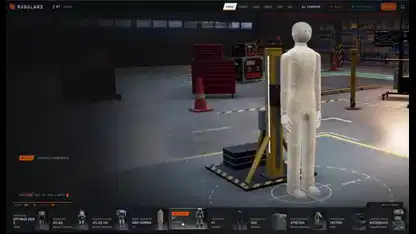

<!-- Generated by scripts/build.py. -->

# A virtual hangar for exploring robot assemblies

[Back to collection](https://github.com/VibeClip/awesome-fable-5-2-videos/blob/main/README.md)

**[▶ Watch](https://video.twimg.com/amplify_video/2120526618925899776/vid/avc1/3596x2084/5KVxtJ0HMeLJ5swp.mp4?tag=29)** · [Original post](https://x.com/0xMovez/status/2120526918621515872)

[0xMovez](https://x.com/0xMovez) · 1:34 · 2026-11-11

The creator says Fable 5.2 generated the 3D robot models in code for an interactive educational demo.

## Shared prompt

No public prompt recorded.

Sources & verification

- Model evidence: Model named in original post
- Post availability checked: 2026-11-13 — Post available

Source availability and video generation are separate checks. Generation and rendering were not independently reproduced.

[License & media rights](https://github.com/VibeClip/awesome-fable-5-2-videos/blob/main/docs/MEDIA-RIGHTS.md)

