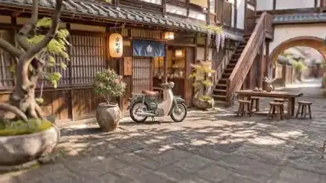

<!-- Generated by scripts/build.py. -->

# A Kyoto streetscape that changes where you touch it

[Back to collection](https://github.com/VibeClip/awesome-fable-5-2-videos/blob/main/README.md)

**[▶ Watch](https://video.twimg.com/amplify_video/2121649253668024321/vid/avc1/1920x1080/G7mrNGThYT_aalmV.mp4?tag=29)** · [Original post](https://x.com/29meat_ai/status/2121802871050318305)

[29meat_ai](https://x.com/29meat_ai) · 0:22 · 2026-11-15

The creator used Atlas to turn a reference image into a 3D Gaussian splat scene and Three.js to display it. Fable 5.2 wrote the touch-driven transition between photoreal, animated and night views.

## Shared prompt

No public prompt recorded.

Sources & verification

- Model evidence: Model named in original post
- Post availability checked: 2026-11-15 — Post available

Source availability and video generation are separate checks. Generation and rendering were not independently reproduced.

[License & media rights](https://github.com/VibeClip/awesome-fable-5-2-videos/blob/main/docs/MEDIA-RIGHTS.md)

