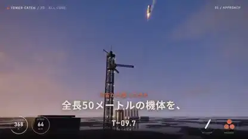

<!-- Generated by scripts/build.py. -->

# An animated reconstruction of a Starship catch

[Back to collection](https://github.com/VibeClip/awesome-fable-5-2-videos/blob/main/README.md)

**[▶ Watch](https://video.twimg.com/amplify_video/2121868165789671424/vid/avc1/1920x1080/xtuXt7hB_shJ9Rr2.mp4?tag=29)** · [Original post](https://x.com/29meat_ai/status/2121884408202617155)

[29meat_ai](https://x.com/29meat_ai) · 0:30 · 2026-11-15

The creator credits Fable 5.2 for recreating the event in code. The video alternates between a wide view of the tower and an annotated diagram of the catch.

## Shared prompt

No public prompt recorded.

Sources & verification

- Model evidence: Model named in original post
- Post availability checked: 2026-11-15 — Post available

Source availability and video generation are separate checks. Generation and rendering were not independently reproduced.

[License & media rights](https://github.com/VibeClip/awesome-fable-5-2-videos/blob/main/docs/MEDIA-RIGHTS.md)

