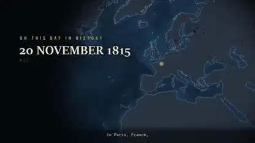

<!-- Generated by scripts/build.py. -->

# The Second Treaty of Paris

[Back to collection](https://github.com/VibeClip/awesome-fable-5-2-videos/blob/main/README.md)

**[▶ Watch](https://video.twimg.com/amplify_video/2121299667233234945/vid/avc1/1920x1080/Fj-__n_Xwic0VA0B.mp4?tag=29)** · [Original post](https://x.com/adityavg13/status/2121299920141599107)

[adityavg13](https://x.com/adityavg13) · 1:44 · 2026-11-13

The creator credits Fable 5.2 and After Effects for the edit and supplies their own voiceover.

## Shared prompt

No public prompt recorded.

Sources & verification

- Model evidence: Model named in original post
- Post availability checked: 2026-11-16 — Post available

Source availability and video generation are separate checks. Generation and rendering were not independently reproduced.

[License & media rights](https://github.com/VibeClip/awesome-fable-5-2-videos/blob/main/docs/MEDIA-RIGHTS.md)

