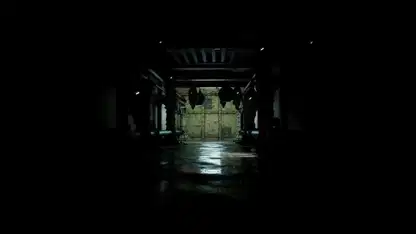

<!-- Generated by scripts/build.py. -->

# The Lantern Spider

[Back to collection](https://github.com/VibeClip/awesome-fable-5-2-videos/blob/main/README.md)

**[▶ Watch](https://video.twimg.com/amplify_video/2122065027339329536/vid/avc1/2580x1080/TXi8bpetSDYDKLzz.mp4?tag=29)** · [Original post](https://x.com/aGim_asf/status/2122065184743153882)

[aGim_asf](https://x.com/aGim_asf) · 1:03 · 2026-11-15

The creator used GPT images and Tripo for assets. Fable 5.2 scripted the rig, shots and animation in Blender. The creator links their full workflow, prompt and sound credits from a reply.

[Original post](https://x.com/aGim_asf/status/2122065188325122269)

## Shared prompt

The creator shared a prompt at the link below. Read it in its original context, with any references and follow-up instructions.

[Read the creator’s prompt](https://x.com/aGim_asf/status/2122065188325122269)

Sources & verification

- Model evidence: Model named in original post
- Post availability checked: 2026-11-16 — Post available

Source availability and video generation are separate checks. Generation and rendering were not independently reproduced.

[License & media rights](https://github.com/VibeClip/awesome-fable-5-2-videos/blob/main/docs/MEDIA-RIGHTS.md)

