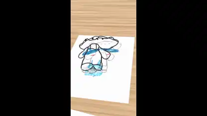

<!-- Generated by scripts/build.py. -->

# A hand-drawn line becomes thread and redraws a character

[Back to collection](https://github.com/VibeClip/awesome-fable-5-2-videos/blob/main/README.md)

**[▶ Watch](https://video.twimg.com/amplify_video/2121888732135788544/vid/avc1/1080x1920/T6MRHBPf7hXe_aPh.mp4?tag=29)** · [Original post](https://x.com/akiyoshisan/status/2121890007237722501)

[akiyoshisan](https://x.com/akiyoshisan) · 1:08 · 2026-11-15

The creator credits Fable 5.2 for extracting lines from hand-drawn art with OpenCV and rendering in Blender with Python. A bass recording supplies the musical seed, and Suno extends part of it.

## Shared prompt

Original language, as shared by the creator. Follow the source for context and required inputs.

> 手描きの線そのものを立体にして

[Read the creator’s prompt](https://x.com/akiyoshisan/status/2121890007237722501)

Sources & verification

- Model evidence: Model named in original post
- Post availability checked: 2026-11-15 — Post available

Source availability and video generation are separate checks. Generation and rendering were not independently reproduced.

[License & media rights](https://github.com/VibeClip/awesome-fable-5-2-videos/blob/main/docs/MEDIA-RIGHTS.md)

