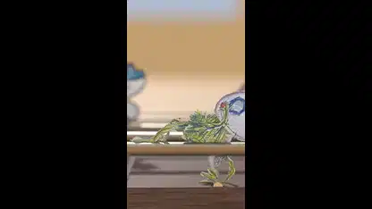

<!-- Generated by scripts/build.py. -->

# Crossing the Bass Strings

[Back to collection](https://github.com/VibeClip/awesome-fable-5-2-videos/blob/main/README.md)

**[▶ Watch](https://video.twimg.com/amplify_video/2122177261424222209/vid/avc1/1080x1920/F6rTkgB40WfGH_Kr.mp4?tag=29)** · [Original post](https://x.com/akiyoshisan/status/2122177989928763667)

[akiyoshisan](https://x.com/akiyoshisan) · 1:07 · 2026-11-16

Fable directed the work. OpenCV split the drawing, Python drove the rig and Blender rendered the frames. Suno extended the creator’s bass recording.

## Shared prompt

Original language, as shared by the creator. Follow the source for context and required inputs.

> お絵描きに芝居をさせて

[Read the creator’s prompt](https://x.com/akiyoshisan/status/2122177989928763667)

Sources & verification

- Model evidence: Model named in original post
- Post availability checked: 2026-11-16 — Post available

Source availability and video generation are separate checks. Generation and rendering were not independently reproduced.

[License & media rights](https://github.com/VibeClip/awesome-fable-5-2-videos/blob/main/docs/MEDIA-RIGHTS.md)

