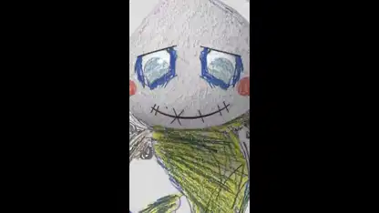

<!-- Generated by scripts/build.py. -->

# The Sewn Mouth

[Back to collection](https://github.com/VibeClip/awesome-fable-5-2-videos/blob/main/README.md)

**[▶ Watch](https://video.twimg.com/amplify_video/2122969942878564352/vid/avc1/320x568/6ePWZHP5RN8fjeCS.mp4?tag=29)** · [Original post](https://x.com/akiyoshisan/status/2122970728492646854)

[akiyoshisan](https://x.com/akiyoshisan) · 0:42 · 2026-11-18

Fable 5.2 animated the original drawing with Python and Blender. Suno extended the creator’s bass recording.

## Shared prompt

Original language, as shared by the creator. Follow the source for context and required inputs.

> 顔に芝居をさせて！

[Read the creator’s prompt](https://x.com/akiyoshisan/status/2122970728492646854)

Sources & verification

- Model evidence: Model named in original post
- Post availability checked: 2026-11-21 — Post available

Source availability and video generation are separate checks. Generation and rendering were not independently reproduced.

[License & media rights](https://github.com/VibeClip/awesome-fable-5-2-videos/blob/main/docs/MEDIA-RIGHTS.md)

