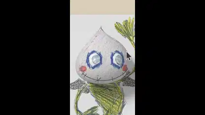

<!-- Generated by scripts/build.py. -->

# The Cursor Gets Bitten

[Back to collection](https://github.com/VibeClip/awesome-fable-5-2-videos/blob/main/README.md)

**[▶ Watch](https://video.twimg.com/amplify_video/2123710302386814976/vid/avc1/320x568/hElUVF47HZ87yHTf.mp4?tag=29)** · [Original post](https://x.com/akiyoshisan/status/2123710585963692068)

[akiyoshisan](https://x.com/akiyoshisan) · 0:32 · 2026-11-20

Fable 5.2 directed nine original drawings in Blender via Python. Suno extended the creator’s bass recording and FFmpeg assembled the frames.

## Shared prompt

Original language, as shared by the creator. Follow the source for context and required inputs.

> 絵が矢印に反応する

[Read the creator’s prompt](https://x.com/akiyoshisan/status/2123710585963692068)

Sources & verification

- Model evidence: Model named in original post
- Post availability checked: 2026-11-21 — Post available

Source availability and video generation are separate checks. Generation and rendering were not independently reproduced.

[License & media rights](https://github.com/VibeClip/awesome-fable-5-2-videos/blob/main/docs/MEDIA-RIGHTS.md)

