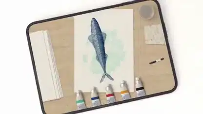

<!-- Generated by scripts/build.py. -->

# A Foldable Watercolor App Demo

[Back to collection](https://github.com/VibeClip/awesome-fable-5-2-videos/blob/main/README.md)

**[▶ Watch](https://video.twimg.com/amplify_video/2120301806248984576/vid/avc1/960x540/SPRHR2g2Wawm3bva.mp4?tag=29)** · [Original post](https://x.com/anshuc/status/2120301850532499927)

[anshuc](https://x.com/anshuc) · 1:07 · 2026-11-10

The creator asked Fable 5.2 to build and film an app with a fold-angle interaction, supplying app design and video skills. The creator describes stepping in to revise the result.

[Original post](https://x.com/anshuc/status/2120301853825024054)

## Shared prompt

The creator shared a prompt at the link below. Read it in its original context, with any references and follow-up instructions.

[Read the creator’s prompt](https://x.com/anshuc/status/2120301853825024054)

Sources & verification

- Model evidence: Model named in original post
- Post availability checked: 2026-11-16 — Post available

Source availability and video generation are separate checks. Generation and rendering were not independently reproduced.

[License & media rights](https://github.com/VibeClip/awesome-fable-5-2-videos/blob/main/docs/MEDIA-RIGHTS.md)

