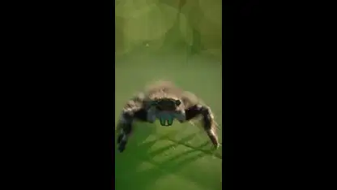

<!-- Generated by scripts/build.py. -->

# A macro-style spider short on a green leaf

[Back to collection](https://github.com/VibeClip/awesome-fable-5-2-videos/blob/main/README.md)

**[▶ Watch](https://video.twimg.com/amplify_video/2120213743829168128/vid/avc1/1080x1920/rJtx59-X2623RSlg.mp4?tag=29)** · [Original post](https://x.com/aollivier82/status/2120290412283703522)

[aollivier82](https://x.com/aollivier82) · 0:15 · 2026-11-10

The creator asked Fable 5.2 for a photorealistic spider video. The short uses shallow focus and leaf-level framing. The production and rendering tools were not disclosed.

## Shared prompt

No public prompt recorded.

Sources & verification

- Model evidence: Model named in original post
- Post availability checked: 2026-11-15 — Post available

Source availability and video generation are separate checks. Generation and rendering were not independently reproduced.

[License & media rights](https://github.com/VibeClip/awesome-fable-5-2-videos/blob/main/docs/MEDIA-RIGHTS.md)

