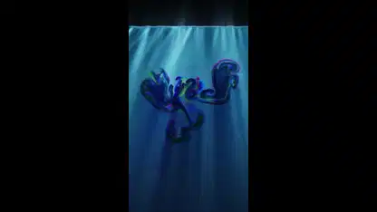

<!-- Generated by scripts/build.py. -->

# An abstract story told through oil and water

[Back to collection](https://github.com/VibeClip/awesome-fable-5-2-videos/blob/main/README.md)

**[▶ Watch](https://video.twimg.com/amplify_video/2120214452507115520/vid/avc1/1080x1920/C_n2LMgpQ5ZWqwdh.mp4?tag=29)** · [Original post](https://x.com/aollivier82/status/2120324378521116962)

[aollivier82](https://x.com/aollivier82) · 0:32 · 2026-11-11

The creator asked Fable 5.2 to tell a story through the effect of oil falling into water. The vertical short uses shifts in color and light to connect successive scenes. The rendering workflow was not disclosed.

## Shared prompt

No public prompt recorded.

Sources & verification

- Model evidence: Model named in original post
- Post availability checked: 2026-11-14 — Post available

Source availability and video generation are separate checks. Generation and rendering were not independently reproduced.

[License & media rights](https://github.com/VibeClip/awesome-fable-5-2-videos/blob/main/docs/MEDIA-RIGHTS.md)

