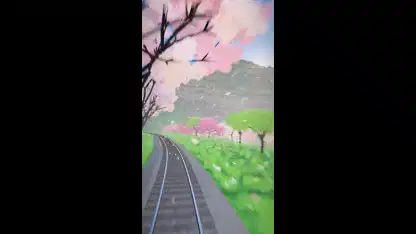

<!-- Generated by scripts/build.py. -->

# A quiet railway ride through changing landscapes

[Back to collection](https://github.com/VibeClip/awesome-fable-5-2-videos/blob/main/README.md)

**[▶ Watch](https://video.twimg.com/amplify_video/2120214618446417920/vid/avc1/1080x1920/jW0o4UtzTEqtErDB.mp4?tag=29)** · [Original post](https://x.com/aollivier82/status/2120335703062290623)

[aollivier82](https://x.com/aollivier82) · 0:40 · 2026-11-11

The creator asked Fable 5.2 for something calming. The vertical film keeps the tracks centered as the landscape changes from blossoms and sunset to snow and aurora. The author did not specify a renderer.

## Shared prompt

No public prompt recorded.

Sources & verification

- Model evidence: Model named in original post
- Post availability checked: 2026-11-15 — Post available

Source availability and video generation are separate checks. Generation and rendering were not independently reproduced.

[License & media rights](https://github.com/VibeClip/awesome-fable-5-2-videos/blob/main/docs/MEDIA-RIGHTS.md)

