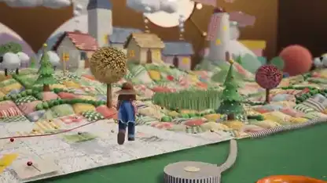

<!-- Generated by scripts/build.py. -->

# A playable patchwork village with a stop-motion look

[Back to collection](https://github.com/VibeClip/awesome-fable-5-2-videos/blob/main/README.md)

**[▶ Watch](https://video.twimg.com/amplify_video/2120745677055733760/vid/avc1/2560x1440/3alE49tTHiEZV3hx.mp4?tag=29)** · [Original post](https://x.com/BlendiByl/status/2120746541636047347)

[BlendiByl](https://x.com/BlendiByl) · 0:27 · 2026-11-12

The creator says Fable 5.2 built the playable scene and describes the map as made entirely in code.

## Shared prompt

No public prompt recorded.

Sources & verification

- Model evidence: Model named in original post
- Post availability checked: 2026-11-14 — Post available

Source availability and video generation are separate checks. Generation and rendering were not independently reproduced.

[License & media rights](https://github.com/VibeClip/awesome-fable-5-2-videos/blob/main/docs/MEDIA-RIGHTS.md)

