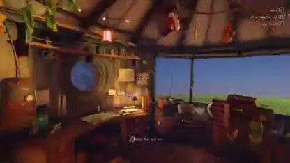

<!-- Generated by scripts/build.py. -->

# A Tiny Solar System You Can Fly Through

[Back to collection](https://github.com/VibeClip/awesome-fable-5-2-videos/blob/main/README.md)

**[▶ Watch](https://video.twimg.com/amplify_video/2122671708192833536/vid/avc1/480x270/LFpmvtDZ4N31P-nD.mp4?tag=29)** · [Original post](https://x.com/BlendiByl/status/2122673770607591855)

[BlendiByl](https://x.com/BlendiByl) · 1:20 · 2026-11-17

The creator credits Fable 5.2 and describes continuous flights, orbits and gravity.

## Shared prompt

No public prompt recorded.

Sources & verification

- Model evidence: Model named in original post
- Post availability checked: 2026-11-21 — Post available

Source availability and video generation are separate checks. Generation and rendering were not independently reproduced.

[License & media rights](https://github.com/VibeClip/awesome-fable-5-2-videos/blob/main/docs/MEDIA-RIGHTS.md)

