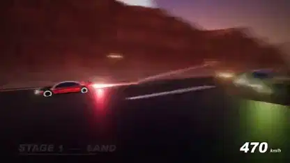

<!-- Generated by scripts/build.py. -->

# An acrobatic supercar race set to an ElevenLabs track

[Back to collection](https://github.com/VibeClip/awesome-fable-5-2-videos/blob/main/README.md)

**[▶ Watch](https://video.twimg.com/amplify_video/2120135695037837313/vid/avc1/1920x1080/yXrA_ezGd_Frjbvw.mp4?tag=29)** · [Original post](https://x.com/challenger_ND/status/2120149476057006186)

[challenger_ND](https://x.com/challenger_ND) · 0:30 · 2026-11-10

The creator asked Fable 5.2 for a code-generated racing clip timed to an ElevenLabs track. The cars flip and slide through several environments in a game-inspired edit.

## Shared prompt

No public prompt recorded.

Sources & verification

- Model evidence: Model named in original post
- Post availability checked: 2026-11-15 — Post available

Source availability and video generation are separate checks. Generation and rendering were not independently reproduced.

[License & media rights](https://github.com/VibeClip/awesome-fable-5-2-videos/blob/main/docs/MEDIA-RIGHTS.md)

