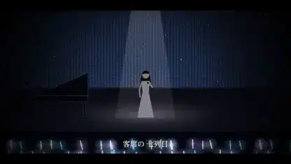

<!-- Generated by scripts/build.py. -->

# The Last Concert

[Back to collection](https://github.com/VibeClip/awesome-fable-5-2-videos/blob/main/README.md)

**[▶ Watch](https://video.twimg.com/amplify_video/2120422211702177792/vid/avc1/1280x720/s1sR2PVkGpwyUSqy.mp4?tag=29)** · [Original post](https://x.com/challenger_ND/status/2120423740756664820)

[challenger_ND](https://x.com/challenger_ND) · 3:02 · 2026-11-11

This is the second cut in the post. Fable 5.2 created the code-based first pass; the creator added a Suno track and adjusted that cut to the music.

## Shared prompt

Original language, as shared by the creator. Follow the source for context and required inputs.

> 全米が泣けるレベルのライブ動画をコードのみで作って

[Read the creator’s prompt](https://x.com/challenger_ND/status/2120423740756664820)

Sources & verification

- Model evidence: Model named in original post
- Post availability checked: 2026-11-16 — Post available

Source availability and video generation are separate checks. Generation and rendering were not independently reproduced.

[License & media rights](https://github.com/VibeClip/awesome-fable-5-2-videos/blob/main/docs/MEDIA-RIGHTS.md)

