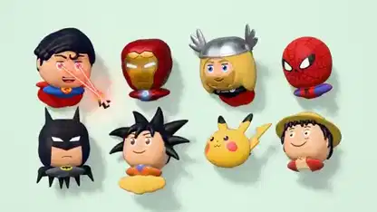

<!-- Generated by scripts/build.py. -->

# A rotating lineup of fictional characters in Three.js

[Back to collection](https://github.com/VibeClip/awesome-fable-5-2-videos/blob/main/README.md)

**[▶ Watch](https://video.twimg.com/amplify_video/2120500565855842304/vid/avc1/1920x1080/QIr-yYCmh1SRLnLh.mp4?tag=29)** · [Original post](https://x.com/chetaslua/status/2120500937852920144)

[chetaslua](https://x.com/chetaslua) · 0:20 · 2026-11-11

The creator names Fable 5.2 and Three.js. The video presents two rows of stylized character heads and rotates them in place so their profiles become visible.

## Shared prompt

No public prompt recorded.

Sources & verification

- Model evidence: Model named in original post
- Post availability checked: 2026-11-14 — Post available

Source availability and video generation are separate checks. Generation and rendering were not independently reproduced.

[License & media rights](https://github.com/VibeClip/awesome-fable-5-2-videos/blob/main/docs/MEDIA-RIGHTS.md)

