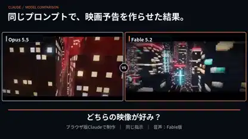

<!-- Generated by scripts/build.py. -->

# Two models cut a sci-fi trailer for The Final Signal

[Back to collection](https://github.com/VibeClip/awesome-fable-5-2-videos/blob/main/README.md)

**[▶ Watch](https://video.twimg.com/amplify_video/2120707203707621378/vid/avc1/1920x1080/phHDECzgrrQ5213D.mp4?tag=29)** · [Original post](https://x.com/_creatorzz_/status/2120707230513377714)

[_creatorzz_](https://x.com/_creatorzz_) · 0:20 · 2026-11-12

The creator places Opus 5.5 on the left and Fable 5.2 on the right. Same-prompt cuts show differences in staging, camera motion and neon-lit settings. The full brief is in the creator’s reply.

## Shared prompt

The creator shared a prompt at the link below. Read it in its original context, with any references and follow-up instructions.

[Read the creator’s prompt](https://x.com/_creatorzz_/status/2120707232824492180)

Sources & verification

- Model evidence: Model named in original post
- Post availability checked: 2026-11-15 — Post available

Source availability and video generation are separate checks. Generation and rendering were not independently reproduced.

[License & media rights](https://github.com/VibeClip/awesome-fable-5-2-videos/blob/main/docs/MEDIA-RIGHTS.md)

