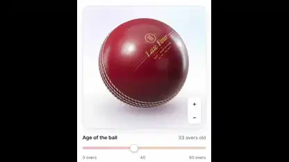

<!-- Generated by scripts/build.py. -->

# Interactive Cricket Ball Rendering

[Back to collection](https://github.com/VibeClip/awesome-fable-5-2-videos/blob/main/README.md)

**[▶ Watch](https://video.twimg.com/amplify_video/2120079222689697792/vid/avc1/1206x1464/ZMBtfuAAUuCSN6CZ.mp4?tag=29)** · [Original post](https://x.com/deedydas/status/2120079288372494782)

[deedydas](https://x.com/deedydas) · 0:18 · 2026-11-10

Fable 5.2 attribution comes from the creator’s original post. The renderer is unspecified.

## Shared prompt

No public prompt recorded.

Sources & verification

- Model evidence: Model named in original post
- Post availability checked: 2026-11-16 — Post available

Source availability and video generation are separate checks. Generation and rendering were not independently reproduced.

[License & media rights](https://github.com/VibeClip/awesome-fable-5-2-videos/blob/main/docs/MEDIA-RIGHTS.md)

