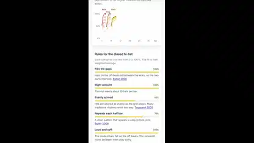

<!-- Generated by scripts/build.py. -->

# A House track assembled from generated patterns

[Back to collection](https://github.com/VibeClip/awesome-fable-5-2-videos/blob/main/README.md)

**[▶ Watch](https://video.twimg.com/amplify_video/2120904570314305536/vid/avc1/1206x2266/8g60h4oMlWzSL0mh.mp4?tag=29)** · [Original post](https://x.com/deedydas/status/2120905625852936318)

[deedydas](https://x.com/deedydas) · 5:51 · 2026-11-12

The creator credits Fable 5.2 with trying patterns for each instrument and arranging the selected patterns into a house track. The original recording includes the audio and a view of the arrangement.

[Original post](https://x.com/deedydas/status/2120905629459992996)

## Shared prompt

No public prompt recorded.

Sources & verification

- Model evidence: Model named in original post
- Post availability checked: 2026-11-15 — Post available

Source availability and video generation are separate checks. Generation and rendering were not independently reproduced.

[License & media rights](https://github.com/VibeClip/awesome-fable-5-2-videos/blob/main/docs/MEDIA-RIGHTS.md)

