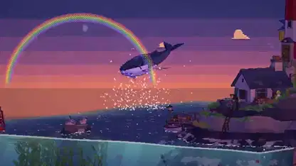

<!-- Generated by scripts/build.py. -->

# An interactive pixel-art world told by a whale

[Back to collection](https://github.com/VibeClip/awesome-fable-5-2-videos/blob/main/README.md)

**[▶ Watch](https://video.twimg.com/amplify_video/2120933027748392960/vid/avc1/3840x2160/TBgnySF6q7jdJhfY.mp4?tag=29)** · [Original post](https://x.com/dfeinition/status/2120933859999059970)

[dfeinition](https://x.com/dfeinition) · 1:57 · 2026-11-12

The creator credits Fable 5.2 for coding the interactive 3D world. The video combines a tour led by a whale with views of how the world was made. The creator links the interactive version in a reply.

[Original post](https://x.com/dfeinition/status/2120933862033240271)

## Shared prompt

No public prompt recorded.

Sources & verification

- Model evidence: Model named in original post
- Post availability checked: 2026-11-14 — Post available

Source availability and video generation are separate checks. Generation and rendering were not independently reproduced.

[License & media rights](https://github.com/VibeClip/awesome-fable-5-2-videos/blob/main/docs/MEDIA-RIGHTS.md)

