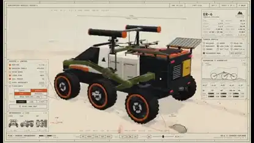

<!-- Generated by scripts/build.py. -->

# A rover suspension simulator for rough terrain

[Back to collection](https://github.com/VibeClip/awesome-fable-5-2-videos/blob/main/README.md)

**[▶ Watch](https://video.twimg.com/amplify_video/2120558575387131905/vid/avc1/3456x1990/D5saQ1Xn1-2_bXLA.mp4?tag=29)** · [Original post](https://x.com/DilumSanjaya/status/2120561077385867663)

[DilumSanjaya](https://x.com/DilumSanjaya) · 1:22 · 2026-11-11

The creator asked Fable 5.2 to design a rocker-bogie vehicle and simulate rough-terrain driving. The recording shows the rover from several angles as its wheels articulate. The original post includes the interactive build.

## Shared prompt

No public prompt recorded.

Sources & verification

- Model evidence: Model named in original post
- Post availability checked: 2026-11-14 — Post available

Source availability and video generation are separate checks. Generation and rendering were not independently reproduced.

[License & media rights](https://github.com/VibeClip/awesome-fable-5-2-videos/blob/main/docs/MEDIA-RIGHTS.md)

