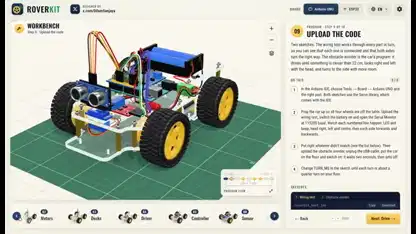

<!-- Generated by scripts/build.py. -->

# RoverKit, an interactive robot-building walkthrough

[Back to collection](https://github.com/VibeClip/awesome-fable-5-2-videos/blob/main/README.md)

**[▶ Watch](https://video.twimg.com/amplify_video/2121283445456588800/vid/avc1/3456x1990/uBZhtusJ-gGu4i86.mp4?tag=29)** · [Original post](https://x.com/DilumSanjaya/status/2121286147393651085)

[DilumSanjaya](https://x.com/DilumSanjaya) · 1:46 · 2026-11-13

The creator credits Fable 5.2 for the app. The demo moves between a 3D assembly guide, a visual code walkthrough and a driving simulator with a configurable arena.

[Original post](https://x.com/DilumSanjaya/status/2121286149910220854)

## Shared prompt

No public prompt recorded.

Sources & verification

- Model evidence: Model named in original post
- Post availability checked: 2026-11-14 — Post available

Source availability and video generation are separate checks. Generation and rendering were not independently reproduced.

[License & media rights](https://github.com/VibeClip/awesome-fable-5-2-videos/blob/main/docs/MEDIA-RIGHTS.md)

