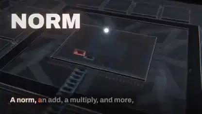

<!-- Generated by scripts/build.py. -->

# A music video about megakernels

[Back to collection](https://github.com/VibeClip/awesome-fable-5-2-videos/blob/main/README.md)

**[▶ Watch](https://video.twimg.com/amplify_video/2119968396469309440/vid/avc1/1920x1080/Q748HuENLMQtMz8O.mp4?tag=29)** · [Original post](https://x.com/elliotarledge/status/2119968762069934415)

[elliotarledge](https://x.com/elliotarledge) · 2:53 · 2026-11-10

## Shared prompt

The creator shared a prompt at the link below. Read it in its original context, with any references and follow-up instructions.

[Read the creator’s prompt](https://x.com/elliotarledge/status/2119968762069934415)

Sources & verification

- Model evidence: Model named in original post
- Post availability checked: 2026-11-10 — Post available

Source availability and video generation are separate checks. Generation and rendering were not independently reproduced.

[License & media rights](https://github.com/VibeClip/awesome-fable-5-2-videos/blob/main/docs/MEDIA-RIGHTS.md)

