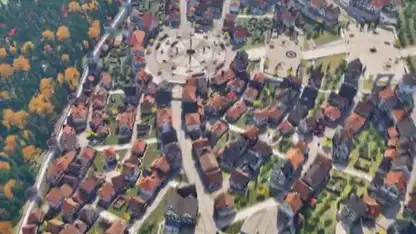

<!-- Generated by scripts/build.py. -->

# A 3D town from rooftops to street level

[Back to collection](https://github.com/VibeClip/awesome-fable-5-2-videos/blob/main/README.md)

**[▶ Watch](https://video.twimg.com/amplify_video/2120059143515987968/vid/avc1/2560x1440/T0fkZZHKry2zwcnM.mp4?tag=29)** · [Original post](https://x.com/eluchocha/status/2120059951485698350)

[eluchocha](https://x.com/eluchocha) · 0:59 · 2026-11-10

The creator credits Fable 5.2 for the town and says the assets were made in Blender. The video starts above the rooftops and ends at street level.

## Shared prompt

No public prompt recorded.

Sources & verification

- Model evidence: Model named in original post
- Post availability checked: 2026-11-14 — Post available

Source availability and video generation are separate checks. Generation and rendering were not independently reproduced.

[License & media rights](https://github.com/VibeClip/awesome-fable-5-2-videos/blob/main/docs/MEDIA-RIGHTS.md)

