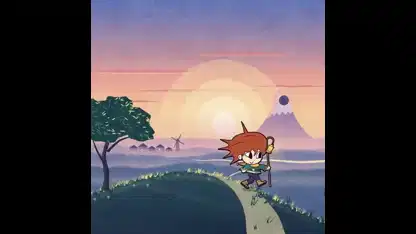

<!-- Generated by scripts/build.py. -->

# A Lantern Journey

[Back to collection](https://github.com/VibeClip/awesome-fable-5-2-videos/blob/main/README.md)

**[▶ Watch](https://video.twimg.com/amplify_video/2120840737180823552/vid/avc1/1080x1080/HLKE2U0C4YCpziCB.mp4?tag=29)** · [Original post](https://x.com/eluchocha/status/2120856734759547259)

[eluchocha](https://x.com/eluchocha) · 1:40 · 2026-11-12

The post attributes the code animation to Fable 5.2 and leaves the renderer unspecified.

## Shared prompt

No public prompt recorded.

Sources & verification

- Model evidence: Model named in original post
- Post availability checked: 2026-11-16 — Post available

Source availability and video generation are separate checks. Generation and rendering were not independently reproduced.

[License & media rights](https://github.com/VibeClip/awesome-fable-5-2-videos/blob/main/docs/MEDIA-RIGHTS.md)

