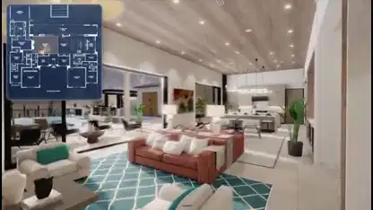

<!-- Generated by scripts/build.py. -->

# A floor plan becomes a furnished home walkthrough

[Back to collection](https://github.com/VibeClip/awesome-fable-5-2-videos/blob/main/README.md)

**[▶ Watch](https://video.twimg.com/amplify_video/2120175906501345281/vid/avc1/1902x1080/bf_XglfsEta4QCXA.mp4?tag=16)** · [Original post](https://x.com/everestchris6/status/2120175941616128277)

[everestchris6](https://x.com/everestchris6) · 0:10 · 2026-11-10

The creator attributes a blueprint-to-3D walkthrough to Fable 5.2. A floor plan stays in the corner as the camera moves through the furnished rooms.

## Shared prompt

No public prompt recorded.

Sources & verification

- Model evidence: Model named in original post
- Post availability checked: 2026-11-15 — Post available

Source availability and video generation are separate checks. Generation and rendering were not independently reproduced.

[License & media rights](https://github.com/VibeClip/awesome-fable-5-2-videos/blob/main/docs/MEDIA-RIGHTS.md)

