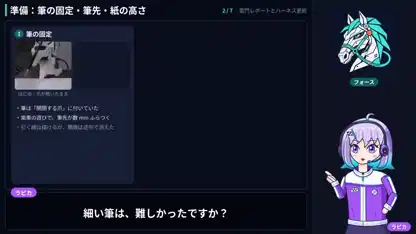

<!-- Generated by scripts/build.py. -->

# An illustrated breakdown of a robot drawing Kaminarimon

[Back to collection](https://github.com/VibeClip/awesome-fable-5-2-videos/blob/main/README.md)

**[▶ Watch](https://video.twimg.com/amplify_video/2121494558106439680/vid/avc1/1920x1080/DPZRyASdC9HYAryE.mp4?tag=29)** · [Original post](https://x.com/gclue_akira/status/2121494801506050378)

[gclue_akira](https://x.com/gclue_akira) · 2:06 · 2026-11-14

The creator describes a Kaminarimon drawing made with Fable 5.2 and Tazuna Robotics Harness. The attached explainer presents the process with an illustrated narrator and screenshots. The creator did not specify how the explainer itself was rendered.

## Shared prompt

No public prompt recorded.

Sources & verification

- Model evidence: Model named in original post
- Post availability checked: 2026-11-14 — Post available

Source availability and video generation are separate checks. Generation and rendering were not independently reproduced.

[License & media rights](https://github.com/VibeClip/awesome-fable-5-2-videos/blob/main/docs/MEDIA-RIGHTS.md)

