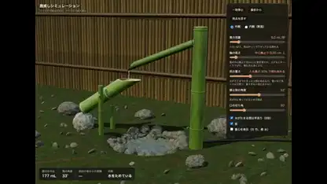

<!-- Generated by scripts/build.py. -->

# A 3D Shishi-Odoshi Water Feature

[Back to collection](https://github.com/VibeClip/awesome-fable-5-2-videos/blob/main/README.md)

**[▶ Watch](https://video.twimg.com/amplify_video/2121960705310232576/vid/avc1/2400x1720/ats5frt2FrWmPy0S.mp4?tag=29)** · [Original post](https://x.com/gengo6com/status/2121960819244372252)

[gengo6com](https://x.com/gengo6com) · 0:14 · 2026-11-15

The creator credits Fable 5.2 for the revised shishi-odoshi simulation. The exact rendering engine is unspecified in the post.

## Shared prompt

No public prompt recorded.

Sources & verification

- Model evidence: Model named in original post
- Post availability checked: 2026-11-16 — Post available

Source availability and video generation are separate checks. Generation and rendering were not independently reproduced.

[License & media rights](https://github.com/VibeClip/awesome-fable-5-2-videos/blob/main/docs/MEDIA-RIGHTS.md)

