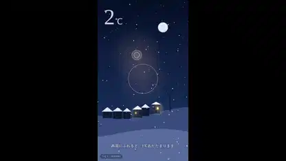

<!-- Generated by scripts/build.py. -->

# One Degree at a Time

[Back to collection](https://github.com/VibeClip/awesome-fable-5-2-videos/blob/main/README.md)

**[▶ Watch](https://video.twimg.com/amplify_video/2120848357682012160/vid/avc1/1080x1920/JsGhsovXasT34cRn.mp4?tag=29)** · [Original post](https://x.com/hiromi_sound/status/2120848396315672592)

[hiromi_sound](https://x.com/hiromi_sound) · 0:15 · 2026-11-12

The author says Fable 5.2 built the piece with code and used no imported images or audio files.

## Shared prompt

No public prompt recorded.

Sources & verification

- Model evidence: Model named in original post
- Post availability checked: 2026-11-16 — Post available

Source availability and video generation are separate checks. Generation and rendering were not independently reproduced.

[License & media rights](https://github.com/VibeClip/awesome-fable-5-2-videos/blob/main/docs/MEDIA-RIGHTS.md)

