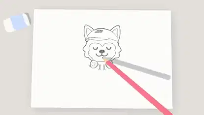

<!-- Generated by scripts/build.py. -->

# A hand-drawn wolf becomes a 3D intro

[Back to collection](https://github.com/VibeClip/awesome-fable-5-2-videos/blob/main/README.md)

**[▶ Watch](https://video.twimg.com/amplify_video/2120622616344219648/vid/avc1/1920x1080/YQkggnwdUXqipVTR.mp4?tag=16)** · [Original post](https://x.com/husky__create/status/2120622644362199182)

[husky__create](https://x.com/husky__create) · 0:10 · 2026-11-11

The creator credits Fable 5.2 and names Three.js for the intro.

## Shared prompt

No public prompt recorded.

Sources & verification

- Model evidence: Model named in original post
- Post availability checked: 2026-11-13 — Post available

Source availability and video generation are separate checks. Generation and rendering were not independently reproduced.

[License & media rights](https://github.com/VibeClip/awesome-fable-5-2-videos/blob/main/docs/MEDIA-RIGHTS.md)

