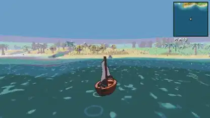

<!-- Generated by scripts/build.py. -->

# An island game demo with newly animated combat

[Back to collection](https://github.com/VibeClip/awesome-fable-5-2-videos/blob/main/README.md)

**[▶ Watch](https://video.twimg.com/amplify_video/2120339686040158208/vid/avc1/1920x1080/-d4odGYaB3R0mUbK.mp4?tag=29)** · [Original post](https://x.com/hyphenholdings/status/2120340122461753345)

[hyphenholdings](https://x.com/hyphenholdings) · 1:05 · 2026-11-11

The creator credits Fable 5.2 for the combat movements added in this update, including dodges and combos. The footage also shows traversal from the water to the island. The author shares a playable build in a reply.

[Original post](https://x.com/hyphenholdings/status/2120340296504643866)

## Shared prompt

No public prompt recorded.

Sources & verification

- Model evidence: Model named in original post
- Post availability checked: 2026-11-15 — Post available

Source availability and video generation are separate checks. Generation and rendering were not independently reproduced.

[License & media rights](https://github.com/VibeClip/awesome-fable-5-2-videos/blob/main/docs/MEDIA-RIGHTS.md)

