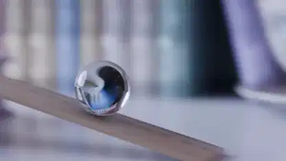

<!-- Generated by scripts/build.py. -->

# A looping miniature tea room in Blender

[Back to collection](https://github.com/VibeClip/awesome-fable-5-2-videos/blob/main/README.md)

**[▶ Watch](https://video.twimg.com/amplify_video/2120311299917873153/vid/avc1/1280x720/XX6AfZsYEyGyUmg8.mp4?tag=29)** · [Original post](https://x.com/ICO_AIvideo/status/2120311646933680355)

[ICO_AIvideo](https://x.com/ICO_AIvideo) · 0:22 · 2026-11-11

The creator identifies Fable 5.2 and Blender for this loop. The camera travels past porcelain and a reflective sphere, then reveals the full pink room.

## Shared prompt

No public prompt recorded.

Sources & verification

- Model evidence: Model named in original post
- Post availability checked: 2026-11-15 — Post available

Source availability and video generation are separate checks. Generation and rendering were not independently reproduced.

[License & media rights](https://github.com/VibeClip/awesome-fable-5-2-videos/blob/main/docs/MEDIA-RIGHTS.md)

