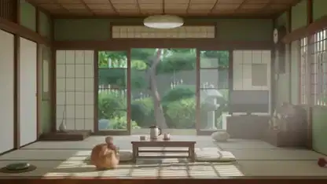

<!-- Generated by scripts/build.py. -->

# A small dog in a sunlit tatami room

[Back to collection](https://github.com/VibeClip/awesome-fable-5-2-videos/blob/main/README.md)

**[▶ Watch](https://video.twimg.com/amplify_video/2120858849347567616/vid/avc1/1920x1080/nn3mPUMUshjI7UNO.mp4?tag=29)** · [Original post](https://x.com/ICO_AIvideo/status/2120860567581921508)

[ICO_AIvideo](https://x.com/ICO_AIvideo) · 0:20 · 2026-11-12

The creator says Fable 5.2 built the room and animated the dog in Blender using images as references. The video follows the dog through patches of sunlight on the floor.

## Shared prompt

No public prompt recorded.

Sources & verification

- Model evidence: Model named in original post
- Post availability checked: 2026-11-15 — Post available

Source availability and video generation are separate checks. Generation and rendering were not independently reproduced.

[License & media rights](https://github.com/VibeClip/awesome-fable-5-2-videos/blob/main/docs/MEDIA-RIGHTS.md)

