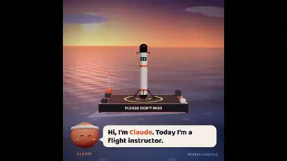

<!-- Generated by scripts/build.py. -->

# An AI learns to land a rocket

[Back to collection](https://github.com/VibeClip/awesome-fable-5-2-videos/blob/main/README.md)

**[▶ Watch](https://video.twimg.com/amplify_video/2121065917526298624/vid/avc1/1080x1080/_fK2vPkd7B9dTr6U.mp4?tag=29)** · [Original post](https://x.com/imjustnewatai/status/2121066003123847611)

[imjustnewatai](https://x.com/imjustnewatai) · 1:32 · 2026-11-13

The creator asked Fable 5.2 to teach an AI to land a rocket. The clip visualizes repeated simulated attempts with on-screen counters. The creator did not specify the rendering stack.

## Shared prompt

No public prompt recorded.

Sources & verification

- Model evidence: Model named in original post
- Post availability checked: 2026-11-14 — Post available

Source availability and video generation are separate checks. Generation and rendering were not independently reproduced.

[License & media rights](https://github.com/VibeClip/awesome-fable-5-2-videos/blob/main/docs/MEDIA-RIGHTS.md)

