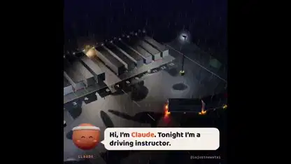

<!-- Generated by scripts/build.py. -->

# Learning to reverse a truck with two trailers

[Back to collection](https://github.com/VibeClip/awesome-fable-5-2-videos/blob/main/README.md)

**[▶ Watch](https://video.twimg.com/amplify_video/2121097408348078080/vid/avc1/1080x1080/pItof1FZpm6_WoHd.mp4?tag=29)** · [Original post](https://x.com/imjustnewatai/status/2121097470373511184)

[imjustnewatai](https://x.com/imjustnewatai) · 1:32 · 2026-11-13

The creator used Fable 5.2 to make a simulation of an agent learning to reverse a truck with two trailers into a tight bay.

## Shared prompt

No public prompt recorded.

Sources & verification

- Model evidence: Model named in original post
- Post availability checked: 2026-11-13 — Post available

Source availability and video generation are separate checks. Generation and rendering were not independently reproduced.

[License & media rights](https://github.com/VibeClip/awesome-fable-5-2-videos/blob/main/docs/MEDIA-RIGHTS.md)

