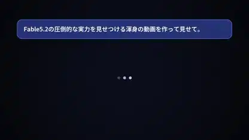

<!-- Generated by scripts/build.py. -->

# A code-rendered Fable self-introduction

[Back to collection](https://github.com/VibeClip/awesome-fable-5-2-videos/blob/main/README.md)

**[▶ Watch](https://video.twimg.com/amplify_video/2120377027459182593/vid/avc1/1920x1080/RslvkhvTk3_XDi4c.mp4?tag=29)** · [Original post](https://x.com/jjjContinue/status/2120435611391909934)

[jjjContinue](https://x.com/jjjContinue) · 0:45 · 2026-11-11

The creator credits Fable 5.2. The finished reel moves from a chat-like opening to glowing shapes, counters and bold Japanese typography.

[Original post](https://x.com/jjjContinue/status/2120097601601372353)

## Shared prompt

No public prompt recorded.

Sources & verification

- Model evidence: Model named in original post
- Post availability checked: 2026-11-14 — Post available

Source availability and video generation are separate checks. Generation and rendering were not independently reproduced.

[License & media rights](https://github.com/VibeClip/awesome-fable-5-2-videos/blob/main/docs/MEDIA-RIGHTS.md)

