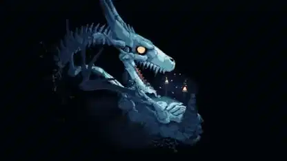

<!-- Generated by scripts/build.py. -->

# Pixel-Art Gaussian Splats: Lanterns and Creatures

[Back to collection](https://github.com/VibeClip/awesome-fable-5-2-videos/blob/main/README.md)

**[▶ Watch](https://video.twimg.com/amplify_video/2121782187787948033/vid/avc1/1920x1080/K-68absx2B7a3ZFC.mp4?tag=29)** · [Original post](https://x.com/JungleSilicon/status/2121782359901212987)

[JungleSilicon](https://x.com/JungleSilicon) · 0:36 · 2026-11-15

The creator credits Fable 5.2 and identifies the rendering style as pixel-art Gaussian splats.

[Original post](https://x.com/JungleSilicon/status/2122245399746637972)

## Shared prompt

No public prompt recorded.

Sources & verification

- Model evidence: Model named in original post
- Post availability checked: 2026-11-16 — Post available

Source availability and video generation are separate checks. Generation and rendering were not independently reproduced.

[License & media rights](https://github.com/VibeClip/awesome-fable-5-2-videos/blob/main/docs/MEDIA-RIGHTS.md)

