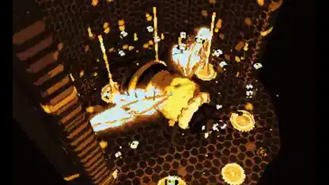

<!-- Generated by scripts/build.py. -->

# Glowing Dioramas in Pixel-Art Gaussian Splats

[Back to collection](https://github.com/VibeClip/awesome-fable-5-2-videos/blob/main/README.md)

**[▶ Watch](https://video.twimg.com/amplify_video/2121893301498548225/vid/avc1/2684x1634/BjcN6u6IjQ3NdAI7.mp4?tag=29)** · [Original post](https://x.com/JungleSilicon/status/2121893902286524880)

[JungleSilicon](https://x.com/JungleSilicon) · 0:38 · 2026-11-15

The creator identifies the method as pixel-art Gaussian splats made with Fable 5.2.

[Original post](https://x.com/JungleSilicon/status/2122245541593751844)

## Shared prompt

No public prompt recorded.

Sources & verification

- Model evidence: Model named in original post
- Post availability checked: 2026-11-16 — Post available

Source availability and video generation are separate checks. Generation and rendering were not independently reproduced.

[License & media rights](https://github.com/VibeClip/awesome-fable-5-2-videos/blob/main/docs/MEDIA-RIGHTS.md)

