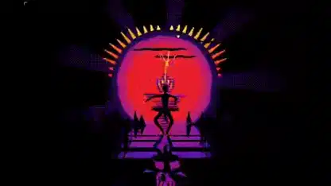

<!-- Generated by scripts/build.py. -->

# The Ballerina

[Back to collection](https://github.com/VibeClip/awesome-fable-5-2-videos/blob/main/README.md)

**[▶ Watch](https://video.twimg.com/amplify_video/2123971926330941440/vid/avc1/412x270/FBsLVwsjJT-k1uy1.mp4?tag=29)** · [Original post](https://x.com/JungleSilicon/status/2123972106073571812)

[JungleSilicon](https://x.com/JungleSilicon) · 3:13 · 2026-11-21

The creator used Fable 5.2 to make this 3D pixel-art Gaussian splat piece.

## Shared prompt

No public prompt recorded.

Sources & verification

- Model evidence: Model named in original post
- Post availability checked: 2026-11-21 — Post available

Source availability and video generation are separate checks. Generation and rendering were not independently reproduced.

[License & media rights](https://github.com/VibeClip/awesome-fable-5-2-videos/blob/main/docs/MEDIA-RIGHTS.md)

