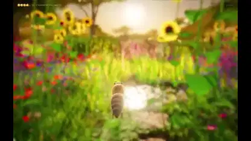

<!-- Generated by scripts/build.py. -->

# A Bee’s Flight Through a Flower Garden

[Back to collection](https://github.com/VibeClip/awesome-fable-5-2-videos/blob/main/README.md)

**[▶ Watch](https://video.twimg.com/amplify_video/2122814845653508096/vid/avc1/572x360/qh2E5wlyamaa7VGq.mp4?tag=29)** · [Original post](https://x.com/KaladinOG/status/2122815191431930197)

[KaladinOG](https://x.com/KaladinOG) · 0:22 · 2026-11-17

The creator names Fable 5.2, Three.js, fal and ElevenLabs for this game demo.

## Shared prompt

No public prompt recorded.

Sources & verification

- Model evidence: Model named in original post
- Post availability checked: 2026-11-23 — Post available

Source availability and video generation are separate checks. Generation and rendering were not independently reproduced.

[License & media rights](https://github.com/VibeClip/awesome-fable-5-2-videos/blob/main/docs/MEDIA-RIGHTS.md)

