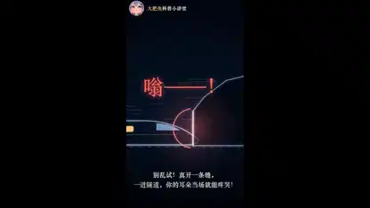

<!-- Generated by scripts/build.py. -->

# Why High-Speed Train Windows Are Sealed

[Back to collection](https://github.com/VibeClip/awesome-fable-5-2-videos/blob/main/README.md)

**[▶ Watch](https://video.twimg.com/amplify_video/2121906157061390336/vid/avc1/1080x1920/PRG5pN5e3FScxxrC.mp4?tag=29)** · [Original post](https://x.com/karyazg/status/2121906216033272110)

[karyazg](https://x.com/karyazg) · 1:01 · 2026-11-15

The creator credits Fable 5.2 for the explainer. The rendering workflow is unspecified.

## Shared prompt

No public prompt recorded.

Sources & verification

- Model evidence: Model named in original post
- Post availability checked: 2026-11-16 — Post available

Source availability and video generation are separate checks. Generation and rendering were not independently reproduced.

[License & media rights](https://github.com/VibeClip/awesome-fable-5-2-videos/blob/main/docs/MEDIA-RIGHTS.md)

