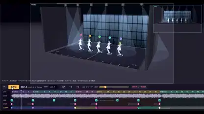

<!-- Generated by scripts/build.py. -->

# A 3D previsualization stage for character choreography

[Back to collection](https://github.com/VibeClip/awesome-fable-5-2-videos/blob/main/README.md)

**[▶ Watch](https://video.twimg.com/amplify_video/2120148511836835840/vid/avc1/2830x1496/qlQkuQ7RRb6l2keO.mp4?tag=29)** · [Original post](https://x.com/keiru_ai/status/2120148813142958454)

[keiru_ai](https://x.com/keiru_ai) · 0:54 · 2026-11-10

The creator names Fable 5.2, Claude Code and Suno for this prototype and says it can import VRM characters and Mixamo FBX motion.

## Shared prompt

No public prompt recorded.

Sources & verification

- Model evidence: Model named in original post
- Post availability checked: 2026-11-13 — Post available

Source availability and video generation are separate checks. Generation and rendering were not independently reproduced.

[License & media rights](https://github.com/VibeClip/awesome-fable-5-2-videos/blob/main/docs/MEDIA-RIGHTS.md)

