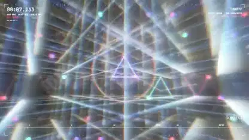

<!-- Generated by scripts/build.py. -->

# Generative audio with a Three.js visualizer

[Back to collection](https://github.com/VibeClip/awesome-fable-5-2-videos/blob/main/README.md)

**[▶ Watch](https://video.twimg.com/amplify_video/2120288036147826688/vid/avc1/1920x1080/rsVqgZfdKMOHajLt.mp4?tag=29)** · [Original post](https://x.com/keiru_ai/status/2120288283167191402)

[keiru_ai](https://x.com/keiru_ai) · 1:30 · 2026-11-10

The creator names Fable 5.2 and Three.js for this code-rendered video and says the audio was generated using randomness.

## Shared prompt

No public prompt recorded.

Sources & verification

- Model evidence: Model named in original post
- Post availability checked: 2026-11-13 — Post available

Source availability and video generation are separate checks. Generation and rendering were not independently reproduced.

[License & media rights](https://github.com/VibeClip/awesome-fable-5-2-videos/blob/main/docs/MEDIA-RIGHTS.md)

